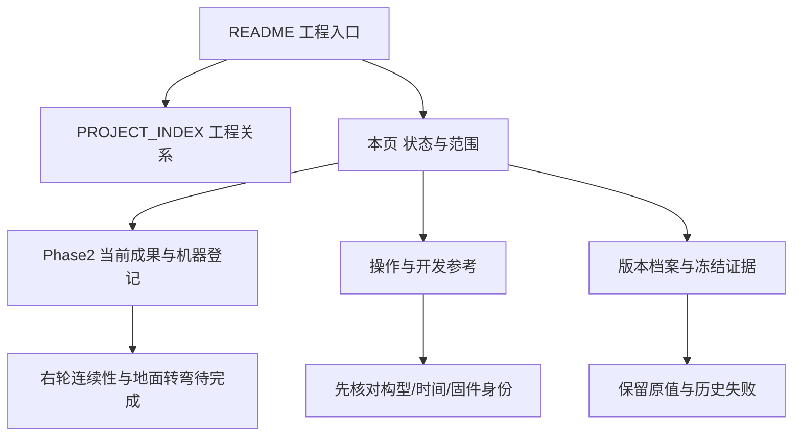

# 仓库文档维护总览

**2026-11-09进度更新：** [Phase3当前进度与交接](changes/phase3-progress-20261109/README.md)。当前处于Phase3影子上板诊断与软降级改造；V4已静态核对，near/full事件解耦已通过软件回归但未烧录。下方既往测试、板载身份和“未提交”叙述按各自时点保留；最新状态以该入口为准。

更新：2026-11-09（北京时间）。本页统一全库维护口径，避免将历史参数、最新实测、工作区实现和生产验收混用。

[主页](../README.md) · [文档目录](INDEX.md) · [工程关系与入口](PROJECT_INDEX.md) · [演进档案](PROJECT_EVOLUTION.md) · [全库逐文档核查清单](changes/2026-11-09_REPOSITORY_DOCUMENTATION_AUDIT.json)

## 当前事实从哪里找

| 问题 | 当前事实入口 | 使用限制 |
| --- | --- | --- |
| 下一步先做什么 | [影子验证待做清单](changes/phase3-progress-20261109/README.md#待做清单推进有效运动影子验证) | 四项必要步骤均待完成；完整降级、最终生产定参及完整SD录像不作为首次影子验证前置阻塞 |
| Phase2此前发布成果 | [Phase2交付与交接](changes/phase2-calibration-20261108/DELIVERY_STATUS.md)，对应main提交`bd94f27` | 对应此前Phase2发布范围；本轮Phase3/Recorder源码与证据归档见页首最新进度 |
| 最后核对的板载是什么 | [V4停机核对](changes/phase3-v4-boardcheck-20261109/README.md) | 已确认PHASE3_C26_SHADOW_20261109_4；Phase2 CURRENT_STATUS仅记录其独立诊断构型，不能代替最新板载身份 |
| 工程之间是什么关系 | [工程导航](PROJECT_INDEX.md) | 主工程MPC_20261106、隔离Phase2诊断、Recorder/B2/B3、工作区Phase3分别构建/验收 |
| 哪些测过、哪些只是未定参 | [剩余数据与定参清单](changes/phase2-calibration-20261108/PHASE2_REMAINING.md) | 已有尺寸/左偏轮角/候选尺度/局部落地及停车，不再泛称全部缺测；缺的是适用范围、误差和具体未覆盖条件 |
| 软回调是否已正常 | [软回调说明](changes/phase2-calibration-20261108/TURN_SOFT_CONTROL.md) | 普通越界不锁停已验证；右轮前进—暂停—再前进，持续性未通过。左右独立回调尚未实现 |
| 测试结果究竟证明什么 | [整合复核](changes/phase2-calibration-20261108/INTEGRATION_REVIEW.json)、[测试验收](testing/VALIDATION.md) | Phase2的41项Python/19350项模拟IO断言与旧统一Host/PreFlash计数分开；没有本轮远程CI通过结论 |

## 阅读顺序与关系

最新事实优先由交付页、机器登记和原始证据核对；专题参考保留历史接口/参数时，必须先读页首适用说明。维护日期不改变工程名，不自动更新发布AXF，也不等于增加硬件验收。

## 本轮维护了什么

- 主页、文档目录、工程索引、演进档案与C31标定入口补齐Phase2链接和当前问题。
- 编码器/舵机/运动参考明确旧方向与最新实测的构型差异；不把旧“1600右偏”直接用于当前安装，也不把右偏镜像写成新实测。
- 测试架构、手册、清单及验收入口明确旧72定义、49 PASS/1 SKIPPED对应11月6日版本；新数据并不自动使performance-host基准条件齐备。
- Recorder、PC数据链、SD与Keil说明明确本轮成果不替代各自联合/运动/发布验收。
- `MEASUREMENT_SUMMARY.json`保留初始固件与采集时间，新增历史范围说明及CURRENT_STATUS入口，避免读者误当最新板载身份。

全库核查覆盖项目自有Markdown，包括操作参考、阶段说明、历史档案及源码快照中的文档。第三方SDK原文不编辑；归档历史、`before-main-documents`和冻结证据只登记范围，不更改原字节。逐页分类、链接检查、排除项与文件摘要见[核查清单](changes/2026-11-09_REPOSITORY_DOCUMENTATION_AUDIT.json)。

上述全库文档核查描述此前维护轮次。本轮另行归档Phase3/Recorder源码、测试和证据，参见页首当前进度；代码推送不等于板载更新或实车验收。冻结证据与历史结论保持原始身份。

## 仍须保留的限制

历史快照中相对路径可能依赖原目录；归档报告可能引用未上传的本地视频、`.build`工程或可执行产物。这些路径不会因改链接自动获得原始证据，不用空文件或新生成结果替换。活动维护页的普通相对链接应能在当前仓库定位；生成工程入口需明确本地重建条件。

本轮只维护文档，没有新增车辆动作、烧录、标定批准或远程CI结论。关键数字来自原生JSON/轨迹和已归档计算：`structured_parsed`、`computed`；人工读数与观察单独标记，未新增仅基于`md_extracted`的精确数值结论。没有修改全局配置或持久化Agent行为。
