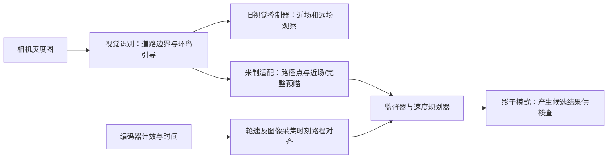

# MPC 工程与速度规划：阅读指南

本页帮助读者理解工程名称、视觉与速度规划之间的数据关系，以及现有证据能证明什么。查看中文名称、缩写和单位请用[技术术语索引](MPC_TERMINOLOGY.md)；本项目约定的领域名称见[领域术语表](../GLOSSARY.md)。

## 工程名与控制算法

**模型预测控制（MPC，Model Predictive Control）**通常指利用模型预测未来状态，并在约束下滚动求解控制问题的方法。本工程名称是`MPC_20261106`；工程名称与当前某个模块使用的具体算法是两件不同的事实。

当前可核对的速度内核在[速度规划源码](../tools/speed_planning/speed_planner.c)中：根据路径曲率、可信路径末端、延迟、加减速等限制生成速度上限，再对速度和加速度参考进行有界变化处理。这个实现有预测和约束思想，但现有源码及[速度目标审核](changes/2026-11-09_MPC_SPEED_120_AUDIT.md)并未证明它是通用在线优化求解的标准MPC；本文称其为**速度规划器**。

## 数据如何流动

图展示本次文档讨论的数据关系，不表示影子候选已控制真实电机。可选运行链路、实际启用状态与历史板载身份须分别查[Phase 3进度](changes/phase3-progress-20261109/README.md)及各次构型报告。

## near、far 和 full 如何区分

| 文档中建议的称呼 | 信号或用途 | 注意 |
| --- | --- | --- |
| **旧控制器近场** | 旧视觉控制器对附近道路的观察及有效状态 | 它有自身的行证据和控制逻辑。 |
| **旧控制器远场** | 旧视觉控制器对较远道路方向的观察及有效状态 | 与规划器`far_valid`不是同一个字段或同一套判定。 |
| **规划器近场预瞄（near）** | 米制适配器单独计算、用于近处规划的一组路径点 | 可与完整预瞄独立有效或失效；有效不代表一定允许动力输出。 |
| **规划器完整预瞄（full）** | 米制适配器单独计算的一组完整路径点；其有效字段叫`far_valid` | 两组采样行可重叠；完整预瞄不等于与近场互斥的一段，也不等于“只看远方”。 |

当前[米制适配器](../tools/speed_planning/vision_adapter.c)对普通道路采样行要求真实双边（`row_flags=3`）。存在当前环岛候选或环岛状态时，可使用经宽度、一侧实测边界和画面内中心检查的单边推算，以及有完整当前锚点的补线；入岛时采用方向、范围均有效的引导坐标。原始`row_flags`保持不变，推算不会变成实测双边。投影范围、时间戳、历史连续性和故障锁存仍分别检查。修复及证据见[视觉与集成回归](changes/vision-contract-fix-20261110/README.md)。

另一个例子是：近场被拒绝、完整预瞄仍有效时，两者分别报告；监督器仍需按近场失效规则决定能否发布动力候选。两组都有效仍需核对路径坐标与导航意图；当前回归独立重算并验证米制引导坐标。修复前现象见[历史环岛报告](changes/vision-scene-integration-20261110/README.md)，当前结论见[本轮回归](changes/vision-contract-fix-20261110/README.md)。

## 速度单位和目标

**编码器计数（tick 或 count）**是轮子转动产生的计数量；`ticks/10ms`表示每10毫秒的等效计数。目标“全程平均至少120 ticks/10ms”按完整运行时间及方向修正的左右轮累计计数统计，包含起步、减速和运行窗口内停顿；它既不是每一时刻至少120，也不是地面速度的直接实测。

按该候选目标的统计口径，设运行时间为`T`毫秒，左右轮方向修正后的累计计数分别为`L`和`R`，则平均值为 `((L + R) / 2) / (T / 10)`，单位为ticks/10ms。左右轮的原始符号需要先按照编码器方向修正；停顿计入`T`，不从分母中删除。

阶段候选将巡航请求设置到约132 ticks/10ms的名义量级，以给全程平均目标留余地；整数目标、速度上限和实际行驶仍受配置及约束影响。影子请求和候选尺度不构成全程均速保证，详细计算与适用条件见[120目标审核](changes/2026-11-09_MPC_SPEED_120_AUDIT.md)。

## 阅读验证结果

| 结果 | 可以说明 | 不能单独说明 |
| --- | --- | --- |
| 合成图识别通过 | 指定构造场景和断言通过 | 实拍全场景准确率 |
| 局部参考边界通过 | 指定图像、指定位置满足标注容差 | 整张图或所有帧均正确 |
| 预瞄可用率 | 给定配置下被接受的帧数比例 | 识别正确率、成功绕行率 |
| 主机耗时 | 开发计算机、指定输入下的测量 | 微控制器最坏耗时或实车圈速 |
| 影子候选构建通过 | 指定工具和源码可以生成候选 | 已烧录、已主动接管或已完成实车验收 |

目前报告中的连续环岛米制规划仍有未通过项：[环岛场景集成报告](changes/vision-scene-integration-20261110/README.md)。早期阶段文档是当时的记录；阅读结果时应看日期、源码/配置身份和测试范围，不把历史“通过”自动推广到当前其他构型。
