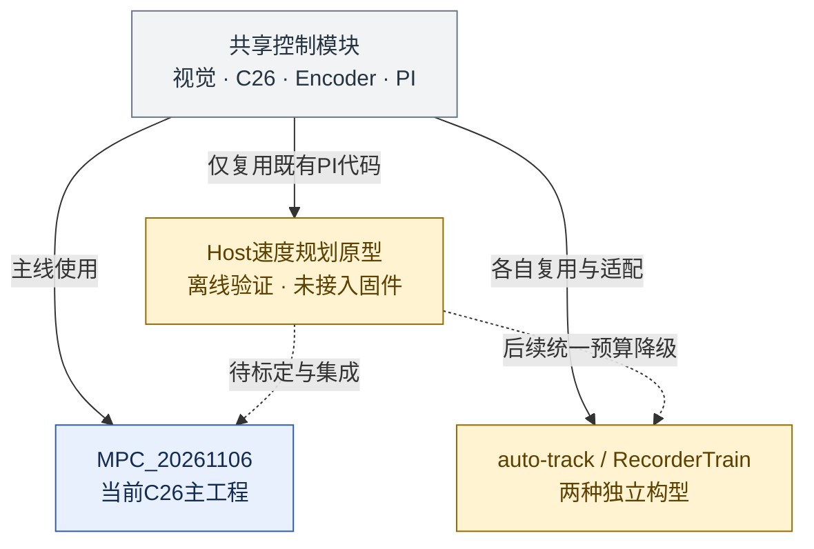
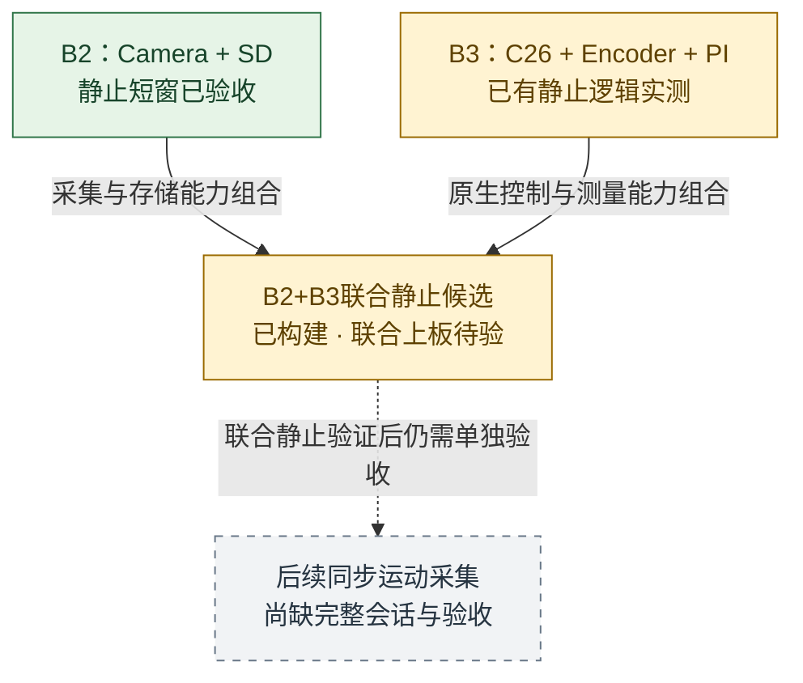

# 工程导航与交接索引

**主工程：MPC_20261106** · 更新：2026-11-06（北京时间） · [返回主页](../README.md) · [项目现状档案](PROJECT_EVOLUTION.md)

供新成员选择工程、核对进度、定位阻塞项与安排下一步。进度按下列阶段证据整理，不是板上当前固件身份的确认，也不是烧录或实车放行记录。

导航：[工程关系](#1-工程关系) · [进度总览](#2-进度总览) · [待解决问题](#3-待解决问题与关闭条件) · [工程入口](#4-工程与说明入口) · [接手路线](#5-新成员从哪里接手) · [维护方式](#6-如何维护这份索引)

> **先记住四件事**
>
> - **主线控制开发看MPC。** Phase 3已有安全边界修正，速度规划器仍在Host端，尚未进入主固件。
> - **B2、B3、联合静止候选是测量/验证构型。** B2短窗通过，不等于三者联合通过，更不等于运动采集通过。
> - **软件阶段与硬件批次分开编号。** `Phase 3`是控制集成阶段；`B3`是静止测量工程，二者不是同一个阶段。
> - **先找证据，再判断进度。** 已构建、Host通过、局部实板通过和整车验收是不同结论；项目尚未整体验收。

## 1. 工程关系

### 控制软件：共享代码，分别管理启动与验收

**实线表示代码复用关系，虚线表示尚未完成的集成。** auto-track、RecorderTrain与MPC不是同一固件：启动授权、调度及SD运行范围各自不同；不能把其中一项的结果直接当作另一项通过。

### 实测链：分别验证能力，再验证组合

这张图表示**能力组合与验收依赖**，不是已完成的数据流：B2和B3记录来自不同会话，不能直接拼成同步运动数据。SD独立工程用于验证存储基础能力；PC数据链负责归档、校验与后续审核，两者都不拥有车辆启动权。

固定B3/联合候选有自己的输入快照与产物哈希。主工程后续安全修正不会自动进入旧AXF；旧B3报告的故障清除行为只适用于被测候选。[固定候选说明](changes/recorder-b3-20261106/encoder-joint-static-20261106/JOINT_STATIC_DELIVERY.md)

## 2. 进度总览

状态只描述明确范围：**软件通过**＝Host/纯构建证据；**局部实测通过**＝指定构型与窗口通过；**部分完成**＝仍有缺项；**待验**＝不能写成PASS。不用完成百分比推断验收。

### C31连续速度规划任务的Phase进度

| 阶段 | 当前状态 | 已交付 / 还差什么 |
| --- | --- | --- |
| Phase 0：基线审计 | 已完成 | 主构型、控制链、单位与原有问题已记录 |
| Phase 1：Host原型 | 软件通过 | 规划/监督/真实PI代码联动已有回放；不代表物理模型准确 |
| Phase 2：数据与定标 | **部分完成** | 左右CPR已采用；负载周长、轮角、地面映射、动态与同步运动数据待补 |
| Phase 3：最小MCU集成 | **部分完成，与Phase 2并行** | 近场无效清零、C26故障重新准入等已改源码；规划器、受控停止及短临界区仍待完成 |
| Phase 4：Recorder与完整回归 | 尚未完成 | 已有采集基础和部分回归；真实同输入A/B、完整软件/板端/赛道验收仍待闭环 |

阶段依据：[任务交付](changes/c31-speed-planning-20261105/README.md) · [数据接入](changes/c31-speed-planning-20261105/DATA_INPUTS.md) · [Phase 3实现与未完成项](changes/c31-speed-planning-20261105/PHASE3_BOUNDARIES.md)。

### 各工程当前能证明什么

| 工程 / 能力 | 当前证据 | 尚不能证明 |
| --- | --- | --- |
| **MPC主工程** | 安全边界专项与Keil纯构建通过；保留C26入口 | 新规划已运行、完整Host通过或整车通过 |
| **Host规划** | 23项Python测试、36组场景/分辨率组合，各两种遥测消费模式通过 | 实测制动能力、物理速度精度或生产阈值有效 |
| **auto-track** | 当前过渡保护的软件回归通过；后续统一MPC预算降级 | 预算规划已接入、实车整体通过或可替代MPC主线 |
| **RecorderTrain** | 采集链软件及启动回归通过；源码锁已审查更正 | 预算规划已接入，或稳定运动写入/收尾/控制时序已实测验收 |
| **B2静止Camera/SD** | **局部实测通过**：101帧真实Session，正常关闭与PC完整回读 | 长期记录、控制并行或车辆运动 |
| **B3静止测量** | 已观测OFF、逻辑ON及同次上电重新授权；有原始遥测，实际执行器输出强制零 | 带载轮速、正常RUNNING到OFF切断时延或运动Session |
| **联合静止候选** | 构建、MAP与Host组合检查通过 | Camera+SD+C26实际联合运行；联合文件PC校验仍待验 |
| **独立SD工程** | BASIC/STRESS、两档16MiB性能测试有实板结果；5个文件断电后PC校验通过 | 控制并行负载、任意写入时刻掉电安全或长期稳定下限 |
| **PC数据链 / 基础诊断** | 导入/校验/抽样/审核接口与独立诊断入口可用；已有B2真实导出链路 | 完整人工审核的运动训练/留出数据集，或所有诊断构型均已实测 |

实测依据：[B2最终验收](changes/recorder-camera-stages-20261106/B2_CAMERA_SESSION_VALIDATION.md) · [B3静止报告](changes/recorder-b3-20261106/HARDWARE_STATIC_REPORT.md) · [SD诊断实板结果](../demo/sd_diagnostic/evidence/hardware-20261105T162039Z/HARDWARE_REPORT.md) · [SD性能实测](../demo/sd_performance/evidence/performance-hardware-20261105T163728Z/PERFORMANCE_REPORT.md) · [断电后PC校验](../demo/sd_performance/evidence/readback-20261105T183635Z-9052/PERSISTENCE_REPORT.md)。

**本轮核定后：PreFlash为63 PASS / 1 SKIPPED；仅含Git发布文件的副本Host为49 PASS / 1 SKIPPED。** 原Phase 3的46 PASS / 3 FAIL / 1 SKIPPED保留为历史记录，本轮已修正源码锁和过渡策略测试失配。跳过项仍是缺数据的`performance-host`；GCC软件通过不等于MSVC/ASan、预算规划或实车放行。[本轮审核与证据](changes/2026-11-06_MPC_AUDIT_AND_PUBLICATION.md) · [原Phase 3历史证据](changes/c31-speed-planning-20261105/phase3-boundaries-evidence.json)

首次两轮MSVC严格编译发现的问题已更正；本地PreFlash再次63 PASS / 1 SKIPPED，测试后续修正专项8 PASS。最终功能提交`7d2ff6d`的[远端CI](https://github.com/fatezerozs/smartcar/actions/runs/42214055736)已完成，optimized和ASan各49 PASS / 1 SKIPPED。失败、更正与最终输入见[CI兼容性证据](changes/2026-11-06_MPC_CI_COMPATIBILITY.json)；随后文档归档不改变被测功能代码。

## 3. 待解决问题与关闭条件

以下是接手顺序建议，不代表已分配人员或新增硬件操作授权。按工作方向选择问题，以右列交付物关闭。

| 问题 | 影响范围 | 下一步交付 / 关闭条件 |
| --- | --- | --- |
| **D1 物理尺度与几何缺测** | MPC规划、轮速/里程与转弯补偿 | 补左右负载滚动周长、实际前轮角、相机地面映射/盲区，记录单位、重复测量与来源；标称尺寸不作为实测 |
| **D2 动态与同步运动数据缺失** | 制动/延迟、near/far预算与恢复迟滞 | 同一Session同步图像、质量、计数、目标、PWM和事件；补速度响应/停车距离/总延迟，按完整Session留出并审核标签 |
| **S1 主构型集成未完** | MPC主工程 | 完成规划器/监督/受控停止与一致候选提交；建立快照、版本复核及短提交区，验证STOP优先、近场清零和far-only双预算；物理阈值须有D1/D2依据 |
| **H1 联合静止验证未做** | B2+B3联合候选 | 固定候选身份/输入摘要，取得分相位控制/采集/SD数据并独立回读；两项独立通过不替代联合PASS |
| **H2 运动与时序验收未闭环** | MPC、RecorderTrain、后续运动采集 | 核对正常运行到OFF切断、负载响应、并行写入长尾/队列/期限及稳定赛道结果；按构型分别给结论 |
| **Q1 数据集评测接口待接入** | performance-host / 质量性能比较 | 接入版本化数据集、Ground Truth、测量Adapter与批准基线；当前SKIPPED不影响其他套件独立运行 |

问题依据：[标定清单与生产门](changes/c31-speed-planning-20261105/CALIBRATION.md) · [Phase 3剩余工作与失败对照](changes/c31-speed-planning-20261105/PHASE3_BOUNDARIES.md) · [训练构型风险清单](vision_recorder/OPEN_ISSUES.md) · [测试手册](TESTING_FRAMEWORK_GUIDE.md)。

**本轮已关闭S2：** 原源码锁的完整字节已找到并对照，差异仅为已采用方向宏替换；两个实验构型按“预算未集成前的零动力恢复”验证，保留远场失效、partial、长时失效、恢复与STOP场景。最终预算降级策略仍属于D1/D2/S1，不能以本轮软件通过代替其实现。

CPR不是新的待测阻塞项：**左2335.8、右2358.6 counts/轮已按用户要求采用**，原记录的重复性限制保留。B3早期报告的“CPR未完成”属于此前时点，当前以[参数交付](changes/vehicle-parameters-20261106/README.md)为准；滚动周长仍缺测。

## 4. 工程与说明入口

这一节只负责导航；进度与问题以上两节为准。工程、构建脚本与固定候选位置分别列明，避免把生成入口当成已验收镜像。

| 工程 / 模块 | 工程或构建入口 | 对应说明与当前范围 |
| --- | --- | --- |
| **MPC_20261106 主工程** | [MPC_20261106.uvprojx](../demo/mdk/competition/MPC_20261106.uvprojx) · [构建脚本](../tools/build_midterm.ps1)（`-Variant switch`） | [工程命名与构建](changes/2026-11-06_MPC_PROJECT_RENAME.md) · [规划与Phase 3进度](changes/c31-speed-planning-20261105/README.md)：C26主构型，首批安全边界已接入，规划器尚未接入 |
| 独立 auto-track 实验 | [midterm_auto-track.uvprojx](../demo/mdk/competition/midterm_auto-track.uvprojx) | [构型与启动说明](PROJECT_EVOLUTION.md) · [本轮审核](changes/2026-11-06_MPC_AUDIT_AND_PUBLICATION.md)：与C26主工程分开验收 |
| Recorder 采集训练 | [生成与构建入口](../tools/build_recorder.ps1) | [实施与使用](vision_recorder/IMPLEMENTATION.md) · [未决事项](vision_recorder/OPEN_ISSUES.md)：独立RTOS持续采集，运动中持续记录尚未完整验收 |
| B2 Camera / SD 静止采集 | [生成与构建入口](../tools/build_recorder_b2.ps1) | [完整会话验收](changes/recorder-camera-stages-20261106/B2_CAMERA_SESSION_VALIDATION.md)：独立静止短窗口已验收，非长期或运动采集结论 |
| B3 C26 / Encoder 静止测量 | [生成与构建入口](../tools/build_recorder_b3_static.ps1) | [工程与规程](changes/recorder-b3-20261106/README.md) · [静止硬件报告](changes/recorder-b3-20261106/HARDWARE_STATIC_REPORT.md)：实际执行器输出强制为零，运动阶段未完成 |
| B2+B3 联合静止候选 | [构建脚本](../tools/build_recorder_joint.ps1) · [固定候选工程位置](changes/recorder-b3-20261106/encoder-joint-static-20261106/current-candidate.txt) | [候选工程、产物与流程](changes/recorder-b3-20261106/encoder-joint-static-20261106/JOINT_STATIC_DELIVERY.md)：使用交付说明中的固定候选，联合板端验收待完成 |
| 速度规划 Host 原型 | [联动回放入口](../tools/speed_planning/replay.py) · [参考参数v0.3](../profiles/c1-host-reference-v0.3.json) | [数据入口与验证](changes/c31-speed-planning-20261105/DATA_INPUTS.md)：离线参考及真实PI代码回放，不是独立可烧录固件 |
| SD 独立诊断 / 性能工程 | [sd_diagnostic.uvprojx](../demo/sd_diagnostic/mdk/sd_diagnostic.uvprojx) · [sd_performance.uvprojx](../demo/sd_performance/mdk/sd_performance.uvprojx) | [诊断说明](../demo/sd_diagnostic/README.md) · [性能测试说明](../demo/sd_performance/README.md)：独立SD测试构型，按各自证据判定结果 |
| 基础模板 / 其他诊断变体 | [rt1064.uvprojx](../demo/mdk/base/rt1064.uvprojx) · [Keil工程目录](../demo/mdk/README.md) | [全部变体与生成方式](../demo/mdk/README.md)：route、编码器速度环、运动、电机阈值及链路诊断入口 |

公共入口：[当前参数与实测数据](changes/vehicle-parameters-20261106/README.md) · [测试框架与执行流程](TESTING_FRAMEWORK_GUIDE.md) · [PC视觉数据链](vision_dataset/README.md)。

SD操作说明保留了较早“待上板”文字；最新实板与持久性结论以第2节后续报告为准。固定候选位于本机`.build/`，GitHub上的位置清单用于定位，不等于仓库内保存了一份通用可烧录项目。

RecorderTrain、B2和B3的Keil工程引用生成适配源或本机run目录，不作为可移植源码直接提交；先运行表内脚本，再打开输出提示的工程。MPC主工程是直接维护的仓库入口。AUTO_TRACK与RecorderTrain后续均以MPC预算降级为目标；预算未集成时现有零动力恢复仅是过渡保护。[本轮审核更正](changes/2026-11-06_MPC_AUDIT_AND_PUBLICATION.md)

## 5. 新成员从哪里接手

| 你要做的工作 | 建议阅读顺序 | 首个可交付结果 |
| --- | --- | --- |
| 改主线控制 / 规划 | 本页关系与Phase表 → [Phase 3报告](changes/c31-speed-planning-20261105/PHASE3_BOUNDARIES.md) → [算法设计](changes/c31-speed-planning-20261105/DESIGN.md) | 明确属于S1还是参数依赖项，给出接口/状态边界与专项回归 |
| 补参数 / 数据 | [当前参数交付](changes/vehicle-parameters-20261106/README.md) → [缺失标定表](changes/c31-speed-planning-20261105/CALIBRATION.md) → [数据契约](changes/c31-speed-planning-20261105/DESIGN.md) | 带原始记录、单位、固件身份、时间/帧号和限制的D1/D2数据包 |
| 做采集 / 存储联调 | B2最终报告 → B3静止报告 → [联合候选交付](changes/recorder-b3-20261106/encoder-joint-static-20261106/JOINT_STATIC_DELIVERY.md) | 围绕H1提交联合证据，不把B2/B3独立结果相加当成联合PASS |
| 修测试 / 交接验收 | [测试手册](TESTING_FRAMEWORK_GUIDE.md) → [本轮更正与验证](changes/2026-11-06_MPC_AUDIT_AND_PUBLICATION.md) → [PC数据链](vision_dataset/README.md) | 可复现问题或版本化评测输入，报告所测构型与未覆盖范围 |

开始改动前核对实际分支、dirty工作区、工程文件与宏；当前工程名是MPC_20261106，固件协议仍有C31历史身份。固定候选还须核对AXF/输入摘要，不能只凭文件名判断“最新”。本页不要求立即烧录或操作设备。

## 6. 如何维护这份索引

1. 新增工程时同时补关系、进度、问题与入口，保留证据链接，不能只加文件名。
2. 更新进度须注明构型、数据/场景范围与来源；先更新阶段报告或证据，再同步本页。旧报告保留历史时点，以后续明确更新为准。
3. 问题写清影响和关闭条件；解决后链接验收记录，再从当前阻塞项移除。不能用新构建覆盖旧失败或把缺数据写成通过。
4. 更名/移动文件时修复本页与[主页README](../README.md)链接；README继续只保留本页入口。

本次整理使用原生Markdown与JSON记录（`structured_parsed`）及既有测试/CRC/哈希证据（`computed`），未重做硬件测量。无仅靠`md_extracted`得出的精确数值，无新增`pdf_verified`；进度整理不改变原报告的测试范围。
