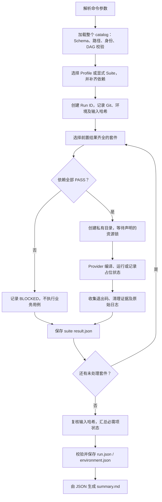
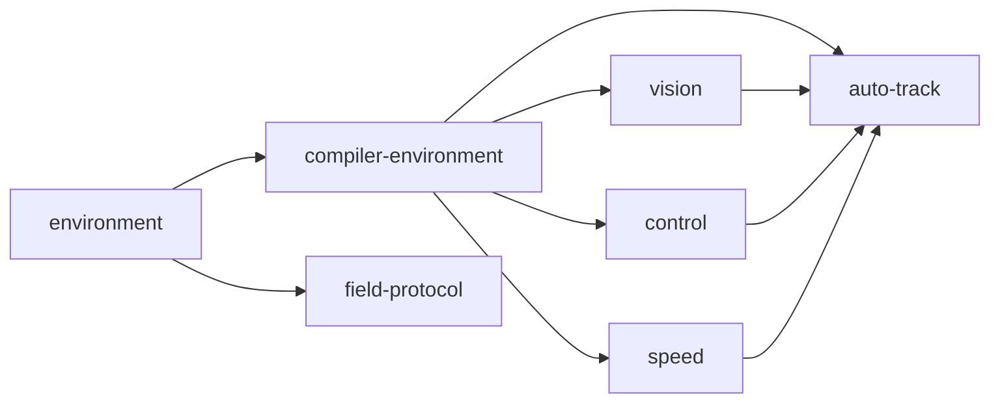

> **维护口径（2026-11-09）：** `00bb7a4`、72定义、49 PASS/1 SKIPPED等数字属于2026-11-06被测版本，不能代表最新HEAD或未提交catalog。Phase2整合提交bd94f27另有41项Python与19350项模拟IO断言，本轮未核定该提交远程CI；它们不是统一Host/PreFlash套件计数，也不代替实车验收。 统一状态与历史适用范围见[文档维护总览](DOCUMENTATION_STATUS.md)。

# SmartCar 测试框架与流程详细手册

维护日期：2026-11-07；基础C32归档日期2026-11-02。适用范围：main上的C32测试框架及Recorder/规划扩展，Manifest/Result/Benchmark契约1.0。
框架最初交付为`d78eb9d`，当前主线合并基准为`00bb7a4`。本文是持续维护的操作与开发手册，引用已有实际运行，不签发烧录授权。

2026-11-06记录为72个定义，包含Recorder与速度规划专项。main合并提交`00bb7a4`的[MSVC optimized/ASan CI](https://github.com/fatezerozs/smartcar/actions/runs/42243602219)各49 PASS / 1 SKIPPED；完整本地PreFlash为63 PASS / 1 SKIPPED，后续测试专属修正以8项Host补充覆盖。身份和范围见[主线同步记录](changes/2026-11-07_MAIN_DOCUMENTATION_SYNC.md)。

合并前功能提交`7d2ff6d`的[分支CI](https://github.com/fatezerozs/smartcar/actions/runs/42214055736)与主线运行分别记录；此前失败与更正保留在[CI兼容性证据](changes/2026-11-06_MPC_CI_COMPATIBILITY.json)。Host通过不覆盖硬件与赛道验收。

[返回仓库主页](../README.md) · [文档目录](INDEX.md) ·
[架构概要](TESTING_ARCHITECTURE.md) · [C32 提交说明](changes/2026-11-02_C32_TESTING_FRAMEWORK.md) ·
[精确验收记录](testing/VALIDATION.md)

## 阅读导航

- [1. 先选任务与执行范围](#choose)
- [2. 环境准备与工具链](#environment)
- [3. 架构、分层与文件职责](#architecture)
- [4. 一次执行的完整流程](#execution)
- [5. Manifest 与路径契约](#manifest)
- [6. DAG、失败传播与资源锁](#dag)
- [7. 隔离、超时与进程清理](#isolation)
- [8. 状态、退出码与放行判读](#results)
- [9. 日志、报告与可复现性](#evidence)
- [10. 新增或维护测试套件](#development)
- [11. 旧入口、Fixture 与参考算法](#compatibility)
- [12. ARM、Keil 与烧录前软件验证](#preflash)
- [13. 性能/质量数据接入流程](#benchmark)
- [14. GitHub Actions 与本地的一致性](#ci)
- [15. 排障与复测](#troubleshooting)
- [16. 当前实现边界与维护规则](#limits)
- [17. 当前套件完整索引](#catalog)
- [18. 本文的来源与校验范围](#provenance)

<a id="choose"></a>
## 1. 先选任务与执行范围

所有命令从仓库根目录运行；本机对应 `C:\shengchanli\smartCar\smartcar`。
入口不依赖调用者的当前源码目录去寻找输入，但从根目录执行最容易核对命令和结果。

| 要做什么 | 选择 | 结论范围 |
| --- | --- | --- |
| 查看清单/检查定义 | `-List` / `Test-Manifest.ps1` | 清单及定义有效；不是业务测试通过 |
| 定位单模块 | `-Suite speed` | 指定套件及其前置依赖 |
| 完整主机回归 | `-Profile Host` | 当前 Host 功能、契约和可选基准节点 |
| 烧录前自动软件检查 | `-Profile PreFlash` | Host + 目标环境 + 自动静态、ARM、Keil 构建 |
| 独立诊断 | `-Profile Diagnostic` | 诊断结果，不作为放行依据 |
| 比较离线测量数据 | `Invoke-Benchmark.ps1` | 显式测量文件与批准基线的指标比较 |
| 硬件验收 | 独立人工流程 | 不属于普通 Host/PreFlash 自动计划 |

### 1.1 常用命令

```powershell
# 查看与校验，不执行完整回归：
./tools/testing/Invoke-TestPlan.ps1 -List
./tools/testing/Test-Manifest.ps1

# 默认使用 MSVC：
./tools/testing/Invoke-TestPlan.ps1 -Suite speed
./tools/testing/Invoke-TestPlan.ps1 -Profile Host
./tools/testing/Invoke-TestPlan.ps1 -Profile Host -Mode asan

# 本机没有 MSVC、但有 GCC 时，显式选择补充工具链：
./tools/testing/Invoke-TestPlan.ps1 -Suite speed -Compiler gcc
./tools/testing/Invoke-TestPlan.ps1 -Profile PreFlash -Compiler gcc -Jobs 2

# 只查看指定的独立诊断集合：
./tools/testing/Invoke-TestPlan.ps1 -Profile Diagnostic -Suite speed,field-protocol -Compiler gcc

# 选择 C 套件中的一个宏构型，不是编译优化模式：
./tools/testing/Invoke-TestPlan.ps1 -Suite motion -Variant diagnostic -Compiler gcc
```

`-Mode optimized/asan` 选择编译模式；`-Variant` 选择 Manifest 中的构型 ID。
两者不能互相替代。`-Variant` 只接受**一个显式选择的 C 套件**，不能用于
`core` 这样的 aggregate，也不能直接给完整 Profile 筛选所有同名 Variant。

### 1.2 Profile 与 Suite 的选择规则

没有 `-Suite` 时，入口按 `profiles` 字段选中目标，再补齐传递依赖。
有 `-Suite` 时，目标是指定 ID 的集合；不会再叠加完整 Profile 的所有目标。
因此 `-Profile PreFlash -Suite speed` 仍只是 speed 的闭包，结果 Profile 为 Suite，
不能据此声称完整 PreFlash 已执行。

Suite ID 不区分大小写，示例统一用清单中的小写 ID。Profile、Compiler 和 Mode
按示例的规范拼写使用，避免 PowerShell 与 Python 参数检查的大小写差异。
PowerShell 数组及经 `pwsh -File` 传递的逗号分隔 Suite 均由入口拆分处理。

C32最初清单为66个定义；2026-11-06清单为72个定义，Host闭包50个、Diagnostic闭包48个、PreFlash闭包64个。当前结果见[MPC审核记录](changes/2026-11-06_MPC_AUDIT_AND_PUBLICATION.md)。
这些数量包含环境、可选占位等节点，**不是独立场景数或断言数**。七个 aggregate
和一个手工硬件节点不因“清单里存在”就自动加入普通 Profile。

<a id="environment"></a>
## 2. 环境准备与工具链

完整执行环境为 Windows、PowerShell 7、Python 3.10+、Git。框架自身使用 Python
标准库和 PowerShell `Test-Json`，无需为框架安装第三方 Python 包。框架虽然有
部分 POSIX 进程辅助代码，L0 仍明确要求 Windows，不表示完整计划支持 Linux。

| 范围 | 需要的工具 | 检查方式 |
| --- | --- | --- |
| 清单/报告及离线套件 | Python、pwsh、Git | JSON Schema、环境 suite、实际脚本调用 |
| MSVC C 测试 | 支持 C11 的 VS C++ Build Tools | 实际编译并运行探针 |
| MSVC ASan | 对应工具链的 AddressSanitizer 组件/运行库 | 使用 ASan 参数编译并运行探针 |
| GCC 补充验证 | PATH 中的 gcc | 实际编译/运行探针，报告明确 compilerFamily=gcc |
| ARM 源码检查 | ARMCLANG、工程依赖/设备包 | 指定目录的编译器与私有副本内编译 |
| Keil 完整构建 | UV4、适用编译器、设备包和许可 | 工具身份 + 实际重新构建、日志和 AXF |

```powershell
$PSVersionTable.PSVersion
python --version
git --version
Get-Command pwsh

./tools/testing/Test-Environment.ps1
./tools/testing/Test-Environment.ps1 -Compiler gcc
./tools/testing/Test-Environment.ps1 -Compiler gcc -Target
```

### 2.1 工具发现与显式配置

MSVC 优先使用当前 PATH 中的 `cl.exe`。没有找到时，检查 `-VcVars` 或
`SMARTCAR_VCVARS`，然后使用 vswhere，最后尝试常规 VS 安装目录。
发现可执行文件不等于工具链可用：探针还会暴露头文件、链接库或 ASan 库缺失。

Keil/ARM 可由命令参数或环境变量指定；参数覆盖环境变量。以下路径仅表示
本机已有安装，不是其他机器必须采用的目录：

```powershell
./tools/testing/Test-Environment.ps1 -Compiler gcc -Target `
  -UV4 'E:\ElecTronic\Keil\UV4\UV4.exe' `
  -ArmBin 'E:\ElecTronic\Keil\ARM\ARMCLANG\bin'
```

| 参数 | 环境变量 | 含义 |
| --- | --- | --- |
| `-VcVars` | `SMARTCAR_VCVARS` | vcvars64.bat 的完整路径 |
| `-UV4` | `SMARTCAR_UV4` | UV4.exe 的完整路径 |
| `-ArmBin` | `SMARTCAR_ARM_BIN` | 含 armclang.exe 的目录 |

工具链路径可以指向仓库外的已安装工具；Manifest 的源码、数据、脚本路径则
必须在允许的仓库范围内。这是两种不同用途的路径约束。

缺少 MSVC 会阻塞依赖 compiler-environment 的 C 套件；独立 Python/协议套件
仍可执行。ASan 链接探针失败属于工具/基础设施问题，不包装成算法断言失败。

<a id="architecture"></a>
## 3. 架构、分层与文件职责

### 3.1 五个逻辑组件

| 组件 | 实现入口 | 应负责 | 不应负责 |
| --- | --- | --- | --- |
| 用例/夹具 | [tests/vision](../tests/vision)、[tests/support](../tests/support) | 场景、断言、参考模型、模拟外设 | 全局调度或共享进程初始化 |
| Suite 契约 | [catalog.json](../tests/suites/catalog.json)、[schemas](../tests/schemas) | 身份、源码、宏、范围、DAG、资源和证据类型 | 复制业务实现 |
| Runner/Provider | [process_runner.py](../tools/testing/process_runner.py)、[providers.py](../tools/testing/providers.py) | 运行过程、工具准备、日志、隔离、进程清理 | 猜测业务断言是否正确 |
| Orchestrator | [Invoke-TestPlan.ps1](../tools/testing/Invoke-TestPlan.ps1)、[run_tests.py](../tools/testing/run_tests.py) | 选择目标、依赖闭包、执行顺序、失败传播 | 调用其他测试 main 复用状态 |
| Reporter | [reporter.py](../tools/testing/reporter.py) | 从持久化 JSON 生成 Markdown | 通过日志里的 PASS/FAIL 单词推断结果 |

PowerShell 是公开的 Windows 入口，Python 是共享执行内核；本地和 CI 使用同一
清单与代码。框架不通过扫描 `test_*.c` 自动发现套件：新增文件必须登记清单。

### 3.2 “证明目标”与“执行方式”分别记录

| 层级 | Manifest layer | 要证明的内容 |
| --- | --- | --- |
| L0 | `environment` | 环境和输入满足执行前提 |
| L1 | `unit` | 局部算法、模块、Host 板级适配或离线工具 |
| L2 | `integration` | 多个真实生产模块的状态/控制/运行时组合 |
| L3-A | `contract` | 算法兼容域、协议、接口数据和宏配置约束 |
| L3-B | `performance` | 固定数据下的质量、计算和系统表现 |
| L4 | `build` | 工程/静态约束、目标源码编译及完整链接 |
| L5 | `hardware` | 实际硬件和整车验收，自动 Profile 之外 |

`category`、`scope`、`executionMethod` 描述证明类别和边界；实际选择 Provider
的是 `entrypoint.type`。例如配置契约由 C 编译执行，目标仍是 L3-A 契约。

`evidenceClass` 进一步区分 `host`、`host_simulated`、`static`、`target_compile`、
`target_build`、`pq_host`、`pq_target`、`pq_system`、`hardware`。清单标签只是
证据分类，不会自动提供该证据；套件必须实际执行并留下对应结果。

<a id="execution"></a>
## 4. 一次执行的完整流程



1. **先验证整个清单。** 即使只选择 speed，其他条目的重复 ID、缺失入口或
   依赖循环也会让清单加载失败。不要删除性能占位 Manifest 来表示“暂不执行”。
2. **再计算闭包。** 单选 auto-track 会补齐 environment、compiler-environment、
   vision、control、speed；每个套件仍在独立进程/产物目录运行。
3. **按 DAG 调度。** 同层独立失败继续收集；真正依赖未通过的下游为 BLOCKED。
4. **逐套件落盘。** stdout/stderr 与结构化结果分开保留，编译和测试阶段可区分。
5. **汇总时再查输入。** 跟踪的源码/夹具/工具输入在运行期间变化会令整轮 ERROR。
6. **结果持久化后生成报告。** 强制中断可能只留下部分 suite 结果，没有完整
   run.json；部分 PASS 行不能充当完整计划通过。

`-List` 只列清单，`Test-Manifest.ps1` 还会检查基准定义。清单/路径错误通常在
创建正式 Run ID 前发生，因此这类执行可能没有新的 summary.md。

<a id="manifest"></a>
## 5. Manifest 与路径契约

唯一可执行清单为 [tests/suites/catalog.json](../tests/suites/catalog.json)。顶层为
`schemaVersion` 和 `suites` 数组；示例中的 suite 对象必须放进该数组，不能另建
同名文件就期待 Runner 自动读取。Schema 拒绝未声明的字段，JSON 读取也拒绝
重复 key 与 NaN/Infinity。

### 5.1 核心字段

| 字段 | 用途与约束 |
| --- | --- |
| `schemaVersion` | 当前为 `1.0` |
| `id` | 全局唯一、稳定的小写字母/数字/连字符 ID；不是显示名称 |
| `name` | 报告展示名 |
| `layer/category/evidenceClass` | 证明层级、类别和证据来源 |
| `entrypoint.type` | 选择实际 Provider |
| `entrypoint.path` | 脚本/基准等入口；相关类型必须存在且后缀匹配 |
| `entrypoint.variants` | C 套件的构型、源码、包含目录、宏和可选参考对象 |
| `workingDirectory` | 私有沙箱内的相对目录，当前清单均为 `.` |
| `timeoutSeconds` | 执行预算，Schema 范围 1..7200 秒；实现边界见第 7 节 |
| `required` | 是否参与该计划的必需项汇总；显式选择的目标会被提升为必需 |
| `dependsOn` | 必须已 PASS 的套件 ID，不是 C 链接依赖的自动推导 |
| `resources` | 跨运行独占的资源名；按固定顺序取锁 |
| `profiles` | 默认会选择此套件的 Host/PreFlash/Diagnostic |
| `environment` | 套件显式环境值，不能据此绕过硬件边界 |
| `artifacts` | 需要索引保留的产物 glob，当前通常为 `artifacts/**` |
| `scope/executionMethod` | 可选的证明边界与方法描述，不改变 Provider 行为 |

### 5.2 一个真实 C 套件示例

下面对象与 C32 的 `link` 套件一致，可对照源码理解，不要原样追加造成重复 ID：

```json
{
  "schemaVersion": "1.0",
  "id": "link",
  "name": "Link",
  "layer": "unit",
  "category": "functional",
  "evidenceClass": "host_simulated",
  "entrypoint": {
    "type": "c",
    "variants": [
      {
        "id": "default",
        "sources": ["tests/vision/test_link.c", "demo/code/app_link.c"],
        "includeDirectories": ["demo/code"],
        "defines": []
      }
    ]
  },
  "workingDirectory": ".",
  "timeoutSeconds": 300,
  "required": true,
  "dependsOn": ["compiler-environment"],
  "resources": [],
  "profiles": ["Host", "PreFlash", "Diagnostic"],
  "environment": {},
  "artifacts": ["artifacts/**"]
}
```

Provider 支持环境检查、`c`、`python`、`powershell`、`cmd`、`native`、`aggregate`、
`static`、`arm`、`keil`、`benchmark`、`manual`。`arguments` 由脚本/原生入口使用，
不是给 C 套件随意添加编译参数的通用开关；C 宏在 `variants[].defines` 声明，
Keil 追加宏在 `entrypoint.defines` 声明。具体以 Schema 和 Provider 为准。

### 5.3 路径与工作目录

源码、包含目录、fixture、入口路径相对仓库根；清单中禁止绝对路径、`..` 和
解析后逃出允许根的路径。脚本/原生/基准入口限定在 `tests/` 或 `tools/`，
相应扩展名需匹配类型。符号链接最终指向仓库外也会被拒绝。

`workingDirectory` 并不表示进入共享的源码目录。C 用例在自己的 Variant 目录
运行；Python 用例应以 `__file__`、PowerShell 用例应以 `$PSScriptRoot` 定位源码。
测试要读取 `fixtures/...` 时，应显式声明复制所需 fixture，不能依赖其他测试
先生成文件。现有 `entrypoint.fixtures` 的复制目标使用源目录 basename；新增时
注意同名目录冲突及测试实际相对路径。

<a id="dag"></a>
## 6. DAG、失败传播与资源锁

以 auto-track 为例，箭头表示“必须先通过”，不是进程内初始化调用：



speed 的断言失败会阻塞 auto-track；不会仅因为二者都在 Host 中就阻塞独立的
field-protocol。缺少 cl 同样不应把独立离线脚本报告成 C 业务失败。

`dependsOn` 应表达实际验收前置。C 链接要用什么生产源文件，在 Variant 的
`sources` 中列出；用同一个 fixture 头文件，也不意味着两个测试要互相依赖。

默认 `-Jobs 1`，显式并行最多 4，C32 已验证完整 Jobs=2。调度器把依赖齐全的
套件送进线程池，资源锁在 worker 中等待；它目前不是按资源可用性优化的调度器，
等待同一资源的套件会占用 worker 名额，不能承诺 Jobs 越大就越快。

锁文件在 `.test-results/.locks/`。锁由 OS 释放，文件留在目录里不表示仍持锁。
不要看到 `.lock` 就删除；先查同一资源是否正在构建。Keil/ARM 及现有共享离线
暂存资源按清单串行；MSVC ASan 运行时还会追加 PDB 服务锁。

<a id="isolation"></a>
## 7. 隔离、超时与进程清理

### 7.1 产物隔离

- 每轮有独立 UTC Run ID，每个 suite 和 C Variant 有独立目录。
- C 编译/运行的 EXE、OBJ、PDB、生成图片和数据文件写入对应私有工作目录。
- Runner 为脚本执行准备私有 CWD 和 TEMP/TMP；已有离线工具可能仍在仓库
  `.build/` 下使用独立 TemporaryDirectory，并通过资源声明保护共享入口。
- Keil/ARM 在复制的工程与 SDK 中执行；输出不写回原有 competition 工程或 releases。

这不是操作系统沙箱。新增 Python/C/CMD 可以自行选择外部路径或访问设备，
必须在审查中确认它遵守软件测试边界，不能仅凭 Provider 名称认定无硬件访问。

### 7.2 进程树与超时

Windows 子进程先挂起创建，纳入 Kill-on-close Job Object 后才恢复。
超时会终止 Job 中的后代；正常返回也清理未回收后代。执行器等待进程句柄、
检查 Job 活跃进程归零，记录 `timedOut` 和 `cleanupVerified`。

`timeoutSeconds` 参与资源等待和后续受管进程的剩余预算；清理也需要额外时间。
当前文件复制、部分 Schema 调用和静态扫描在编排进程内执行，没有可强制中断
所有 Python 操作的线程级截止机制。因此实际 wall time 可超过该值，不能将它
当成硬实时保证或 MCU 的 WCET。

若中途关闭进程、机器重启或报告写入失败，先保留已有日志，再对必要范围复测。
手工补写 PASS 或直接复用旧 EXE 都不能替代本轮执行。

<a id="results"></a>
## 8. 状态、退出码与放行判读

### 8.1 Suite 状态和标准退出码

| 状态 | 标准码 | 含义 |
| --- | ---: | --- |
| PASS | 0 | 实际执行并满足套件要求 |
| FAIL | 1 | 断言/契约预期或明确构建要求失败 |
| ERROR | 2 | 编译、工具、执行或基础设施错误 |
| BLOCKED | 3 | 环境或前置依赖不满足，未执行相关业务测试 |
| MANUAL_PENDING | 4 | 人工/硬件证据待独立流程补充 |
| TIMEOUT | 124 | 执行预算耗尽，需核对清理记录 |
| SKIPPED | 0 | 本轮未执行，如允许延期的基准占位 |

普通编译返回非零通常为 ERROR，测试 EXE/脚本非零通常为 FAIL。负向配置测试
不同：必须同时非零且命中预期生产 `#error` 才算 PASS。Keil 进程成功但日志
不满足零错误/零警告要求，也会判定失败。结果来自结构化状态和退出码，不能
只在日志里搜索单词 `error`、`FAIL` 或 `PASSED`。

必需项汇总优先级为 ERROR → TIMEOUT → FAIL → BLOCKED → MANUAL_PENDING →
SKIPPED；存在必需项且全部必需项 PASS 才是 PASS。可选项异常仍写入结果和 risks，但不会
自动变成必需项。显式 `-Suite` 选中的目标在该轮按必需项处理。

### 8.2 命令退出码不等于各个编译器退出码

计划入口通常返回：成功 0、整体非通过 1、参数/清单或计划级框架错误 2；
最后一类也包括汇总/报告阶段错误，并不一定发生在用例执行之前。
suite 的标准码在 `result.json.exitCode`；原始进程码在 `processes[].exitCode`
及 `details.lastRawExitCode`。同一份报告出现 suite PASS/0 与预期拒绝的编译器
非零是正确现象。

还需区别两个性能占位入口：

- `Invoke-Benchmark.ps1` 在当前 pending 状态打印 SKIPPED 并返回 0，表示没有测量。
- `Invoke-TestPlan.ps1 -Suite performance-host` 将该目标设为必需，整轮 SKIPPED，
  计划返回 1；不能因为单独的 Benchmark 命令返回 0 就说性能门禁通过。

### 8.3 softwarePassed 与 releaseEligible

当前实现中 `softwarePassed` 等于整轮状态是否 PASS；`releaseEligible` 还要求
MSVC 工具链以及报告 Profile 为 Host 或 PreFlash。它没有自动审签所有人工风险。
dirty 会记录但不单独禁止 PASS；不能只拿工作区 HEAD 当成完整的被测代码身份，
还要结合 dirty、diff 和输入哈希核对。

| 报告 | 可以说明 | 不可以延伸成 |
| --- | --- | --- |
| Host / MSVC / PASS | 该 Host 范围通过，字段可能为 true | L4 构建或真实硬件已经通过 |
| PreFlash / GCC / PASS | 补充 Host + 已执行的 L4 通过，字段为 false | 业务用例失败，或已经形成 MSVC 完整放行 |
| Suite / PASS | 选中闭包通过 | 完整 Host/PreFlash 通过 |
| Diagnostic / PASS | 诊断集合通过 | 放行依据 |

跨机器/工具链的证据应按 SHA、输入、宏、工具、范围逐项核对，不能对几个布尔
值做 OR 来替代完整验收。软件通过、源码工程归档、正式烧录决定和实车验收是
不同结论，人工未关闭项应保留在审查记录中。

<a id="evidence"></a>
## 9. 日志、报告与可复现性

```text
.test-results/<UTC-run-id>/
  run.json
  environment.json
  summary.md
  suites/<suite-id>/
    result.json
    stdout.log
    stderr.log
    artifacts/
      <variant-id>/            # C 编译/执行及复制的 fixture
      work/                    # 脚本的私有 CWD
      workspace/               # ARM/Keil 私有副本，相关 suite 才有
```

优先按以下顺序阅读：

1. `run.json`：Profile、Git 身份、整体状态、必需项及 risks。
2. 失败/阻塞 suite 的 `result.json`：reason、依赖、标准/原始退出码、阶段与命令。
3. 该 suite 的 stdout/stderr：编译器具体诊断、断言位置及工具日志。
4. `environment.json` 和 Variant：工具链、参数、宏、源码与输入哈希。
5. 构建产物与原始采样证据：只在其适用范围内解释。

报告记录 SHA、branch、dirty、工作区 diff 哈希、清单哈希和受跟踪输入的 SHA-256。
当前快照扫描 `demo/code`、`demo/user`、`demo/mdk/base`、`demo/mdk/scf`、
`libraries`、`tools`、`tests` 下受支持的源码/配置/fixture 扩展名，排除生成目录。
它不是所有系统文件、所有外部库或任意手改部署工程的完整机器快照。

宏表主要是清单中的显式定义。编译器安装、系统头库和用户环境也可能影响结果；
严格重现还需核对 CL/_CL_、INCLUDE/LIB、PATH、工具版本及主机条件。不要声称
当前机制已经实现密闭构建或所有 EXE 字节完全可复现。Keil AXF 单独有摘要，
`artifacts` 文件索引本身不表示每个文件都已独立计算摘要。

Run ID 使用 UTC，可能与中国本地日期相差一天。比较日志时先统一时区。
重建 Markdown 时指定真实的 JSON 路径：

```powershell
$runJson = Read-Host '请输入本轮 run.json 的完整路径'
./tools/testing/Write-TestReport.ps1 -RunJson $runJson
```

该命令只从现有 JSON 重建报告，不重新运行测试或修复错误结果。

<a id="development"></a>
## 10. 新增或维护测试套件

### 10.1 推荐步骤

1. 确定证明目标与层级；写出 Host 模拟边界和实际要验证的行为。
2. 在 `tests/` 下建立独立入口；复用明确的 fixture，不能包含另一个测试 `.c`。
3. 将外部依赖变成显式 mock/stub 或链接源码，提供本测试自己的初始化。
4. 在 `catalog.json.suites` 增加唯一 ID；参照真实的同类 suite，改源码/宏/依赖。
5. 声明必要资源与产物；只有已满足默认执行前提的套件才加入自动 Profile。
6. 运行 Test-Manifest，再以 `-Suite <id>` 单独定位。
7. 检查 result.json、原始日志、工作目录和清理证据，确认不是依赖旧产物才通过。
8. 对受影响的功能/契约范围复测，最终执行要求的完整 Profile。
9. 修改 Runner/Schema/调度时执行 `framework` 自测，并更新手册及 CI 契约。

### 10.2 正确声明依赖和资源

C 套件通常依赖 compiler-environment，纯离线 Python/协议套件通常依赖
environment。只有业务验收确实需要其他套件先通过时才额外加 dependsOn。
资源应代表真实共享内容，例如同一个工具服务或共享暂存目录；不能用随机
不同资源名掩盖共享写入，也不要无理由把所有 Host 套件锁成一条链。

新增脚本以参数或源码所在位置定位输入，不要求调用者 cd 到 tests/vision。
若脚本仍写固定共享路径，需要声明资源或先改为独立暂存；进程 CWD 私有并不
自动消除脚本内部的绝对/固定路径共享。

### 10.3 非法宏的负向用例

以下是现有 Variant 的结构示例；编译真实生产头文件，而不是复制 guard 逻辑：

```json
{
  "id": "motion-no-threshold",
  "sources": ["tests/suites/contract/configuration_probe.c"],
  "includeDirectories": ["demo/code"],
  "defines": ["VISION_MOTION_DIAG=1", "VISION_MOTOR_THRESHOLD_DIAG=0"],
  "expectCompileFailure": "Motion diagnostic requires"
}
```

同时保留相近合法构型和可用编译器探针。修改预期诊断必须有生产契约依据；
不能看到任何非零编译结果后反向调整期望让用例变绿。

### 10.4 验证框架自身

```powershell
./tools/testing/Invoke-TestPlan.ps1 -Suite framework
```

此 suite 不依赖 C 编译器，但需要 Windows/pwsh/Git。当前 29 项自测覆盖清单、
路径、DAG、独立失败、标准退出码、超时/后代清理、资源锁和指标门禁。
自测会故意创建 FAIL/BLOCKED/TIMEOUT 子场景，日志中的这些词不等于 framework
自身失败，仍以它的结构化状态与 unittest 退出码为准。

<a id="compatibility"></a>
## 11. 旧入口、Fixture 与参考算法

| 兼容 CMD | 统一目标 |
| --- | --- |
| `run_tests.cmd` | `core`，不是完整 Host |
| `run_equivalence.cmd` | `equivalence` → `vision-contract` |
| `run_link_tests.cmd` | `link-group` |
| `run_speed_tests.cmd` | `speed-group` |
| `run_midterm_tests.cmd` | `midterm` |
| `run_route_tests.cmd` | `route` |
| `run_switch_tests.cmd` | `switch` |
| `run_auto_track_tests.cmd` | `auto-track` |
| `run_motion_tests.cmd` | `motion` 的 normal，第二参数 diag 选 diagnostic |
| `run_motor_threshold_tests.cmd` | `motor-threshold` |

这些文件位于 `tests/vision/`，首参数 `asan` 继续选择 ASan；默认 MSVC。
`SMARTCAR_TEST_COMPILER=gcc` 仅由兼容包装读取，不是 Invoke-TestPlan 默认工具链开关：

```powershell
$env:SMARTCAR_TEST_COMPILER = 'gcc'
cmd /d /c tests\vision\run_speed_tests.cmd
cmd /d /c 'tests\vision\run_motion_tests.cmd optimized diag'
Remove-Item Env:SMARTCAR_TEST_COMPILER
```

五个公共夹具为 `speed_io.h`、`speed_helpers.h`、`route_lane.h`、`switch_io.h`、
`runtime_io.h`。它们拥有模拟模型，不引入另一个 suite 的 main；现有 stubs 仍在
`tests/vision/stubs/`，历史算法仍在 `tests/vision/reference/`。

vision-contract 的承诺是全局统计/灰度预览、定义好的均匀场景兼容域及独立行
Otsu Oracle；不是当前视觉全部输出与旧算法全等价。跟踪/叠线的有意变化和
实拍预览的分辨率边界见 [C32 说明](changes/2026-11-02_C32_TESTING_FRAMEWORK.md)。

<a id="preflash"></a>
## 12. ARM、Keil 与烧录前软件验证

PreFlash 的 58 个节点是在 Host 的 44 个节点上增加两个目标环境检查和 12 个
Build/Static 节点。L4 包含 project-structure、static-safety、arm-source 及九种
Keil 构型：base、train、route、switch、auto-track、link、threshold、motion、speed。

ARM 单元编译和 Keil 完整链接分开报告。Keil suite 从 `demo/mdk/base/rt1064.uvprojx`
的私有副本生成变体，复制 demo/libraries、追加声明宏并重定向 Objects/Listings；
它不是直接拿某个手改 competition 工程原地构建。

构建通过要求包括进程成功、日志存在、零错误/零警告、新鲜 AXF 和哈希记录。
受控追加宏与基底同名定义冲突会拒绝，未知宏的全部语义并不会被自动求解。
手工修改过的部署工程还需单独核对目标、宏、输入和预期生成工程是否一致。

自动静态检查覆盖工程源文件引用、测试间 `.c` 包含、固定 fixture 哈希/尺寸、
当前 PWM 写入归属等。它不能代替 DMA 所有权、时间戳可信度、临界区、最终
机器码及 PWM/LDOK 实际时序的人工/板端证据。

完整 PreFlash 命令不调用 flash 工具、不等同于选择某个 AXF 烧录，更不表示
整车可运行。固件构型、产物身份、未关闭风险和后续硬件验收应在独立记录中
确认；`hardware-acceptance` 只是人工待验节点，不会访问真实设备。

<a id="benchmark"></a>
## 13. 性能/质量数据接入流程

### 13.1 现状与真实能力

当前 [vision-host.json](../tests/benchmarks/manifests/vision-host.json) 为 pending，
数据/标签/Adapter/批准基线尚未接入。Host/PreFlash 中此节点可选 SKIPPED，
其他功能/契约/构建不依赖它。

框架已经实现数据身份检查、显式测量文件导入、统计与独立指标比较。它**尚不
自动执行测量 Adapter**：将 Manifest 改为 ready 后，普通计划中的 benchmark
Provider 会提示显式提供测量而为 BLOCKED；需使用 Invoke-Benchmark.ps1。
不要把 ready 当成自动跑算法或自动纳入强制回归门禁的开关。

### 13.2 接入顺序

| 步骤 | 产物 | 必须确认 |
| --- | --- | --- |
| 固定数据 | 内容 Manifest 与原始样本 | ID/version、来源/场景、每个文件哈希、旧版本保留 |
| 固定标签 | Ground Truth 文件及哈希 | 标签含义、标注版本、有效行/帧规则 |
| 测量 Adapter | 独立离线程序与参数 | 数据解码、算法配置、预热、计时方法和完整样本覆盖 |
| Manifest ready | dataset/adapter 等实际路径 | Schema、样本哈希、标签路径/哈希配对均有效 |
| 生成测量 JSON | 代码/输入身份与逐样本 metrics | 实际执行来源，排除预热样本，避免选择性删掉困难样本 |
| 批准基线 | 旧测量加 approval | reviewer、ISO 时间、clean Git SHA，人为审核，不自动取最新 main |
| 显式比较 | 原始 JSONL、metrics.json、comparison.md | 同条件比较、噪声区间和独立质量门禁 |
| 接入自动门禁 | 后续实现与清单调整 | 完成 Adapter 调用/证据绑定后再评估 required，不能只改布尔值 |

dataset.path 指向内容 Manifest。其 `id`、`version` 必须匹配 Benchmark 定义；
`samples` 必须非空、ID 唯一，每条包含 `id/path/sha256/source/scenario`。
groundTruthPath 与 groundTruthSha256 成对提供并核验文件哈希。
详细目录约定见 [benchmarks README](../tests/benchmarks/README.md)。

### 13.3 测量格式

以下只展示字段结构，尖括号是待替换占位符，空 samples 不能作为有效测量。
实际 dataset 对象、parameters、warmup、repetitions 必须与 Manifest 完全匹配：

```json
{
  "gitSha": "<真实40位提交SHA>",
  "dirty": false,
  "inputTreeSha256": "<真实64位输入快照SHA256>",
  "compilerId": "<编译器版本及关键配置身份>",
  "environmentId": "<同一主机与测量条件身份>",
  "mode": "optimized",
  "dataset": {
    "id": "vision-track",
    "version": "<不可变版本>",
    "sha256": "<内容Manifest的真实SHA256>",
    "groundTruthSha256": "<标签真实SHA256>",
    "groundTruthPath": "tests/benchmarks/ground_truth/<实际文件>",
    "path": "tests/benchmarks/datasets/<实际内容Manifest>"
  },
  "parameters": {},
  "warmup": 5,
  "repetitions": 20,
  "samples": []
}
```

有效样本记录形如下面的对象；示例数值是格式示意，不是 SmartCar 的实测结果：

```json
{
  "sampleId": "session-a/frame-000001",
  "repetition": 0,
  "valid": true,
  "metrics": {
    "boundary-mae": 1.2,
    "processing-time": 0.8
  }
}
```

每次测量重复至少有有效样本；sampleId/repetition 不得重复，重复序号从 0 开始，
valid 为明确布尔值。有效样本的 metrics 必须恰好包含声明的指标 ID，值必须有限。
比较旧/新版本时，样本 ID、重复序号和有效性集合必须一致。

Adapter 仍需保证样本 ID 真正对应数据且没有遗漏、指标算法和单位正确。
`validSampleRule` 是说明文字，不是自动执行的筛选 DSL；比较器不会从指标名称
推导 MAE/RMSE/准确率，也不自动证明测量值来自某次真实算法运行。

### 13.4 基线、统计与门禁

基线是旧测量 JSON 加 `approval`，包含 reviewer、approvedAt、与测量一致的 gitSha；
dirty 必须为 false。Manifest 的 approvedBaseline 指向人工批准的文件。
命令行给出的 Baseline 也必须与它匹配，不能临时换一个更容易通过的文件。
approval 是审阅元数据约束，不是对评审人身份或密码学签名的自动验证。

支持 mean、median、min、max、p95、p99；分位数在排序样本位置 `(n-1)*p`
上作线性插值。例如 `[1,2,3,4,5]` 的 p95 为 4.8。业务误差指标的定义和先后
聚合顺序由 Adapter 说明，平均逐帧 RMSE 不应误写成整个数据集 RMSE。

| gate | 当前比较行为 |
| --- | --- |
| observation | 记录数值，不阻断；全是观察项时 PASS 不代表质量已达硬门槛 |
| absolute | 按 lower/higher 方向比较绝对上/下限，等于边界允许 |
| regression | 与批准基线比较允许退化；需要 maxRegressionFraction |
| no-regression | 同条件下不允许超过噪声区间的退化 |

相对比较令 `scale=abs(baseline)`，噪声带为 noiseFraction×scale；regression 的
允许退化为 maxRegressionFraction×scale。差异命中噪声区间或阈值边界时可为
INCONCLUSIVE，需复测；基线为 0 时这些相对量也为 0，不存在除零推断。
这不是自动置信区间/显著性检验，阈值与噪声仍需有实际测量依据。

缺少可比批准基线会使相对门禁 INCONCLUSIVE；数据、参数、编译器、环境、模式、
预热或重复条件不一致会拒绝比较。无 Ground Truth 的质量指标只能是 observation；
safetyCritical 只接受独立 absolute/no-regression 门禁。任何指标 FAIL 都不能被
更快的计算速度抵消。

```powershell
# 当前 pending 只会 SKIPPED：
./tools/testing/Invoke-Benchmark.ps1

# 数据/标签/Adapter/基线完成后，填写实际仓库相对路径再执行：
$measurements = Read-Host '请输入实际测量 JSON 的仓库相对路径'
./tools/testing/Invoke-Benchmark.ps1 -Measurements $measurements
```

比较命令的 PASS 返回 0，FAIL/INCONCLUSIVE 返回 1，输入/契约错误返回 2。
输出在 `.test-results/benchmarks/comparison-<id>/`，保留 measurement、Manifest、
可选批准基线、raw-results.jsonl、metrics.json 和 comparison.md。

<a id="ci"></a>
## 14. GitHub Actions 与本地的一致性

| Workflow | 触发与环境 | 执行 |
| --- | --- | --- |
| [host-tests.yml](../.github/workflows/host-tests.yml) | push/PR 的指定代码路径及 workflow_dispatch；windows-latest | Python 3.12，先校验清单，再分 optimized/asan 调用同一 Host 入口 |
| [preflash-tests.yml](../.github/workflows/preflash-tests.yml) | workflow_dispatch；self-hosted/Windows/smartcar-keil | 相同 PreFlash 入口，需要设备包、MDK 与许可 |

Host 路径过滤覆盖 demo、libraries、tests、tools、.github/workflows；纯 README/docs
提交通常不触发新回归。不要将“这次文档 SHA 没有新 Job”解释成已对文档 SHA
重跑，也不要忽略代码 SHA 的实际运行结果。分支、被测 SHA、Job 和 artifact
链接应一起保留。

两组 Host Job 独立执行，fail-fast=false；归档步骤用 always，失败时也尽量保存
证据。当前 artifact 包括隐藏的 `.test-results/`，保存期为 30 天；链接与摘要
可以保存在 Git，不能承诺包永久可下载。

远程日志 success、归档上传 success、下载 ZIP 的摘要核验、JSON 内容复核是
不同证据。若只读取了 GitHub 的 digest 元数据，应如实标明，不能说本机已经
重新计算 ZIP 摘要。当前 C32 main 实测与此类边界见
[C32 main CI 记录](changes/2026-11-02_C32_TESTING_FRAMEWORK.md)。

专用 PreFlash runner 的存在、标签、许可和可信执行 ref 需要实际配置与验证。
Host 的 success 不证明专用 runner 已就绪，本地 Keil success 也不算远程 PreFlash。

<a id="troubleshooting"></a>
## 15. 排障与复测

| 现象 | 先检查 | 正确处理 |
| --- | --- | --- |
| 还没开始测试就 exit 2 | 参数、Schema、全清单路径和 DAG | 修正定义；检查未选套件是否也有缺入口/循环 |
| C 全 BLOCKED，离线套件正常 | compiler-environment | 配置 MSVC/VcVars 或显式 gcc，勿修改业务断言 |
| ASan 探针 ERROR | 编译/链接 stderr、ASan 库与运行库 | 补全对应工具链；不能把非 ASan 运行称为 ASan 通过 |
| 某集成测试 BLOCKED | dependsOn 结果 | 先处理最早失败的真实前置，不直接运行旧 EXE |
| 负向编译有 error 但 suite PASS | expectCompileFailure 与原始码 | 核对是否命中生产 guard；这种非零可正是期望证据 |
| framework 日志有故意 FAIL/TIMEOUT | suite 状态、unittest 最终结果 | 区分合成反例与框架自身失败 |
| Keil 找不到或构建不出 AXF | target-environment、设备包/许可、build.log | 指定正确工具，确认私有副本工程和产物新鲜度 |
| 并行反而慢/等待 | resources、worker 是否持锁等待 | 先退回 Jobs=1；不要仅删除 lock 文件 |
| PASS 但有性能 SKIPPED | required、reason、Benchmark status | 是延期接口，不是性能已测量 |
| 运行结束变 ERROR | 输入前后哈希、执行异常 | 不使用混合工作区结果放行，稳定输入后复测 |
| 找不到本轮 run.json | 是否仅 List/Validate、是否提前中断 | 查入口错误和 suite 日志，不手工补齐成功报告 |
| 显式 performance-host 返回非零 | 目标被提升为 required | 与独立 Benchmark 的 pending/0 区分，按第 8 节判读 |
| JSON 与 summary 不一致 | 是否手改 Markdown、run.json 是否同轮 | 从该轮 JSON 重建，保留原日志 |

Runner 当前没有自动失败重试、按源码自动推导最小影响集或增量结果缓存。
可以用 Suite 缩小诊断范围，但最终需要的完整 Profile 应在稳定输入下执行。
预期结果变化须来自明确的新契约，不能为了全绿放宽安全断言或改历史基线。

<a id="limits"></a>
## 16. 当前实现边界与维护规则

1. **以代码和清单为准。** 本文的接口/索引是 C32 快照；修改 Schema、Provider、
   Profile 或路径时同步更新示例和附录。
2. **先保证单独运行。** 新套件不能依赖别的测试初始化、固定公共输出或遗留 EXE。
3. **不把声明当证据。** layer/evidenceClass/validSampleRule/adapter 路径都不能
   自动证明业务正确、统计有效或硬件安全。
4. **隔离有范围。** 私有目录、Job Object 与资源锁不是密闭系统、完整设备沙箱或
   对所有进程内代码的实时抢占。新增工具仍需审查实际读写和设备访问。
5. **性能接入尚需扩展。** 当前独立比较器可以消费测量文件，普通计划不会自动
   运行 Adapter 或把比较输出作为必需门禁回填；也没有自动下载数据集/LFS 的流程。
6. **不扩大旧结果。** 记录实际 SHA/dirty/输入/宏/工具/范围；没有 L5 证据不写
   实车完成，没有目标测量不从 Host 耗时推断 MCU WCET。
7. **文档职责分离。** 本文维护方法；架构概要维护简图；C32 说明和验收记录保存
   运行事实；产品当前状态只在项目演进档案统一维护。
8. **人工入口仍是占位。** manual 只产生待验标记，没有读取外部签署证书、自动
   关闭硬件风险的功能。静态扫描中的源码包含检查也有具体匹配范围，不能替代
   对改名绕过、隐藏依赖和设备访问的人工代码审查。

<a id="catalog"></a>
## 17. 当前套件完整索引

以下表格由 C32 的 catalog.json 生成，是阅读索引，不是第二份可执行清单。
H=Host，P=PreFlash，D=Diagnostic；默认 profiles 为空的条目仅显式选择。
Required 是清单默认值，显式选择的目标在该次执行中会提升为必需。
精确源码、宏、Variant、依赖和资源以 [catalog.json](../tests/suites/catalog.json) 为准。

<!-- CATALOG_TABLE_START -->
| Suite ID | Layer / Evidence | Provider | Profile | Required |
| --- | --- | --- | --- | --- |
| `environment` | `environment` / `host_simulated` | `environment` | H/P/D | 是 |
| `compiler-environment` | `environment` / `host_simulated` | `compiler-environment` | H/P/D | 是 |
| `target-environment` | `environment` / `host_simulated` | `target-environment` | P | 是 |
| `arm-environment` | `environment` / `host_simulated` | `arm-environment` | P | 是 |
| `vision` | `unit` / `host_simulated` | `c` | H/P/D | 是 |
| `control` | `unit` / `host_simulated` | `c` | H/P/D | 是 |
| `bayes` | `unit` / `host_simulated` | `c` | H/P/D | 是 |
| `field` | `contract` / `host_simulated` | `c` | H/P/D | 是 |
| `servo-probe` | `unit` / `host_simulated` | `c` | H/P/D | 是 |
| `motor-probe` | `unit` / `host_simulated` | `c` | H/P/D | 是 |
| `startup` | `integration` / `host_simulated` | `c` | H/P/D | 是 |
| `board-mode` | `unit` / `host_simulated` | `c` | H/P/D | 是 |
| `drive` | `unit` / `host_simulated` | `c` | H/P/D | 是 |
| `debug` | `integration` / `host_simulated` | `c` | H/P/D | 是 |
| `link` | `unit` / `host_simulated` | `c` | H/P/D | 是 |
| `link-board` | `unit` / `host_simulated` | `c` | H/P/D | 是 |
| `transport` | `contract` / `host_simulated` | `c` | H/P/D | 是 |
| `dual-runtime` | `integration` / `host_simulated` | `c` | H/P/D | 是 |
| `speed` | `unit` / `host_simulated` | `c` | H/P/D | 是 |
| `encoder-board` | `unit` / `host_simulated` | `c` | H/P/D | 是 |
| `route-trial` | `integration` / `host_simulated` | `c` | H/P/D | 是 |
| `route-switch` | `integration` / `host_simulated` | `c` | H/P/D | 是 |
| `switch-runtime` | `integration` / `host_simulated` | `c` | H/P/D | 是 |
| `turn-route` | `integration` / `host_simulated` | `c` | H/P/D | 是 |
| `roundabout` | `unit` / `host_simulated` | `c` | H/P/D | 是 |
| `roundabout-projection` | `unit` / `host_simulated` | `c` | H/P/D | 是 |
| `tangent-preview` | `contract` / `host_simulated` | `c` | H/P/D | 是 |
| `midterm-boot` | `integration` / `host_simulated` | `c` | H/P/D | 是 |
| `midterm-runtime` | `integration` / `host_simulated` | `c` | H/P/D | 是 |
| `auto-track` | `integration` / `host_simulated` | `c` | H/P/D | 是 |
| `motion` | `integration` / `host_simulated` | `c` | H/P/D | 是 |
| `motor-threshold` | `integration` / `host_simulated` | `c` | H/P/D | 是 |
| `vision-contract` | `contract` / `host_simulated` | `c` | H/P/D | 是 |
| `capture-vision` | `unit` / `host_simulated` | `python` | H/P/D | 是 |
| `fit-model` | `unit` / `host_simulated` | `python` | H/P/D | 是 |
| `restore-training-parameters` | `unit` / `host_simulated` | `python` | H/P/D | 是 |
| `run-analysis` | `unit` / `host_simulated` | `python` | H/P/D | 是 |
| `seekfree-import` | `unit` / `host_simulated` | `python` | H/P/D | 是 |
| `track-trials` | `unit` / `host_simulated` | `python` | H/P/D | 是 |
| `training-analysis` | `unit` / `host_simulated` | `python` | H/P/D | 是 |
| `field-protocol` | `contract` / `host_simulated` | `powershell` | H/P/D | 是 |
| `configuration-contract` | `contract` / `host_simulated` | `c` | H/P/D | 是 |
| `invalid-configuration` | `contract` / `host_simulated` | `c` | H/P/D | 是 |
| `interface-contract` | `contract` / `host_simulated` | `c` | H/P/D | 是 |
| `project-structure` | `build` / `static` | `powershell` | P | 是 |
| `static-safety` | `build` / `static` | `static` | P | 是 |
| `arm-source` | `build` / `target_compile` | `arm` | P | 是 |
| `keil-base` | `build` / `target_build` | `keil` | P | 是 |
| `keil-train` | `build` / `target_build` | `keil` | P | 是 |
| `keil-route` | `build` / `target_build` | `keil` | P | 是 |
| `keil-switch` | `build` / `target_build` | `keil` | P | 是 |
| `keil-auto-track` | `build` / `target_build` | `keil` | P | 是 |
| `keil-link` | `build` / `target_build` | `keil` | P | 是 |
| `keil-threshold` | `build` / `target_build` | `keil` | P | 是 |
| `keil-motion` | `build` / `target_build` | `keil` | P | 是 |
| `keil-speed` | `build` / `target_build` | `keil` | P | 是 |
| `performance-host` | `performance` / `pq_host` | `benchmark` | H/P/D | 否 |
| `hardware-acceptance` | `hardware` / `hardware` | `manual` | 仅显式选择 | 否 |
| `framework` | `unit` / `host` | `python` | H/P/D | 是 |
| `core` | `integration` / `host_simulated` | `aggregate` | 仅显式选择 | 是 |
| `link-group` | `integration` / `host_simulated` | `aggregate` | 仅显式选择 | 是 |
| `speed-group` | `integration` / `host_simulated` | `aggregate` | 仅显式选择 | 是 |
| `midterm` | `integration` / `host_simulated` | `aggregate` | 仅显式选择 | 是 |
| `route` | `integration` / `host_simulated` | `aggregate` | 仅显式选择 | 是 |
| `switch` | `integration` / `host_simulated` | `aggregate` | 仅显式选择 | 是 |
| `equivalence` | `integration` / `host_simulated` | `aggregate` | 仅显式选择 | 是 |
| `recorder` | `integration` / `host_simulated` | `python` | H/P/D | 是 |
| `recorder-tools` | `contract` / `host` | `python` | H/P/D | 是 |
| `recorder-startup` | `integration` / `host_simulated` | `c` | H/P/D | 是 |
| `recorder-sd-pins` | `unit` / `host_simulated` | `c` | H/P/D | 是 |
| `speed-planning-host` | `integration` / `host_simulated` | `python` | H/P/D | 是 |
| `c26-baseline-characterization` | `integration` / `host_simulated` | `c` | H/P/D | 是 |
<!-- CATALOG_TABLE_END -->

<a id="provenance"></a>
## 18. 本文的来源与校验范围

本文直接核对原生 Python/PowerShell 源码、JSON Schema/Manifest、workflow YAML、
版本化 Markdown 和 C32 已存档结果。当前环境没有 MarkItDown MCP；没有仅从
`md_extracted` 确认的公式、表格数值或运行结论。结构化字段为 `structured_parsed`，
计数、命令检查与统计示例为 `computed`，没有 PDF 版面或硬件实测声明。

2026-11-02原手册交付只增加文档入口和流程说明，原C32证据按其代码SHA引用。
2026-11-06维护补充72项索引和发布边界；2026-11-07同步main合并与独立CI结果。
源码/断言更正及实际业务测试另见MPC审核记录，不把原C32远端CI当成本批验证。文档自身校验包括链接、
锚点、清单索引、真实suite示例Schema和命令参数。
