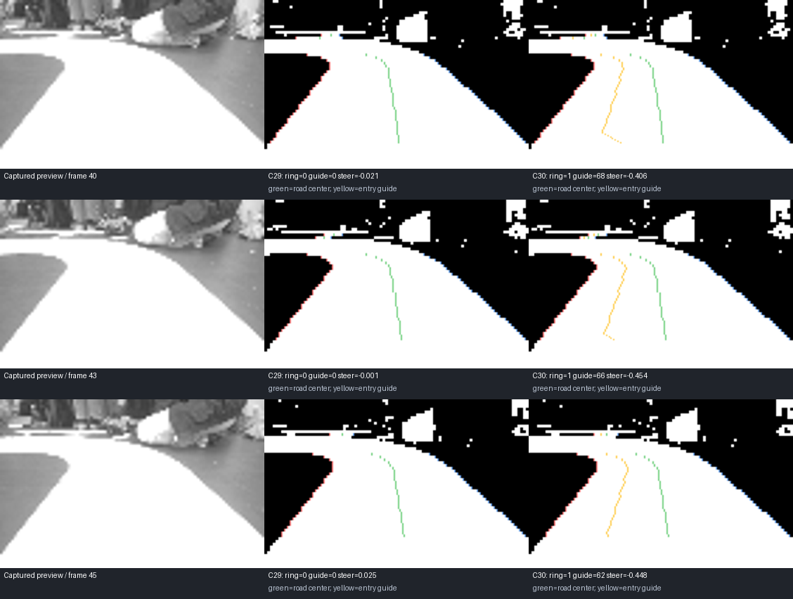

> 历史归档：本文只描述原版本，不作为当前启动、参数或验收说明。当前现状见 [项目设计与演进档案](../../PROJECT_EVOLUTION.md)。

# C30：基于实拍修复相切圆环入口漏检

日期：2026-10-22。基于恢复后的 C29，版本 `MIDTERM_C26_30`。
工程：`demo/mdk/midterm_switch.uvprojx`，目标 `nor_sdram_zf_dtcm`。

C29 的连续轮速支持、入口白色余量引导、受训练/新鲜度约束的贝叶斯提示和同步诊断全部保留。
本次新增的生产算法改动仅在 `vision_reference_route.h` 的侧边截断内岛验证中；另更新版本号。
C26 引脚、启停条件、编码器参数、舵机标定和速度/转向增益沿用 C29。

## 数据与复现

使用操作者确认的 `camera-g-20261022-215128-961-921fc390`（21:51 批次）。
操作者说明包含视角转换和手推入环，不是正常驾驶的连续轨迹。
该会话原 67 帧，既有清理清单保留 57 帧；本次没有更改采集文件、清理结果或标注。

输入是 94×60 灰度调试缩略图；按每点复制 2×2 进入实际 188×120 算法，不能还原缺失细节。
57 个姿态分别重置视觉历史，重复相同图像 12 次检查静态获取；不能把重复次数解释为真实确认耗时。
控制回归另用 24 次重复及模拟 20ms 时钟，同样不代表实际采集帧率或车辆运动。
拍摄视角变化时，图像左右不固定对应赛道平面图左右；派生镜像用于验证方向对称性，不冒充实拍右转数据。

## 漏检与修正

第 40、41、43、44、45 帧能看到侧边暗岛的上下端、凸出的内边界和外侧当前白色通道。
旧算法用外侧边界的第一个、最后一个有效点连线，再要求全部中间点到线的横向偏差不超过 4 像素。
端点的像素量化误差会改变整条参考线；第 40、41、43、45 帧的对应最大偏差约为
4.33、4.76、4.76、4.21 像素，超过门槛，入口状态没有建立，控制继续按普通道路中线走。

改为用全部当前有效外侧点拟合 `x = a + b*y`：

- 至少 8 点，纵向方差为正，保留外边界斜率上限。
- 保留每点最大横向偏差 4 像素，再要求均方偏差不超过 4（RMS 不超过 2 像素）。
- 暗岛大小、密实度、上下端、侧边形状、同一路面连接、当前道路宽度和多帧确认检查仍参与判定。
- 引导仍由 C29 当前白色通道及两侧余量约束，没有新增固定转向时序或单独提高转向增益。

这只修正已复现的一个漏检原因，不将所有未识别图都判成环岛；缺少可见边界的画面仍不能凭旧路径启动。

## 结果

补充：下表的静态控制模块回放当时使用默认观测控制器增益，并非实际 switch 工程的完整配置；C31 已对齐实际参数，另补跨 ROI 下端的连续性验证。见 [C31](C26_31_ENTRY_CONTINUITY.md)。

57 个独立姿态中，5 个入口视角改变，其他 52 个的本次回放结果不变。
原 C29 在新增的入口/镜像回归中出现 40 项失败；C30 的 40342 项检查通过。
这 5 帧及其镜像获得 62～68 行入口引导；实际控制器输出转向与图像中岛侧一致。
普通可见道路、无边界白区、OFF 撤销及人为弯曲外侧边界的反例检查通过。

| 实拍帧 | C29 入口状态 | C30 入口状态 | C30 引导行 | 模拟稳态转向 C29→C30 |
| --- | --- | --- | --- | --- |
| 40 | 0 | 1 | 68 | -0.021 → -0.406 |
| 43 | 0 | 1 | 66 | -0.001 → -0.454 |
| 45 | 0 | 1 | 62 | +0.025 → -0.448 |

上表是同一静态图重复 24 次的主机控制输出，不是实测舵角、实际入环轨迹或真实时间序列。

绿色为道路中线，黄色为入口引导。左列是原始缩略图；中列 C29；右列 C30。

## 验证与产物

- `tests/vision/run_switch_tests.cmd`：启停 300874 项、路径 374625 项、圆环 266 项、投影 578909 项以及实拍 40342 项通过。
- `tests/vision/run_switch_tests.cmd asan`：同一套回归与内存检查通过。
- Keil：Code 86728 / RO 13644 / RW 212 / ZI 196604，0 错误、0 警告。
- 数据摘要：`evidence/C26_30_PREVIEW_REVIEW.json`。
- 可复现实拍子集与 SHA256：`tests/vision/fixtures/tangent-preview/manifest.json`。
- 烧录文件：`releases/MIDTERM_C26_30/rt1064.axf`，版本与校验见同目录清单。
- C29 原始发布文件继续保留，SHA256 为 `35365F6D3F10C75BD73C2E00EE92EBC8C5078C4A718737C61B9539E653720E70`。

本次没有连接串口、烧录或驱动车辆。实际右侧相切圆环切入、出环与整圈效果仍需现场复测。
采集时相机姿态发生变化，静态缩略图结果不能替代最终固定安装视角下的标定与动态验证。
