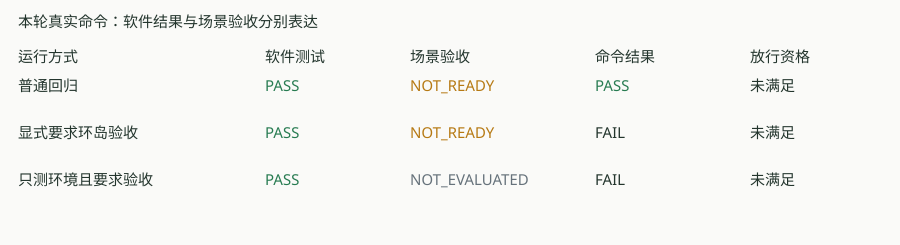

# 自动结果与实际场景验收一致性改进

**结论：汇总机制回归通过；连续米制环岛仍未就绪。** 完整GCC Host：通过63项、跳过1项、失败/错误0项。42个框架测试通过；跳过的是原有通用性能占位项，实际图像性能与场景回放已执行。



## 改变了什么

统一结果现在同时记录软件测试、声明场景验收和命令是否满足要求。场景未就绪、未执行或证据错误都不能取得软件范围放行资格；场景结果仅适用于已声明的检查，不代表实车或烧录授权。

| 真实运行 | 软件结果 | 场景验收 | 命令退出码 | 放行资格 |
| --- | --- | --- | ---: | --- |
| [普通回归](../../../.test-results/20261110T084348-e367f57c01/user-report.md) | PASS | 未就绪 | 0 | 未满足 |
| [显式要求环岛验收](../../../.test-results/20261110T084433-b793437d50/user-report.md) | PASS | 未就绪 | 1 | 未满足 |
| [只测环境且要求验收](../../../.test-results/20261110T084433-569bb5c82f/user-report.md) | PASS | 未执行 | 1 | 未满足 |

普通回归仍能用于检查保护行为是否正确；需要判定场景能否通过时，使用显式验收模式：

```powershell
./tools/testing/Invoke-TestPlan.ps1 -Suite vision-scene-integration -Compiler gcc -RequireAcceptance
```

Python对应参数为`--require-acceptance`。当前四个完整环岛合成序列仍有米制输出抑制或锁存，因此该命令正确返回1。仅选择环境检查时，该场景是“未执行”，不会借用历史通过结果。

## 结果如何保持一致

- 新整轮JSON版本为1.1。`status`和`softwarePassed`保留软件含义；`acceptance`保存场景范围、未通过案例、报告路径及SHA-256文件哈希；`commandPassed`说明本次命令是否通过。
- `releaseEligible`要求软件通过、全部已声明场景通过，以及完整MSVC Host/PreFlash条件。本轮真实集成使用GCC；MSVC放行判断分支通过受控测试验证，没有声称执行真实MSVC构建。
- 清单声明验收报告的本轮相对路径；文件缺失、格式错误、未知或矛盾状态会记为证据错误，并使普通命令也返回非零。未选中或未完成的检查记为未执行。
- 用户报告与技术报告读取同一份持久化顶层结论；重新生成报告不会根据后来改变的子文件重算本轮验收。旧1.0结果仍能校验和读取，原历史数字保留原意义。

## 验证证据

原故障先被受控回归真实检出：模拟MSVC Host范围内软件通过，子报告NOT_READY，旧顶层却为releaseEligible=true；修复后同一测试验证其为false。该模拟只检验框架汇总分支，未构建MSVC固件。

[修复前误判记录](../../../.test-results/20261110T083944-5c944c82f3/run.json) · [完整Host用户报告](../../../.test-results/20261110T084433-3575b5ac3d/user-report.md) · [完整运行JSON](../../../.test-results/20261110T084433-3575b5ac3d/run.json)

定点及框架回归覆盖：未就绪阻止放行、显式验收返回非零、未选择/跳过不继承通过、缺失/损坏/未知/矛盾证据、输入变化、未完成的其他声明场景、路径越界/重复声明、正向通过与工具链/范围限制，以及重新生成报告时保留原结论。JSON规则也拒绝“场景未通过而放行字段为true”的新版本结果。

## 范围与自查

本轮只改测试框架、结果规则、声明清单和说明文档，未修复环岛算法、修改动力参数或操作硬件。原有环岛问题详见[场景诊断](../vision-scene-integration-20261110/README.md)。场景是否具备真实车辆能力仍需独立证据。

自查：真实回放结果与顶层状态一致；本轮声明报告哈希可核对；完整回归输入未在执行期间变化；旧1.0结果校验通过；报告链接/图形和差异空白检查已复核。数据层使用原生JSON的structured_parsed和自动执行统计的computed，没有PDF/文本转换数值推断。

主要实现：[验收汇总](../../../tools/testing/acceptance.py)、[统一入口](../../../tools/testing/run_tests.py)、[用户报告](../../../tools/testing/user_report.py)、[框架回归](../../../tests/framework/test_framework.py)。使用与字段说明见[测试手册](../../TESTING_FRAMEWORK_GUIDE.md#83-软件通过场景验收与放行资格)。[本轮摘要与源码哈希](evidence.json)。
