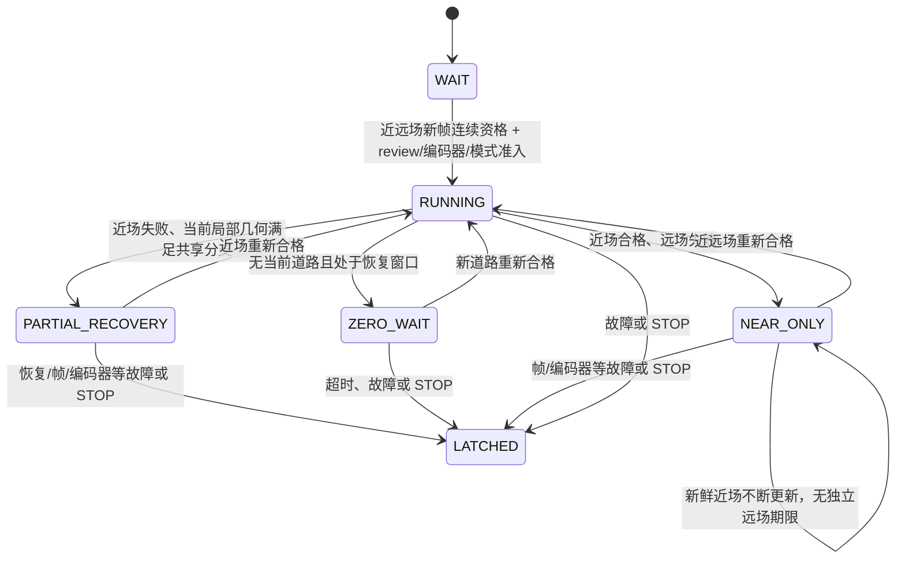

# Phase 0：基线与真实路径核查

状态：基线冻结完成；配置和主要安全路径已核查，不能等同于最终整改审计。

## 可恢复记录

HEAD 为 `de1415743b004160f520d385c9e3e63008f52007`。开始时已有 27 个已跟踪修改，以及 recorder、第三方库、测试、工具和文档等未跟踪内容；均视为用户既有工作。

证据目录：`.build/c31-safety-20261105-phase01/`。

- `baseline/status-short.txt`、`head.txt`、`diff-stat.txt`、`untracked.txt`：开始时 Git 状态。
- `baseline/tracked-before.patch`、`index-before.patch`、`index-entries.txt`：工作树与暂存状态记录。
- `baseline/workspace-and-recorder-build.zip`：1,428 个文件，共 111,744,614 原始字节，压缩后 62,064,962 bytes。
- `baseline/snapshot-manifest.json`：逐文件长度/SHA-256、时间和归档 SHA-256。
- 归档 SHA-256：`915a84fe7710c4009bd6fbaa64091a58c3e03106109074b5ee14cb4f97ed8eb9`。

压缩包已执行 CRC 检查、逐项解压哈希检查，以及归档时的现场哈希复核。保护范围包括原始源码、来源锁、生成脚本、生成工程、adapted 文件、identity/provenance、AXF/BIN/MAP、对象文件和日志。没有执行 reset、clean 或覆盖既有产物。

恢复流程：先在独立目录解包；核对 manifest 和需要恢复的文件；单独保存待替换文件；逐文件恢复。快照是恢复材料，不授权自动批量回滚，也不替代 Git 对象库备份。

## 历史停止语义

`git show 96aa840:demo/code/midterm_boot.c` 已读取并保存为 `historical-boot.txt`：`terminal()` 调用 `vision_drive_stop()`；RUNNING 离开运行状态后进入终止状态，启动仅在 WAIT 分支发生。历史设计为一次 boot 的一次启动流程。

`git show 79c8ec6:demo/code/vision_drive.c` 已读取并保存为 `historical-c31-drive.txt`：`vision_drive_observe()` 在 C31 RUNNING 且 observation_valid 或 far_valid 为零时直接 `vc_trip(VC_FAULT_VISION)`。

当前 `docs/vision_recorder/IMPLEMENTATION.md` 第 14 节明确记载：此前按用户要求取消单帧视觉失效锁止，允许近场反馈、局部恢复及零动力等待。当前源码与这次改变一致。新任务书要求为这些行为重新建立可验证边界；采用即时锁止备选会改变上述恢复策略，需要在设计确认时明确。

## 当前状态流转（整改前）

NEAR_ONLY、PARTIAL_RECOVERY、ZERO_WAIT 是现有变量组合的解释名，不是已存在的 enum。PARTIAL_RECOVERY 目前可产生非零 duty；ZERO_WAIT 双目标为零时会清 PI。不能将两者混称为“无道路时总是零 PWM”。

## 配置与编译证据

`keil-project.json` 保存完整 target 公共、C 编译、链接配置和 390 个工程条目；`active-compilation-units.json` 按当前工程启用字段识别出 193 个 C/汇编单元。这不是声称每个单元都向最终 AXF 贡献保留符号；链接器可能删除未引用内容。

生产单元 `vision_control.c`、`vision_actuator.c`、`recorder_isr.c`、`recorder_control.c` 已使用当前 recorder 工程的 define/include/强制包含配置进行 ARMCLANG 预处理，命令与退出码见 `analysis-commands.json`。这是按工程配置重建的预处理命令，不是从历史 Keil 进程捕获的完整实际命令行。3 个单元各有一项头文件名大小写警告，详见日志，未隐藏该诊断。

既有 AXF 已由 fromelf 成功导出反汇编，保存为 `baseline-disassembly.txt`，并提取输出、PI、启动和 PWM 驱动函数。没有新链接或覆盖 AXF。实际软件时限、DMA/缓存/总线及物理停止行为尚未测量。
