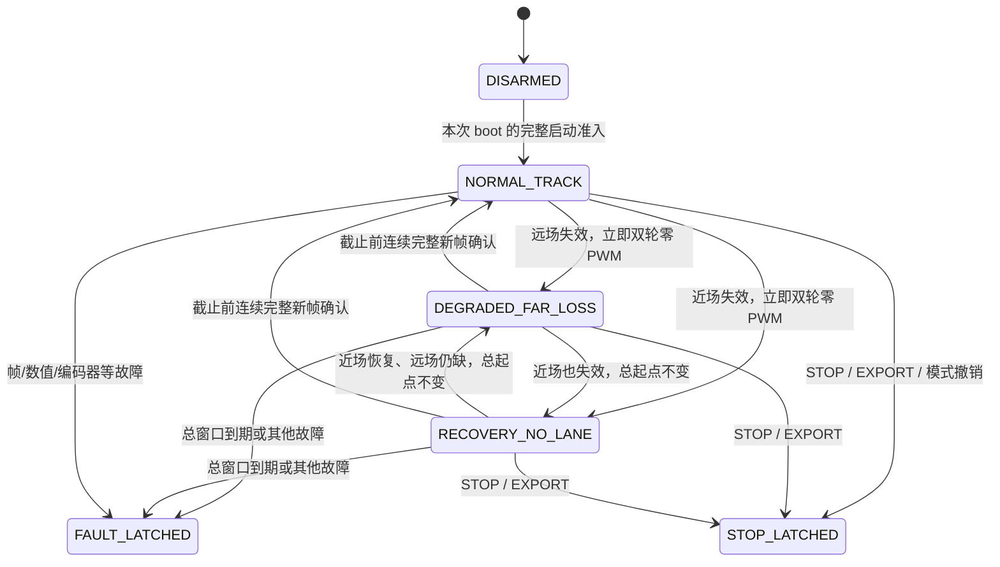

# Phase 1：待确认的整改设计

状态：设计草案；源码尚未修改。确认范围包括本文件及 `CONTROL_EVENTS_SCHEMA.md`。实施仍限于软件和离线验证。

## 运行政策（按用户选择修订，参数待讨论）

用户选择“保留零动力恢复窗口，先讨论期限依据”。初稿“任一视觉失效立即终止”的政策已被此选择取代，不据其修改固件。

本版设计方向：运行中近场或远场失效，立即将左右轮目标与最终提交 PWM 归零，并进入有界等待；等待本身不授权继续运动。只有连续规定数量的新鲜、不同序号、近/远场同时合格的帧，才能在截止前恢复本次原运行租约。到期进入终止锁止，STOP/FAULT 则随时优先撤销整次授权。

待讨论候选为总窗口 300 ms、连续恢复帧 5。300 ms 的来源是现有恢复初始窗口和已有 200 ms 黑图场景的软件行为基线；5 是现有启动基础稳定帧门槛。这些来源只能支持软件策略的连续性与可验证性，不是新的物理安全证明。未确认前不写入生产宏。

## 时序与参数依据

- 当前 300 ms 约束距 last_valid_ms 的恢复初始窗口；100 ms 是局部证据新鲜度；1200 ms 是强局部证据可延长的最大窗口。不能将后二者带入新零动力等待来无限延长总期限。
- 新窗口从首个合格的新鲜失效帧的 capture timestamp 起算，使用同源 Control 当前时间检查，处理延迟消耗窗口。近场/远场失效切换共用首次失效起点；近场恢复但远场仍缺、单帧完整道路、partial 出现均不能清除它。
- 总期限包括连续恢复确认。配置 50 FPS 时名义间隔 20 ms；5 个恢复帧自身跨越 80 ms。若失效持续 200 ms 后出现首个恢复帧，第五帧名义在起点后 280 ms；300 ms 候选只余 20 ms 余量，调度或帧抖动可能导致超时，这应按策略终止，不能续期。
- 一个失效帧后，第一个合格帧通常在 20 ms 后，第五个在 100 ms 后；若照搬 100 ms 作总窗口且到期优先，名义上也不能完成这次恢复。因此不能把 frame timeout=100 ms 或 partial freshness=100 ms 直接当总窗口。
- 相机不再产生图像时，仍受现有 100 ms frame timeout 独立约束；300 ms 候选不能放宽它。到期与恢复同轮时先终止，不接受迟到恢复。
- 序号重复、倒退、过期/未来异常时间戳不计恢复资格或刷新起点。完整证据中断则连续计数清零；最大帧间隔与新鲜度沿用现有严格 frame timeout 检查，并在设计确认时明确边界。

## 状态和证据

运行主状态与视觉子状态分开：主状态为 DISARMED / RUNNING / FAULT_LATCHED / STOP_LATCHED；RUNNING 下有 NORMAL_TRACK / DEGRADED_FAR_LOSS / RECOVERY_NO_LANE。后两个状态的目标与最终双轮 PWM 均为零，保持原租约只是为等待证据，不代表电机输出许可。

STOP 与 FAULT 同时发生时保留双方原因及 fault bitmap。终止后图像可继续采集和诊断，不能退出终止状态。启动前仍须完整现有准入流程。

本次不增加正常运行总时限；当前 C31 的 max_run_ms=0 如实记录。正常速度配置、舵机标定和启动资格不重新标定。

## 控制层与执行器层

1. C31 近场失败不得先进入共享 partial 非零 duty 分支；近场成功但远场失败也不得继续正常驱动计算。独立视觉状态/输出抑制标志决定零电机输出，不依赖 recovering 单一布尔。
2. 周期 poll 独立检查固定总截止时间，先检查到期再接受恢复帧；无新图像同样有效。近场/远场失效原因可以变，总起点保持不变。
3. 视觉等待抑制电机目标与最终 PWM，但不撤销本次运行租约；终止 STOP/FAULT 则撤销整次授权。不能直接用同时清总授权的 vd_output_zero 代替非终止电机抑制。
4. 非终止抑制清 PI、目标、待提交缓存并使旧候选失效；连续恢复达标后从清零状态按现有目标/PWM 上升约束恢复。不得直接提交等待前的非零 PWM，不绕过已有速度样本新鲜度要求。
5. 舵机等待策略须依据现有约定明确为保持当前经过校验的命令或当前可信局部方向；无可信方向时不沿历史路径授权动力。候选设计保留现有舵机限幅/变化率，STOP/FAULT 沿用全部 PWM 清零，不引入反向电机制动。
6. 普通运行路径不能再次调用 init 清锁止；Host 模拟重启必须显式重建完整 boot。零 PWM 不等于物理静止，窗口内恢复仍可能在惯性运动中发生，物理效果待单独验证。

## 计算、PI 与提交的并发方案

输出与 PI 计算移出全局关中断区间，但先建立一致快照和最终复核，不能只删除 PRIMASK。

- Control 是 C31 控制器、输出准备和 PI 服务的任务所有者；PIT 只采样或撤销，Link 只发布停止请求/链路错误序号，Storage 不获得输出权限。
- 增加或复用输出授权版本。arm、终止撤销、配置/允许输出边界变化都使先前候选失效；单个候选不跨多次 boot 存活。32 位对齐版本访问在所选 core 下审查，说明回绕前提，不声称 volatile 本身提供并发协议。
- 极短 PRIMASK 快照区复制整数授权、版本、样本序号及 PI 状态；常规计算使用局部副本。ISR 的 STOP/reset 即使发生在计算中，也不修改这份候选；最终版本检查将拒绝它。
- PI 提交同时检查输出授权版本、配置/请求版本和已消费样本身份；样本或授权不匹配时丢弃候选，下一轮用新快照重算，不把旧测量重放为多次 PI 更新。故障记录不能在丢弃旧候选后覆盖更新的终止原因。
- 最终提交区只做标量条件复查、有限固定长度状态发布、方向/PWM 写入及必要屏障。profile 的复杂浮点校验在配置/准备阶段完成，其有效性与配置版本绑定；不能将每次完整 profile 校验留在最终关中断区。
- 启动入口的外围 PRIMASK 同步收缩：准入计算在外，原子检查/授权在内，`vd_output_apply()` 不在外围长临界区内调用。PI 服务、STOP、arm 的所有调用者均纳入审计。
- 保留进入前 PRIMASK 状态；不把 PRIMASK 机械替换为 BASEPRI。CSI=2、PIT=0 不被当前 FreeRTOS 阈值屏蔽，但会受 PRIMASK 影响。

候选准备与提交之间插入确定性测试钩子，覆盖 STOP、FAULT、模式撤销、配置/版本变化与下一样本。钩子只存在于 Host 构型，不能在生产 Control 路径引入阻塞回调。

正常 route-switch / bench / diagnostic 构型的宏隔离和回归必须保留。优先在 C31 路径完成整改，若共享 PI 结构必须调整，按真实 diff 扩大相关构型回归；不能为隔离而复制整个控制器形成第二套长期实现。

## PWM 硬件提交边界

M1、M2 使用 PWM2 的不同 submodule，舵机使用 PWM4。当前 `pwm_set_duty()` 对单通道执行 LDOK 清除、寄存器更新和 LDOK 置位，配置为 full-cycle reload。软件关中断只能保证任务/普通 ISR 的提交不交错，不能保证三通道物理同时生效。

实施中保持现有硬件驱动接口，核对零写覆盖待加载旧值、缓存失效及 STOP 后没有再次非零提交。若无法在源码、驱动和目标指令层建立所需的软件顺序，暂停相关验收并报告。实际 reload 延迟、芯片总线等待和物理停车留待单独硬件验证。

## 实施批次与完成条件

1. P1 控制失效零动力窗口、连续恢复、终止锁止及实际 recorder 构型测试；在隔离/已备份产物下构建。
2. P1 输出候选、PI 所有权、启动调用链和临界区收缩；交错测试与目标反汇编审计一起闭环。
3. P2 按事件 schema 增加固定内存队列、Storage sidecar 和 PC 解析；保持原始像素与 SCRAW 记录兼容。
4. 全量 Host/PreFlash、Switch/Speed/Link/Equivalence、Keil recorder 两种 review 构型及宏覆盖；最终 diff 与证据报告。

生成器、精确来源锁项、catalog、harness 和 PC schema/parser 属于必要配套范围。先审查原始源码 diff，再更新对应锁项；生成文件必须由生成器得到，不直接手改。MSVC 工具链目前未发现，完整软件验收需解决该工具依赖；不得下载安装或升级工具链来绕过当前授权边界。
