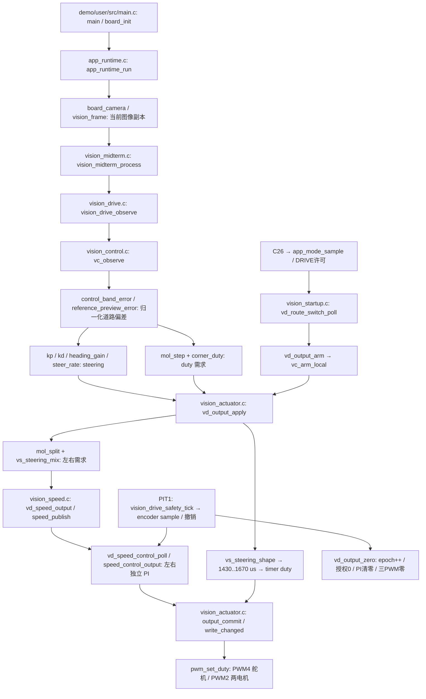

# C31 连续速度规划：Phase 0 控制链路审计

日期：2026-11-05。验收构型只认 `demo/mdk/competition/midterm_switch.uvprojx` / MIDTERM_C26_31。
本报告以本轮开始时的**工作区**为基线，HEAD 为 de1415743b004160f520d385c9e3e63008f52007；已有未提交安全整改和 Recorder 文件，不能把 HEAD 当成全部有效源码。
原始工作区 1015 个文件 SHA-256、二进制 diff 和 status 保存在 `.build/speed-planning/{before.json,before.patch,status-before.txt}`。Phase 0 不修改生产源码。

## 来源与裁决

用户请求实施 v1.4；任务书第 10 节优先于历史 AUTO_TRACK 通用描述。历史 `c31-safety-boundaries-20261105/SAFETY_STATE_MACHINE.md` 的“far invalid 也零驱动”和“一次 boot”描述不能成为 MIDTERM_C26_31 新目标。此处记录冲突，不篡改此前尚未提交的设计文件。

用户明确答复没有标定数据。v1.4 第 4、5 节禁止把未确认的 300 ms / 5 帧、仿真制动参数或虚构距离写成生产宏。因此本轮可完成只读审计和独立 Host 原型；Phase 2 真实 session 阈值审查、Phase 3 MCU 策略集成与正式验收仍有实质数据依赖。不能声称全任务完成。

## 实际调用链

`straight_duty()` 在当前生产源码不存在；不能按历史名称报告。实际速度选择在 `corner_duty()`、`mol_step()`、`vt_route_ticks()`、`vt_ramp_targets()` 和 PI feedforward / effort limit 分层发生。

## 量纲、周期与数据来源

| 量 | 源码 / 更新 | 实际单位与限制 |
|---|---|---|
| result.left/right/center | vision_midterm；新图像 | 图像列像素；188×120，不是米 |
| near/far band y | vc config；新帧 | 行/(HEIGHT−1)；近场 .86，远场 .62，半宽 .035 |
| lateral / heading | vc_observe | 以半道路宽归一化的偏差及差值，不是曲率 |
| steering | vc_observe | −1..1；归一化命令，不是弧度 |
| servo pulse | actuator；提交 | 中位1550 us，右1430 us，左1670 us；右转符号−1；缺有效转角实测 |
| servo timer duty | actuator → pwm_set_duty | pulse_us × SERVO_MOTOR_FREQ × PWM_DUTY_MAX / 10^6；截断转换 |
| cruise / duty_cap | route RAM profile | .145 / .18；是目标需求域，**不是最终闭环 PWM 18% 上限** |
| duty_rise_per_s | mol_step / corner_duty | .20 /s，约束需求上升；下降可立即发生，无实际速度/jerk 证明 |
| raw3/raw4 | PIT1 encoder | 实际 count×10/elapsed_ms，即 ticks/10ms；有整数截断 |
| speed target | speed_control_output | 同上 ticks/10ms；转 ticks/s 乘100，不得漏因子 |
| MT_ROUTE_BASE/FAST/CORNER/EDGE_TICKS | route profile | 50/132/104/92 ticks/10ms；现有经验配置，非物理标定 |
| PI kp/ki | speed config | Q8；route初始化 kp=1，ki=.05 后量化；两个 ws_pi_t 状态独立 |
| PWM output | PI / output_commit | permille → PWM_DUTY_MAX；route物理域可达1000 permille |
| encoder sampling | PIT1 nominal10ms | 合法10..20ms；样本最大年龄30ms；准入20ms；控制失联50ms |
| frame timeout | vc_poll / safety tick | 100ms；相机不出帧独立截止 |
| old recovery | vc_poll / partial branch | INITIAL300ms，PARTIAL_FRESH100ms，MAX1200ms；相对last_valid_ms，并非新near/far模型 |
| max_run_ms | route RAM override | 0；关闭总运行期限，不代表far-loss已有独立预算 |

轮速控制只消费样本序号差 `samples-consumed`；超过1个未消费样本故障，不把最新值重复当历史样本。无新样本保持缓存 PWM。零目标立即 `vd_speed_stop()`，清左右 target、PWM、PI/request。`wheel_speed.c` 条件积分及输出限幅是 anti-windup；大幅降目标按比例减积分。它们都不能证明真实制动能力。

## 源码证实的问题和启动边界

1. near成功、far失败仍走尾部 `last_valid_ms=frame_ms`、`recovering=0`，没有独立far累计时间/距离。
2. route-switch 的 current_partial_direction 分支可发 cruise×.45/.60 非零需求；不满足新目标near-invalid同周期零输出。AUTO_TRACK的C31零等待分支不是主构型。
3. `band_error()` 在 route 允许单边建模行；任务目标中的near-valid几何定义需要按标注数据确认，不能把 bool valid 等同于完整实测双边。
4. `reference_preview_error(...) || have_far` 可使较宽行段的预瞄结果充当far-valid，尚未建立near/far独立质量分数与米制可信距离。
5. route 的 `vd_output_apply`、`vd_speed_control_poll` 仍把浮点准备/PI计算放在PRIMASK内；先前未提交整改主要缩小AUTO_TRACK路径。不得宣称主构型已完成短临界区改造。
6. `vd_route_switch_poll` 在保持DRIVE/ON时清理仅VISION/FRAME故障，随后五个新有效帧可重启；现有 `test_route_switch.c` 明确断言“No OFF->ON needed”。v1.4新规则要求故障后物理OFF→ON，此处是现状/目标冲突。
7. OBSERVE/OFF首次释放分支在新鲜encoder时直接 `guard_faults=0`、`vc_clear_fault`、尝试speed_enable；该分支未按严重故障类别保留锁止。不得把“ON分支不会清encoder”扩大为“OFF→ON不会清严重故障”。
8. 人工STOP通过route_operator_stop抑制；OBSERVE释放/物理模式流程允许后续ON。UART `a` 在route-switch拒绝；不开放旁路。
9. RAM profile覆盖autostart_enabled=0；`VISION_AUTO_START_DELAY_MS=2000`不是本构型实际启动延时。保留 `VISION_MIDTERM_AUTONOMOUS=0`、route switch/trial/encoder=1；不改AUTO_TRACK管理器。

这些问题记录为集成前必须解决的验收差距，Host旧测试通过不等于目标策略通过。此轮不放宽旧断言。

## Storage / SD 隔离

实际switch工程入口是 `demo/user/src/main.c` → `app_runtime_run()`，不是Recorder FreeRTOS入口。项目没有引用 `demo/recorder` 源文件。`vision_storage_board_init()`只注册NOR双槽callback；route配置跳过启动保存profile加载。`vision_field.c`显式存储命令还经 `vision_drive_can_store()` 等静止条件检查。未调用recorder_storage_task、未启动持续SD写入队列。SD_ENABLED/SDK的SD对象参加编译不能说明运行时写卡。目标MAP/AXF再核对符号保留情况，不能仅凭文件名下结论。

## 构建与并发证据范围

主构型原工程以完整目录私有副本纯重建，仅改输出/Listing绝对目录；before/after hooks全部关闭。不会在原目录产生AXF，不执行调试、下载、串口或任何硬件操作。完整宏、AXF/BIN/MAP哈希及fromelf符号/反汇编保存 `.build/speed-planning/actual-switch/`；构建结果见最终 [验收记录](VALIDATION.md)。

驱动 `pwm_set_duty` 单通道CLDOK→缓冲寄存器→LDOK，full-cycle reload。`output_commit` 软件顺序是舵机→右电机→左电机；`vd_output_zero` 是右→左→舵机。PWM2不同submodule与PWM4不会因PRIMASK而物理同步。零写能更新同一缓冲寄存器、使write cache失效；芯片reload时刻/总线等待/真实停车距离仍未验收。

读取层：原始UTF-8 Markdown与C源码（原生文本）；工程XML、catalog/report JSON为 **structured_parsed**；文件哈希、Host测试、目标构建/指令检查为 **computed**。无MarkItDown工具，且输入本身为Markdown，无需格式转换。没有仅靠md_extracted断言的物理数值；没有pdf_verified或硬件实测证据。
