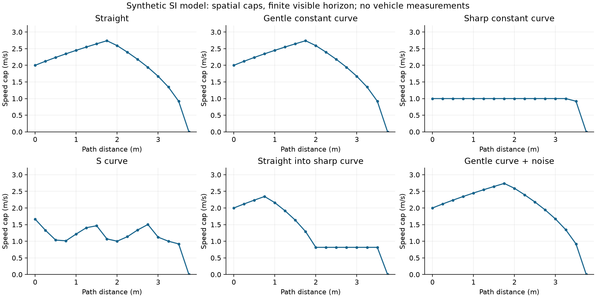
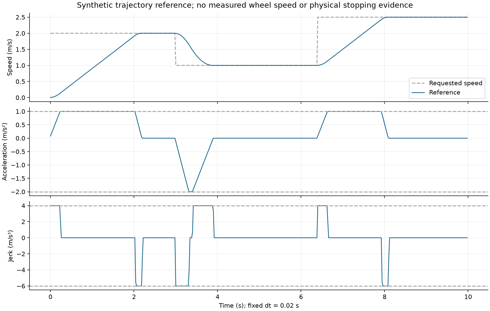

# Host 速度规划、降级监督与离线数据设计

**阅读提示：** Host指开发计算机；路径预瞄（preview）是按顺序排列的前方路径点，不是缩小的相机预览图；加加速度（jerk）是加速度随时间的变化率。本文描述当时的软件原型和模拟条件；当前代码关系见[阅读指南](../../MPC_GUIDE.md)，其他缩写及单位见[术语索引](../../MPC_TERMINOLOGY.md)。

状态：Phase 1/2 软件原型；不在 MCU 生产控制路径。所有构造输入与参数均为 **SIMULATION**，不代表本车实测。

## 1. 单一轻量算法与数据契约

源文件为 `tools/speed_planning/speed_planner.{h,c}`，数组上限16；调用者持有状态，没有动态分配、全局控制状态、PWM写入或输出授权修改接口。

`vision_adapter.{h,c}` 复用已有 `vision_result_t`，没有新增图像识别器。调用者提供按近到远递减的采样行：每行要求当前双边实测 `row_flags==3`、边界次序/宽度/中心一致，任何一个指定样本不合格就拒绝整组。此原型选择比现有 route partial 更严格，尚未宣称就是生产 near-valid 分类器；十字/环岛桥接行的生产策略仍要用标注数据复核。

- 无地面变换时，只产生 `SP_NORMALIZED`：横向列/(W−1)，前向1−行/(H−1)，曲率单位为归一化坐标的倒数。
- 调用者提供3×3单应矩阵时产生 `SP_METRES`，输入像素、输出米，矩阵来源另行管理。分母近零、非有限值、前向坐标非递增拒绝。
- `sp_geometry` 检查序号与capture时间半域模序、同源now新鲜度、未来时间、有效点数、空间次序、非有限数。先在内点横向坐标做三点中值，再以三点有向曲率 `2×cross/(|a||b||a+b|)` 估计。x向右/y向前，右转曲率为正。
- 同一单位、同一采样数量的新鲜前序几何可做横向连续性检查；超过调用者给出的步长上界拒绝，不借旧几何授权动力。失联后的新几何可重新建立连续性，不能永久卡在旧路径。
- 失败不发布新preview，不更新序号或capture。单位改变须显式清history。三点中值只抑制单个内点尖峰，端点噪声、多点异常和真实曲率变化仍需数据验证。

`preview.distance[0]=0` 是**首个可见路径点作为局部坐标原点**，不是已证明车辆后轴位置。真正MCU集成前必须把车辆/相机偏移、盲区及定位误差计入几何或margin，不能把此原型的起点冒充车辆真实后轴。

## 2. 空间速度上限

`sp_limits_t` 显式携带参数来源 `SP_SIMULATION` / `SP_PROJECT_CALIBRATION`；这是来源标签，不是认证凭证。库不提供任何本车默认速度、加减速度、jerk、预算。

输入只接受米制preview；`SP_NORMALIZED`直接拒绝，像素不能进入米制制动公式。逐点约束为：

\[
v_\kappa=\sqrt{a_{lat}/(|\kappa|+\epsilon)}
\]

\[
d_u=\max(0,d_{end}-d_i-d_{margin}),\quad
v_b=\frac{2a_b d_u}{\sqrt{(a_bT)^2+2a_bd_u}+a_bT}
\]

后式是 `−a_bT+sqrt((a_bT)^2+2a_bd_u)` 的数值稳定等价式；代码分母加极小量只防0/0，不形成安全余量。最大车速、曲率、可信视野停车边界、near_cap取最小。远场缺失时调用者必须只传near可信点。

未知视野外不假设无限直路：当前版本始终要求在可信末端完全停车，故即使调用者提供非零terminal_speed，也会被视野停车上限进一步压到0。这比非零终端边界保守；要放开必须设计明确可观测性契约。

先后向传播曲率/末端边界，保存 `current_cap`；再把当前点以实测速度上界固定，做前向加速传播和再次后向制动传播：

\[
v_{i+1}^2\le v_i^2+2a_{acc}\Delta s,
\qquad v_i^2\le v_{i+1}^2+2a_b\Delta s.
\]

`current_cap` 是供时间整形器消费的当前几何限速，`speed[0]` 是被实测起始边界限制后的空间轨迹。启动时实测0不应让几何限速也永远0。每个点附最终限速原因bitmap：MAX/CURVE/HORIZON/NEAR/FORWARD/BACKWARD；它记录最后实际起约束作用的来源及相等来源，不是所有历史约束的完整日志。

曲率误差传播参考：当曲率约束主导时，`|dv/d|κ||=.5 sqrt(a_lat)/(|κ|+ε)^(3/2)`。噪声上界必须来自相应标定/标注；当前噪声用例是明确的人工扰动，不能产生本车置信区间。

## 3. 时间域离散 jerk

`sp_shape` 用实测控制dt，数值支持10µs至调用者max_dt（不超过1s）；jerk数值下限10⁻⁶只是算法浮点支持域，不是生产推荐值。异常dt拒绝，状态不更新。`hard_stop`先于所有参数校验执行，立即清速度/加速度。

每周期下一加速度位于 `[a−j_brake dt,a+j_acc dt] ∩ [−a_brake,a_acc]`。计算从候选加速度以规定jerk退回0时还会增加的离散速度，以固定24次标量二分求解目标。该式避免连续平方根估计配合Euler更新时在恒速附近往复。

若当前安全cap低于正常jerk整形结果，则cap优先并置 `brake_override`；若所需减速度超过a_brake，另置 `infeasible`。这表示模型已不可行，不能称为已满足物理制动；集成者必须上报故障/进入更高优先级处理。不可行后state.accel可能超出正常域，下一次普通整形会拒绝，必须由监督层处理，不得忽略返回值继续沿用旧输出。

当前速度没有和实测反馈自动校正的生产闭环接入。正常参考与硬事件分别验证，不把PWM平滑当实际速度平滑。





6类空间输入各16点，500个时间样本、dt=.02s。两图纵轴/横轴为人工米制模型；没有轮速实测曲线。目标2→1→2.5m/s仅为软件测试输入，不是本车推荐速度。

## 4. 分级监督与输出候选

`sp_supervise` 是Host策略状态原型，不能直接grant生产授权；`sp_supervisor_arm` 的注释明确要求外部C26 owner先完成真正准入。当前没有把它调用到 `vd_route_switch_poll`。

| 状态 | Host行为 | 生产集成仍需实现 |
|---|---|---|
| NORMAL_TRACK | 当前near/far均有效 | 新preview→planner→PI→最终提交 |
| DEGRADED_FAR_LOSS | 保留generation/授权，允许候选；累计时距 | near-only模型给非零上界，不能仅因far无效清PWM |
| RECOVERY_NO_LANE | motor_inhibit，generation递增拒绝旧候选；固定near起点 | 同周期清目标、PI/cache和最终PWM，保留有界租约 |
| CONTROLLED_STOP | 时距任一到期后保持本episode停止意图 | 已标定减速度参考经左右PI，等待真实零速 |
| STOP_LATCHED / FAULT_LATCHED | 撤销，generation变化，普通帧/arm不能清锁 | C26物理OFF→ON按故障类别重新准入 |

frame_timeout、near_window、far_budget分别计时；既有deadline先于新帧。只接受新鲜、序号/capture均前进的新帧。near-invalid中near_streak连续计数，far未稳定恢复时保留整个far episode；near恢复不能清far预算。far连续恢复完成前仍near-only，预算到期优先于同周期退出降级。

Control每轮检查far elapsed，无新视觉也不暂停；距离仅由新encoder序号对应的单调累计路程更新。首次far-loss还必须提供capture对齐的路程及valid标志，初值为当前路程减capture路程，不能漏掉采集到控制之间的行驶；缺失对齐值则拒绝/encoder fault。真实系统需有界历史或经过误差审查的插值来提供此量，当前未接入。重复encoder序号不能带新时间/路程，防冻结伪造新鲜度；这里是单个车速/路程抽象，真实左右反转、计数丢失及PI仍由现有encoder控制器负责。

受控停止只有多个不同encoder样本确认零速才锁止；独立stop_timeout防永远不能停。near失效会立即禁止动力，但不会重置已有stop deadline；硬STOP/严重故障随时优先。不允许普通视觉恢复清锁。模拟会话显式init作为新的运行边界；**没有用该规则覆盖真实C26重启政策**。

当前prototype只给状态/目标判定，没有真实PWM writer、ISR并发或PI所有权；`sp_candidate_allowed` 的测试不能充当生产最终提交交错验收。

## 5. 舵机与双后轮模型

舵机表按angle递增、pulse严格单调校验，支持左右非对称的分段线性映射及端点限位。测试里的角度是虚构值；真实1550/1430/1670us仅知脉宽，未测有效前轮转角，不能填入真实表。

默认共同纵向速度；左右ticks/m可不同，保证各自跟踪同样线速度。几何补偿要求显式geometry_calibrated并提供后轮轮距，右转κ正：`vL=v(1+κb/2)`，`vR=v(1−κb/2)`。拒绝使内轮反向/为零的极端曲率。函数使用路径曲率输入；若从舵机角推κ，集成者还须轴距及`tanδ/L`标定。不把双后轮驱动改为差速转向。来源bool不能替代实际项目审查。

ticks/s目标进入旧PI时需除100并处理量化/低速死区；此连接没有实现。既有PI输入是ticks/10ms，不能直接把ticks/s当成原max_ticks写入。

## 6. 可选PC控制sidecar

`sessions.py`实现独立JSONL契约 `smartcar.control-replay/1`，不读串口、不改SCRAW像素/封包。首行header字段：

| 字段 | 要求 |
|---|---|
| schemaVersion | 精确版本；未知明确拒绝 |
| sessionId / datasetVersion | 非空字符串 |
| units | SI；不支持把ticks/pixels当米 |
| provenance | simulation / project-measured，仅来源声明 |
| imageSha256 | 原始图像归档64位十六进制SHA-256；目前校验格式，实际归档哈希比对由导出方负责 |

每样本必需frameSeq/captureMs、nearValid/farValid、odometerM、speedMeasuredMps/speedReferenceMps、left/rightTargetTicksS、left/rightPwmPermille、mode、outputGeneration。可选nearDistanceM/curvaturePerM/queueDrops/storageErrors。整数和布尔分开检查，PWM范围0..1000，拒绝重复JSON键、NaN/Infinity、未知字段、序号/时间倒退、路程下降。PC时间和帧号须在导出时展开回绕；与MCU内部uint32模序契约分开。

此sidecar可按声明的图像hash及frameSeq/capture关联帧，但不伪装成现有Recorder已经输出它。帧完整率分母、原始归档逐帧核对、队列实现/并发/Storage timeout、板端version writer仍未实施。已有SCRAW/PC parser保持原状，旧数据不会被当作此JSONL自动猜测解析。

预算统计按完整session分组。任意sessionId重复、文件hash重复、图像归档hash重复或dataset/provenance混用均拒绝；仍需导出方保证不同归档没有同一视频的分段泄漏。near-invalid期间不重置far episode；far稳定恢复所需帧计入episode时长/距离。断流超过max_gap及文件尾未恢复片段标为censored，单独报告，不放进已完成恢复片段分位数拟合。

P99为nearest-rank经验分位数；完成片段不足显式样本量政策（默认100）时用最大值，并标临时统计。100只是软件分析政策，不证明P99稳定或足够安全。时间余量max(2×frame_period,latency)，距离余量由调用者给出测量误差；每次输出均`productionApproved=false`。验证session统计双预算严格未到期覆盖率；等于deadline不算恢复成功。没有真实“可恢复/危险”标签时，误停率为null，不能把超预算比例冒充误停率。

```powershell
python tools/speed_planning/sessions.py `
  --train <完整训练session.jsonl> --validation <独立留出session.jsonl> `
  --recovery-frames <已审查帧数> --frame-period-ms <实测名义周期> `
  --latency-ms <实测延迟> --distance-margin-m <定位误差余量> `
  --max-gap-ms <有效帧截止> --output .build/speed-planning/budget-proposal.json
```

尖括号是必须替换的数据，不是可原样执行的数字。无数据调用失败，不生成假预算。

## 7. 资源与数值边界

Host结构大小与ARM编译器静态stack报告见验收记录。`sp_plan`固定16点O(N)，`sp_shape`固定24次二分；无大型优化器、阻塞IO或堆分配。使用sqrtf/ceilf，成本需结合目标FPU和libm最终链接测量。浮点非有限/范围检查和uint32半域条件不等于全平台数值证明。

原型ARM对象编译不等于已接入AXF，也不提供MCU WCET/端到端实时性。没有降低原控制频率，没有改中断优先级，没有更改任何生产PRIMASK区间。
