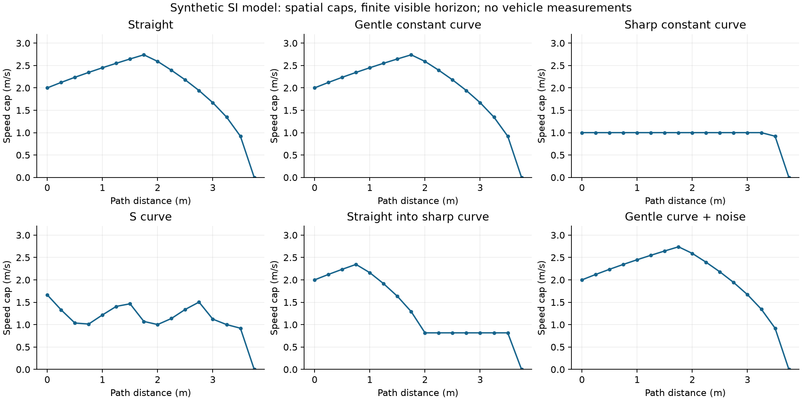
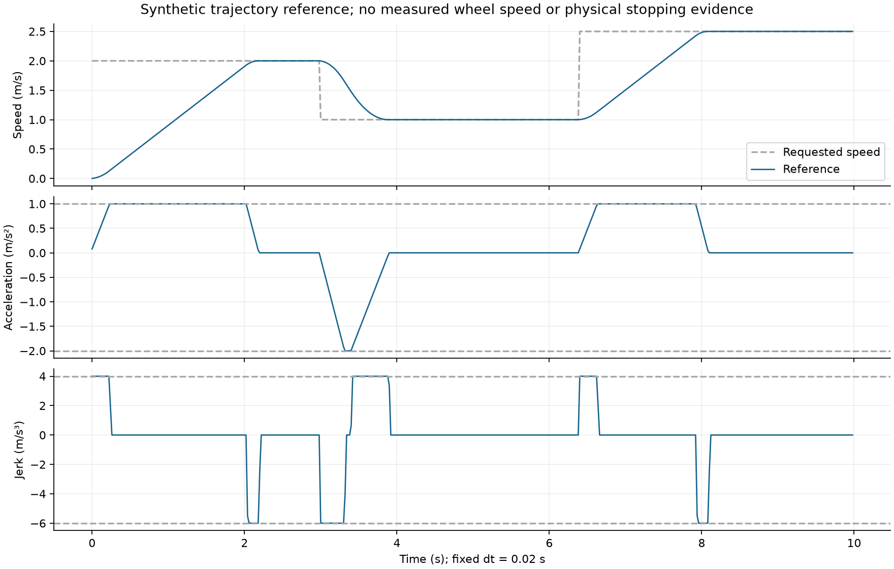

# 正常运动性能：Host 模型报告

执行：2026-11-05 至11-06。输入是人工固定路径和速度目标，没有真实图像session、轮速实测或车辆A/B。

## 已计算

- C与独立Python实现对照：直线、缓恒曲率、急恒曲率、S弯、直入急弯、缓弯叠加人工噪声，6×16=96点，允许速度误差2×10⁻⁵m/s。
- 每点断言：非负/最大速度、横向加速度约束、带延迟可信视野停车边界、前向加速与后向制动约束、限速原因。相同输入结果逐字节一致。
- 独立噪声测试：κ=.8±.001m⁻¹，使用导数上界 `.5sqrt(a_lat)/(.799+ε)^1.5×.001` 检查各点速度偏差。该扰动是人工值，非相机噪声标定。
- 时间整形：固定dt=.02s，500点，目标2→1→2.5m/s；正常段a∈[−2,1]m/s²，jerk∈[−6,4]m/s³，浮点断言容差显式纳入；稳定段参考/目标误差<10⁻⁵m/s且|a|<10⁻⁴m/s²。
- 低安全cap优先于jerk，超过减速度能力时显式infeasible；硬STOP即使参数无效也立即清零参考，不通过平滑器等待。

这些参数来自 `tests/planning/test_speed_planner.c:limits()` 的仿真常量。实际生成JSON见本轮 [evidence.json](evidence.json) 的normalPerformance；CSV保存在对应测试运行的 `speed-planning-host/artifacts/work/planning/planning-replay.csv`。它包含空间距离/曲率/速度/原因和时间/加速度/速度/override。采样速度用m/s，加速度/jerk由参考差分计算，非PWM差分。

## 曲线

可选绘图脚本 `tools/speed_planning/plot_replay.py`；绘图使用已有matplotlib，核心CI测试无此依赖。两图均已检查标题、单位、曲线和边界无裁切。

## 不可报告为已完成的指标

| 指标 | 当前证据 |
|---|---|
| 当前主线与新规划同输入A/B | 缺少把既有duty/ticks目标转换成相同物理量的本车标定；未做，不能把Python oracle对照称为主线A/B |
| 目标与实际速度RMSE / 跟踪延迟 | 无实测，JSON为null |
| 实车弯前制动距离 / 出弯恢复时间 | 无真实几何、制动数据及session；未测 |
| 圈时、通过时间、打滑或抓地边界 | 未测 |
| near-only实测上限及预算覆盖/误停 | 无真实episode/标签；统计工具可运行但不生成生产值 |
| MCU端到端WCET | Host CPU批量时间及ARM单函数stack报告不能代替 |

主构型没有调用本原型，所以本报告也不能证明主线连续速度规划已经生效。
