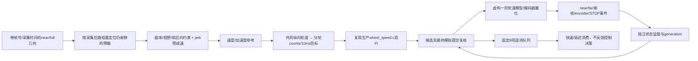
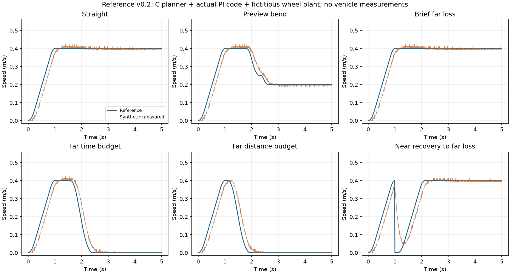
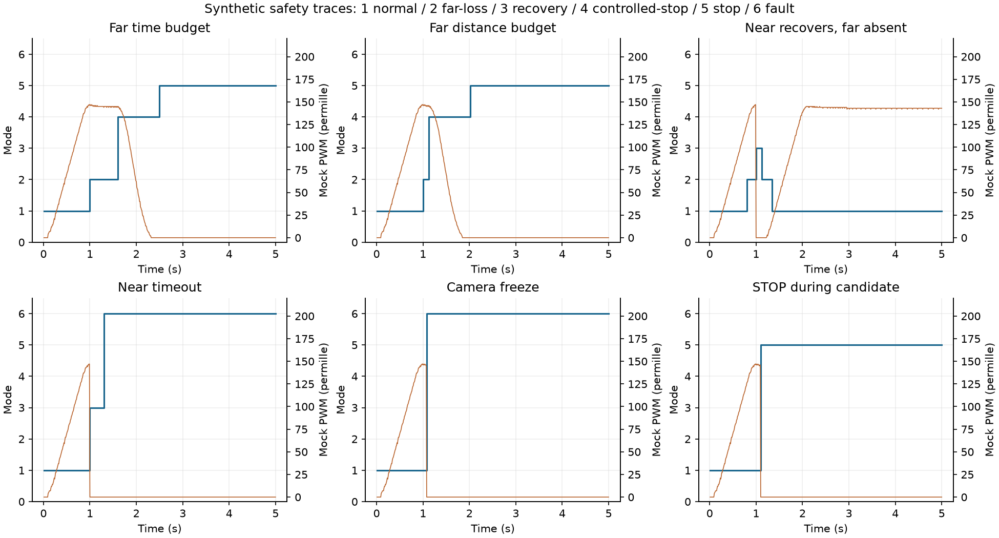

# v0.2 参考参数与双PI联动回放

后续状态：本文为v0.2阶段快照。当前默认回放已升级为[数据入口与v0.3接入](DATA_INPUTS.md)，使用已采用的左右轮CPR，本文1024假设和C0等待不再是当前数据状态；历史图表/数值保留，不作为v0.3结果。原v0.2可通过`--reference profiles/c1-host-reference-v0.2.json`显式选择。

日期：2026-11-06。用户明确允许“未实际给定的也可以根据说明给出参考值”，并表示必要时可申请target测试/烧录。本阶段据此增加**有来源、有假设的工程参考配置**，不把它们称为实测参数。

当前结果：离线组合控制链和ARM对象编译通过；没有修改MIDTERM_C26_31生产源码/宏，没有连接串口、烧录或运行车辆。用户随后告知目标正在进行另一项测试，C0硬件读取等待用户通知，详见 [目标测试范围](TARGET_TEST_REQUEST.md)。

## 1. 本轮具体推进

此前分别测试几何、空间规划、jerk、near/far监督与双轮模型。本轮新增 `tools/speed_planning/pipeline.{h,c}`，把它们与**原样链接的生产 `demo/code/wheel_speed.c`**组合，检查跨模块状态与输出关系。没有复制PI算法，没有另建图像识别器或C26启动器。



这里“最终输出”是Host状态中的模拟PWM提交记录，不是 `vision_actuator.c` 最终硬件writer。外部测试显式完成模拟admission后才arm；没有改真实OFF→ON启动和故障分类，也没有借这个Host入口绕过C26。

## 2. 参考参数及推理依据

完整逐项状态和说明见 [c1-host-reference-v0.2.json](../../../profiles/c1-host-reference-v0.2.json)。原 [C1几何基线](../../reference/C1_VEHICLE_MODEL.md) 中真实CPR/实际轮角/动态测量字段仍为null。

| 参数 | 本轮参考值 | 依据与边界 |
|---|---:|---|
| 最大速度参考 | 0.4m/s | 在假设near距离/规划减速度下，低于计算上限0.45153m/s；非本车实测车速上限 |
| 横向加速度约束 | 0.2m/s² | 设计工况R=.2m时v=.2m/s；非轮胎抓地测量 |
| 加速度上限 | 0.5m/s² | 参考0→.4m/s至少.8s，另计jerk过渡 |
| 空间规划减速度 | 0.4m/s² | 比整形器保留明确0.4m/s²差额；用于本轮跟踪/量化工况，不是已验证安全系数 |
| 整形器最大减速度 | 0.8m/s² | 与规划上限分开；.4m/s匀减速理想距离.1m，不能忽略延迟/jerk或冒充停车距离 |
| 加速/减速jerk | 2 / 3m/s³ | 对应.5/2=.25s加速斜率过渡，.8/3≈.2667s制动斜率过渡 |
| 总延迟参考预算 | .1s | 人工设计预算，不是frame watchdog100ms已经证明的端到端延迟 |
| near/full可信视野 | .35 / 1.5m | 人工米制场景，不是像素到地面的标定结果 |
| 距离余量 | .05m | 设计保留量，不是测量不确定度 |
| near恢复 | 300ms / 5新帧 | 历史任务书候选，仅用于此参考场景 |
| far恢复 | 3新帧 | 本轮迟滞参考，没有错误连续帧分布数据 |
| far累计预算 | 600ms / .24m | 路程参考=.4×.6；两个独立累计，任一先到，非P99统计结果 |
| 受控停止期限 | 2000ms | .4/.8+.8/3+.1+1.0≈1.867s向上取整；1s是仿真余量，不是实测 |
| 编码器条件假设 | 1024 counts/轮 | **仅当**标称1024确实指当前A上升沿的轮端计数且传动比1；尚未确认 |
| PI Kp/Ki Q8 | 256 / 12 | 既有项目参考，未辨识新的米制控制器 |
| 虚构电机模型 | 满PWM3m/s、一阶时间常数.15s；左通道增益.92/右1 | 故意构造左右差异；不来自电机规格、实测或电流/转矩关系 |

名义周长仍是π×.064≈.20106193m；条件ticks/m≈5092.958。该数只存在于明确的参考仿真，不回填真实轮端标定。

按规划减速度a=.4、假设延迟T=.1、可用距离d=.35−.05=.3计算：

\[
v_{near,brake}=\sqrt{(aT)^2+2ad}-aT\approx0.451528m/s.
\]

取当前参考near cap=min(.4,.451528)=.4m/s。直线far失效不会因此单独清零电机，仍受near路径、曲率和独立episode时距预算限制。近场突然不可用则立即抑制目标、PI缓存及模拟最终PWM；两者不同。

## 3. 联动暴露的问题及修正

### 采集到Control的路程不能遗漏

每组近/远场preview保留其capture时刻路程。Control在仍新鲜的同一观测内，按当前路程减capture路程把可见采样前移、裁去已越过的部分，当前点曲率线性插值。不制造新帧号/时间戳，不续frame lease；视野耗尽拒绝。

这不是near-invalid后沿历史路继续驱动：新near-invalid立即进入抑制，旧preview不能授权恢复。缺采集对齐路程、错序/过期几何和米制不合法输入都不能静默代入。

### 规划与整形使用相同制动极限没有误差余量

最初组合试验在量化/跟踪略超参考速度时遇到制动边界不可行。最终配置显式把空间规划减速度设为.4，整形器保留.8的上限，新增可复现测试；没有放宽原断言或隐藏不可行标志。真实误差界和制动能力仍需要C0/C1数据，不能宣称这组差额适用实车。

### 弯前需考虑jerk过渡

只让整形器追当前空间cap会在接近曲率界后才急于减速，造成下冲。新增未来曲率目标触发：从当前a/v估计正加速度消退、制动斜率建立/释放与延迟所需的设计路程，加上 `(v_peak²−v_curve²)/(2a_plan)`，提前把参考目标降到可见曲率目标。

该式是本轮明确假设下的设计提前量，不是未经证明的物理停车上界。可信视野/空间cap仍独立优先；突然出现不可行上限继续上报故障，不靠平滑器保持超限速度。

固定预瞄弯场景现在没有cap override；参考不低于理论弯速−10⁻⁵m/s，正常jerk仍在配置范围，已写入C断言。STOP/near-invalid不受正常jerk约束。

## 4. 候选、PI与遥测边界

- prepare使用PI局部副本；最终模拟commit同时检查session、输出generation、请求版本和encoder样本身份。成功提交使同一候选不能重复提交。
- 同样本的更新请求会拒绝之前候选；STOP插在prepare/commit之间会立即撤销并清缓存；新session拒绝旧候选。新样本积压超过当前消费契约则故障，不用最新测量补演历史PI。
- near恢复期间每轮清零左右目标、PI积分/输出、模拟PWM及时间整形状态；恢复后从零重新爬升，不能提交等待前的缓存。
- 使用共同后轴纵向速度目标、独立counts/m与独立PI。未标定实际前轮角/后轮几何补偿前，不把估算轮距直接写进真实轮速差。
- 固定8项遥测队列满时丢最新样本、计数饱和保护，控制调用只做有界内存复制。没有文件写、flush、SD等待。**这是单owner的Host队列，尚非已验证的ISR/SPSC/FreeRTOS实现。**
- CSV含control时间、frame_seq/capture_ms、encoder序号、原始与有效near/far标志、mode/fault/generation/commit序号、参考/反馈、左右目标/PI积分/模拟PWM、far起点、cap override。它是仿真诊断格式，不冒充现有Recorder已输出新sidecar。

CSV的mode/fault使用 `SP_*` 原型枚举，不能直接按真实串口 `VC_*` 故障bitmap解释；真实固件协议适配尚未接入。

## 5. 场景、结果与可复现命令

每个组合5s、Control10ms、视觉20ms，500个控制样本。12场景×3种条件分辨率因子=36组；每组分别快速消费和延迟消费，合计72个执行场景。3因子.5/1/2同时改变模拟传感器分辨率和控制器换算，**只测试一致尺度下的量化影响，不是CPR错误标定试验，更不是置信区间。**

| 场景 | 因子1的状态时序（ms） |
|---|---|
| 正常直线 / 预瞄弯 | 全程NORMAL；弯速平滑降至约.2m/s |
| 远场短失效 | 1000 DEGRADED →1140 NORMAL |
| far时间先到 | 1000 DEGRADED →1600 CONTROLLED_STOP →2500 STOP |
| far距离先到 | 1000 DEGRADED →1130 CONTROLLED_STOP →2020 STOP |
| near恢复、far仍缺 | 800 DEGRADED →1000 RECOVERY →1120 DEGRADED →1340 NORMAL；near恢复不重置far起点 |
| near持续失效 | 1000 RECOVERY →1300 FAULT |
| 相机不再出帧 | 1080 FAULT（最后新鲜capture980ms，独立100ms截止） |
| encoder冻结 | 1020 FAULT（最后样本990ms，参考30ms截止） |
| STOP交错 | 1100 STOP，旧候选拒绝 |
| preview身份不匹配 | 1000 RECOVERY →1120 NORMAL；raw near仍为真时，有效near可为假 |
| 不可行突发急弯cap | 1000 FAULT；不伪称正常制动可行 |

快速消费周期20ms，最多2项在队列；延迟消费周期300ms，队列达到8项、每个5s场景丢364项。**两种消费模式下的500个完整控制快照hash一致**（含PI/输出/状态，不含队列统计）。这证明本Host实现的数据消费差异未改变控制结果，不证明真实SD阻塞/CPU/总线竞争已经隔离。

因子1，直线2–5s活动样本的**仿真**tracking RMSE约.00659m/s，预瞄弯约.01869m/s。分母是活动NORMAL/DEGRADED且时间≥2s的样本，不与停车或恢复段混算。反馈来自虚构轮模型，不能发布为实车跟踪精度。near-invalid图中仍有合成惯性速度而PWM已零，也不能把零PWM称作实际停稳。





```powershell
# 已有GCC，纯Host；输出完整CSV、队列实验及replay-report.json。
python tools/speed_planning/replay.py --output .build/planning-pipeline-20261106/example

# 同样Host回放，再编译ARM可重定位对象；不生成/下载运行固件。
python tools/speed_planning/replay.py `
  --output .build/planning-pipeline-20261106/example-target `
  --arm-bin E:/ElecTronic/Keil/ARM/ARMCLANG/bin

# 集成到已有共享入口，使用其明确选择的编译器/mode。
pwsh -NoProfile -File tools/testing/Invoke-TestPlan.ps1 `
  -Suite speed-planning-host,c26-baseline-characterization,speed-group -Compiler gcc -Jobs 2
```

最终Host运行 `20261105T215858-ad14ab2ba0`：18个Python测试，原规划C104496次CHECK；组合回放3因子分别37816/37814/37810次CHECK。重复循环/计数不是独立功能用例数。此前本轮关联运行 `20261105T215310-5b3d061975` 的C26现状、encoder-board、speed及前置/aggregate共7节点PASS。完整Host原有其他构型失败未在本轮修复，也未宣称全绿。

## 6. target对象证据与下一步

ARMCLANG Cortex-M7/fpv5-d16/hard-float/O2编译 `pipeline.c`、`speed_planner.c` 和原 `wheel_speed.c`，0编译错误/警告；对象Code分别4074/6350/526字节，RO分别88/80/32，RW/ZI均0。内存状态由调用者分配，不是“没有RAM需求”。`-fstack-usage`自身栈帧和对象哈希见 [本阶段机器证据](reference-pipeline-evidence.json)。自身栈不含全部callee/libm/中断叠加，没有MCU WCET结论。

这些是可重定位对象，**未链接进MIDTERM_C26_31 AXF，没有可直接烧录的新实验固件**，不把对象编译称为目标闭环测试或固件发布。

下一实际数据依赖是C0轮端CPR/周长/实际舵机角，以及真实相机地面/速度响应/制动数据。已准备停机与状态读取的具体申请；用户要求先等待另一项测试完成，故不占串口、不烧录。后续如需烧录会先准备独立构型、功能/安全回归及具体产物哈希再申请，不覆盖主线已成功启动路径。

本轮读取层：现有C/Markdown原生阅读；JSON/CSV为structured_parsed，公式、C/Python回放、hash/ARM对象为computed；原图几何来源沿用C1基线的原图核验，没有新物理实测或pdf_verified内容。工作区并行B3文档/工具改动单列记录，不算本任务diff。
