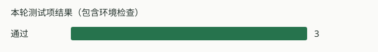

# 回归报告

**软件测试：通过；场景验收：未执行；命令结果：通过。** 软件检查和场景验收分别记录，场景结论仅限本轮声明的检查范围。
测试时间：2026-11-11 23:55:38（北京时间）；总耗时 13.1 秒。

| 检查内容 | 本轮结果 |
| --- | --- |
| 运行环境 | 通过 |
| 编译环境 | 通过 |
| minimal-track | 通过 |

## 场景验收与放行判断

| 场景检查 | 本轮验收状态 | 原因 |
| --- | --- | --- |
| 连续米制环岛场景（合成回放） | 未执行 | 本轮未执行该场景检查。；无可用验收证据 |

本轮软件范围放行资格（releaseEligible）：未满足。该字段不授予烧录或真实电机运行权限。
未执行的检查不继承历史结果；普通回归可单独验证软件，显式要求场景验收时，未就绪、未执行或证据错误都会使命令未通过。

## 验证范围

结论仅适用于上表列出的项目。未执行的测试、板端时序和实车行驶不能视为通过。
版本：`1cae353a1b13`；工作区含未提交改动；工具：`gcc` / `optimized`。

[完整测试明细](summary.md) · [原始结果与执行参数](run.json) · [环境记录](environment.json)
