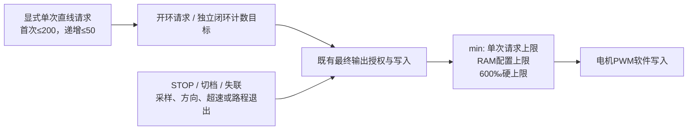

# 速度响应与450档测量候选：已构建，尚未烧录

2026-11-09。版本 **PHASE2_SPEED_RESPONSE_20261109_1** 已烧录，Keil Programming Done / Verify OK；首次无运行回复，用户RST后COM14/115200准确版本、USB所有权、OFF/OBSERVE及空缓存确认。已一次性恢复静止RAM配置：cruise=0、cap=0.6、balance=1/1、方向1/1、编码器符号-1/+1、中位1550µs；speed_mode=0。**尚未发送运动命令，未取得新运动数据，生产参数未批准。** 下文构建准备及“未烧录”描述为此前时点，当前状态以本段及候选JSON为准。

[返回工作包](README.md) · [候选清单与SHA256](speed-response-candidate.json) · [前一项离线回归](VISUAL_SUPERVISOR_REPLAY.md)

## 本次用户明确的参数含义

| 项目 | 采用值 | 不应如何解释 |
| --- | --- | --- |
| 直线最快参考档 | 请求450‰ | 不是450mm/s、0.45m/s，也不是450‰前馈或最低输出 |
| 最终电机PWM硬上限 | 600‰，即驱动单位6000/10000 | 不代表每次试验都允许输出到600‰ |
| 450档实际车速 | 未测 | 不用PWM比例推导速度，不填入生产速度模型 |
| 首次单次请求上限 | 200‰ | 首先验证新候选的接线与限幅；不是450档已验收 |
| 同一开机会话上升步长 | 最多50‰ | 不是自动连续扫描授权；每点导出后再明确继续 |

本轮只制作独立标定候选，主工程巡航/规划参数未改。诊断配置的`cruise=0`保留，450是后续显式直线请求档，开机、拨码或看到赛道不会自动发车。

## 两种模式，目标与输出分别记录

| 模式 | 请求档含义 | 配置与记录 |
| --- | --- | --- |
| 开环档位测量，speed_mode=0 | ramp后PWM请求上限；用来测200→…→450的轮速与起步 | 原始/累计编码器、真实采样间隔和软件最终PWM写入；PI目标字段不代表速度命令 |
| 闭环响应，speed_mode=1 | 单次输出上限；速度目标由独立max_ticks指定 | 满斜坡目标=max_ticks counts/10ms，记录目标、反馈、积分、消费样本身份和最终PWM；前馈保持0，允许输出降到0 |

例如闭环`max_ticks=23`按工作尺度左11394/右11389 counts/m换算约0.202m/s，仅是低速测试参考，不是450档车速，也不是生产批准值。配置范围限定max_ticks≤60、kp≤5、ki≤0.2；示例kp=2、ki=0.1，Q8实际为512/25，ki实际25/256≈0.09765625。左右尺度分别保留，暂以同一整数计数目标做基础响应，不宣称完全相同米制轮速或已标定差速几何。

## 独立限幅和停机路径



| 边界 | 实现与限制 |
| --- | --- |
| 动作类型 | 仅显式直线，舵机保持配置中位；独立舵机/单轮probe、倒车、shuttle、circle、视觉arm均拒绝 |
| 请求/最终输出 | 请求≤600‰，首次≤200‰、后续上升≤50‰；最终电机输出独立限制为min(单次请求、RAM cap、600‰)，闭环PI同样受单次请求约束 |
| 斜坡/时长 | 请求斜坡300‰/s，替代旧100‰/s；200ms零电机转向预置，直线驱动最长3000ms；闭环斜坡作用于计数目标，不能当作实际PWM变化率保证 |
| 通信/拨码 | 保留500ms失联停机与模式切换停机；客户端每50ms发送心跳，不放宽板端门槛 |
| 新动作准入 | 已确认方向/编码器符号，最新计数年龄≤20ms、两路原始归一化计数在±1内，既有档位/配置/故障门通过；小计数不独立证明机械停稳 |
| 采样/PI | 10ms标称采样；新样本只消费一次，积压/过期/控制卡顿保持原失败停机；未改变主工程PI算法 |
| 独立方向/无计数保护 | 开闭环都检查持续明显反向计数；开环请求已到180‰且持续50个样本无计数时退出；闭环保留按实际PI输出判断的原无计数保护 |
| 超速参考退出 | 任一轮归一化前进计数>120 counts/10ms触发fault_detail=12；按候选尺度约1.05m/s，属于未批准的软件试验包络 |
| 轮端路程退出 | 自动作准入累计绝对计数左≥11394或右≥11389即撤输出，motion reason=12；约1m候选轮端尺度，不是地面实际1m或总停车距离 |
| 冻结与重启 | 停止后继续采2秒；640条容量，冻结未释放时不接受新动作。导出默认不释放，下一点须用同generation及CRC核对过的完整文件显式释放 |

600‰和450‰均高于既有最高200‰现场数据范围，尚无对应电池、地面或载荷下的车速/停车边界。先架空逐点核对；450仅是目标档，不承诺在其他保护条件触发前一定达到或保持。保护触发应照实导出，不放宽保护来完成档位数字。

## 工程与镜像

- 构建：`C:\shengchanli\smartCar\smartcar\.build\phase2-calibration-20261108\speed-response-20261109_1-release\speed_response.uvprojx`
- 专用下载：`C:\shengchanli\smartCar\smartcar\.build\phase2-calibration-20261108\speed-response-20261109_1-release\speed_response_download.uvprojx`
- AXF：同目录`Objects\phase2_speed_response.axf`
- SHA256：`f3c79ad0c60d1ba1033f08e765d9ff58016b10f9482c5e5324543def17d261a1`
- USB UART1及无线UART8均115200/8N1；与前一静止视觉版本COM14/921600不同，换烧后按新波特率核对。

构建工程关闭调试前下载开关及原构建钩子；专用下载工程保留显式下载配置。生成脚本只创建新目录，不调用烧录器。Keil 0错误0警告，Code73192、RO12792、RW212、ZI175336字节；不以纯构建代替目标板运行验证。

最初私有生成遇到CRLF锚点不匹配；首轮编译缺蜂鸣器头文件声明。已修正，最终发布目录为上述`-release`，早期中间目录不用于下载。完整来源和更改哈希见候选清单；[冻结证据](evidence/speed-response-candidate/candidate.json)保存81个私有源码/头文件、项目、工具、Host输出及[文件哈希](evidence/speed-response-candidate/sha256.json)。生成源来自当前仓库，不依赖此前`.build`诊断源码作为唯一输入。

## 同源记录能证明什么

每条采样22字段：时间/样本号、左右原始计数和累计计数、软件最终PWM、运动phase/reason、实际采样间隔、已发布PI状态的消费样本号和时刻、左右目标/反馈/积分、故障与闭环启用标志。准入时另外冻结10字段配置：请求、时长、RAM cap、max_ticks、kp/ki Q8、两路符号、闭环模式及舵机中位；**CRC覆盖配置及全部采样字段**。

采样行在ISR读编码器后、当样本的前台PI计算之前生成，因此同一行的held PI通常来自前一消费样本。`control_seq/control_ms`用于配对，不能把这一行所有列都解释为同一瞬时计算结果。STOP/重置发布零目标和积分时，control_ms可表示该重置时刻；开放环的PI字段不用于反馈性能计算。故障在该次采样保护检查后触发时，行中的故障字段可能下一样本才体现；首个零写入另有stop_ms。

第0行是准入种子，interval=0、raw=0，不是新增硬件测量；随后使用累计计数差与实际interval重算速度/路程，保留原归一化10ms计数的量化限制。软件PWM不是示波器测得的生效输出；2秒尾部完整也不自动证明机械停稳。若尾部仍有计数，记录停止过程被截断。

协议：`@response_info`、`@response_config`、`@response_row index`、`@response_release generation`、`@response_beep`。冻结配置及每行整数按固定字段序列转为小端uint32求CRC32；有符号值使用二补码。行传输为22个8位十六进制字，避免C结构体padding/主机格式差异。老`STOP_INFO/STOP_ROW`导出器不适用于本版。

## 本地检查与复现

私有真实运动/速度/最终写入/解析模块和既有PI在模拟计时器、编码器和PWM下通过14414次断言。覆盖首次/步进/类型/期限拒绝、600‰实际输出到界及601‰拒绝、较低单次200‰下PI饱和受限、STOP、心跳、切档、反向/无计数、采样/控制卡顿、超速、路程退出、冻结和generation释放。为直接检查600上界，Host测试显式设置“此前已到550”的测试状态；现场串口不能绕过实际步进准入。

原生C冻结451行记录及配置，Python复算CRC通过，并校验2秒尾部。8项Python检查覆盖CRC/配置篡改、单次与绝对上限、未来控制身份、间隙/尾部、未冻结拒绝及客户端默认不连接串口。此次未增加统一catalog套件，未运行远程CI或完整Host矩阵；以上不能计入新增整车通过数。

```powershell
# 新目录生成，只准备，不构建或烧录。
python tools/prepare_phase2_response.py `
  --output .build/phase2-calibration-20261108/response-new

# 编译真实私有适配器并检查C原生记录，无设备访问。
python tools/check_phase2_response.py `
  --candidate .build/phase2-calibration-20261108/response-new `
  --compiler 'C:/Program Files/mingw64/bin/gcc.exe'
python tests/planning/test_speed_response_export.py

# 仅打印计划，默认不连接串口，不发动作。
python -m tools.speed_planning.run_speed_response --request 450 --duration 1500 --mode open
```

## 现场顺序与执行工具

1. 先驱动电机断电、两拨码OFF、接下载器；换烧后报告版本、Verify及实际运行身份。本版已完成烧录及RST后身份核对，尚待架空动力就绪。
2. 配置仅在RAM一次恢复：关闭自动启动、中位1550/范围1430—1670/sign=-1、motor_dir=1/1、balance=1/1、raw符号-1/+1、cruise=0、cap=0.6。闭环配置独立设置max_ticks；开环测档不据此推定车速。
3. 车可靠架空、人员离开轮/连杆，操作人可切断动力；现场就绪后只执行一次200‰/1000ms开环新候选核对。客户端必须显式`--execute --bench-ready`，命令只发一次，不自动重试或扫描。
4. 停止后导出完整配置/轨迹并核验；保留主控供电。观察双轮方向及停稳，审核故障、限幅、尾部后，明确下一点及释放上一记录。200→250→300→350→400→450是候选顺序，保护触发则停止推进。
5. 450档轮速取得后，独立选择闭环计数目标和单次输出上限，检查目标/反馈/积分/饱和及停车过程；架空结果不直接作为落地速度模型。落地前重新审查场地、实际电池状态和已测停车余量。

实际单次动作工具为`tools/speed_planning/run_speed_response.py`，默认dry-run，首次换烧后可用`--configure`一次恢复RAM。每次读取准确版本和配置；没有显式执行及架空就绪标志不会打开端口。心跳50ms，客户端结束时STOP；状态ACK不代替编码器和操作者物理观察。

只读导出（先发STOP，不发送动作或自动释放）：

```powershell
python -m tools.speed_planning.export_speed_response `
  --port COM10 --output .build/phase2-calibration-20261108/response-export-new
```

下一单次可用`--release-verified <上一完整trace.json>`：工具先复算上一文件的配置及行CRC，再与板端当前冻结generation/count/CRC逐项核对后显式释放。不同会话、缺行或配置改变均不自动清除；异常或复位后重新确认，不能用旧文件冒认新缓存。

证据层：C/原生Markdown直接核查，项目XML、JSON、CSV和协议为structured_parsed；构建、Host断言、整数编码、CRC及哈希为computed。无仅md_extracted关键数据或新增pdf_verified结论。未测硬件输出、450/600档车速、真实电池电压、载荷/地面覆盖和目标板调度是当前主要限制。


## 2026-11-09 架空首点200‰/1000ms

操作者确认架空动力就绪后，COM14执行一次开环200‰/1000ms，未加档、未重试。板端gen=1，start_ms=240791，stop_ms=241991（含200ms预置），reason=1正常到时。321条记录及冻结配置CRC通过、停止后采满2000ms，软件最终PWM峰值2000/10000；左右累计计数增量均0，原始计数全程0、记录故障0。原始动作/导出日志及分析见[首点证据](evidence/speed-response-bench200-01/review.json)。实际转动、停稳和该次电机供电等待操作者确认，不把软件写入称为物理驱动通过。记录保持冻结，未释放，不自动重试或加档。数据为structured_parsed，CRC/计数核对为computed，尚无该次物理动作结论。


## 2026-11-09 供电反馈、重启与200‰延长点

用户确认首点两轮未转、电机电源开启。随后计划250‰/1500ms，第一次在USB所有权申请被拒绝（仅STOP/x发送，未发运动）；第二次核对冻结信息发现gen=0/count=0、板端uptime约38秒，旧缓存/RAM/步进状态已不在，未发250‰。重启原因及用户具体操作尚未确认，不归因于固件或供电。首次321条原数据已存档，不受缓存丢失影响。

恢复一次RAM配置后执行200‰/1500ms，板端左轮无计数保护detail=11、fault=256触发，motion reason=5退出。331条记录CRC通过，停止后2000ms尾部完整，左右累计计数仍0，软件PWM峰值200‰。该次物理反馈待确认；不自动加档。见[完整记录及异常日志](evidence/speed-response-bench200-1500/review.json)。

客户端修正：申请所有权前等待STOP应答；显式释放后按recording/frozen判断可启动，不要求保留的历史count清零。解码器修正准入种子与首个真实采样的相位差：本轮种子到下一采样6ms，而采样窗口10ms，允许首间隔短于真实采样窗口；其后严格检查时间差等于interval。原失败导出字节保留，修正后只读重新导出同一冻结记录、CRC及最终信息一致通过。9项离线导出/客户端检查通过，未改板端镜像、保护或阈值。

当前等待该次轮转和复位/逻辑供电反馈；新450档及闭环响应仍未取得。软件写入PWM和两个零计数不能单独区分电机未起转、动力链路或实际电气输出问题，不从该现象直接推导速度模型。


**现场反馈已补齐：** 用户确认中间做过手动复位，故RAM/步进状态重置不登记为固件自行重启；最近200‰/1500ms也确认两轮均未转。保留两条200‰无响应与完整采集事实。下一项候选为250‰/1500ms单次，先确认当前架空状态，再显式清除已记录故障并释放已核验缓存，不要求再次RST、不放宽原保护。


## 2026-11-09 架空250‰单点

用户确认250架空动力就绪后，先在停机状态显式c清除旧故障、speed_mode=0核对faults=0；按已核验文件匹配gen/count/CRC释放上一冻结记录。只发送一次250‰/1500ms，未复位、未换烧、未自动加档。

gen=2记录331行，配置与原始行CRC及最终冻结信息一致通过，停止后采满2000ms；软件PWM峰值2500/10000，左右累计计数均0。记录fault=256/detail=11（左轮无计数），不是正常到时完成。首个零写入发生于start后1291ms，info.reason=0：速度故障先调用输出零写入，后续运动取消才发布reason=5；因此首零reason0不能解释为无故障。完整故障/运动字段均保留，见[250单点证据](evidence/speed-response-bench250-01/review.json)。这暴露记录事件顺序的限制，本轮未修改板端镜像。

当前暂停加到300‰，等待现场两轮转动/停稳反馈及可用的驱动输入电压信息；继续核对软件输出路径。软件PWM写入、零计数与ACK本身不独立证明电机端真实PWM或动力供电。450档及新闭环实车响应仍未取得。


## 电池不足反馈与下一对照

250‰试验后用户报告“电池电压不够了，现在重新搞了”。登记为用户确认的供电不足及已处理，不填造电压、处理方式或逐次试验电压。此前200/250无响应原始记录、软件PWM写入和无计数停机事实保留，但不用于核定可靠起步阈值，也不能仅凭这条反馈断言唯一根因已独立验证。下一项先做恢复电源后的同参数250‰/1500ms单次架空对照，等待操作者确认架空状态及主控是否复位；如已复位，保留首点≤200‰门槛，不绕过步进。当前未发新动作、不升档。


## 电源处理后复位及200‰对照

用户确认电池已处理、已复位并架空就绪。恢复RAM后执行一次200‰/1500ms开环动作，不直接跳到250‰。记录307行及配置CRC通过、停止后2000ms尾部完整，软件PWM峰值200‰。左累计-2857、右+177，raw左范围-121—5、右-14—20；按符号-1/+1，左轮单样本前进121counts/10ms超过候选120门槛，fault=256/detail=12，动作准入后1053ms首个零写入。info.reason=0仍是速度故障先零写入、运动取消后更新原因的既知事件顺序限制，不能据此判断正常结束。

最后5条左右raw均0，尚不单独证明机械停稳；现场左右转动、方向、停稳和异响反馈待确认。原始动作/导出日志、触发样本与核定见[恢复电源后200证据](evidence/speed-response-battery-restored200-01/review.json)。恢复供电后出现编码器响应，与此前全0不同；但两路明显不一致，未取得输入电压，复位/重新配置同时发生，不把改善归为已隔离验证的唯一原因。当前暂停升档，不提高保护阈值。


## 首次闭环200与250上限对照

用户确认架空停稳就绪后，以目标23counts/10ms、kpQ8=512/kiQ8=25、零前馈执行200‰上限/1500ms。372行配置及采样CRC通过，reason=1正常到时，停止后2007ms；左右累计-1615/+10。末段左反馈22—24、软件PWM约107—111‰，右反馈0—1且软件PWM到200‰上限。用户报告右轮几乎不转、方向向前；随后下一轮就绪确认停稳。证明左右PI输出会按反馈区别调整，但右轮未跟踪目标，不能称闭环性能通过。见[闭环200完整记录](evidence/speed-response-closed200-01/review.json)。

下一轮仅把单次上限升到250‰，目标仍23、1500ms；307行CRC通过、停止后2007ms。实际提前因fault256/detail8（右轮反向）退出；左右累计-107/+19。退出前右轮反馈连续出现-2counts/10ms；右PWM峰值135‰、左119‰，尚未到250‰上限，目标最高22，未到完整目标平台。因此不得将该轮当成250‰起步阈值试验或推导250档稳态速度。info.reason0仍是故障零写入先于motion取消的记录顺序限制。最后5条原始计数均0，机械停稳等待操作者反馈。见[闭环250记录](evidence/speed-response-closed250-01/review.json)。

两轮均没有换烧或改变反向保护。当前暂停动作，先核对右轮肉眼方向/起步抖动和计数符号一致性，不放宽反向门槛来追求250或450档。450最快参考档及600硬限仍只是用户指定候选范围，不是实测速度能力。


## 闭环250上限同参数复测

前次detail8右轮反向计数保护的物理方向未被操作者注意，用户要求复测。停机状态清除旧故障、核验并释放上次完整缓存后，只执行一次同参数：目标23counts/10ms、PWM单次上限250‰、1500ms、kpQ8=512/kiQ8=25、零前馈，未改变反向保护。

本次gen5，start359191ms、stop360891ms，reason1正常到时，371行配置/采样CRC及最终冻结信息一致通过，停止后2000ms。左累计-1461、右+1054，软件PWM峰值右176‰/左169‰，未到单次250‰上限；fault/detail全0。操作者报告“没有[倒转]，几乎和左轮一致速度向前”。记录支持本轮双轮前向响应，不能因此排除上次计数反向或直接归为误报；上次结果仍保留。

末段10个held PI反馈样本右20—28、左22—33，目标23，仍有超调/波动；全程峰值右28、左36。动作含起步斜坡，短段两轮累计不等，不把现场“几乎一致”改写成精确等速或稳态性能通过。按control_seq去重、以control_ms选末300ms的描述性误差见[本轮分析](evidence/speed-response-closed250-02/review.json)，不将单条误差指标用于生产调参结论。末5条原始计数均0，机械停稳尚未另行明确确认。

当前不追加同参数重复、不升档；离线比较三条闭环的起步、饱和、方向与反馈过程。450档实际速度、闭环稳定性、真实落地模型及停车边界仍未验收。


## 闭环250上限、3000ms延长观察

用户要求观察时间更长并确认就绪后，驱动期限由1500ms改为固件当前上限3000ms，保留目标23counts/10ms、PWM单次上限250‰、kpQ8=512/kiQ8=25、零前馈及全部保护；未换烧。核验并释放上次记录后只执行一次。

本次gen6，start770268ms、stop773468ms（含200ms预置），reason1正常到时，无fault/detail。522行配置/采样CRC及最终冻结信息一致通过，停止后2003ms；左右raw累计-4999/+4599，软件PWM峰值右164‰、左142‰。用户确认“两轮持续向前，停稳，正常”，最后5条raw左右均0。现场正常及停稳可在本轮范围内确认；不扩大为速度稳定性或落地验收。

295个非零目标控制反馈与源样本匹配；目标0阶段1条旧held反馈残值仍单独排除，原因同[离线比较](CLOSED_RESPONSE_REVIEW.md)。末300ms目标23、29个去重样本：左反馈18—29、均值24.103、RMSE3.162；右反馈14—28、均值21.655、RMSE4.004，单位均counts/10ms。各14/29样本在目标±2计数内。PWM未到上限但仍有波动，不将增加上限视为改善该波动的依据，不把短段统计当成稳定性放行。

完整原始日志、轨迹、对齐CSV和机器结果见[3000ms记录](evidence/speed-response-closed250-3000-01/review.json)。按候选尺度，23目标约0.202m/s；这是计数换算而非独立地面速度。450档对应车速仍未测、生产参数未批准。下一步离线分析反馈波动与PI输出、采样/机械及未测电压的关系，准备单一变量参数对照，不自动调参或继续发车。


**积分A-B-A对照已完成：** Ki请求0.05的353行故障退出后，恢复0.1（Q8=25）无需RST；3000ms基线复测正常到时、无故障，522条CRC通过、PWM峰值163‰，用户确认一切正常。冻结配置与原基线相同，保留原Ki，不批准低Ki候选。详细比较、种子1ms时间边界及原始证据见[积分对照结果](CLOSED_GAIN_CONTRAST.md)。


## 闭环目标30计数单点

操作者确认架空停稳就绪后，只将目标从23升至30counts/10ms，保持Kp2/Ki请求0.1（Q8=512/25）、250‰单次PWM上限、3000ms与原保护；没有RST或换烧。冻结配置与上一23目标基线逐字段比较，唯一变化为maximumTargetTicks10ms=23→30。

本次gen9，start1365152ms、stop1368352ms，reason1正常到时，fault/detail全0，522行配置/采样CRC及最终冻结信息一致通过；停止后2009ms，软件PWM峰值158‰，左右raw累计-6766/+6420，最后5条raw均0。用户确认“一切正常”（针对双轮持续向前、无异响且停稳的询问）。见[30目标原始与分析](evidence/speed-response-target30-01/review.json)。

296个非零目标held控制状态与源计数匹配，1条目标0旧反馈排除。末300ms29个去重样本：左均值30.241、范围25—37、RMSE3.644；右均值30.586、范围23—35、RMSE3.378，单位counts/10ms。目标±2内左8/29、右12/29。按工作候选尺度，目标30约0.263m/s；这不是独立地面实测速率。均值接近目标、未到输出上限，仍不等于瞬时波动或落地稳定性通过。

当前在相同PI下已取得23和30两个架空目标的正常3000ms记录；低Ki失败、反向计数故障和电池不足轮次仍保留。下一项可准备40counts/10ms目标的受限单点或安排落地低速验证，但需另行确认现场及评价范围，不自动升档或把450档对应车速填为已标定。


## 闭环目标40计数单点

用户确认架空、停稳、动力开启且未复位后，只将目标30→40counts/10ms；保持Kp2/Ki0.1（Q8=512/25）、单次PWM上限250‰、3000ms及全部保护。冻结配置与30点逐字段核验，唯一变化为maximumTargetTicks10ms。

本轮gen10，start1590013ms、stop1593213ms，reason1正常到时，fault/detail全0；522条配置/采样CRC及最终冻结信息一致通过，停止后2008ms。左右raw累计-9440/+9092，软件PWM峰值157‰，最后5条raw均0；用户针对双轮向前、无异响及停稳确认“一切正常”。原始及核定见[40目标证据](evidence/speed-response-target40-01/review.json)。

297个非零目标held控制反馈正确匹配，目标0旧残值1条排除；末300ms29个去重样本左均值39.793、范围34—47、RMSE3.714，右均值40.931、范围33—47、RMSE3.926，单位counts/10ms。目标±2内左13/29、右11/29。按候选尺度，40约0.351m/s，属于轮端计数换算，不是独立地面速度。

本轮仅确认这个架空目标点的正常动作、记录和停稳；仍有瞬时波动，不宣称最终稳定性通过。当前23、30、40三个架空正常目标点均有完整记录，但各为有限场次，电压未同步测量，不能由不同目标的PWM峰值反推固定PWM→车速模型。450请求档实际车速未测、600硬限未作为实车输出能力验收。下一步应先汇总目标响应包络和保护余量，再选择更高目标或落地低速验证，不自动追加动作。


## 首轮闭环落地：COM10无线准备

用户指定COM10无线继续。115200只读/停机核对已确认PHASE2_SPEED_RESPONSE_20261109_1、port=radio/owner=radio，RAM硬件配置保留，速度环启用、max_ticks仍为上一40点、Kp2/Ki实际0.0977、faults0，软件PWM0。gen10的522行40目标缓存仍冻结，尚未释放。反馈列42/38是停机后held历史值，不是当前实时轮速。原始查询见[无线预检](evidence/radio-ground-precheck01/precheck.json)。

下一项准备落地目标23、PWM单次上限250‰、1500ms，执行前串口设置目标并回读，匹配已存档40点后才释放其缓存；不换烧、不RST。当前等待操作者明确落地摆放就绪，未发送运动命令。场地沿用此前3m×45cm的待确认条件，前轮中位、无主动视觉转向；该候选是速度诊断，不能把当前画面或ready字段当作视觉循迹准入。


## 首次无线闭环落地实测（目测位移）

用户指定COM10并确认落地就绪后，原250‰计划在读取缓存时发现gen0/count0、运行时间约24秒；该次日志仅STOP/所有权/版本/缓存查询，没有运动命令。记录为主控重启迹象，原因未另行确认。恢复RAM并遵守首次≤200‰门槛后，实际仅执行200‰上限、目标23counts/10ms、Kp2/Ki0.1、1500ms闭环单次，没有绕过门槛直接执行250。

本轮gen1，start44067ms、stop45767ms，reason1正常到时，fault/detail全0。372条配置/采样CRC及最终冻结信息通过，停止后2004ms；左右原始累计-851/+854，软件PWM两路峰值均200‰，尾部5条raw均0。按工作候选尺度左11394/右11389counts/m换算，轮端分别约74.69/74.99mm，不能称为独立地面位移。

用户回复“50;0;无”，随后明确“我是估测的”：登记前移约50mm、横移目测约0mm、无异常报告，方法为目测估计，未给量具或误差范围。不得写成精确尺测50mm/0mm；也不能用轮端约75与目测约50的差值标定尺度、证明滑移或修改CPR。机械停稳没有单独明确答复；尾部计数归零只作计数事实，后续动作仍需现场停稳就绪确认。

146个正目标控制状态匹配源样本，末300ms29个样本左均值14.862、范围11—22，右均值15.103、范围12—19，目标均23。两轮平均反馈未跟上目标，本轮不能验收负载闭环跟踪；短动作、输出限幅与起步过程仍需区分。原始查询失败、实际动作、完整记录和估测标签见[落地首轮证据](evidence/speed-response-ground23-01/review.json)。

下一步可在相同目标/PI/1500ms下提高单次输出上限到250‰，检验输出余量；需另行确认停稳、场地和动力条件，保留主控供电。新的实际位移若仅能估测继续标为估计，不要求用目测值强行做计数尺度核定。当前不自动追加动作、不升目标。


## 无线落地250‰上限、目标23

用户确认落地就绪后，COM10核验并释放上一200上限完整缓存，执行一次目标23、PWM单次上限250‰、1500ms，KpQ8=512/kiQ8=25及保护不变，未换烧/复位。冻结配置唯一差异为requestPermille200→250。

本轮gen2，start206540ms、stop208240ms，reason1正常到时，fault/detail全0，372条配置/采样CRC及最终信息一致通过；停止后2001ms。左右raw累计-1134/+1117，候选轮端约99.53/98.08mm，软件PWM峰值右186‰/左184‰，没有达到250‰；最后5条raw均0。实际位移和物理停稳/异常反馈待用户确认。原始及分析见[250落地记录](evidence/speed-response-ground23-cap250-01/review.json)。

145个非零目标控制反馈与源样本匹配，1条目标0旧held残值排除。末300ms29样本左均值16.172、范围11—25、RMSE7.719；右均值16.862、范围12—22、RMSE7.139，目标均23，仍未充分跟踪。不能称负载稳定性通过，亦不能因累计较上轮增加就认定“提高输出上限”是唯一原因。

实现细节修正：诊断闭环目标=当前斜坡请求×max_ticks/本次request，斜坡为300‰/s。request从200改250，除了最终努力上限，达到完整23目标的名义斜坡时间也由约667ms延至833ms；因此这不是纯粹独立改变最终PWM限幅的对照。两次冻结配置差异虽只有一字段，物理效应不止一项。当前软件写入未触及250上限，先分析起步/后段时窗，不通过盲目加档代替跟踪分析。此前“仅提高上限”的操作简述应结合该实现限制理解。

首轮50mm/横移0为用户明确的目测估计，仍不得用于校准尺度或断言本轮真实位移；本轮未取得尺测结果前也不把约99mm轮端换算称作地面实际位移。当前没有发送后续动作。


**250落地尺测已补齐：** 用户回复“75.7;-2;无(尺测)”，登记后轴中心前移75.7mm、横移-2mm（左移2mm），无异常，方法为尺测但量具型号/读数不确定度未提供。候选轮端左99.53/右98.08mm相对前移分别多约23.83/22.38mm。该差异保留，不能用一条约76mm的短行程更改11394/11389counts/m或证明具体滑移原因；起步/停车、实际滚动尺度、参考点和测距不确定度尚未独立分离。前一200上限的约50mm仍为目测，不能混入尺测重复统计。原始观察与差值见[evidence/speed-response-ground23-cap250-01/review.json](evidence/speed-response-ground23-cap250-01/review.json)。当前未发新动作。


## 落地2500ms尝试：无线心跳超时

用户确认就绪，COM10只执行一次目标23、PWM上限250‰、2500ms，Kp2/Ki0.1不变。gen3，start433090ms、stop434025ms，reason3（心跳超时）于准入后935ms撤输出，未完成2500ms。296行配置/采样CRC及最终冻结信息通过，停止后2006ms；左右raw累计-1/+4，软件PWM峰值105‰，fault/detail字段0不表示动作正常到时。完整记录见[本轮证据](evidence/speed-response-ground23-2500-01/review.json)。

主机动作日志47条h CR LF，主机发送间最大约72.997ms，不能据此证明无线或板端连续收到心跳。动作ACK及停止遥测明确存在，不归为动作未发送；尚无定位丢包/干扰/所有权变化的板端逐字节接收证据。保护门槛500ms保持，不自动重试、不放宽期限。当前核对现场停稳、有线是否连接及其他串口发送者，再安排无运动通信检查。该轮不用于长时负载跟踪或地面位移模型。


## 无线停机心跳核对01

用户确认上一超时轮未移动、COM14有线未接、没有其他收发者。随后COM10执行停机/版本/所有权查询，再做约6秒有限心跳发送，没有运动命令、未清除或释放冻结记录。100条h CR LF共300字节，板端rx20529→20832（增加303，含一次x CR LF查询），owner始终radio；overflow/errors/tx_rejected均0。主机最大心跳发送间隔80.0233ms。原始字节及统计见[无线静止核对](evidence/radio-heartbeat-static01/review.json)。

该结果与本窗口字节总量匹配，不证明每个h均被应用解析，也没有板端逐条心跳接收时间；无法由此排除上轮瞬时无线延迟/丢包、带动力电磁干扰、位置变化或其他尚未测得因素。不能宣布reason3根因已修复。源码核对显示心跳只有在当前所有者端且不处于字段行丢弃状态时才能进入运动心跳更新；现有记录未给出故障时的解析器状态。500ms期限保持，当前不改固件。

下一步可在重新确认落地停稳与场地条件后，只复测一次同参数目标23、250‰上限、2500ms；遇再次超时则停止重复动作，转为带板端心跳时序/解析状态的诊断方案。不得通过扩大watchdog掩盖通信缺口。


## 无线2500ms同参数复测：正常完成，末段超调

用户确认落地停稳和场地/动力条件后，只复测一次目标23、PWM上限250‰、2500ms，Kp2/Ki0.1、500ms心跳保护均不变，COM10无线。核验并释放上一reason3完整缓存，未RST或换烧。

本次gen4，start863468ms、stop866168ms，reason1正常到时，fault/detail全0。472条配置/采样CRC及最终冻结信息一致通过，停止后2003ms。左右raw累计-4112/+4082，软件PWM峰值212‰，最后5条raw均0。用户针对尺测和停稳询问回复“380;0;无 一切正常”，登记前移380mm、横移0mm、尺测请求下报告、无异常且正常停稳；量尺误差未给出。不将横移0称绝对无偏差。

候选轮端左360.89/右358.42mm，相对尺测380mm约少19.11/21.58mm；与上次75.7mm短行程轮端偏大的方向不同。不能把两条不同期限/动力历程的数据当同参数重复统计，不能据此选单个比例校准或直接归因于滑移。参考点、量尺准确度、起步/停机和滚动尺度仍需独立核对。原始与分析见[本轮证据](evidence/speed-response-ground23-2500-02/review.json)。

245个非零目标控制反馈匹配源计数，无目标0配对异常；末300ms29样本左均值29.931、范围26—34、RMSE7.156，右均值29.310、范围27—34、RMSE6.536，目标23，左右均无样本在±2内。现场正常与当前闭环末段超调同时成立，不等于跟踪验收通过。保持增益，不立即升目标或PWM上限，下一步离线比较起步后积分与速度时间过程，再决定单变量对照。

本轮未出现心跳超时，但单次成功不关闭上一reason3通信缺口。没有放宽500ms门槛，仍无板端逐条心跳时间。失败轮、静止链路检查和成功复测分别保留，不能将其解释为已经定位或修复无线根因。


**Kp单变量对照准备：** 落地基线约1.18s出现明显计数、约1.79s达到23，此时积分约194—197‰，随后超调。下一点只改Kp2→3，Ki0.1、23目标、250‰上限和2500ms不变，尚未写入RAM或执行；待现场就绪。见[依据与计划](GROUND_KP_CONTRAST.md)。


**Kp3落地单点已完成：** 目标23、KiQ8=25、250‰上限、2500ms不变，仅kpQ8=512→768；正常到时无故障，472条CRC通过，用户尺测请求下报告335mm/横移0、一切正常。末300ms均值26.41/26.00仍超23，RMSE3.78/3.54较Kp2单次下降，但未批准参数。首次只读回传超时、重导出成功，未重发动作；无线缺口保留。详见[Kp对照结果](GROUND_KP_CONTRAST.md)。


**Kp2→3→2对照已完成：** 原Kp2配置回归正常到时、无故障，472条CRC通过，前移363mm/横移0、一切正常。末300ms反馈30.55/30.31，RMSE7.85/7.57，再现超调；中间Kp3约26，支持候选改善但仍未验收。当前RAM仍Kp2、Ki0.1，未切回Kp3。原始和比较见[Kp对照报告](GROUND_KP_CONTRAST.md)。


## 落地目标30首点：心跳超时，非完整响应试验

COM10单次目标30counts/10ms、Kp2/KiQ8=25、上限250‰、期限2500ms。实际启动后1087ms撤输出，reason3（心跳超时），fault/detail均0，软件PWM峰值179‰；310条记录CRC通过，停止后2001ms。用户反馈“好像没有动”，未提供距离或明确停稳确认。不能作为完成2500ms的响应数据，未触发超速故障，不由本轮推断启动阈值。

主机记录发送48条h心跳，最大发送间隔77.658ms；这只证明主机发送调用，不证明板端接收、解析或刷新心跳。此前同类reason3已出现，本次不再重复发车，不放宽500ms保护，先排查链路与板端处理。当前目标配置30、Kp2/KiQ8=25；无RST、无换烧。见[原始及核定记录](evidence/speed-response-ground-target30-01/review.json)。


**2026-11-09 无线心跳定位更新：** 目标30首轮因reason3提前结束；8秒静止接收计数吻合，不能解释运动中超时。隔离候选PHASE2_HEARTBEAT_DIAG_20261109_1构建0错误0警告、Host15212断言及18项Python检查通过，尚未烧录，未发追加运动。原保护保持。详见[心跳定位与诊断工程](HEARTBEAT_DIAG.md)。


**诊断换烧更新：** PHASE2_HEARTBEAT_DIAG_20261109_1已Programming Done、Verify OK；COM10首次STOP查询超时，运行身份未确认。未发运动，待RST后静止核对。见[诊断记录](HEARTBEAT_DIAG.md)。


**诊断RST后更新：** 新运行身份已确认；6秒静止发送/顶层解析心跳均100条，错误计数1未增。OFF/OBSERVE、PWM0，RAM恢复目标30/Kp2/KiQ8=25，缓存为空；未发运动。待架空诊断首点，详见[心跳定位](HEARTBEAT_DIAG.md)。


## 首轮架空心跳诊断：正常结束，未复现超时

运行版本PHASE2_HEARTBEAT_DIAG_20261109_1，COM10，目标30/Kp2/KiQ8=25、单次PWM上限200‰、期限2500ms；用户确认架空动力就绪，仅执行一次。gen1/start137531ms/stop140231ms，含200ms预置后正常到时reason1；471行配置与采样CRC通过，后续2000ms完整。fault/detail均0，PWM峰值200‰，左右原始累计−5403/+5342。用户在两轮前进、左右差异/异响及停稳问题下答“一切正常”。未自动追加动作。

停止快照reason1与轨迹stop_ms一致，lease140218ms、age13ms；RX字面h、顶层解析h和有效续租均42次，last_ms均140218、max_gap均324ms，radio_rx709→836。主机动作窗口发送45条心跳，最大发送间隔78.670ms；主机窗口包含板端到时结束后的心跳，不能直接用主机总数减42计算丢包。板端事件间隔324ms明显大于主机最大发送间隔，但快照没有逐事件序列，无法隔离无线模块排队、射频传输、UART接收调度及解析影响，也不能由单点宣布已修复。500ms超时保持。

末300ms29个独立控制样本：左均值36.414、范围33—40、RMSE6.680；右均值35.931、范围33—39、RMSE6.303，均高于目标30，不批准速度跟踪。架空/200‰条件不同于此前落地/250‰，不能以本轮替代原工况对照或尺度标定。见[本轮证据](evidence/heartbeat-bench-target30-cap200-01/review.json)。

当前仍目标30/Kp2/KiQ8=25，停止、冻结记录保留，无需RST。下一步优先设计减少非必要无线下行遥测的隔离对照或补逐事件时间记录；须另确认现场并检查候选，不自动落地、不延长超时门槛。


**遥测隔离候选准备完成：** PHASE2_HEARTBEAT_DIAG_20261109_2支持同镜像停机切换周期遥测，构建0错误0警告，Host15230断言及18项Python检查通过；尚未烧录/运动。当前板载仍为V1。下一步同镜像A/B架空诊断，500ms保护不变，详见[说明与下载入口](HEARTBEAT_DIAG.md)。


**V2换烧更新：** PHASE2_HEARTBEAT_DIAG_20261109_2已Programming Done、Verify OK；COM10首次查询超时，等待RST后确认实际运行身份。没有追加运动，尚未执行同镜像遥测A/B对照。见[诊断文档](HEARTBEAT_DIAG.md)。


**V2用户RST后检查：** COM10 STOP查询仍超时，未配置RAM、未发运动。两端各被动接收3秒：COM10为0字节，COM14为6776字节，板端反复报告C26=0/C27=0、DRIVE（不是预期OFF/OBSERVE）。随后COM14 STOP、claim和版本查询成功，实际运行PHASE2_HEARTBEAT_DIAG_20261109_2；owner已切至usb，默认hw0/cap0、速度环关闭、PWM0/faults0、quiet0。诊断无快照，各事件计数0。证明新固件运行，尚不能确认无线模块供电/连接或无线接收路径故障原因；不能把COM10无回复写成固件未运行。无重复烧录。下一步请用户两拨码OFF、保持动力隔离并确认无线供电/通信连接，再静止复核COM10。原始证据见[有线身份](evidence/heartbeat-diag-20261109_2/usb-identity-01/review.json)、[被动双端检查](evidence/heartbeat-diag-20261109_2/passive-after-rst-01/review.json)。


**用户报告断电重启后的交叉端口检查：** COM10 STOP仍无回复。有线COM14可确认V2，owner=usb，默认hw0/cap0、速度环关闭、PWM0/faults0。USB读取诊断前后，通过COM10明确发送10条h心跳；radio的RX字面h计数均0，COM10收到0字节。RX字面h计数在UART入队处、独立于owner，因此不能以“USB占有控制权”解释本窗口没有计数。该证据仅定位到主机发送调用之后至板端RX计数之前的链路（含端口/模块/供电/射频/UART及其错误丢弃）；不能直接断言模块损坏或线路断开。没有恢复RAM、没有运动、没有重烧。原始见[交叉端口证据](evidence/heartbeat-diag-20261109_2/cross-port-rx-check-01/review.json)。下一步检查两端模块的供电/配对指示、COM10设备身份及车载模块接线，通信恢复后再进行遥测A/B。


**充电后V2无线恢复：** 用户现场反馈电池电压不足，随后确认已充好电；未提供实测电压。COM10 STOP/claim/新身份查询成功，静音开关1→0均收到明确回读；恢复目标30/Kp2/KiQ8=25、闭环、方向1/1、配平1/1、编码器符号−1/+1、servo1550及既有cap0.6等RAM。PWM0/faults0，缓存gen0/count0/frozen0。4秒主机66条心跳，顶层解析0→66；link RX242→443（201字节=198心跳+3结束查询），errors1未增、overflow/tx_rejected0，主机最大间隔78.8233ms。诊断rx_h包含查询字面h，累计最大459ms含配置等待，不当作运动心跳间隔；accepted0是静止预期。支持本次无线无响应与供电状态相关，但未证明此前运动超时全部由欠压导致，没有建立实际电压阈值。无烧录、无运动；当前quiet0，等待独立确认架空A条件。见[原始及回读](evidence/heartbeat-diag-20261109_2/charged-radio-check-01/review.json)。


**V2同镜像A条件已执行，现场反馈待确认：** COM10、quiet0正常周期遥测、目标30/Kp2/KiQ8=25、上限200‰、2500ms；只执行一次，未RST。gen1/start106183/stop108884（预置及驱动2701ms），reason1正常到时、fault/detail0；472行CRC通过，post2007ms，软件PWM峰值200‰。入场seed重置时间偏移1ms符合仅限零seed的既有规则。冻结心跳rx/parsed/accepted均42次，最后接收108806、解析/续租108808、stop108884，age76ms；最大RX间隔350ms、解析/续租348ms，quiet0。未复现500ms超时。

原始累计−436/+455；末300ms左右均值均0.138（0—1），与目标30差距明显，不是持续跟踪成功。动作主机日志仅收到早段遥测，不把缺失日志当作动作中止；板端CRC冻结记录证明到时结束。现场究竟短转后停、基本未转及电机供电状态，仍等待用户回复。暂不切B或追加运动，不由低响应直接认定供电或硬件故障。见[A条件原始及核定](evidence/heartbeat-v2-bench-A-normal-01/review.json)。


**A现场反馈补记：** 用户答“无响应，基本未转动”；未明确回答驱动电源及停稳项，分别保留待确认。本轮正常到时、有效续租连续，不归因为心跳保护。软件PWM提交值不等于电机端电气输出。B尚未执行，先确认驱动供电状态。


**A供电/停稳确认及B准备：** 用户确认A时动力已接通、现已停稳。COM10停机设置heartbeat_quiet1并收到value1回读，仍目标30/Kp2/KiQ8=25、PWM0/faults0。旧A快照quiet0及gen1/472行CRC保持不变；尚未释放缓存、未发B动作、未RST。B仅改变周期遥测条件，目标/上限200‰/时长2500ms及保护不变，待架空现场确认。此前A“供电待确认”由本补记更新，未将基本未转动改写为正常轮速。见[B准备回读](evidence/heartbeat-v2-prepare-B-quiet-01/review.json)。


## V2同镜像A/B完成：心跳间隔改善，因果尚未闭合

两轮均COM10、目标30/Kp2/KiQ8=25、PWM上限200‰、2500ms；冻结10字段动作配置完全一致，只显式改变quiet开关。B在用户确认架空就绪后仅发一次，gen2/start344768/stop347468，正常到时reason1、fault/detail0；472行CRC通过、post2003ms、软件PWM峰值166‰。246个非零目标held控制状态与源计数匹配，目标0的旧held残值1条排除。用户在两轮前进/停稳/异常及场次间调整合并问题下答“一切正常”；按运行停稳正常记录，是否调整供电/接线/电池/车轮/支架未逐项明确，保留未知。

| 项目 | A：quiet0正常遥测 | B：quiet1暂停运动周期遥测 |
| --- | --- | --- |
| 正常结束/CRC行数 | reason1 / 472 | reason1 / 472 |
| RX/解析/有效续租次数 | 42 / 42 / 42 | 45 / 45 / 45 |
| 最大接收间隔 | 350ms | 70ms |
| 最大解析/续租间隔 | 348ms | 70ms |
| 停机时续租年龄 | 76ms | 19ms |
| 软件PWM峰值 | 200‰ | 166‰ |
| raw累计左/右 | −436 / +455 | −5546 / +5161 |
| 末300ms反馈均值左/右 | 0.138 / 0.138 | 30.552 / 31.414 |
| 末300ms RMSE左/右 | 29.864 / 29.864 | 3.886 / 4.004 |
| 现场反馈 | 动力接通、基本未转、已停稳 | 一切正常、停稳 |

B末300ms29独立控制样本，左右范围24—37/25—38，目标±2内10/29与12/29，仍有波动，不能只凭均值接近30通过速度跟踪。两轮都未触发500ms超时；B的70ms最大间隔明显小于A，支持周期下行遥测影响心跳传输/处理间隔的假设，但不能隔离RF争用、模块排队与调度，也不能证明静音是B恢复转动的唯一原因。电池实测电压未知、物理场次间改变未知，A/B的轮端运行条件并不等价。供电恢复后的无线恢复事实与本组对照分别保留，不把全部历史超时归因于同一原因。

当前quiet1、目标30/Kp2/KiQ8=25，停止、B冻结记录保留；无RST、无追加动作或自动加档。证据及主机发送间隔见[AB核定JSON](evidence/heartbeat-v2-AB-01/review.json)，A原始见[A证据](evidence/heartbeat-v2-bench-A-normal-01/review.json)。后续可将“运动时减少周期遥测”作为诊断候选行为，保留STOP/错误/最终状态及事后完整回读；若做生产修改须另审核，不将此次诊断版直接当作生产验收。


## 用户确认优先推进落地测量

后续不追加架空遥测重复，优先在既有3m×45cm场地完成目标30落地直线响应；配置目标30/Kp2/KiQ8=25、quiet1、PWM上限250‰、2500ms，沿用V2镜像与500ms心跳保护。当前已完成200‰首点，250‰符合单次最多+50‰门槛；若用户或板端表明复位，不能假定该门槛或RAM仍保留。新动作仍需起点/动力/清场确认，只执行一次，先导出冻结记录再安排下一点。

本次同时利用2秒撤输出后编码器记录分析滑行与零速候选，用户尺测后轴中心前移/横移并记录地面、装载、供电变化；总行程不能直接充当停车距离。若末端2秒未覆盖停稳，则保留不完整停车结论，不外推保守制动边界。当前既有数据不能批准安全预算。下一档依据本次实际速度、输出饱和、停车距离和横向余量决定，不预先承诺450‰或自动升级。

后续落地项目按：直线负载响应→不同已观测速率的滑行/停车→可用宽场地上的转弯曲率/侧滑；45cm窄场地不安排转弯。动态视觉遮挡及MPC预算联动须使用相应受审构型，当前诊断运动不会因near/far语义自动实现MPC降级，不能把当前直线诊断作为该验收。


## 静音落地目标40首点完成：响应与停车同步取得

用户要求跳过原目标30落地点，改为目标40/Kp2/KiQ8=25、250‰上限、1500ms；板载PHASE2_HEARTBEAT_DIAG_20261109_2、quiet1、COM10，用户确认地面起点/动力/清场就绪后只执行一次。gen3/start553660/stop555360，预置200ms后正常到时reason1，fault/detail全0；372行配置/采样CRC通过，post2001ms、软件PWM峰值236‰。最后300ms29个独立控制样本左均值44.241、右44.345，范围32—52/31—52，RMSE7.204/7.139；仍有超调，不作稳定性通过。146个非零目标held控制反馈匹配源计数，目标0旧held残值1条单独排除。

用户在尺测及停稳问题下报告前移410mm、误差20mm，横移−2mm（左偏）、一切正常。将误差保存为用户估计范围±20mm，不作统计置信区间。原始累计左−4653/右+4688，按候选11394/11389counts/m换算总轮程408.373/411.625mm，均在390—430mm范围内。单点相符不能批准尺度；保留此前短行程不一致记录，不重新拟合CPR或尺度。

心跳RX/解析/续租均26次，最大RX间隔272ms、解析/续租274ms；停机lease年龄89ms，quiet1。比上一静音架空B的70ms更大，不能声称静音保证70ms或已根治链路超时。本次未超500ms门槛，无改保护。

停车候选观测：软件撤输出555360ms，采样包围其前9ms/后1ms；所有后续软件PWM提交均0。撤输出前100ms左右轮端平均速度0.43268/0.42497m/s；前50ms为0.43532/0.44253，前200ms为0.42127/0.42234。撤输出后的采样包围轮程左204.318—209.321mm、右204.583—209.413mm。这里只计采样边界，不含尺度/滑移/物理PWM重载误差；不是独立地面停车尺测。

以两轮raw均0观察，最后非零样本在撤输出后1121ms，最终连续零尾从1131ms开始，末尾覆盖880ms；允许每样本±1计数时最终尾起点1081ms，±2时891ms。仅为容差敏感性分析，不能将任一值直接写为生产零速阈值/停止超时。未由单轮推导保守制动减速度或jerk。实际电池电压、载荷和地面变化未新增实测。

当前目标40/Kp2/KiQ8=25、quiet1，停止、gen3冻结缓存保留，未RST/换烧；无自动追加动作。此次补齐一个较高目标的实际落地响应和停车观测。下一独立点可保持上限/PI不变将目标降到30、期限1500ms，采另一实际初速度的停车过程；该点是速度分档测量，不是用户已跳过的30/2500ms点，仍须单独确认。见[完整核定证据](evidence/ground-target40-cap250-1500-01/review.json)。


## 落地目标40长时点完成：730±10mm

同V2/COM10/quiet1、目标40/Kp2/KiQ8=25、PWM上限250‰，仅驱动期限1500→2500ms。用户确认新起点/清场/动力后执行一次，gen4/start756438/stop759140；预置及驱动2702ms，正常到时reason1、fault/detail0。472行CRC通过，post2001ms、软件PWM峰值228‰。246个非零目标held控制反馈匹配源计数，零目标旧held残值1条排除。心跳rx/parsed/accepted均43次，最大接收359ms、解析/续租360ms，停止时lease年龄60ms；无超时，不把静音当作固定70ms延迟保证。

用户尺测请求下报告前移730mm、横移−2mm、一切正常；随后明确补充误差10mm，按730±10mm保存，非统计置信区间，不沿用上一轮±20mm。raw累计−8359/+8370，候选轮程733.632/734.920mm，分别比尺测多3.632/4.920mm，均在720—740mm范围内。两轮尺测一致性支持当前尺度用于继续观察，但尚不批准生产尺度，也不覆盖旧短行程不一致。

| 响应项 | 1500ms落地 | 2500ms落地 |
| --- | --- | --- |
| 末300ms左/右均值，目标40 | 44.241 / 44.345 | 40.690 / 41.138 |
| 末300ms左/右范围 | 32—52 / 31—52 | 35—46 / 38—45 |
| 末300ms左/右RMSE | 7.204 / 7.139 | 2.421 / 2.189 |
| 目标±2内左/右样本 | 1/29 / 4/29 | 21/29 / 21/29 |
| 现场前移/误差 | 410±20mm | 730±10mm |
| 横移 | −2mm | −2mm |

较长点末段更接近目标，支持起步后存在收敛过程；两个不同期限场次、未测实际电压，不能当作同条件重复统计或最终稳定性验收。前1500ms与后2500ms末段也不是同一时间窗，不能把均值差全归因于其他控制参数。

本轮撤输出前100ms候选轮速左0.35018/右0.35736m/s；前50ms0.33175/0.33892、前200ms0.35369/0.36175。软件撤输出759140ms，采样包围−9/+1ms，随后软件PWM全部0；轮端滑行左111.550—114.885mm、右109.843—113.004mm。最后非零raw样本在撤输出后881ms，最终连续零尾从891ms开始，覆盖1120ms；±1计数容差结果相同，±2时最终尾起点641ms。采样包围不含尺度、滑移、物理PWM等误差，未采用生产零速门槛或推导保守制动参数。

本轮约0.35m/s的滑行观察与上一轮约0.43m/s、204—209mm的滑行分别保留，补充了两个实际停止前速度点，但它们不是相同条件重复；缺少实际电压/载荷覆盖、独立地面停车位置及保守边界验收。当前停止、gen4冻结记录保留，无RST/换烧/自动追加。原始及核定见[长时点证据](evidence/ground-target40-cap250-2500-01/review.json)。


**转向类别准备完成：** 用户确认场地足够，可标记。PHASE2_TURN_GEOMETRY_20261109_1受限开环短弧候选构建0错误0警告，三份Host程序和19项Python检查通过；尚未烧录/转弯。短弧≤250‰/1500ms、1500或1600µs，首点≤200‰，500ms心跳及已有保护保留。当前仍V2已停机。见[转弯测量说明及专用下载入口](TURN_GEOMETRY_TEST.md)。


**转弯版换烧完成：** PHASE2_TURN_GEOMETRY_20261109_1镜像SHA核对一致，Keil Programming Done、Verify OK；COM10首次STOP查询超时，实际新运行身份未确认。未恢复RAM、未发运动；等待保持动力隔离、两拨码OFF并按RST后继续静止核对，不重复烧录。上文“未烧录/当前V2”为准备时历史状态，当前以本更新为准。见[烧录记录](evidence/turn-geometry-candidate-20261109_1/flash.log)及[首次查询](evidence/turn-geometry-candidate-20261109_1/runtime-check-01/review.json)。


**转弯版RST后静止配置完成：** COM10确认PHASE2_TURN_GEOMETRY_20261109_1、owner radio；仅停机恢复startup0、servo1550/1430/1670/sign−1、cruise0/cap0.6/rise0.3、方向/配平1/1、编码器符号−1/+1及PI参考30/2/0.1。speed_mode0回读enabled0、PWM0、faults0，明确采用开环；quiet1命令回读成功。空缓存gen0/count0/frozen0。无运动准入时HB_DIAG的quiet0是尚未生成的快照默认字段，不是当前RAM quiet状态；当前值以HB_QUIET value1回复为准。radio errors累计1，未作零错误链路认证。尚未执行架空方向检查或落地转弯。见[运行与配置回读](evidence/turn-geometry-candidate-20261109_1/runtime-configure-02/review.json)。


## 首次架空左偏：方向确认，短弧超速保护退出

用户架空就绪后，COM10仅执行一次1600µs/200‰/1000ms开环短弧。gen1/start93615/first-zero94410，启动后795ms撤输出、未完成原期限；281行CRC通过，post2000ms，软件PWM峰值178‰。config closedLoop0、servo1600；max_ticks23为客户端默认写入的非活跃PI参考，不能解读为开环速度目标。左raw最小−74超过短弧前进门槛60，faults包含256、detail12；右raw最高33。全记录累计−1181/+283，含撤输出后尾部及少量反向计数，不作曲率估计。

原始response_info记录reason0，而心跳冻结reason5、stop94410。这是速度故障先写零输出、随后取消动作时写故障原因的顺序；首次零事件reason0不等于无故障，必须并列保留detail12、faults和取消原因。心跳接收/解析/续租均14次，最大157/155/155ms、age31ms，quiet1，未触发心跳超时。

用户答“是;是;没注意;停稳了”，分别确认前轮左偏、两驱动轮向前、左右速度差未观察、已停稳。异响/卡滞没有单独明确回答，不补称无异常。实际左偏方向已确认，但200‰架空响应超出该诊断门槛，不能直接落地放行，不以架空负载小为由放宽60计数保护。

下一候选仅将努力请求降到170‰，保留1600µs、1000ms及全部保护；尚未执行，需独立确认架空就绪，不重复200‰或自动阶梯扫描。成功后再安排地面短弧记录。当前停止、gen1缓存保留、速度故障仍需显式停机清除后回读，未自动清故障或释放记录。见[首轮核定及原始](evidence/turn-bench-left1600-cap200-1000-01/review.json)。


## 降至170‰仍短弧超速：停止连续降档试探

用户确认170架空就绪。先验证上一gen1冻结信息与已CRC导出记录完全一致；单字符c仅清控制故障后，速度层faults仍256，未发动作。核对实际速度模块后在停机状态显式@speed_mode0清速度故障，回读enabled0/PWM0/faults0，再由标准执行器匹配并释放已存档gen1。没有靠RST或放宽保护清除故障。两个清故障步骤的原始日志分别保留。

仅执行一次1600µs/170‰/1000ms开环。gen2/start253478/first-zero254270，启动792ms撤输出、未完成时长；281行CRC通过、post2000ms、软件PWM峰值170‰。左raw最小−68，右最高23；faults包含256、detail12。首次零事件reason0，随后取消快照reason5；沿用故障先写零的时序解释，不误记正常结束。raw累计−1035/+236。心跳接收/解析/续租14次，最大78ms、age25ms，quiet1，未超时。现场左右速度/停稳及异常反馈待用户确认。

相较200‰点左74/右33，170‰点仍呈明显不均的编码器响应；停止连续降档试探，不放宽60门槛，不直接安排落地。该左右差异尚不能单凭计数判断电机、轮端摩擦或编码器异常，需要结合现场观察及源码/输出路径复核。当前停止、gen2记录冻结，速度故障尚保留，无自动重试、无换烧。见[核定及原始](evidence/turn-bench-left1600-cap170-1000-01/review.json)。


**按用户要求改为软回调：** PHASE2_TURN_GEOMETRY_20261109_2（目录turn-geometry-20261109_2-soft）将普通速度越界改为降低/恢复PWM限额，不以原60门槛置故障停机；试验努力/时长/软速度/脉宽区间停机可调、可回读。STOP/反馈失效与异常共同120兜底分开保留。构建0错误0警告，Host19350断言、19项Python测试通过；尚未烧录，车上仍V1。原63/65为首次越线、74/68为后续峰值，已更正解释。详见[软控制说明与唯一下载入口](TURN_SOFT_CONTROL.md)。


**软回调版已换烧：** PHASE2_TURN_GEOMETRY_20261109_2（-soft目录）镜像SHA核对一致，Keil Programming Done、Verify OK；COM10首次STOP查询超时，运行身份尚未核实。未发运动、未恢复新RAM。等待保持动力隔离、两拨码OFF，按RST后静止核对。前述“未烧录、车上V1”是准备时历史状态，以本更新为准。见[烧录记录](evidence/turn-soft-config-candidate-20261109_2/flash.log)及[首次运行查询](evidence/turn-soft-config-candidate-20261109_2/runtime-check-01/review.json)。


**软回调版RST后配置已确认：** COM10确认PHASE2_TURN_GEOMETRY_20261109_2、owner radio；恢复方向/配平1/1、编码器符号−1/+1、servo1550/1430/1670/sign−1、startup0/cruise0/cap0.6/rise0.3；speed_mode0、quiet1明确回读。turn_config设250/1500/60/1500/1600并二次读取一致，60现在是软阈值，不是V1硬停门槛。PWM0/faults0、空缓存gen0/count0/frozen0，soft_hits0/min_cap600为无动作初值；未发车。下一点170‰/1600µs/1000ms仅验证此前普通越界的软回调行为，待现场确认架空就绪；无需RST。见[运行与配置](evidence/turn-soft-config-candidate-20261109_2/runtime-configure-02/review.json)。


## 软回调首个实机点：普通越界未锁停，正常到时

用户确认架空就绪后，COM10仅执行170‰/1600µs/1000ms开环短弧，quiet1。gen1/start710606/stop711806，200ms预置后正常到时reason1；322行CRC通过、post2004ms、软件PWM峰值170‰，fault/detail全0。冻结turn_config为request250/duration1500/soft speed60/servo1500—1600，soft_hits12/min_cap50；表示运行12个超阈值采样触发输出限额回调，最低50‰，没有因原60门槛取消动作。附加快照在轨迹CRC之外，按原始日志和SHA保存。

左右raw范围−79—1/−5—39，累计−2104/+575；采样峰值未超过异常120兜底。负向尾部样本不自动解释为主动倒转；物理方向及停稳待用户反馈。左右响应差异仍存在，不能由本次软控制成功推断地面转弯半径或左右一致性。心跳接收/解析/续租均20次，最大63/65/65ms、age29ms，无通信超时。

同170‰的V1曾在启动792ms时硬停机；本轮启动1200ms正常完成，普通速度越界改为回调的机制已取得实机证据。但不同场次负载/电压未严格配对，不称为定量控制性能对照。下一步核对现场，再在足够宽地面测短弧；尚未执行落地转弯，无自动追加动作。当前停止、gen1冻结保留、无需RST。见[本轮原始与核定](evidence/turn-soft-bench-left1600-cap170-1000-01/review.json)。


**现场反馈及延时准备：** 用户确认左偏、已停稳、一切正常，驱动轮方向未观察，要求延长观察时间。仅在停机状态将turn_config允许时长1500→2500ms，其他值250/60/1500/1600不变，回读开环/PWM0/faults0。下一动作候选170‰/1600µs/2000ms，尚未执行；不RST、不重烧、不释放上一缓存。回读soft_hits12/min_cap50属于上一已完成动作的统计，不是新试验结果。见[配置记录](evidence/turn-soft-prepare-long2000-01/review.json)。


## 延时2000ms点：共享回调后右轮反向计数退出

用户架空就绪后仅执行170‰/1600µs/2000ms。gen2/start887572/first-zero888570，启动998ms撤输出，未跑满期限；301行CRC通过、post2000ms、PWM峰值170‰。turn快照request250/duration2500/soft speed60，soft_hits12/min_cap50；说明普通速度越界继续走软回调，没有detail12超速锁停。随后右轮raw在888550/888560/888570均−5，触发原独立反向检测detail8，faults256。首次零reason0、取消快照reason5，不能解读为正常结束。心跳16次、最大72ms、age60ms，quiet1，无通信超时。

故障前共同PWM提交先降到50‰，随后51/52/53/54‰缓升；左raw同时−51→−34，右5→1→−5×3。共享限额压制较快左轮时也压低右轮，是当前控制结构的不足；此为采样时序与控制解释，不证明物理倒转的机械原因。总raw−1784/+740。物理方向/停稳/左右差异待用户反馈，不由计数补称倒转。未加长重试、未清故障、未释放gen2，不通过延长时间绕过问题。后续先核对现场并审查按轮独立回调/低速反向判别，不自动削掉异常检测。见[本轮证据](evidence/turn-soft-bench-left1600-cap170-2000-01/review.json)。


**延时点现场反馈：** 用户“没看清，很快停止”。物理右轮倒转、左右快慢、异响均未知，不补称反向或无异常；仅确认快速停止的观察。后续优先离线审查左右独立努力限额，避免一轮超阈值回调同时压低另一轮；反向计数检测不能当作物理方向真值，也不直接删除。当前无新动作、无RST。


**用户要求同参数再测：** 现场重新确认架空就绪后，先CRC复核上一gen2并匹配板端冻结信息，再停机c及speed_mode0清故障，PWM0/faults0回读通过；仅释放已存档匹配缓存，执行一次170‰/1600µs/2000ms，未改控制逻辑/阈值、未RST。gen3/start1140944/stop1143144，200ms预置后正常到时reason1；422行CRC通过、post2006ms、PWM峰值170‰、fault/detail0。soft_hits20/min_cap50；心跳36次、最大RX175/解析续租174ms、age34ms，quiet1。raw累计−3377/+1414，raw范围左−69—5、右−5—39。虽然全记录仍有小反向样本，本次没有达到独立反向故障条件；不能据正常退出断言物理未倒转。用户现场反馈待确认。前次detail8故障保留，未以成功样本覆盖，也不认定问题消失。无自动追加动作，当前gen3冻结保留。见[重测核定](evidence/turn-soft-bench-left1600-cap170-2000-02/review.json)。


**重测现场反馈：** 用户报告右轮“没有持续向前，先向前一段时间，停止，再向前”。记录为前进—暂停—再前进，不认定实际倒转；最终停稳、左右快慢及异响未逐项回答。软件正常到时不等于持续前进性能通过。本观察与共用限额从170降至50再恢复的机制相符，但尚非唯一因果证明。当前软回调造成连续性问题，列为待修正；不追加同参数试跑。后续设计按左右各自反馈独立回调，避免左轮快连带压低右轮，并分别记录限额与干预次数后再验证。未修改板载逻辑或发新动作。
