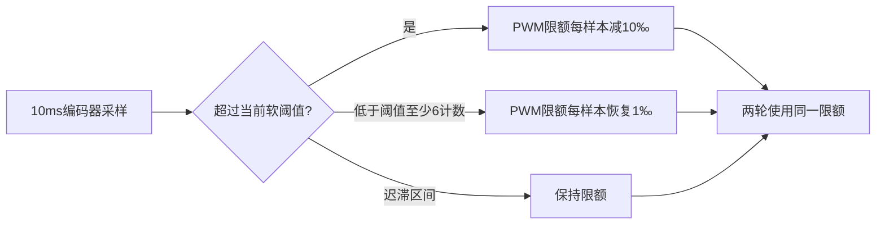

# 转弯诊断：可配置软限速

2026-11-09，按用户要求优先考虑效率、功能和稳定性，普通速度越界采用软性回调。新版本`PHASE2_TURN_GEOMETRY_20261109_2`已构建与Host检查通过，**尚未烧录**。车上仍为V1、已停机，最近170‰试验的速度故障与冻结缓存未自动清除。

## 为什么改

V1额外设定短弧单样本60计数即故障停机，而直线诊断采用120；60没有实车边界标定依据。两次200/170‰试验中，首次前进超60样本分别为63/65，随后撤输出后的采样峰值为74/68。此前将峰值描述为触发样本不够准确，本节更正，原始记录不改。两次均10ms连续采样、左右软件PWM各行相同，没有发现软件配平误写；等PWM仍有左右不同响应，原因未由日志单独确定。

用户确认170‰动作后停稳、无异响或卡滞，左右快慢未观察清楚；原回复的时间表述不作测试时长要求解读。原始见[170‰记录](evidence/turn-bench-left1600-cap170-1000-01/review.json)。

## 新行为

普通越界不置故障、不取消动作；降低限额至0也不锁停，反馈回落后按恢复规则继续。动作仍按原时间、操作者STOP等条件结束。首次默认软阈值仍为60，含义从“硬停机门槛”改成“输出回调目标”；不是已标定车速。默认速度回调读取左右前进raw最大值；不把负向计数当作前进超速，原反向异常逻辑独立保留。

采用整数比较、加减和单个共享限额，无浮点计算、阻塞打印、动态内存或额外采样。减10/恢复1‰是初版控制增量，不是标定的加减速度或jerk；恢复须低于阈值超过5计数，减少边界来回抖动。它不是精确速度闭环，也不解决左右轮输出/转速不均，尚须实物检验。限额在下次显式准入初始化，PWM写入路径每次都执行该限制。

主动降输出后，原无计数判断同时检查实际可用努力限额，避免将软限速导致的低输出误判成“高输出无响应”。未降低输出的原无计数条件、反向/样本故障仍保留。两轮使用同一限额意味着较快一轮可能牵制另一轮，本轮尚不批准曲率精度。

**硬撤输出仍有明确范围：** STOP、拨码/控制权撤销、500ms通信租约失效、采样失效/反向等不能可靠调节的故障、原候选距离切断和到时停止；前进单样本超过共同120计数是异常兜底。120继承诊断构型，未当作已认证车辆安全速度。它与可调日常软阈值分开；用户要求的63/65这类普通越界已改走软回调，不以旧60门槛锁停。

## 停机可配置，不再每个试点重烧

命令为`@turn_config request duration speed min_us max_us`。例如默认`@turn_config 250 1500 60 1500 1600`：允许的努力请求/动作时长/软速度阈值/舵机脉宽区间。`@turn_config`回读当前配置；`@turn_frozen`读上次准入冻结的配置及干预次数、最低限额。设置只在停机接受，不授权运动；保留原首点200‰、后续+50‰等会话规则。

可配置值仍不能超过现有构型全局包络：努力600‰、时长3000ms、软阈值120、舵机当前profile范围。它们不是新一轮已授权动作。保留开环短弧准入，以免相同左右闭环目标抵抗实际转向差速；独立点动、reverse、shuttle和视觉自动驾驶仍未开放。中心脉宽不接受作为circle动作，中心直行用line。

每次动作的舵机脉宽与努力/时间仍受原轨迹CRC覆盖；附加`TURN_CONFIG`快照含`soft_hits/min_cap`，不在原10字段CRC中。导出器显式标记`coveredByTraceCrc=false`，原始串口、配置快照和文件SHA同时存档。新客户端起动前回读当前配置并验证请求，旧V1的客户端限制仍保留，避免误接受错版本。

运行中不发送配置查询（原字段查询会先停机）；导出期间`@turn_frozen`不重写旧快照。不能先RST再期待上一次诊断仍存在。

## 已完成的检查

- Keil：0错误、0警告；Code74656/RO13308/RW240/ZI175488。
- 三个独立Host程序：原响应14414、心跳815、转弯4121断言，共19350；覆盖普通61/65越界不锁停、PWM实际提交受回调限额约束、逐步下降/恢复/零限额、配置参数与停机准入、冻结配置不被改写，以及异常121计数兜底。
- 451行原生响应轨迹CRC及Python解码通过；客户端/导出/分析19项测试通过。
- 此处计时、编码器、PWM为替身，没有实物软限速效果、RF和地面曲率验收。

原始源码与检查见[证据目录](evidence/turn-soft-config-candidate-20261109_2/candidate.json)。SHA256：`489155cc56adc984674dc25b3ca6b4febd97869b33ddde9962455d4b4401081c`。

专用下载工程：[speed_response_download.uvprojx](../../../.build/phase2-calibration-20261108/turn-geometry-20261109_2-soft/speed_response_download.uvprojx)；构建工程：[speed_response.uvprojx](../../../.build/phase2-calibration-20261108/turn-geometry-20261109_2-soft/speed_response.uvprojx)。唯一待烧录候选为`turn-geometry-20261109_2-soft`；同级不带`-soft`的V2中间产物不是本次交付镜像，未烧录，不使用。准备工具`--configurable`输出当前软控制实现。

下一步先在动力隔离、两拨码OFF状态换烧，明确报告版本/Verify，再恢复配置。实物首点验证软回调是否减少不必要中断，之后推进地面轨迹；本次没有自动烧录或执行动作。

来源分层：原生JSON/XML/轨迹读取为`structured_parsed`；源码、CRC/SHA、Host模拟与单位检查为`computed`；实物效果未验证。无仅`md_extracted`数值结论，未改全局配置或持久化Agent行为。

**软回调版已换烧：** PHASE2_TURN_GEOMETRY_20261109_2（-soft目录）镜像SHA核对一致，Keil Programming Done、Verify OK；COM10首次STOP查询超时，运行身份尚未核实。未发运动、未恢复新RAM。等待保持动力隔离、两拨码OFF，按RST后静止核对。前述“未烧录、车上V1”是准备时历史状态，以本更新为准。见[烧录记录](evidence/turn-soft-config-candidate-20261109_2/flash.log)及[首次运行查询](evidence/turn-soft-config-candidate-20261109_2/runtime-check-01/review.json)。

**软回调版RST后配置已确认：** COM10确认PHASE2_TURN_GEOMETRY_20261109_2、owner radio；恢复方向/配平1/1、编码器符号−1/+1、servo1550/1430/1670/sign−1、startup0/cruise0/cap0.6/rise0.3；speed_mode0、quiet1明确回读。turn_config设250/1500/60/1500/1600并二次读取一致，60现在是软阈值，不是V1硬停门槛。PWM0/faults0、空缓存gen0/count0/frozen0，soft_hits0/min_cap600为无动作初值；未发车。下一点170‰/1600µs/1000ms仅验证此前普通越界的软回调行为，待现场确认架空就绪；无需RST。见[运行与配置](evidence/turn-soft-config-candidate-20261109_2/runtime-configure-02/review.json)。

## 软回调首个实机点：普通越界未锁停，正常到时

用户确认架空就绪后，COM10仅执行170‰/1600µs/1000ms开环短弧，quiet1。gen1/start710606/stop711806，200ms预置后正常到时reason1；322行CRC通过、post2004ms、软件PWM峰值170‰，fault/detail全0。冻结turn_config为request250/duration1500/soft speed60/servo1500—1600，soft_hits12/min_cap50；表示运行12个超阈值采样触发输出限额回调，最低50‰，没有因原60门槛取消动作。附加快照在轨迹CRC之外，按原始日志和SHA保存。

左右raw范围−79—1/−5—39，累计−2104/+575；采样峰值未超过异常120兜底。负向尾部样本不自动解释为主动倒转；物理方向及停稳待用户反馈。左右响应差异仍存在，不能由本次软控制成功推断地面转弯半径或左右一致性。心跳接收/解析/续租均20次，最大63/65/65ms、age29ms，无通信超时。

同170‰的V1曾在启动792ms时硬停机；本轮启动1200ms正常完成，普通速度越界改为回调的机制已取得实机证据。但不同场次负载/电压未严格配对，不称为定量控制性能对照。下一步核对现场，再在足够宽地面测短弧；尚未执行落地转弯，无自动追加动作。当前停止、gen1冻结保留、无需RST。见[本轮原始与核定](evidence/turn-soft-bench-left1600-cap170-1000-01/review.json)。

**现场反馈及延时准备：** 用户确认左偏、已停稳、一切正常，驱动轮方向未观察，要求延长观察时间。仅在停机状态将turn_config允许时长1500→2500ms，其他值250/60/1500/1600不变，回读开环/PWM0/faults0。下一动作候选170‰/1600µs/2000ms，尚未执行；不RST、不重烧、不释放上一缓存。回读soft_hits12/min_cap50属于上一已完成动作的统计，不是新试验结果。见[配置记录](evidence/turn-soft-prepare-long2000-01/review.json)。

## 延时2000ms点：共享回调后右轮反向计数退出

用户架空就绪后仅执行170‰/1600µs/2000ms。gen2/start887572/first-zero888570，启动998ms撤输出，未跑满期限；301行CRC通过、post2000ms、PWM峰值170‰。turn快照request250/duration2500/soft speed60，soft_hits12/min_cap50；说明普通速度越界继续走软回调，没有detail12超速锁停。随后右轮raw在888550/888560/888570均−5，触发原独立反向检测detail8，faults256。首次零reason0、取消快照reason5，不能解读为正常结束。心跳16次、最大72ms、age60ms，quiet1，无通信超时。

故障前共同PWM提交先降到50‰，随后51/52/53/54‰缓升；左raw同时−51→−34，右5→1→−5×3。共享限额压制较快左轮时也压低右轮，是当前控制结构的不足；此为采样时序与控制解释，不证明物理倒转的机械原因。总raw−1784/+740。物理方向/停稳/左右差异待用户反馈，不由计数补称倒转。未加长重试、未清故障、未释放gen2，不通过延长时间绕过问题。后续先核对现场并审查按轮独立回调/低速反向判别，不自动削掉异常检测。见[本轮证据](evidence/turn-soft-bench-left1600-cap170-2000-01/review.json)。

**延时点现场反馈：** 用户“没看清，很快停止”。物理右轮倒转、左右快慢、异响均未知，不补称反向或无异常；仅确认快速停止的观察。后续优先离线审查左右独立努力限额，避免一轮超阈值回调同时压低另一轮；反向计数检测不能当作物理方向真值，也不直接删除。当前无新动作、无RST。

**用户要求同参数再测：** 现场重新确认架空就绪后，先CRC复核上一gen2并匹配板端冻结信息，再停机c及speed_mode0清故障，PWM0/faults0回读通过；仅释放已存档匹配缓存，执行一次170‰/1600µs/2000ms，未改控制逻辑/阈值、未RST。gen3/start1140944/stop1143144，200ms预置后正常到时reason1；422行CRC通过、post2006ms、PWM峰值170‰、fault/detail0。soft_hits20/min_cap50；心跳36次、最大RX175/解析续租174ms、age34ms，quiet1。raw累计−3377/+1414，raw范围左−69—5、右−5—39。虽然全记录仍有小反向样本，本次没有达到独立反向故障条件；不能据正常退出断言物理未倒转。用户现场反馈待确认。前次detail8故障保留，未以成功样本覆盖，也不认定问题消失。无自动追加动作，当前gen3冻结保留。见[重测核定](evidence/turn-soft-bench-left1600-cap170-2000-02/review.json)。

**重测现场反馈：** 用户报告右轮“没有持续向前，先向前一段时间，停止，再向前”。记录为前进—暂停—再前进，不认定实际倒转；最终停稳、左右快慢及异响未逐项回答。软件正常到时不等于持续前进性能通过。本观察与共用限额从170降至50再恢复的机制相符，但尚非唯一因果证明。当前软回调造成连续性问题，列为待修正；不追加同参数试跑。后续设计按左右各自反馈独立回调，避免左轮快连带压低右轮，并分别记录限额与干预次数后再验证。未修改板载逻辑或发新动作。
