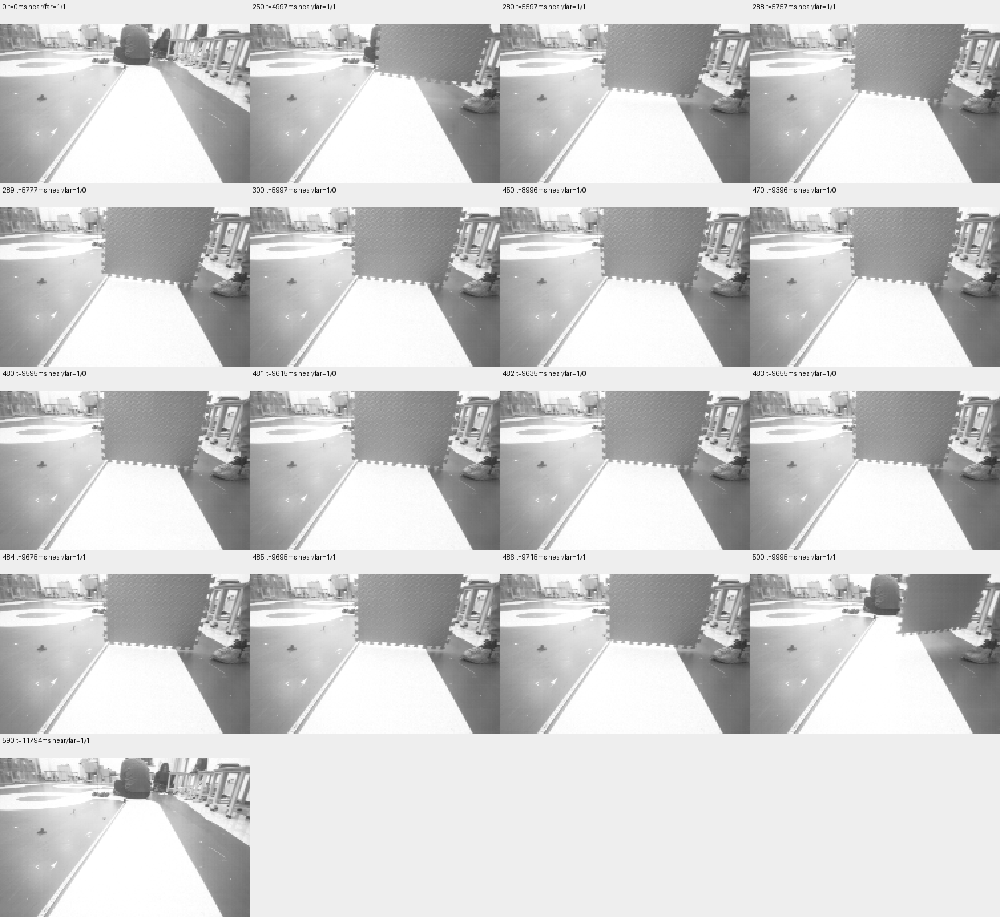

# 连续远场遮挡/恢复：首轮局部有效记录

2026-11-09。结论：已取得覆盖正常、远场失效和恢复的591帧同步原图/状态；**完整750帧会话未通过**。不修改生产参数，不据此填写MPC远场降级预算或恢复迟滞。

## 数据在哪里，完成了多少

使用`PHASE2_VISUAL_TRACE_20261109_1`，此前烧录Keil Verify OK；本轮未重新烧录。静止OBSERVE，私有PWM入口强制零，COM14有线921600。操作者按蜂鸣提示遮挡远场并移除；蜂鸣时间不是实际遮挡时间。

板端冻结报告为gen=1、count=750、reason=1、active=0，启动179595ms、冻结194573ms。首次电脑导出中断，目录中有592个文件：索引0—590的591帧通过头部身份、尺寸、CRC32、元数据时序及前向序号校验；索引591文件头全零，身份校验失败，保留原件并排除。索引591—749均未核验，不能以板端count替代完整导出。

随后重试COM14不存在；用户恢复有线后，专用版本身份及OBSERVE可读，但板端报告gen=0、count=0、运行时间约19秒，旧缓存已不可读取。无法仅凭这些信息确定复位/掉电原因；本工具没有发送清除、复位或新采集命令。没有用新数据补齐旧会话。

全部原始文件、无效文件、控制通信日志、逐帧SHA256及解析结果保存在[evidence/visual-continuous/session01-partial](evidence/visual-continuous/session01-partial/partial-session.json)；[文件总索引](evidence/visual-continuous/session01-partial/sha256.json)覆盖证据文件自身以外的全部文件。

## 可核定的状态变化

下表是算法控制观测状态，索引从0开始；时间相对第一帧CSI收帧完成时刻179596ms，不是相对物理曝光或手动遮挡时刻。

| 阶段 | 索引 | 帧数 | 首末采集时间（ms） | 近场控制有效 | far有效 |
| --- | --- | --- | --- | --- | --- |
| 初始 | 0—288 | 289 | 0—5757 | 1 | 1 |
| 远场失效 | 289—483 | 195 | 5777—9655 | 1 | 0 |
| 恢复后已导出部分 | 484—590 | 107 | 9675—11794 | 1 | 1 |

591帧内源序号缺口0、累计拷贝失败首末均0；未导出的159帧未知。独立调用的近/远几何支持标志在该前缀内与上表一致，但它仍复用同一几何函数，不是独立物理真值。



已核对原图：索引0无遮挡；250、280、288可见板材进入远处，不能因板材出现便断言整个far支持带已丢失；289、300、450、470为远处被板材遮挡、近处赛道仍可见；480—486板材正在移开，算法在484恢复；500仍有板材边缘，590已移除。这里仅作关键帧定性图像核对，没有独立人工逐像素far支持带标签。不得把289/484的算法切换反过来作为物理遮挡切换真值，也不能将195帧失效解释为允许继续行驶的时长。

## 时序和适用范围

已核验前缀的CSI完成到observe返回为3—4ms，P95/P99均4ms；记录图像和诊断额外占用0—1ms（1ms时钟量化，0不表示零耗时）。这属于带额外全图复制的静止实验，不能代替RUNNING/MPC负载、曝光到实际PWM生效的总延迟或保证上界。此处统计对应原始前缀时间戳，可从原始帧复算。

## 下一步与验收门槛

本轮可用于远场失效/恢复回归样例；完整采集/高速回传验收仍待一条750帧全部CRC及冻结信息复核通过的会话。再次采集前需恢复真实赛道无遮挡基线，回读期间保持主控逻辑供电与有线连接，直至电脑确认完整存档；本轮不自动启动重测。

Phase2还缺运行构型端到端时序、闭环速度响应及限幅、更多地面/电池条件的停车边界和弯道侧向验证。一次静止远场切换不能批准生产预算。

复核已保存前缀（输出必须为新文件，不连接设备）：

```powershell
python -m tools.speed_planning.analyze_visual_trace `
  docs/changes/phase2-calibration-20261108/evidence/visual-continuous/session01-partial `
  --partial --output .build/visual-prefix-review.json
```

证据层：二进制头、元数据、冻结报告及串口文本为structured_parsed；CRC32、SHA256、序号、时间差和状态分段为computed；遮挡形态为原始图像核对。没有仅md_extracted的关键数值或新增pdf_verified结论。物理遮挡精确时刻、未导出帧及缓存丢失原因仍未知。
