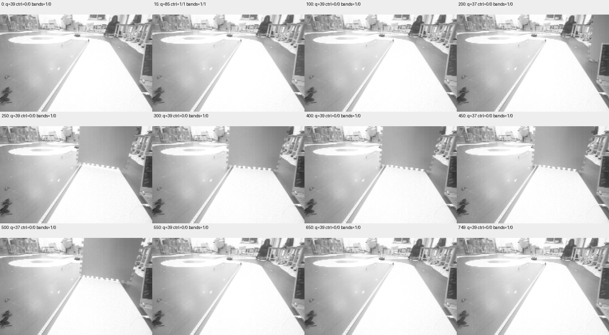

# 连续采集第二轮：完整回传通过，场景基线未通过

2026-11-09。750帧原图及同帧元数据全部导出并校验通过；但无遮挡前后均未形成稳定有效控制观测，不能认定远场单独失效/恢复场景验收通过。Phase2和生产参数批准状态保持未完成。

## 本轮取得的证据

沿用此前烧录且Keil Verify OK的`PHASE2_VISUAL_TRACE_20261109_1`，本轮没有重新烧录。启动前再次核对专用版本、COM14有线921600、OBSERVE和空缓存；操作者确认真实赛道无遮挡、车和相机固定、动力隔离，随后按两次短鸣遮远场并移开。采集期间未发送运动命令，私有PWM驱动两个入口仍强制零。

| 完整性项目 | 实际结果 |
| --- | --- |
| 冻结报告 | gen=1，count=750，active=0，reason=1 |
| 软件启动/冻结时刻 | 260297 / 275277ms |
| 软件提示时刻 | 第一次264297ms，第二次269300ms；不是物理遮挡时刻 |
| 原图 | 750张188×120灰度，每张与16字段元数据配对 |
| 主机导出 | 索引0—749全部CRC32、头部身份、元数据时序、SHA256通过；结束后冻结报告与导出前完全相同 |
| 第一至最后一帧CSI完成时间差 | 14973ms |
| 相邻CSI完成间隔 | 19—20ms，中位/P95/P99均20ms |
| 源序号缺口 | 0 |
| 累计稳定拷贝失败 | 首末均0 |

原始证据：[session.json](evidence/visual-continuous/session02/session.json)、[分析](evidence/visual-continuous/session02/analysis.json)、[文件SHA256清单](evidence/visual-continuous/session02/sha256.json)。750个`.vqf`原始二进制、冻结报告和控制通信日志均在同目录。板上缓存没有自动清除；电脑已完整保存，这轮数据不再依赖板上供电保存。

## 为什么场景验收仍未通过

原始视觉raw_valid在750帧均为1，但控制观测仅索引15一帧有效且far有效（quality=85）。其余749帧控制valid/far均为0；独立几何支持near=1、far=0。质量中位/P95/P99均39，范围35—85。不能把raw_valid等同于控制可运行。

同一冻结源码中`VISION_CONTROL_MIN_COVERAGE=40`；`vision_control.c`在全局valid、TRACK状态、coverage及近场支持门槛后才更新有效观测。质量低于40是本轮控制观测被拒绝的充分条件之一；无效时far输出也被清零。独立far几何支持同时多数为0，因此不能仅通过降低coverage门槛推定远场已恢复。本轮没有修改门槛、配置或生产算法。

| 控制观测分段 | 帧数 | 首末相对采集时间（ms） |
| --- | ---: | --- |
| 索引0—14：valid=0、far=0 | 15 | 0—280 |
| 索引15：valid=1、far=1 | 1 | 300 |
| 索引16—749：valid=0、far=0 | 734 | 320—14973 |



原图核对：0、100等初始帧可见赛道；250、300、400可见板材遮远处，近处白色赛道仍可见；550、650、749板材已移除。尽管物理遮挡动作出现并撤除，初始及恢复后控制基线均不稳定有效。图像抽查没有建立逐帧物理遮挡真值，不能直接把软件短鸣或算法标志当成物理事件标签。

首轮591帧有效前缀曾覆盖稳定正常、near有效/far失效、恢复，详见[首轮结果](VISUAL_CONTINUOUS_RESULT_01.md)。两轮分别保留：不能将首轮局部场景数据和本轮完整传输数据拼接成一条完整通过的场景会话，也不能因本轮异常推翻首轮原始记录。

## 软件耗时及适用边界

750帧CSI完成到observe返回3—4ms，P95/P99均4ms；视觉处理3—4ms；额外图像复制和诊断记录0—1ms。时钟分辨率1ms，0不表示零耗时。这是静止零PWM、带采集负载的实验，尚未覆盖RUNNING/MPC、曝光起点或实际PWM电气生效时刻，不是保证上界。

## 后续顺序

1. 先恢复无遮挡真实赛道的稳定基线；核查车/相机位姿、赛道在图像中的近远支持、光照和板载观测。不要为了得到PASS先降低准入门槛。
2. 基线连续有效后再安排一次远场单独遮挡/恢复，保存完整同步会话。当前完整采集和回读路径已通过，不需重做尺寸、CPR和停车原始测量。
3. 完成场景后继续运行构型端到端时序、闭环速度响应、停车与弯道边界。生产远场时间/距离预算、恢复迟滞仍未标定。

离线复算（不连接设备，输出文件须尚不存在）：

```powershell
python -m tools.speed_planning.analyze_visual_trace `
  docs/changes/phase2-calibration-20261108/evidence/visual-continuous/session02 `
  --output .build/visual-session02-review.json
```

证据层：原始二进制及JSON、串口报告为structured_parsed；CRC32/SHA256、时序、统计和序号检查为computed；遮挡形态按原始灰度图核对。没有仅md_extracted的关键数值或新增pdf_verified结论。单帧quality=85的原因、两轮基线变化原因及物理遮挡精确时刻尚未核定。
