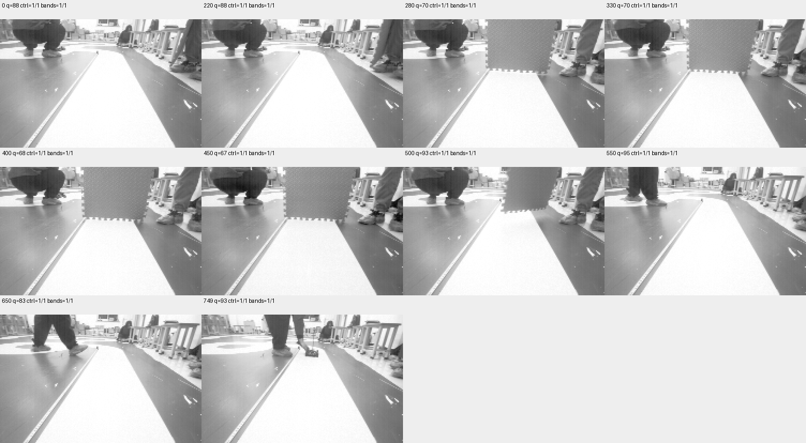

# 连续采集第三轮：正常基线恢复，遮挡未触发far失效

2026-11-09。750帧完整导出，全部近、远场控制观测有效；基线已恢复，但本轮遮挡没有产生far失效，不能作为失效/恢复场景验收。生产预算仍未标定。

## 基线恢复及采集前处理

用户回复“基线就绪”后，核对COM14/921600及`PHASE2_VISUAL_TRACE_20261109_1`身份。当前版本仍为此前Keil Verify OK的零PWM静止镜像，本轮没有换烧或修改控制参数。

第二轮完整数据归档及哈希复核后，对板端冻结信息与已归档冻结报告逐字段比对，再显式发送匹配generation的`@vq_clear`，恢复实时文本输出。初始16条CAL报告13条近远有效、3条近有效/far无效；随后47条CAL均近远有效、quality=74—93。后者板端时间跨度22990ms，主机读取8秒且包含串口积压，不能称为“8秒内47个新帧”。这些是约500ms间隔的稀疏报告，不是逐帧保证；三张94×60预览图另行采集，没有逐报告同步配对。

基线记录、原始串口字节、预览及哈希见[基线证据](evidence/visual-continuous/baseline-before-session03/settled-summary.json)。预览解码工具的通用session元数据baud固定为115200，不适用于本次离线回放的921600来源；实际串口打开参数和本轮专用版本为921600。该字段不用于判断传输速率或时间。

操作者随后确认材料就绪，启动一次750帧采集，按短鸣遮远场并移开。车/相机固定，动力隔离，OBSERVE；没有发送运动命令。

## 完整性与实际结果

| 项目 | 本轮结果 |
| --- | --- |
| 原始图像与状态 | 750张188×120灰度与同帧16字段元数据 |
| 导出校验 | 索引0—749全部CRC32、身份、时间顺序及SHA256通过 |
| 最终冻结报告 | 自动导出最后一次查询无回复；随后只读重查成功，与导出前全部字段一致，无需重采或重传图片 |
| 第一至最后一帧CSI完成时间差 | 14974ms |
| 相邻采集间隔 | 19—20ms，中位/P95/P99均20ms |
| 源序号缺口 | 0 |
| 累计拷贝失败计数 | 首末均2，本轮记录期间增量0；不能写成从开机至今失败0 |
| raw_valid | 750帧均1 |
| control_valid / control_far_valid | 750帧均1/1 |
| 独立近/远几何支持 | 750帧均1/1，仍不是独立物理真值 |
| quality | 67—98，中位88，P95=96，P99=97 |
| CSI完成到observe返回 | 3—4ms，P95/P99均4ms |
| 额外图像复制/诊断记录 | 0—1ms；1ms量化，0不表示零耗时 |

完整原始证据：[session.json](evidence/visual-continuous/session03/session.json)、[分析](evidence/visual-continuous/session03/analysis.json)、[文件SHA256清单](evidence/visual-continuous/session03/sha256.json)。全部750个`.vqf`、控制日志、最终冻结信息重查日志均保留。原导出脚本的异常退出也保留在事实记录中；最终complete来自全部原始文件重新校验及冻结信息只读复核，不是忽略末次查询失败。

原图核对：0、220未放入遮挡板；280、330、400、450板材遮住画面上部的远处区域；500正在移除；550、650、749板材已移除。算法在这些帧仍报告far支持有效。可见有遮挡动作，不等于全部可用远场支持均消失；本轮没有像素级物理真值，也不能将此现象直接判为算法漏检。

冻结源码`control_band_error`会先查配置带；启用`VISION_ROUTE_SWITCH`时还允许有限扩带，因此只遮住名义far中心行未必消除所有支持。未记录逐行边界/支持来源，不能据此确定本轮具体使用了哪条路径。下一步先实时确认“近场有效、far失效”的遮挡摆放，再采整段，避免同样摆放再次完整导出后才发现未触发。

## 工具更正和后续

PC工具`visual_trace.py`对只读`@vq_info`增加最多三次查询重试；不会重试启动、清除或运动命令，不放宽冻结信息一致性要求。该更正在本轮完成后加入，本轮最终信息通过单独只读重查获得。

本轮验证正常基线和完整同步采集；首轮局部有效远场切换、第二轮基线无效及本轮部分遮挡分别保留，不拼接成一次通过。下一次先调整遮挡深度或位置，以实时状态及原图确认far确实失效且近场有效，再安排完整连续切换。

以上仍是静止构型，未验证RUNNING/MPC、曝光到实际PWM延迟、far时间/距离预算或恢复迟滞。地面映射若相机姿态改变需另行核对，不能直接用旧映射保证新视角的遮挡距离。

证据层：原始二进制、JSON及串口数据为structured_parsed；CRC32/SHA256、时间和状态统计为computed；遮挡形态由原始灰度图核对。无仅md_extracted关键数值或新增pdf_verified结论。实际遮挡精确时刻、逐行支持来源及两轮间基线变化原因尚未核定。

## 2026-11-09 遮挡摆放快速核对04

用户调整遮挡后取得12条CAL报告，全部valid=1/far=1，quality68—70；三张另行采集的预览显示板下沿约在画面高度42%处，低于此处的赛道仍可见。名义far中心为0.46，带宽半高0.035，不能因遮挡上部画面便断言far支持消失。记录为[far-placement04](evidence/visual-continuous/far-placement04/summary.json)，图像与文本不逐帧同步，图像位置为原视图估计。未启动新的750帧采集、未改参数。下一步要求下沿进一步下移至画面约55%—60%，同时保留近处可见，再以实际状态核对。

## 2026-11-09 遮挡摆放快速核对05

用户进一步压低遮挡后，6秒文本采样获得12条CAL报告，全部valid=1/far=0、quality=54。三张另行采集的预览显示近处白色赛道仍可见，遮挡物覆盖中上部的赛道区域；这次摆放达到近有效/far无效的功能核对条件。原始字节、预览和哈希见[far-placement05](evidence/visual-continuous/far-placement05/summary.json)。图像与文本不逐帧同步，实际位移并未量测；此前“再压低约10cm”是操作建议，不能登记为实测尺寸。没有改控制门槛或烧录。下一步移除遮挡确认恢复，再复用同一摆放采完整连续会话；尚未新增完整场景验收。证据为structured_parsed、computed及原图核对，物理遮挡精确起止时刻仍待连续图像核查。
