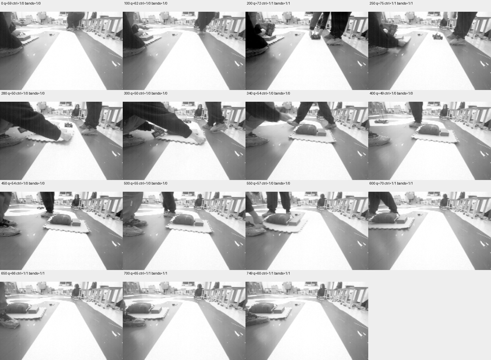

# 连续采集第四轮：完整远场失效/恢复记录，保留基线波动

2026-11-09。750帧原图和同帧状态完整校验通过，记录包含far有效、持续失效及恢复，近场全程有效。该功能过程已取得完整证据；初始及移除阶段有far波动，**干净受控场景验收、生产预算和Phase2整体仍未通过**。本轮先进入离线分析，不追加相同现场操作。

## 起点、操作和完整性

使用此前Keil Verify OK的`PHASE2_VISUAL_TRACE_20261109_1`；本轮未重新烧录或改控制参数。COM14有线921600、OBSERVE，用户确认车/相机固定且动力隔离，按第一次短鸣放入此前核对成功的遮挡，第二次移除。

此前[摆放05](evidence/visual-continuous/far-placement05/summary.json)12条报告全部近有效/far无效。用户移除后，首次读取包含大量串口积压，142条中104条far无效、38条有效，不能作为当下基线。再次发送`@status`并收到专用版本回复后，后续4秒8条报告为首条far无效、其后7条连续有效。保留两次严格“窗口内全部有效”检查未通过的事实；本次在最新7条连续有效后继续采集，没有把原检查改写为全窗口通过。完整采集实际揭示了起始far波动，稀疏遥测不足以保证下一段逐帧稳定。

原始基线读取、命令回复和启动决定见[采集前证据](evidence/visual-continuous/baseline-before-session04/start-decision.json)。

| 项目 | 结果 |
| --- | --- |
| 图像/元数据 | 750张188×120原灰度，每帧16字段 |
| 完整性 | 索引0—749全部CRC32、头部身份、元数据时序和SHA256通过，最终冻结报告与导出前完全一致 |
| 第一至最后一帧CSI完成跨度 | 14973ms |
| 相邻采集间隔 | 19—20ms，中位/P95/P99均20ms |
| 源序号缺口 | 0 |
| 累计稳定拷贝失败计数 | 首末均6，记录区间增量0；开机至今不是0 |
| 原始视觉有效 | 750帧均1 |
| 控制近场有效 | 750帧均1 |
| 控制far有效/无效 | 419 / 331帧 |
| 独立几何支持 | 与上述近/far状态一致；复用算法几何函数，非物理真值 |
| quality | 49—90，中位62，P95=89、P99=90 |
| CSI完成→observe返回 | 3—4ms，P95/P99均4ms |
| 图像复制/诊断记录额外耗时 | 0—1ms，1ms量化，0不代表零耗时 |

原始证据：[session.json](evidence/visual-continuous/session04/session.json)、[analysis.json](evidence/visual-continuous/session04/analysis.json)、[文件哈希清单](evidence/visual-continuous/session04/sha256.json)。全部750个`.vqf`及控制日志保留。电脑已完整归档，本轮数据不再依赖板端保持供电。

## 真实状态过程

索引从0开始，时间相对第一帧CSI完成时刻；不是曝光或人为遮挡起点。下表保留关键连续段，所有38个状态段见analysis.json，不合并或删除抖动。

| 区间 | 帧数 | 相对采集时间（ms） | 解释 |
| --- | ---: | --- | --- |
| 0—102 | 103 | 0—2039 | far无效与有效交替，近场有效；原图关键帧尚未见指定遮挡物放入 |
| 103—273 | 171 | 2059—5457 | 连续近/far均有效；后部包含操作者接近、物体开始放入过程 |
| 274—317 | 44 | 5477—6337 | 放入过程far状态交替，不包装成单一失效段 |
| 318—527 | 210 | 6357—10535 | 连续近有效、far无效；首末采集跨度4178ms |
| 528—582 | 55 | 10555—11635 | 移除过程中far有效/无效交替 |
| 583—749 | 167 | 11655—14973 | 连续近/far均有效，首末采集跨度3318ms |

210帧是算法失效连续段，4178ms是首末采样跨度，不能直接作为物理遮挡持续时间或允许继续行驶的预算。全部331帧far无效也不全由指定遮挡物引起。



原图核对：0、100未见指定遮挡物放入但有人体/近旁物品，far仍无效；200、250物体接近且far有效；280、300可见手和物体进入赛道区域；340、400、450物体遮住中部赛道，近处白色赛道仍可见；500仍遮挡；550、600物体向画面左侧移开；650、700、749物体已移到赛道旁。人员、手脚、阴影及物体变化可能同时影响画面，但没有独立试验可把基线波动归因于其中某项。

这不是无纹理黑板实验，遮挡物自身有边缘与纹理。关键帧图像核对支持记录功能切换，不构成逐像素地面真值；不能用far标志切换反向标定物理事件时间，也不应按软件短鸣时刻代替操作者实际动作。

## 核定范围与下一步

- 完整采集/回传和原始证据完整性通过；本轮近有效/far持续失效/恢复已观察到。
- 干净受控场景验收仍有基线波动缺口。候选JSON的`physicalContinuousSessionPassed=true`仅指完整现场记录及功能过程，`cleanFarOcclusionRecoveryScenarioPassed=false`和`productionApproved=false`明确保留。
- 先把本轮的初始波动、连续失效及移除抖动加入离线回归。不要从单条记录直接选定恢复帧数、far时间/距离预算或调整门槛以消除报告中的波动。
- 静止OBSERVE没有累计行驶距离、闭环速度或实际PWM生效证据；下一阶段仍需RUNNING/MPC时序、闭环速度响应和停车/弯道边界。地面、电池电压及载荷覆盖继续保持既有缺口。

复算命令（输出须为新文件，不连接设备）：

```powershell
python -m tools.speed_planning.analyze_visual_trace `
  docs/changes/phase2-calibration-20261108/evidence/visual-continuous/session04 `
  --output .build/visual-session04-review.json
```

证据层：原始二进制、JSON及串口报告为structured_parsed；CRC32/SHA256、序号、状态段和耗时为computed；遮挡形态按原始图像核对。无仅md_extracted关键数值或新增pdf_verified结论。物理事件精确时刻、基线波动原因及生产安全参数仍未核定。


**后续离线推进已完成：** 本轮750帧已接入[Host监督回归](VISUAL_SUPERVISOR_REPLAY.md)，5场景3750行关键状态对照与6项专项检查通过。此前“先加入离线回归”为本报告建立时的下一步，现已完成；生产预算、真实运动输入及干净受控场景缺口不因此关闭。
