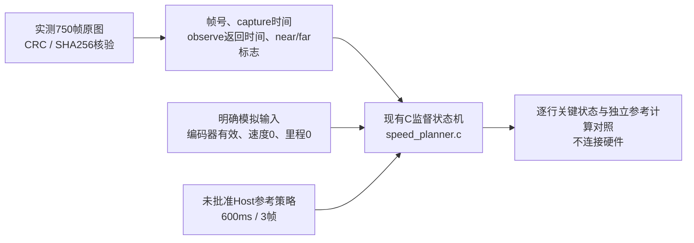

# 实测视觉元数据驱动的Host监督状态机回归

2026-11-09。第四轮750帧已进入离线回归：5个场景、3750行关键状态与独立Python参考计算一致。统一入口专项通过，6项检查通过，清单/schema/path/DAG校验通过（当前73个套件定义）。这是本地软件结果，尚未验证本次远程CI。

**结论：** 现有Host参考策略能在这段观测上触发降级、预算到期停车并保持锁存；现有3帧恢复规则也会在遮挡放入期间的短暂有效段满足恢复条件。两者都是待评估行为，不能据此把600ms或3帧批准为实车参数。

## 实测和模拟分别来自哪里



真实输入为[第四轮完整会话](VISUAL_CONTINUOUS_RESULT_04.md)的750个已校验原始记录：源帧号、CSI完成时间、observe返回时间、控制near/far有效标志。工具重新核验全部750帧CRC32及SHA256后才生成输入CSV，不直接信任另行填写的标签。

模拟输入为每条观测一个有效编码器样本，序号index+1、时刻observe_end_ms、速度0、累计里程0；它们不是静止实验实际同步采得的编码器数据。调用频率是每个新观测一次，约20ms，没有补造中间10ms调度。控制时刻采用实测observe返回时刻，不等同未来MPC提交时刻。

调用的是既有`sp_supervisor_arm`/`sp_supervise`，本轮未修改`speed_planner.c`。不构造米制路径，不运行规划器、轨迹整形、PI或PWM输出，也不重跑图像识别。现有control-replay格式要求运动字段，因此没有将零值填成“project-measured”运动会话。

## 五个场景和结果

| 场景 | 显式Host准入索引 | 时间预算 / 恢复帧 | 结果 |
| --- | ---: | --- | --- |
| 初始准入拒绝 | 0 | 600ms / 3 | 索引0 far无效，准入拒绝；之后有有效帧也一直DISARMED，不自动授权 |
| 现有参考策略 | 103 | 600ms / 3 | 进入降级，短暂恢复后再次降级；索引323进入CONTROLLED_STOP，326进入STOP_LATCHED，后续恢复仍锁存 |
| 诊断敏感性1 | 103 | 10000ms / 1 | 易被单帧有效打断失效段，最终回到NORMAL_TRACK |
| 诊断敏感性3 | 103 | 10000ms / 3 | 在索引291短暂恢复，293再次降级；主要长失效段在532确认恢复 |
| 诊断敏感性5 | 103 | 10000ms / 5 | 没有在289—292的4帧有效段恢复；主要失效过程在534确认恢复 |

索引103是对本条记录显式选择的Host实验准入点，控制near/far均有效。它不是生产启动准入规则，不是自动挑帧跳过坏数据；其前103帧仍被输入并记录为DISARMED，另有索引0准入拒绝场景保留。

600ms和3帧取自未批准的`c1-host-reference-v0.3.json`。10000ms是为了观察不被时间预算中断的恢复行为而刻意放宽的诊断设置，**不是建议生产预算**。距离策略仍保留参考0.24m，但输入里程为模拟0，本轮没有测试距离耗尽。

参考600ms场景的关键时序如下，时间相对实测第一帧CSI完成时刻：

| 索引 | 相对capture时间（ms） | Host监督状态 | 解释 |
| --- | ---: | --- | --- |
| 103 | 2059 | NORMAL_TRACK | 显式Host实验准入 |
| 274 | 5477 | DEGRADED_FAR_LOSS | 首次观测失效 |
| 291 | 5817 | NORMAL_TRACK | 索引289—291连续3帧有效 |
| 293 | 5857 | DEGRADED_FAR_LOSS | 再次失效并开始新的预算段 |
| 323 | 6457 | CONTROLLED_STOP | 以observe返回时间检查，预算已到期 |
| 326 | 6517 | STOP_LATCHED | 后续3个模拟零速样本达到锁存条件 |

6517ms是模拟输入下的软件锁存发生帧，不能解释为车辆实际停稳时间或停车距离。本轮没有测电机输出。

## 恢复规则暴露的具体问题

完整原图在索引280、300、340等仍可见遮挡物的放入过程；算法在289—292有连续4帧far有效。3帧规则因此会恢复并清除本次far预算段，下一次失效重新计时。与原图核对时，这只能称为遮挡操作过程中的短暂准入，尚无逐像素真值将它定性为“错误恢复”。

5帧诊断没有被这4帧打断，但一条场景不足以选定5帧。还需要不同光照、材料、反光、单边和背景条件及留出场次，评估恢复延迟、过早恢复和反复重置预算。不要为该单条样本直接调整生产阈值，也不要将4.2秒失效段作为允许行驶4.2秒的依据。

`observationRecoverySensitivity`另外保存1/3/5帧确认下的观测段，起始已失效的片段标为leftCensored，结束仍未恢复的片段标为rightCensored。没有伪造距离、速度、漏停率或百分位预算。

## 回归如何复现

统一入口（只运行该专项及依赖，不连接串口、不烧录）：

```powershell
python tools/testing/run_tests.py --profile Host `
  --suite speed-planning-visual-trace --compiler gcc --mode optimized
```

归档包含当时的[统一测试报告](evidence/visual-supervisor-replay04/unified-test-run-final/summary.md)、[回放报告](evidence/visual-supervisor-replay04/replay-report.json)、每场景750行CSV、生成策略头、冻结的C/Python源码及[哈希清单](evidence/visual-supervisor-replay04/sha256.json)。本地GCC验证通过；工具支持既有MSVC编译参数，本轮没有实跑MSVC或ASan，不扩大通过范围。

单独生成新回放目录：

```powershell
python -m tools.speed_planning.replay_visual_supervisor `
  docs/changes/phase2-calibration-20261108/evidence/visual-continuous/session04 `
  --output .build/visual-supervisor-new --arm-index 103 `
  --compiler 'C:/Program Files/mingw64/bin/gcc.exe'
```

输入必须是完整且未篡改的会话；本版独立参考计算只支持近场全程有效的记录，不适用于近场丢失、运动距离或异步控制调度。输出目录须新建，已有证据不覆盖。每行对照mode、authorized、motor_inhibit和generation，另外检查输入索引和C输出faults；并非逐字段独立验证整个状态结构。

6项检查覆盖：真实记录关键状态对照、初始拒绝后不自动准入、预算到期及后续恢复不解锁、4帧短暂有效对3/5帧策略的不同影响、原始文件篡改拒绝、截断观测段标记且不虚构距离。

## Phase2接下来缺什么

这项离线回归已完成，不需要立刻重复相同遮挡采集。下一项动态工作应先准备受限闭环候选和采集方案，使用候选距离尺度左11394/右11389 counts/m，明确其未获生产批准；目标速度、反馈、实际PWM、限幅、停止事件和实际电池状态需要同源记录。实施前再安排现场条件与相应版本烧录。

运行构型视觉到执行时序、真实闭环响应、停车安全边界、弯道侧向限制和更多视觉留出场次仍未完成；完整速度规划器尚未接入主固件。详见[剩余任务](PHASE2_REMAINING.md)。

证据层：原生二进制/JSON/CSV为structured_parsed；哈希、统计、编译、C回放和独立参考计算为computed；物理遮挡形态沿用原始图像核对。没有仅md_extracted关键结论或新增pdf_verified项目。模拟输入、未测距离预算、缺少独立物理真值及未测生产构型是本轮主要准确度边界。
