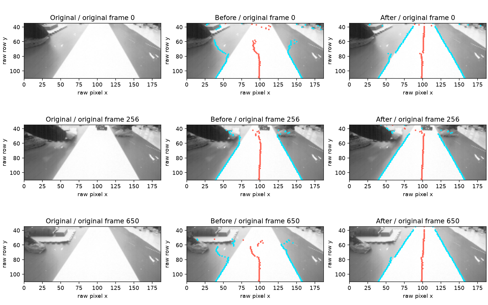

# Phase3：亮灰地面误分割修复与原始图像回归

2026-11-09，北京时间。用户要求用图像回归验证修复。本轮修改图像阈值处理并形成V4构建；未烧录V4、未操纵车辆，板端最后确认身份仍为V3。

## 修复和实际结果

按行两类Otsu有时把暗物体单独分成背景，将亮灰地面与白色赛道合并，后续跟踪获得错误双边。现在复用当行直方图，对亮类最多细分两次，分离暗背景、灰地面和白赛道。只有子类有足够支持及对比度、亮度接近、当前连通白区的中点仍保留时才采用细分；普通两类图和已有阴影场景保留原有阈值。

没有修改地面矩阵、采样行、域边界、原PI参数或输出门限。新版配置ID因图像源码SHA改变而更新为`C26-SHADOW-8CA1CE06`；计算核对新旧`runtimeConfig`和`measured.groundMapping`完全相同。

| 同一750帧原始188×120图像 | V3图像算法 | 本轮修复 |
| --- | ---: | ---: |
| 近米制预览接受 | 36 / 750 | 470 / 750 |
| 完整米制预览接受 | 3 / 750 | 376 / 750 |
| 近预览因地面域拒绝 | 313 | 7 |
| 完整预览因地面域拒绝 | 245 | 3 |

每帧先核对原始VQF的CRC、SHA和元数据，直接将原始灰度送入当前原生C图像/适配器。没有放大预览充当原图、合成图替换实图或另写识别器。上述数字是米制输入接受覆盖，不是完整图像识别正确率。

原图 / 修改前 / 修改后对照：蓝点为双边、红点为中线。直接叠加原生算法输出，不改变原图像素或手工拉直中线。



另对7张原图的4个采样行建立±3原始像素的局部视觉参考带，共28组双边；修改前4组落入参考带、5组缺双边，其余偏出，修改后28组均落入、无缺双边。这些参考带在算法试验后选取并目视核对，属于局部复查，不是独立留出集，也不覆盖全部750帧人工真值。标注、逐行结果和源文件SHA均归档。

## 回归和性能

新增`vision-image-regression`，自动核对750帧完整性、原生米制覆盖及上述28组局部边界。新增亮灰渐变地面/暗物体合成复现，直接检查已知真实边界；半边阴影扫描保留原算法可通过的60～95%亮度区间。已有40～55%强半边阴影错误在修改前后仍存在，未假称本轮解决。

预处理合约继续用独立排序/有理数判据检查每行分割，而不是将新输出自身当预期；保留32896种8位灰度对的严格兼容、6000组组合输入、二值像素、灰度预览和解析阴影检查。原始历史参考程序未改写成新版。

初版无条件细分虽使近/完整覆盖达到533/352，却将旧半边阴影赛道切掉，已弃用并保留失败记录。最终方案通过新增复现和原有直线、噪声、阴影、弯道、路口、环岛/投影及控制链回归。

| 检查 | 结果 |
| --- | --- |
| 最终GCC optimized Host | `20261109T035200-dbec095d66`，59 PASS / 1 SKIPPED；performance-host因原有数据集/批准基线缺项跳过 |
| 最终图像预处理专项 | `20261109T035109-d99d8a9a4d`，vision、vision-contract、vision-image-regression及环境依赖通过 |
| 静态/工程结构选择 | `20261109T035321-ea96a23b4d`，environment/static-safety/project-structure共3 PASS；仅为选择项，非完整PreFlash |
| Keil V4最终构建 | 0错误、0警告；Code105296、RO15536、RW212、ZI211116字节，ZI与V3相同 |
| V4身份 | `PHASE3_C26_SHADOW_20261109_4`，RUNTIME=1、ACTIVE=0、PROFILE_REVIEWED=0；未烧录 |

性能实现复用了原有256项直方图：将单行累计计数和灰度和打包到原数组，细分类统计用常数时间查表；行Otsu以有界64位整数比较精确分数，避免MCU上的行级软件double除法。没有新增图像缓存或堆分配，细分次数有固定上限。全图统计保持原方法。

三组交替执行的Host `clock()`对照，每组3750次原生图像处理：原版中位558ms，新版720ms，折合0.1488→0.1920ms/帧，本机观测增加约29%。初版增加的计算经直方图复用有所压缩，但最终仍有开销；不据此宣称更快。Windows时钟/调度、桌面整数与浮点单元均不能替代ARM执行时序。实际板端视觉耗时、原PI并行和运行稳定性仍需V4上板核对，不能将Host功能PASS解释为性能已验收。计时原始值、基准代码和构建SHA见[evidence.json](evidence.json)。

## 保留的问题与下一步

完整预览仍有374帧未被接受：源状态/质量6、指定行缺双边310、几何/历史55、域3。遮挡、边界跳变和高曲率噪声仍需进一步处理。新增图像回归提供了明确复现入口，不代表全部离线问题或Phase3结束。

同一静止合成编码器、20ms时间模型中，首帧即能准入，下一帧为READY；第67帧因持续近几何缺失触发近场超时并锁存，不自动重新准入。这是软件组合与保留失败的证据，不是实测运动反馈、整车运行或动态保护参数验收。

下一步可用V4在动力隔离下核对实际二值图/边界和处理耗时，再安排可信输入下的影子会话。当前主板的V3故障/冻结数据已在前一阶段归档，本轮未清除板端记录。

最终下载入口：[MPC_Phase3_Shadow_Download.uvprojx](../../../.build/phase3-vision-regression-20261109/delivery-final/workspace/demo/mdk/competition/MPC_Phase3_Shadow_Download.uvprojx)。同目录`MPC_Phase3_Shadow.uvprojx`为纯构建入口。早期`delivery`为优化前中间版本，使用`delivery-final`。

```powershell
python tools/testing/run_tests.py --profile Host --suite vision-image-regression --suite vision-contract --suite vision --compiler gcc --jobs 3
python -m tools.speed_planning.audit_metric_input --output .build/phase3-vision-audit-new
python tools/prepare_phase3_shadow.py --output .build/phase3-vision-rebuild-new --build
```

来源层：原始C、VQF/JSON/CSV、Keil XML为`structured_parsed`；CRC/SHA、原生回放、测试断言、统计与构建为`computed`；局部边界按原图目视复查。没有仅`md_extracted`关键数值；强阴影、遮挡、独立留出集和板端时序仍存在准确性/适用范围限制。未修改全局配置、技能或持久Agent行为。
