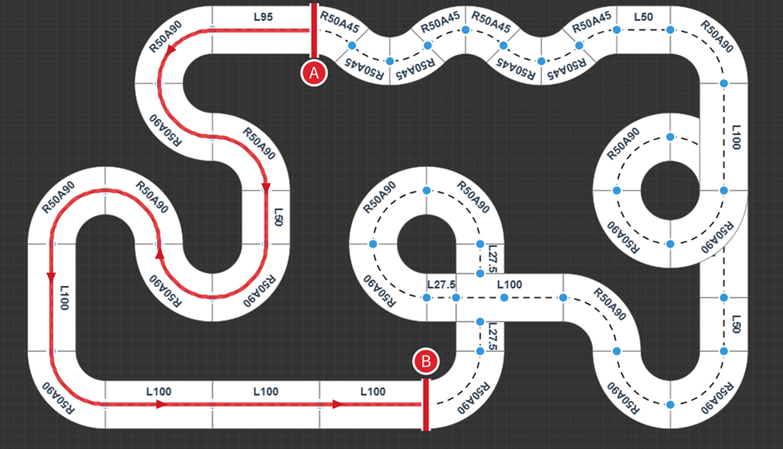

# R13 行为基准与 MPC 职责框架：最小赛道工程提案

2026-11-11，北京时间。状态：首版分期与行为范围已由用户确认，已形成[独立软件候选与验证记录](../../../releases/MPC_R13_MINIMAL_20261111_1/README.md)；未烧录、未实车通过。用户提出以 R13 较成熟设计为基准，采用 MPC 系统的职责框架，以 R4 等复杂构建为参考，先形成可跑完整赛道的轻量工程，再逐步改进。[架构决策](../../adr/0002-r13-minimal-track-baseline.md)。

## 可行性与推荐方向

建议采用“MPC 的职责框架、R13 的首版行为实现”。用户已将此方向理解为先按 MPC 的框架组织、目前仍按 R13 执行以方便后续接入；这里具体指支持 MPC 接入的职责和数据 Interface，并非首版先实现完整动力学模型或预测优化器。先保持已知控制行为与可比较性，明确感知、运动决策、轮速执行、生命周期和最终输出的 Interface，再逐项替换内部算法。不能因本提案而把此前针对米制 CONTROL 的设计改为已取消。

轻量化以减少运行职责交叉、构型和手工同步点为准，不以删除旧证据、测试或必要故障检查为准。交付目标是具备完成指定赛道所需功能，并通过相应实车验证；精简源文件本身不保证跑完全程。

## 参考版本不能混同

| 来源 | 可用作什么 | 已知限制 |
| --- | --- | --- |
| `RINGLOG13_20261110/source`，`MIDTERM_C26_28_RINGLOG13` | 原 R13 行为与普通道路经验标准 | 普通赛道稳定来自操作者描述，环岛未通过；历史原始 AXF 缺失，不能证明现存源码就是当时板载固件。 |
| `R13_LEGACY_SHADOW_20261111_1` | 早期迁移、隔离构建与发布记录参考 | 不是完整旧链逐项恢复；保留了不同轮速/PI和连续支持权重，不应仅因版本名当作原 R13。 |
| `R13_REAUDIT_SHADOW_20261111_SIDE2` | 完整链迁移与差分回归参考 | 软件最终输出对照覆盖更完整，但实车发生启动约 150ms 反向保护停机，不能当成熟全程版本。 |
| `R13_V2_START_GUARD_20261111_1` | 启动扰动处理的独立候选 | 软件构建/回归已通过，未烧录，新增门槛仍为工程候选。 |
| `METRIC_EXPERIMENT_20261111_4` 等 | 并发提交、候选身份复核、PI连续性、输入对齐和隔离实验的经验 | 一秒/一次加载等实验策略不适合直接继承为全程工程；米制主动控制仍有输入和验收缺口。 |

## 已确认的首版运行职责

1. **感知与道路证据**：沿用选定视觉基线，输出路径/元素证据、来源、帧号和采集时间；不同时更换检测算法。
2. **运动决策**：首版采用 R13 行为计算转向与左右轮目标；以后新的预瞄速度规划或 MPC 实现替换明确职责，避免两条动力策略同时参与最终决定。像素/归一化证据不伪装成米制数据。
3. **轮速执行**：保持选定基准中的轮速目标和 PI 配对，记录不同来源的差异，不能用“原 PI”混称 R13 条件积分与其他 PI 实现。
4. **生命周期与输出**：保留明确的物理授权、STOP、严重故障、帧/采样新鲜度与唯一 writer；每类决定只有一个清楚所有者。启动反向故障单独闭环，不靠精简构建自动认为已解决。
5. **最小配置与诊断**：明确版本和参数身份，保留必要停车查询与已有诊断。首版不要求持续 SD 写入、图像录像、复杂参数持久化或自动寻优。

保留 R4 中已验证有价值的机制时，需要逐项证明它适用于选定 R13 行为；不能把 R4 整套 runtime、旧控制、影子包装和实验限制一起搬入。

## 可后置内容与设计关系

首版选择 R13 真实动力，MPC 的算法实现先保留清晰的替换位置，不要求影子计算常驻运行。它是分期运行基线，不声称已经完成米制规划主动接管。

[ADR-0001](../../adr/0001-planner-near-authority.md)的规划器 near 权威、首次 near+full、连续降级与零速等待设计仍对应后续米制 CONTROL。首版以 R13 行为建立分期基线，暂不把这些米制主动接管前置叠加到 R13；原无道路、STOP和严重故障处理仍需保持。像素/旧控制近场与规划器米制近场的定义继续区分，不能通过改名混同。

用户已确认首版沿用 R13 的 C26 物理开关启动、停止。上电自动运行、配置/运行双固件与参数持久化后置；[此前设计](../metric-control-experiment-20261111/POWER_CYCLE_CONFIGURATION_DESIGN.md)保留为后续目标。实施时核对所选 R13 基准的具体开关与故障恢复行为，不引入第二个启动管理器。

## 最小构建与验证路线

选定唯一冻结行为基准与源码来源后，用版本化构建策略生成隔离 `.build` 树；生成目录作为可再生构建产物，不在那里长期维护第二套手改主源码。保留已有工程与冻结证据，使用独立版本和输出目录。

复用 R13 完整控制链差分和既有视觉/输出/启动回归，先验证行为保持，再针对已定位的启动问题验证。完成 Host 与 ARM 构建后，实际赛道要分别覆盖普通直弯、恢复及指定元素；环岛若在全程内必须单独解决，不由普通赛道通过代替。

提供下载工程时，按原 R13 工程约定独立保存源码、AXF/BIN、哈希、构建与验证记录，并给出完整 Windows 工程路径与 Target。实施阶段已准备软件候选，见上述验证记录；未操作串口、复位、下载或发车。

## 首版完整赛道范围

用户明确以本次提供的完整赛道图作为首版范围，不能只验收红色 A→B 段或普通直弯就称全程完成。这里的“所有赛道”按所附整张布局理解，不扩大为任意未知赛道均已适用。

从原图可确认：较长直道、多段不同曲率的连续弯/回头弯、上方连续 S 形弯、中央与右上两处环形结构，以及环形结构和普通道路之间的进出交接。它们均须纳入首版能力与连续全程验收，不能把环岛作为跑通后的可选项。图中环形区域的交汇不能未经规则确认就泛称为标准十字；也不由图外推坡道等未给出的元素。

用户已确认：A 出发，沿红色方向到 B，继续完成其余道路并回到 A，算完整一圈；中央与右上两处环形结构各只绕一圈，要求“一笔画完”。据此，B 是全程中的中间位置，不能在 B 宣告完成。

本说明将“一笔画完”按整次行驶连续完成、不中途人工搬车或重新起跑理解，而非要求图论意义上每段边恰好通过一次。环形进出使用图示连接的主路线，不无限绕环或通过重新起跑拼接分段结果；具体出口识别、绕行完成证据及防止重复入环由后续实现明确。完成一圈的验收点为返回 A，本轮没有因此额外确定自动终点停车功能。

图中长度与半径标注只作图纸原始标签，尚未核定单位或实物尺寸，不据此计算全程长度或生产曲率。

建议的验收顺序为：启动→普通直弯与连续 S 弯→每处环形的进入/环内/退出→出环后普通道路重获→不重启的连续全程。该顺序是验证分解，不减少最终完整路线范围。

原图按用户附件逐字节保存，SHA256：`4666a10c66f1c35afbc8a41bd493a171348c175237ab221f8889c58645a3cd35`；原始位置为 `C:\Users\zfn19\AppData\Local\Temp\codex-clipboard-90375a46-eb1b-47fb-9c36-e9cb81138178.png`。这是赛道设计输入，不是实车识别结果或新增行驶录像。

## 已确认的路线辅助与首版验收

允许使用已知赛道顺序辅助当前视觉识别：普通道路→中央环形→右侧道路→右上环形→上方连续 S 弯→回到 A。顺序用于缩小预期元素、减少误触发和防止重复入环；进入和退出仍必须有当前视觉证据，不能仅按定时器或轮程盲目生成转弯。具体元素事件与已完成状态应在同一条实际控制链内衔接，不再产生独立动力所有者。

首版验收范围已经收敛为：C26 准入与停止、普通道路连续运行、上方 S 弯、中央与右上环形各一次的完整进出、出环重获，以及 A→B→其余图示道路→A 的一次连续全程。启动反向保护问题必须独立核查；不能由源码精简或 Host 通过推定已解决。

软件实施已固定源码/参数身份、整理 Interface，并实现当前弧线/出口资格、可用道路重获及两次视觉环形事件预算，通过专项回归及目标构建。两次视觉事件不等于两处各绕完整一圈，亦不能证明回到 A。实车完成全程仍需另行取得运行证据；本记录不自动授权烧录或发车。

## 证据与自查

- [R13 早期重构及边界](../r13-control-refactor-20261110/README.md)
- [SIDE2 完整迁移报告](../../../.build/r13-audit-side-v2/user-report.md)
- [SIDE2 实车启动故障](../../../.build/v2-track-20261111-040756/user-report.md)
- [启动保护候选](../../../releases/R13_V2_START_GUARD_20261111_1/README.md)
- [R4 实验报告](../metric-control-experiment-20261111/user-report.md)

提案形成时，Markdown 直接读取；C、工程 XML、JSON为 `structured_parsed`，所述回归、差分与构建引用各自历史 `computed` 记录。赛道按原始 PNG 版面直接查看，图像哈希为 `computed`；未据提取文本推断几何，没有依赖 `md_extracted` 给出精确公式/数值，也无新增 PDF 验证结论。之后的软件实施、改动范围及新执行结果单独见[候选报告](../../../releases/MPC_R13_MINIMAL_20261111_1/README.md)，不将其解释为新增实车测量。未修改全局配置、技能或持久 Agent 行为。
