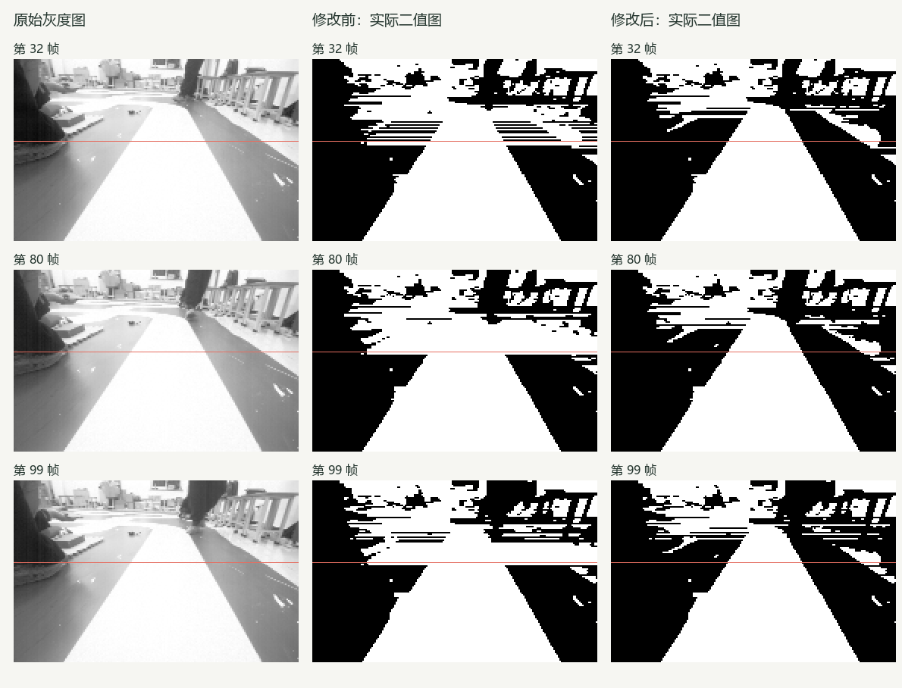
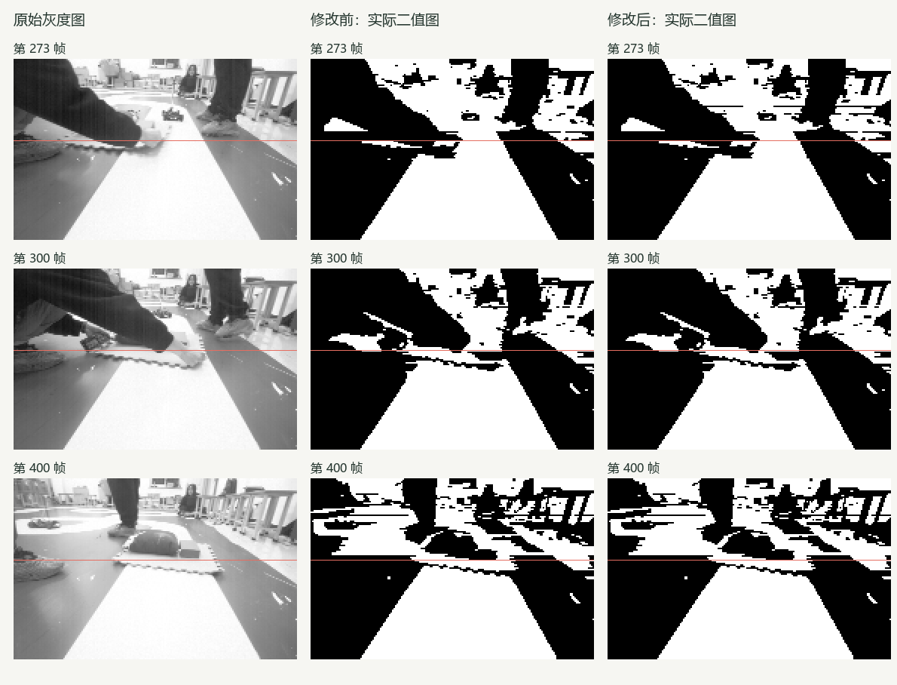

# 灰地面误识别修复与回归报告

**阅读提示：** Host指开发计算机，near/full分别指规划器近场/完整路径预瞄；本页局部图像验收、预瞄可用率及主机耗时是不同指标。详见[术语索引](../../MPC_TERMINOLOGY.md)和[阅读指南](../../MPC_GUIDE.md)。

**结论：原故障已在选定原图上修复，图像局部验收通过。** 全套 Host 回归结果 `PASS`：通过 62 项，跳过 1 项，失败/错误 0 项；另有 Keil 候选构建通过。未进行板端时序或实车验收。

## 为什么误识别，以及如何导致远近失效

暗物体、亮灰地面、白色赛道同时出现时，初始逐行大津法可能先把“暗物体”和“地面＋赛道”分开。旧实现又要求中间亮类均值至少达到白类均值的75%，否则拒绝继续细分。第32/80/99帧恰好低于门槛，阈值停留在127/139/130，灰地面随赛道一起变白。

这会抹去真实黑白边界，出现无双边或路口补线。近/完整预览需要指定采样行上的真实双边，再经过投影和历史检查；上游分割错误使这些条件不成立，所以原图明明看得见路，预览仍被拒绝。完整预览要求更多、更远的行，因此拒绝更容易发生。

这次不是修改有效标志或放宽几何门槛。保留原有阈值和阴影保护路径，在原75%门槛拒绝时增加局部证据：候选通道足够宽、左右三像素内外都有至少18灰度的平均跃变，且两侧具备地面证据；初始阈值已分开一侧地面时，再要求两侧外部亮度相近。必要时只追加一次亮类细分。

参考 [上交 AuTop 原始图像处理实现（固定版本）](https://github.com/SJTU-AuTop/RT1064-Code/blob/4038f81ad85f915adc988f3791887b1c823ae350/Project/CODE/imgproc.c) 的局部灰度对比思路，按本项目实现了有边界检查的行内判据。没有整体移植其迷宫巡线、标定参数或状态机。模块接口和依赖关系未改；没有增加图像大小的缓存。

## 原故障图像验收

图源：session04 的原始188×120灰度帧，按记录SHA/CRC核验；中、右列分别来自修改前后原生C算法实际输出。放大采用最近邻；红线标示第54行，不是检测结果。帧号从0开始。

| 验收内容 | 修改前 | 修改后 |
| --- | --- | --- |
| 第54行：左灰地面/白赛道/右灰地面 | 白/白/白，失败 | 黑/白/黑，3张均通过 |
| 第49/54/61/70行局部双边 | 原故障未被旧28组参考覆盖 | 新增12组参考带均通过（容差±3像素） |
| 第32/80/99帧近端与完整预览 | 存在拒绝 | 观察/路线识别两种模式均通过 |
| 既有28组边界 | 通过 | 通过，平均误差 0.429、最大 1 像素 |

新增12组边界平均误差 0.458、最大 1 像素。两组参考均为目视近似带，且在算法试验后选取：40组局部边界通过不能写成750帧全图准确率。原单帧冷启动和0～99帧连续回放均重新验证。

## 750帧回放与耗时

| 指标 | 修改前 | 修改后 |
| --- | ---: | ---: |
| 近端预览可用 | 470/750 | 530/750 |
| 完整预览可用 | 376/750 | 459/750 |
| 原先可用帧变为拒绝 | — | 0（逐帧集合比较） |

可用率表示几何链路接受，不是识别准确率。两种路线识别模式均得到相同的530/459可用帧数。

| 模式 | 修改前均值 / P95（ms） | 修改后均值 / P95（ms） |
| --- | ---: | ---: |
| 路线识别关闭 | 0.185 / 0.272 | 0.178 / 0.228 |
| 路线识别启用 | 0.224 / 0.310 | 0.206 / 0.244 |

条件：同一主机、同一GCC及优化选项、同一750帧输入，每模式预热2轮、计时5轮。这里只报告两次实测观测值；没有批准的耗时回归基线，不据此宣称性能提升，也不能换算成板端耗时或120 ticks/10ms实车能力。

## 剩余拒绝与验收边界

| 原因（原生诊断复核） | 近端拒绝帧 | 完整预览拒绝帧 |
| --- | ---: | ---: |
| 采样行不具备真实双边 | 203 | 234 |
| 历史一致性拒绝（冷启动复查确认） | 7 | 7 |
| 投影非前向 | 3 | 47 |
| 超出配置地面范围 | 7 | 3 |

第273/300/400帧展示物体、手等遮挡场景，这三帧近端和完整预览均被拒绝。不能据此把全部剩余拒绝归因于遮挡；投影范围与历史一致性问题按上表保留。算法仍依赖轴线种子和可见的局部边缘，不能保证强阴影、过曝或遮挡下恢复不可见赛道。既有半幅阴影60%～95%保护测试通过；40%～55%强半幅阴影不在本次合格范围。

通用 performance-host 占位套件因缺少数据/批准基线跳过；本次实际图像性能套件已独立执行。MSVC、ASan、MCU实时耗时、相机DMA与实车行驶均未验收。

## 回归过程与复查

| 本轮运行 | 结果与含义 |
| --- | --- |
| [修改前图像基线](../../../.test-results/20261109T160726-2930bc00df/user-report.md) | 原28组参考通过，但未覆盖故障图 |
| [阶段回归](../../../.test-results/20261109T160820-a550e98c37/user-report.md) | 首版故障像素与原有视觉测试通过 |
| [阶段回归](../../../.test-results/20261109T160842-41970bf008/user-report.md) | 固定470/376断言失败；原28组边界通过 |
| [阶段回归](../../../.test-results/20261109T161014-ff764d7875/user-report.md) | 新增解析场景检出2处遗漏，未通过 |
| [阶段回归](../../../.test-results/20261109T161041-497b381417/user-report.md) | 同一遗漏的定点复现，未通过 |
| [阶段回归](../../../.test-results/20261109T161141-c3482aa155/user-report.md) | 补充局部两侧亮度判据后通过 |
| [最终完整Host回归](../../../.test-results/20261109T161249-4b30605552/user-report.md) | {'PASS': 62, 'SKIPPED': 1}；输入未变化 |

最小复现：`python tests/vision/test_ground_merge_regression.py --indices 32 --cold --output .build/<新目录>`。修改前已真实失败，修改后冷启动通过；新增解析回归对未修改旧源码运行得到53个失败，最终源码通过，证明用例能检出原问题。

Keil：0错误、0警告；候选视觉源文件SHA与最终回归一致；未烧录。[构建日志](../../../.build/vision-autop-fix-20261110/target-build/build.log) · [候选记录](../../../.build/vision-autop-fix-20261110/target-build/candidate.json)

自查：原始输入逐字节一致；前后诊断采用相同几何配置（配置仅更新源文件绑定/版本标识）；既有可用帧无丢失；缺失边界仍按失败统计；旧参考实现保留；生产代码无临时调试输出；无全局skill或配置变更。

证据层：代码与原始灰度布局直接检查；JSON/CSV/VQF元数据为 `structured_parsed`；逐帧比较、误差、耗时和原生C重放为 `computed`。未使用仅文本提取的公式/数值作为结论；无 `md_extracted` 独占结论。

[逐帧前后对照](frame-comparison.csv) · [汇总证据](evidence.json) · [最终详细日志](../../../.test-results/20261109T161249-4b30605552/summary.md) · [单帧红灯证据](../../../.build/vision-autop-fix-20261110/initial-red/result.json) · [最终冷启动证据](../../../.build/vision-autop-fix-20261110/final-cold/result.json)

## 本轮修改文件

| 文件 | 用途 |
| --- | --- |
| [demo/code/vision_midterm.c](../../../demo/code/vision_midterm.c) | 局部对比与受控亮类细分 |
| [profiles/phase3-c26-shadow-20261109.json](../../../profiles/phase3-c26-shadow-20261109.json) | 重新绑定视觉源码版本，保留影子配置 |
| [tests/vision/test_equivalence.c](../../../tests/vision/test_equivalence.c) | 独立排序/区间枚举预处理判据 |
| [tests/vision/test_vision.c](../../../tests/vision/test_vision.c) | 亮度/宽度/位移解析图像回归 |
| [tests/vision/test_ground_merge_regression.py](../../../tests/vision/test_ground_merge_regression.py) | 故障像素、双边和近/完整预览验收 |
| [tests/vision/fixtures/ground-merge-cases-20261109.json](../../../tests/vision/fixtures/ground-merge-cases-20261109.json) | 新增12组目视边界参考 |
| [tests/vision/test_image_regression.py](../../../tests/vision/test_image_regression.py) | 保留旧可用数下限，允许正确改进 |
| [tests/planning/test_shadow_preparation.py](../../../tests/planning/test_shadow_preparation.py) | 保留旧可用数下限与控制约束 |
| [tests/suites/catalog.json](../../../tests/suites/catalog.json) | 将故障回归纳入Host/PreFlash/Diagnostic常规入口 |

本目录保存报告、实际图像、逐帧CSV和证据JSON；其他已有工作区改动保持原状。全局配置、skill、AGENTS.md未在本轮修改。
