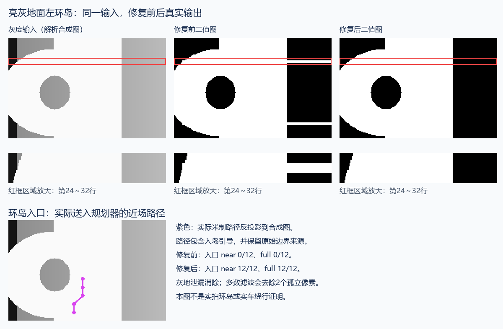
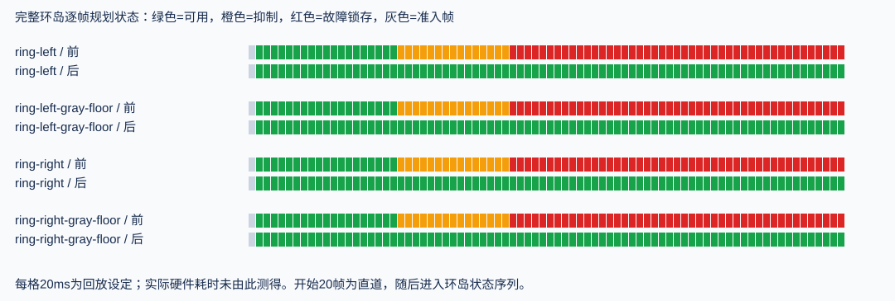

# 视觉识别与规划集成修复回归

**最终结论：当前已纳入回归的图像识别、主机时序和集成契约全部通过；连续米制环岛合成场景验收通过。** 完整GCC Host通过63项、跳过1项、失败/错误0项；跳过的是缺少数据/基准的原有通用性能占位项，实际图像性能测试已执行。 本轮修复亮灰地面环岛分割遗漏，以及环岛路径未进入米制规划的问题。模块依赖、速度目标、地面投影范围和保护超时预算不变。

## 问题怎样发生、怎样修复

| 问题 | 已验证原因 | 修复 |
| --- | --- | --- |
| 灰地被当成白赛道 | 暗物体贴近环岛边缘，使一侧局部灰度偏暗，原双侧对比规则拒绝再次分割，地面与道路仍归为一类 | 当另一侧有足够长、平滑且延伸到画面边缘的灰地证据时，允许有界的阈值修正；原阴影保护回归保留 |
| 识别环岛但规划停止 | 适配器只接收真实双边中点，拒绝单边推算/补线，也没使用入岛引导；近场恢复前达到300ms窗口并锁存 | 普通道路仍要求真实双边。当前环岛候选/状态下，检查宽度、一侧实测边界、画面内中心和补线锚点，采用方向/范围有效的入岛引导；不把推算改写为实测 |
| 测试只看有效标志，难以证明路径正确 | 仅有near/full接纳不能说明规划器使用了引导路径 | 独立重算采样点及三点中值滤波后的米制横坐标，与实际规划历史逐点核对；增加错误方向、缺失宽度、无环岛证据、残缺补线等反例 |

这里的near/full分别是规划器近场/完整路径预瞄，不是旧控制器的两项同名观察；IoU（交并比）为预测白区与参考白区交集面积除以并集面积。[术语索引](../../MPC_TERMINOLOGY.md)。

图片取自同一解析合成左环岛的第31帧，采用原生C算法的实际二值输出。紫色是规划器实际近场路径按合成映射反投影的位置，不是人工画出的理想路线。放大区显示原来的灰地泄漏。

## 场景与准确度

750帧原图的28组既有局部边界参考、3张故障图的12组补充边界及指定灰度像素，均在路线识别开/关模式通过。近场/完整预瞄分别接纳530/459帧，未下降；这两个数是可用率计数，不是准确率。

| 检查 | 修复前 | 当前定点结果 |
| --- | --- | --- |
| 左/右环岛及亮灰派生，共4个完整序列 | 4/4出现近场锁存，每个序列49个环岛状态帧均被抑制 | 4/4持续产生规划候选，环岛状态帧抑制0、锁存0；预热后每帧near/full与规划候选均接纳 |
| 亮灰左环岛入口白区IoU | 96.94% | 99.98%，与基础曝光一致 |
| 合成图像像素比对 | 原先仅记录阶段末帧IoU | 每帧第24～110行与解析白区经既定三像素多数滤波的期望结果比对，差异为0；两个孤立像素被滤波去除，未伪称原始白区100% |
| 实拍预览的环岛方向/反例 | 既有覆盖 | 11/11正例及派生姿态方向正确，8/8反例及派生姿态未入岛；共10个原姿态，不是19张独立原图 |

当前场景回放57个场景/配置组合，共2030帧；包括直道、左右弯、左右完整环岛、侧裁切、十字路口、开放暗区反例、短/长near和far丢失及整帧失明。已有透视/安装姿态和图像一致性测试另由统一回归执行。

## 延时与时序契约

- 相机20ms、编码器和规划器10ms，连续80周期通过；复用未过期图像不会伪造新帧。
- 另9周期模拟相机停更：缓存过期后归零并锁存整帧失效，不能刷新旧时间戳继续行驶。
- 重复帧拒绝更新几何历史；图像年龄99ms接纳、100ms拒绝。时间戳对齐、丢样、跨回绕、身份/配置版本与故障保持由已有集成测试共同覆盖。
- 高速突然失去完整预瞄仍可能进入不可行保护，这是保留的契约，不作为降级成功。没有放宽窗口、清除锁存或自动重新准入。

750帧原图、2轮预热及5轮计时，Windows/GCC优化构建。P95表示95%的样本不超过该耗时；“最大”是本次观察的最大值，并非最坏执行时间保证。

| 视觉运行模式 | 均值 | P95 | 本次最大值 |
| --- | ---: | ---: | ---: |
| 路线识别关闭 | 0.173ms | 0.208ms | 0.341ms |
| 路线识别开启 | 0.204ms | 0.228ms | 0.428ms |

米制适配P95为0.0007ms。无批准的性能基准，本轮不声称提速比例或已通过板端截止时间验收。

**板端最坏执行时间、相机至控制输出总延时、实体车辆绕行和120 ticks/10ms平均车速未在本轮验证。** 10ms编码器计数单位并不能直接充当算法耗时验收。

## 证据范围与记录

750帧原图含遮挡/不可用图，只有已有局部边界标签及三个故障图的补充标签；不能据此保证全部750帧的全像素识别准确度。静态94×60环岛预览不能代替原始分辨率的动态环岛数据，另一安装条件的地面映射也不会被强制接纳。当前能交付的是覆盖范围明确的图像断言、主机时序和软件集成验收。

失败信号先于修复建立：[原始环岛复现](../../../.test-results/20261110T085552-328b61e6aa/user-report.md)、[灰地分割失败测试](../../../.test-results/20261110T085823-54928e7a5c/user-report.md)、[环岛引导适配失败测试](../../../.test-results/20261110T085951-e8947cffcc/user-report.md)。三者均非通过修改期望输出制造通过。

新增停更测试曾误将整帧过期预期为临时归零，[该轮失败保留](../../../.test-results/20261110T090926-0890146dc2/user-report.md)；依据已有整帧超时锁存契约修正测试，生产保护逻辑未改。[随后定点验证通过](../../../.test-results/20261110T091708-0a911df680/user-report.md)。

数据来源使用原生JSON/CSV（structured_parsed）及原生C回放、解析图像统计（computed），图片已目视复查；无仅凭文档文本提取作出的数值结论。没有修改全局skill、AGENTS.md、硬件参数或执行烧录。

## 最终运行与自查

- [完整Host用户报告](../../../.test-results/20261110T091724-79ef7668ca/user-report.md) · [统一结果JSON](../../../.test-results/20261110T091724-79ef7668ca/run.json)：软件PASS、场景PASS、显式验收命令返回0。`releaseEligible=false`仍保留，因为本轮为GCC而非完整MSVC放行条件；不代表硬件授权。
- [场景逐项报告](../../../.test-results/20261110T091724-79ef7668ca/suites/vision-scene-integration/artifacts/work/vision-scene-integration/user-report.md) · [逐阶段结果](../../../.test-results/20261110T091724-79ef7668ca/suites/vision-scene-integration/artifacts/work/vision-scene-integration/cases.md) · [时序检查日志](../../../.test-results/20261110T091724-79ef7668ca/suites/vision-scene-integration/artifacts/work/vision-scene-integration/timing-contract.log)。
- [ARM源码编译回归](../../../.test-results/20261110T090817-2937e80f04/user-report.md)：通过。不是完整固件链接/烧录或板端测速。
- [本轮摘要、源码与图片来源哈希](evidence.json)。图中输出取自同一最终算法的定点运行，并逐字节核对与最终完整回归一致。

自查：原始失败用例已变绿；最终回归期间输入未改变；四个环岛均无阻塞案例；验收子报告哈希与统一结果一致；图像和链接已检查；没有残留`[DEBUG-...]`日志。临时最小复现和时序探针留在`.build`的明确诊断目录，固定测试已并入统一入口。

实现集中于[视觉阈值修正](../../../demo/code/vision_midterm.c)、[路径适配](../../../tools/speed_planning/vision_adapter.c)、[场景/时序探针](../../../tools/testing/vision_scene_pipeline.c)和[图像与路径验收](../../../tools/testing/vision_scene_integration.py)。影子配置仅重建源码绑定与版本，运行数值及主动控制禁用状态保持原样。
