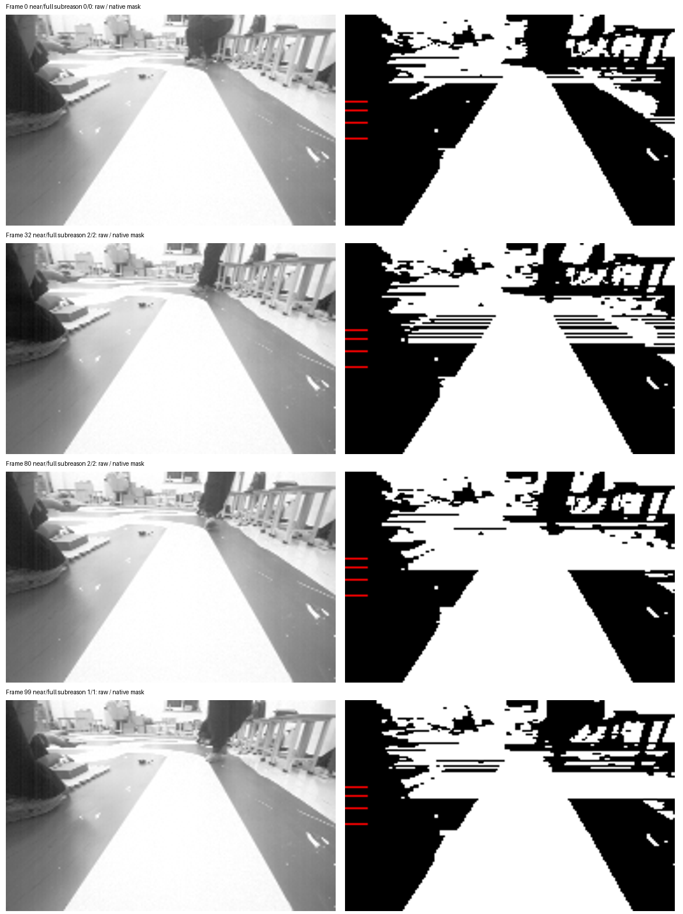
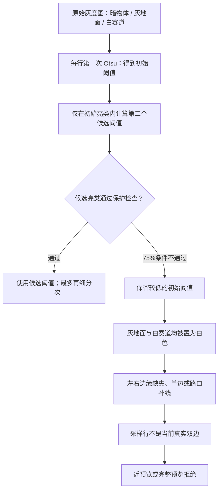

# 亮灰地面并入白色赛道：视觉识别诊断报告

日期：2026-11-09。对象：当前 C26 视觉及 Phase3 米制预览代码，750 帧静止采集会话中的典型帧。状态：**已复现并定位具体分割条件；生产修复尚未实施。**

## 结论

这次观察到的误识别发生在软件的**按行灰度二值化**：原始图中亮灰地面和白色赛道仍有亮度差别，但图像中较暗物体影响了 Otsu 的第一次分组，使灰地面和白赛道落入同一个亮类。程序本来可以再次细分亮类，但其“中间亮类均值至少是最亮类均值的 75%”保护条件在部分行不满足，于是保留了过低的第一次阈值。

以第32帧、第54行为例：当前阈值是 **127**；目视位于灰地面的 `(x=40,y=54)` 原始灰度是 **192**，赛道上的 `(100,54)` 是 **255**。两者都高于127，三点投票后的原生二值图里都是白色。原来可见的地面与赛道边界因此在二值图里消失。

二值白色只表示“通过当前亮度阈值”，并不是相机输出的语义分类。后续路径算法会尝试在白色区域里追踪边界或补线；在此例中第54行被标记为路口补线而非当前真实双边。米制预览明确要求这些采样行是真实双边，所以近端与完整远端都拒绝该帧。

## 1. 涉及的数据与适用范围

- 原图来源：`docs/changes/phase2-calibration-20261108/evidence/visual-continuous/session04`，188×120、8位灰度，750帧。每帧有独立VQF及会话元数据。诊断编号从0开始；第32帧是 `frame-0032.vqf`，本报告的 `(x,y)` 同样从0开始。
- 这是一段**静止采集、包含人为干预和遮挡**的会话，不等于完整赛道的行驶数据。第0、32、80、99帧被选为可见直道的针对性案例；原始图经目视核查，并非独立全图像素标注。
- 原生离线回放使用当前 C 图像模块和米制适配器；每种路线识别状态按时间顺序回放。报告中的具体掩膜和行结果来自路线识别关闭的回放；已有另一次启用路线识别的回放显示这些案例和总体拒绝统计一致。
- 回放使用**均匀20ms帧间隔和合成静止编码器**以检查软件组合；不能把它当成高速运动、真实里程、板端时序或停车性能的证据。
- 本次对四个案例分别重新核对 VQF 的 SHA、CRC/元数据、代码哈希、独立有理数 Otsu 计算，以及整行三点投票结果与原生二值掩膜一致。[可机器核对的逐项数据](evidence.json)。

下图每组左边为原始灰度图，右边为实际 C 代码生成的二值图；红线标出部分审核行。白色区域向地面扩张在第32、80、99帧尤为明显。



## 2. 正常路径和实际误识别路径

处理逻辑可以按下图理解，箭头表示实际数据依赖：



1. [`vision_midterm_process`](../../../demo/code/vision_midterm.c) 先计算整图直方图和对比度，再针对 ROI 中对比度足够的行分别使用 `road_otsu`。低对比度行会退回整图阈值，不能把所有行的问题都归因于本报告的亮类细分。
2. 第一次按行 Otsu 本质上只分两类。图像某行里可能同时有很暗的背景、亮灰地面、白色赛道等多个亮度群；当较暗像素影响分割时，统计上最合适的两类切分可能是“暗背景 / 其余亮区域”，而不是“地面 / 赛道”。是否由某一具体暗物体导致，还需改变该物体或受控输入的反事实试验；现有数据已确认的是阈值和误合并结果。
3. `refine_road_otsu` 对第一次阈值以上的亮类重新求第二个 Otsu 阈值，并检查亮类像素数量、亮度跨度、两组像素数、组间亮度差、两组均值比例及轴线连通区中点等条件。它最多被调用两次；不通过时保留当前阈值。
4. 当条件通过，较高的候选阈值有机会把灰地面排除；当条件失败，当前例子里的阈值127会同时把灰地面和白赛道置为亮。程序随后对每个像素使用相邻三个像素的多数票，减少孤立噪声。大块连续灰地面越过阈值后仍会保持白色，多数票不能把它还原为背景。
5. [`reference_route`](../../../demo/code/vision_reference_route.h) 从二值图找边和可用中心线。输出 `row_flags=3` 代表当前双边；`1/2` 代表单边与模型推算，`4` 代表路口补线，`0` 代表该行无有效结果。可视化中画出的 `left/right` 不一定都是真实边缘，必须同时看标志。
6. [`sp_vision_preview`](../../../tools/speed_planning/vision_adapter.c) 要求整帧有效、状态为 TRACK、质量合格，且全部指定行满足 `row_flags=3` 等条件；任何一个必需行失败即可拒绝整个预览。

## 3. 第32帧：用真实数值还原一次失败

第54行共188个像素。第一次 Otsu 阈值 **127**，在该阈值以上再次计算出的第一轮候选是 **213**。第二次分组的统计如下；这里“中间亮类/最亮类”是按阈值统计的像素集合，不能无条件视为完美的人工地面/赛道标签。

| 第二次分组 | 定义 | 像素数 | 灰度总和 | 平均灰度 |
| --- | --- | ---: | ---: | ---: |
| 中间亮类 | 127 < 灰度 ≤ 213 | 71 | 12939 | 182.2394 |
| 最亮类 | 灰度 > 213 | 83 | 20308 | 244.6747 |

当前保护条件是：

```text
中间亮类平均灰度 >= 最亮类平均灰度 × 0.75
182.2394 >= 244.6747 × 0.75 = 183.5060   → 不成立
```

等价整数条件在代码里写为 `sa*4*b < sb*3*a` 时拒绝细分，其中 `a=71、sa=12939、b=83、sb=20308`；两侧分别为 **4,295,748** 和 **4,325,604**，确实进入拒绝分支。差值约 **1.2666灰度级**，但触发的是整行阈值的离散选择：保留127，而不是采用本轮候选213。

| 位置与原始灰度 | 原生阈值127后的三点投票 | 仅该行强制候选阈值213的三点投票 |
| --- | --- | --- |
| x=40，灰度192，目视为左侧灰地面 | 白 | 黑 |
| x=100，灰度255，目视为白赛道 | 白 | 白 |
| x=140，灰度175，目视为右侧灰地面 | 白 | 黑 |

原生第54行有 **154/188** 个白像素；只对这一行强制候选213后有 **83/188** 个。该计数包含视野内其他亮物体，不能直接当成赛道面积。这个受控计算仅说明候选阈值对这一行像素分离的影响；**没有修改整帧或重新运行路径跟踪，不能据此宣称候选阈值能修好整帧或安全上车**。

## 4. 同场景对照与阈值敏感性

| 帧 | 第一阈值 | 第一轮候选 | 中间/最亮均值比例 | 75%检查 | 最终阈值 | 第54行标志 | 整帧 valid |
| --- | ---: | ---: | ---: | --- | ---: | ---: | ---: |
| 0 | 131 | 216 | 76.075% | 通过 | 239 | 3 | 1 |
| 32 | 127 | 213 | 74.482% | 拒绝 | 127 | 4 | 1 |
| 80 | 139 | 210 | 74.183% | 拒绝 | 139 | 0 | 1 |
| 99 | 130 | 203 | 70.755% | 拒绝 | 130 | 4 | 0 |

第0帧第一轮通过后，程序还完成了第二轮细分，因此最终阈值是239而不是216。第32帧第54行虽然展示了两条 `left/right` 坐标，但 `row_flags=4` 表示它是补线，不是实际双边；其置信度和整帧有效也不能替代这一标志。

第99帧另有整帧级失效：输出包含33个路口补线行，但只有4个路口锚点。当前有效性条件要求有补线时至少8个锚点，所以即便 confidence=87，`valid` 仍为0。`confidence` 是覆盖评分，并不是“图像识别有87%概率正确”。

这些对照说明该规则在约75%附近存在**硬门槛**；它们并不能证明所有画面中阈值波动都由灰度噪声引起，也不能证明750帧中每个失败都来自这个规则。当前代码没有在这一判据上使用显式回差；跨帧切换与强光/曝光变化的量化关系仍需受控数据。

## 5. 如何传播到近端、远端和控制

本次 Phase3 候选配置：

| 米制预览 | 固定行，从近到远 | 本例第54行影响 |
| --- | --- | --- |
| 近预览 | 70、65、61、58、54 | 属于必需行，`flags=4` 导致拒绝 |
| 完整预览 | 70、65、61、58、54、52、49 | 同样包含54行，因此也被拒绝 |

[`vm_vision_frame`](../../../demo/code/vision_metric_io.c) 的近、完整预览各自计算并各自维护历史；完整预览不是机械地复制近预览的布尔值。它们共享前五个采样行，所以共享行失效时都可能失败。完整预览还多检查52、49行，所以也可能出现“近有效、完整远端无效”。

传统视觉转向控制的近带和米制近预览不是同一组行：C26 近带中心约为图像第102行，而米制近预览是54～70行。不能只看图像底部白路是否可见，就判断米制近预览应当有效；也不能把米制近预览失效直接等同于传统控制器的 near 标志失效。

影子规划监督器的设计中，近预览失效会进入无路恢复并抑制动力候选；近有效而远端失效时会进入受预算约束的降级，超出时间或距离预算后请求受控停车。当前候选是影子模式，默认主动规划接管关闭；上述是代码/离线组合行为，不能声称这段静止回放已经证明实车实际输出或停车距离。

## 6. 出现范围：有多少是这个原因？

750帧中近米制预览接受470帧，完整预览接受376帧。首个拒绝原因统计如下；一个帧可能同时有多个问题，分类不是所有缺陷的并集。

| 首个拒绝原因 | 近预览 | 完整预览 |
| --- | ---: | ---: |
| 采样行不是当前真实双边 | 256 | 310 |
| 原始状态或质量不满足 | 6 | 6 |
| 有历史时被拒、清空历史重试通过 | 8 | 8 |
| 地面点前向坐标不递增 | 3 | 47 |
| 超出候选地面域 | 7 | 3 |

统计中包含人员、手和物体遮挡，**不能把256或310帧都归因于亮灰地面，也不能称之为256或310帧误识别**。例如第434帧存在物体遮挡，跟踪点跳到其他区域后，地面前向坐标出现倒退；这种拒绝具有独立原因。8帧历史分类通过对同一原生适配器做清空历史的诊断重试确认；重试不参与实际控制。

近、远预览组合为两者有效376帧、仅近有效94帧、两者无效280帧；该数据集中没有出现“近无效而完整有效”的帧。这不足以证明这种组合在其他数据中不可能发生。

## 7. 当前措施、未解决问题与建议

**已有措施：** 代码已有亮类二次细分、像素数量/对比度/连通性检查和75%亮度比例保护；后者目的是避免把阴影中的半条赛道错误当成灰地面。预览另要求真实双边，并检查投影顺序、地面域和历史跳变。既有合成回归覆盖亮灰地面与中等半边阴影，当前局部人工参考带也有28组通过。

**仍未解决：** 第32、80、99帧的清晰直道失效仍然存在。现有28组参考只覆盖另外7帧，并在早期算法试验之后选取；通过这28组不能覆盖本次困难案例。已有文档还记录更强半边阴影的一些既存失败；不应把当前阴影保护描述为对所有阴影均有效。

**建议的内部修复方向（尚未实现、尚无通过证据）：**

1. 在视觉模块内部重新评估亮类细分的证据，结合当前行赛道连通形态、可见双边及相邻行一致性，区分“灰地面＋白赛道”与“赛道半边阴影”。明确处理边界刚好接近75%的情况；具体规则和门槛需要实验支持。
2. 用原始图的32、80、99帧和相邻帧建立**带明确期望的困难样例**，并加入独立标注的直道、弯道、阴影、强光、遮挡、无路及真实路口数据，避免只优化已知四帧。对真实遮挡应允许安全拒绝，不能把提高接受率当成唯一目标。
3. 每次修改同时检查：灰地面误合并、真实赛道漏检、假路口、单边与补线的标记、近/远预览接受和错误接纳；保留现有半边阴影及基础图像回归。评估连续帧的阈值/边界抖动，而不只查看静态单帧。
4. 以当前性能测试比较主机处理耗时，再单独测 RT1064 运行时的执行时间及视觉到控制的端到端延迟。局部图像成功不等于在120 ticks/10ms下可稳定行驶。
5. 优先维持现有模块职责和数据依赖。是否需要扩充接口或标注字段，应以候选实现和回归结果决定；目前没有证据支持通过去掉双边/地面域/历史检查或直接放松超时来解决上游误分割。

## 8. 复现与证据层次

先运行性能回归生成原生掩膜和逐行数据，再运行本次行级复算：

```powershell
python tools/testing/run_tests.py --profile Host --suite performance-vision-images --compiler gcc --mode optimized --jobs 1
python tools/testing/audit_ground_merge.py --artifacts <本次运行目录>/suites/performance-vision-images/artifacts/work/vision-image-performance --output <输出目录>/evidence.json
```

第二条命令中的两个尖括号路径为占位符，需要替换。脚本会拒绝当前源码与被检查的回放源码哈希不同的情况；它核验四帧VQF、计算阈值并逐像素核对三点投票掩膜。脚本使用 `masks.gray` 和 `rows.csv`，它们由性能测试生成，完整文件默认位于 `.test-results`，不包含在本报告的精简证据中。

本次实际执行：

```powershell
python tools/testing/audit_ground_merge.py --artifacts .test-results/20261109T110931-d0057bad42/suites/performance-vision-images/artifacts/work/vision-image-performance --output docs/changes/vision-ground-merge-diagnosis-20261109/evidence.json
```

`structured_parsed`：读取原生 C 源码、JSON、CSV 和 VQF；`computed`：SHA/CRC、Otsu/比例及原生三点投票复算；原始布局视觉核对：查看原始灰度与原生二值图，判断示例探针落在可见灰地面或赛道上。没有依赖 `md_extracted` 的关键结论，也没有 PDF 表格/公式需要 `pdf_verified`。原图语义仅为选定案例的目视判断，尚无独立全图真值；具体行的数值和掩膜已计算核对。

更广泛的近远端拒绝统计、测试执行情况和证据清单位于[视觉性能与失效审核](../vision-performance-20261109/README.md)。
