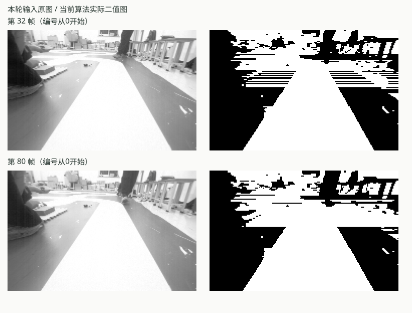

# 图像误识别复查报告

**结论：灰地面误并入白赛道的问题尚未解决。** 本次用当前原生C算法重放原来的故障图像，新专项检查失败；四个相关图像/几何源码文件的哈希也与原诊断版本一致。

本轮执行于2026-11-09 23:59（北京时间），GCC optimized、本机回放；仅核验软件及原图案例。不是新的板端或运动测试。


| 检查 | 本轮结果 | 含义 |
| --- | --- | --- |
| 原始故障像素专项 | **失败** | 第32、80、99帧，两种路线识别状态共6例均复现误合并 |
| 750帧图像性能与局部质量 | 通过所设门槛 | 近预览470/750，完整预览376/750；可用率不是准确率 |
| 既有7帧、28组局部边界参考 | 通过 | 原有参考不包含上述三张故障图，不能证明问题已修复 |
| 单独输入第32帧、清空历史 | **连续两次失败** | 误合并无需前序帧或学习历史就能发生 |

## 这次实际看到什么

在原始图像的第54行，x=40和x=140经原图目视复核为可见灰地面，x=100为白赛道。本次新检查直接读取原生C算法生成的二值像素；灰地面应为0、赛道应为255，而非只检查程序能否执行。

| 帧号 | 当前阈值 | 两个灰地面探针的实际/期望 | 白赛道探针实际/期望 | 第54行结果 |
| ---: | ---: | --- | --- | --- |
| 32 | 127 | 255 / 0，255 / 0 | 255 / 255 | 路口补线 |
| 80 | 139 | 255 / 0，255 / 0 | 255 / 255 | 无有效边界 |
| 99 | 130 | 255 / 0，255 / 0 | 255 / 255 | 路口补线，且整帧无效 |

下图左侧是本轮输入的原始灰度图，右侧是本轮实际二值图。展示第32、80帧；并非合成示意图。



## 审核判断

原诊断中的亮类细分75%均值比例保护仍存在，本轮故障行的阈值和后果没有变化。像素在进入几何投影之前已经被错误合并；不能通过放宽几何、超时或动力准入来解决这一上游分割问题。

近/完整预览都包含第54行，米制适配器又要求采样行是真实双边，因此上述补线/缺边继续导致预览拒绝。第99帧还因路口补线锚点不足使整帧无效。

当前测试覆盖也有缺口：旧局部参考图索引为0、50、150、256、560、650、749，和32、80、99没有交集。这解释了“已有图像测试通过”和“原问题仍复现”为何可以同时发生；并不是本轮已经修复。

## 后续与复现

已增加 `vision-ground-merge-regression` 显式专项，用真实原图及原生二值像素捕获这三个已知案例。它当前不自动加入默认Host/PreFlash集合；需要显式选择。可复现命令：

```powershell
python tools/testing/run_tests.py --profile Host --suite vision-ground-merge-regression --suite performance-vision-images --suite vision-image-regression --compiler gcc --mode optimized --jobs 1
```

最小单帧检查：

```powershell
python tests/vision/test_ground_merge_regression.py --indices 32 --cold --output .build/ground-merge-new-check
```

输出目录必须是未使用过的新目录。当前原生代码返回退出码1，控制台显示 `FAIL`，这是原始故障被捕获的结果。本次审核没有实施生产算法修复。

下一步应修复亮灰地面与白赛道的分割判据，连同原始故障、半边阴影、弯道与路口用例一起验证；不只降低75%门槛或以可用率上升判断成功。

[本轮完整用户报告](../../../.test-results/20261109T155907-6f784ed16b/user-report.md) · [专项逐例结果](fault-check.json) · [本轮原始输出](fault-check.log) · [源码及证据核对](evidence.json)

证据为 `structured_parsed`（源码、原生JSON/CSV、VQF）与 `computed`（CRC/SHA、原生回放及断言）。图像语义沿用原图目视核验的针对性案例，不是独立全图标签；没有仅依赖 `md_extracted` 的关键数值结论。
