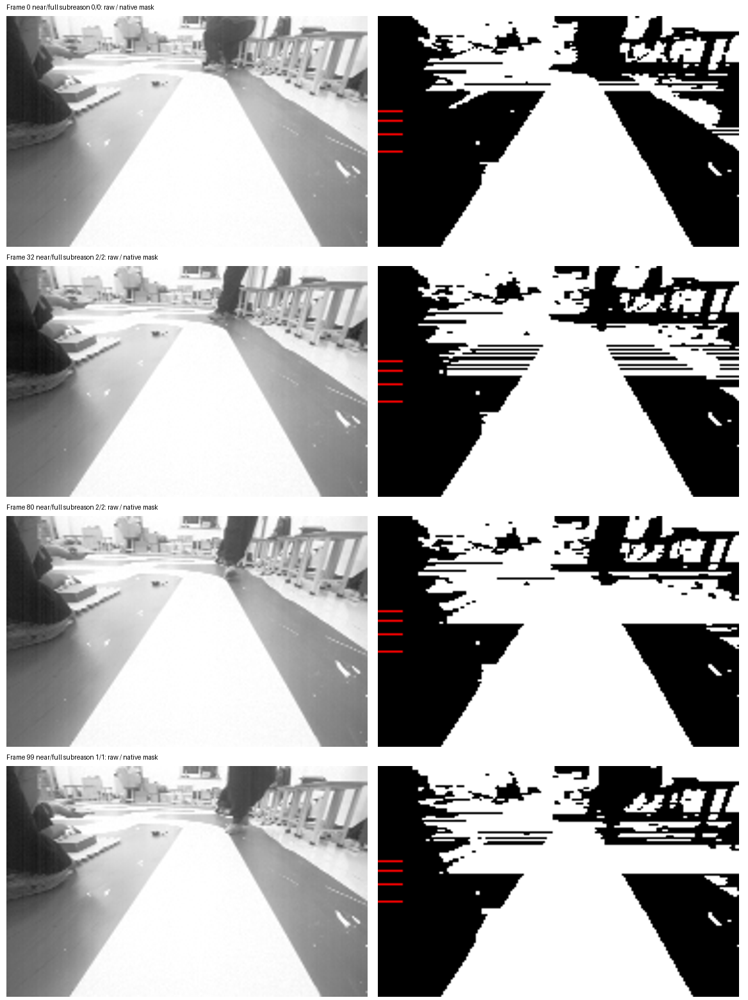
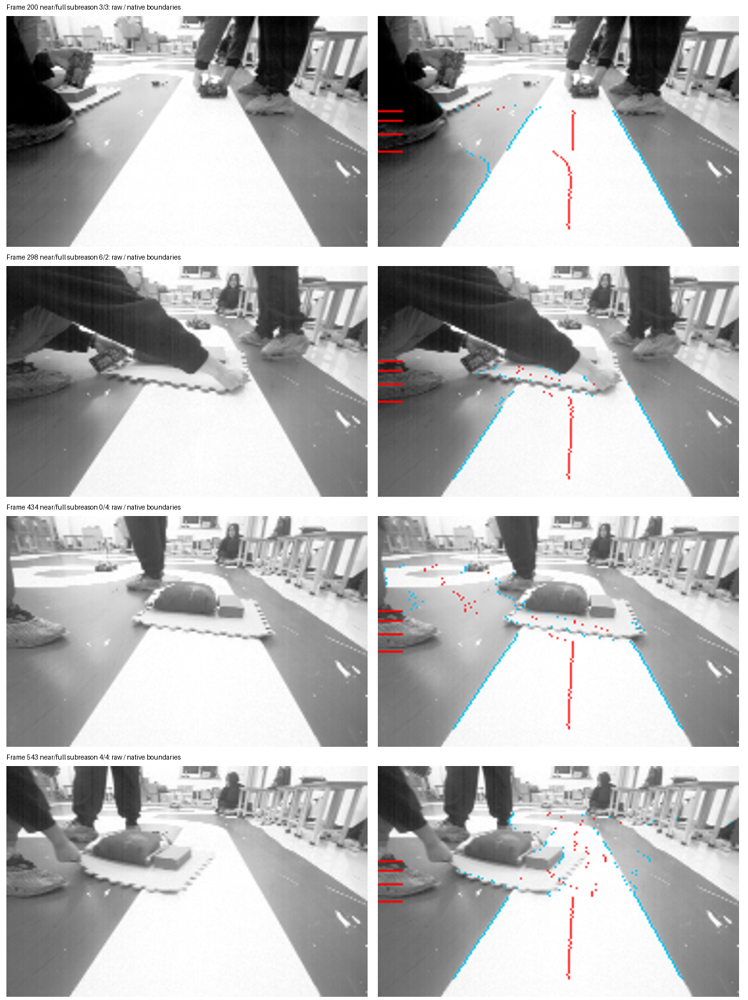

# 视觉图像性能测试与近远端失效审核

2026-11-09。新增 `performance-vision-images`，已接入 Host / PreFlash / Diagnostic；当前图像回归及相关控制、弯道、环岛、投影测试通过。**局部参考边界通过不代表视觉问题已经解决：无遮挡直道仍能触发错误阈值、假路口补线和近远端失效。** 本次交付为测试、诊断与证据，生产识别算法的修复仍待后续实施。

## 测试范围和结果

数据为 session04 的750帧原始188×120灰度图，每帧核对VQF CRC、SHA和元数据；数据集清单及已有局部标签分别固定内容哈希。实际调用当前 `vision_midterm_process` 和 `vm_vision_frame`，没有用另一个检测器替代。

路线识别关闭与启用各自独立测试；启用路径调用生产的 `vision_midterm_route_enable(1)`，覆盖 DRIVE 模式的识别分支。它不等于整车已运行。每种状态先完整预热2遍，再按时间顺序计时5遍；每遍从空状态开始，遍内保留学习/历史。原图预加载，计时区间排除文件读写、内存分配、绘图和诊断。计时采用Windows高分辨率单调时钟；保存逐帧及分遍统计，不减去计时器开销。

| 本机 GCC optimized，本轮最终运行 | 路线识别关闭 | 路线识别启用 |
| --- | ---: | ---: |
| 图像处理均值 | 0.19187 ms/frame | 0.22136 ms/frame |
| 图像处理 P50 | 0.1712 ms | 0.2023 ms |
| 图像处理 P95 | 0.27906 ms | 0.31073 ms |
| 图像处理 P99 | 0.35617 ms | 0.38997 ms |
| 图像处理最大观测值 | 0.5537 ms | 0.5127 ms |
| 近米制预览接受 | 470/750，62.67% | 470/750，62.67% |
| 完整米制预览接受 | 376/750，50.13% | 376/750，50.13% |
| 28组已有局部边界参考的 MAE | 0.42857 px | 0.42857 px |
| 局部参考最大边界误差 | 1 px | 1 px |
| 局部参考缺失双边 | 0/28 | 0/28 |

准确度使用既有7张原图×4行双边参考带，每种状态独立回放两遍。所有28组均在原有±3px带内；缺失双边会留在分母中，并独立触发失败。参考在此前算法试验后选取，属于局部视觉核查，不是独立留出集，也没有750帧全标注。**上表62.67%/50.13%是几何输入可用率，不能叫识别准确率。** 典型无遮挡失效帧不在原来的28组参考中，这也是保留额外异常案例审查的原因。

耗时是本机观测，不是RT1064耗时或WCET；系统调度会影响尾部。此前一轮启用路径曾出现4.8553ms的最大观测值，最终轮未复现，不能把最终最大值当成执行上界。当前没有批准的可比性能基线，速度指标明确为 `OBSERVATION`；测试PASS表示采集契约和局部质量门槛通过。

## 近端、远端到底在哪里失效

以下为每帧的**首个拒绝原因**，不是该帧所有缺陷的并集。诊断结果逐帧与实际原生适配器的接受标志核对；关闭/启用路线识别的计数一致。

| 原因 | 近预览 | 完整预览 |
| --- | ---: | ---: |
| 接受 | 470 | 376 |
| 原始道路状态/质量不满足 | 6 | 6 |
| 指定采样行没有真实双边 | 256 | 310 |
| 历史连续性拒绝 | 8 | 8 |
| 投影后前向坐标不再递增 | 3 | 47 |
| 超出配置地面域 | 7 | 3 |
| 合计 | 750 | 750 |

米制近预览固定采样70、65、61、58、54行，完整预览再加52、49行。适配器要求这些行全部为 `row_flags=3`，单边推算和路口补线不满足。缺双边的首个失败行中，61行有167帧，54行有59帧。近预览的256帧缺双边包含233帧无有效行、22帧单边、1帧路口补线；完整预览对应286/23/1。

需区分两个“近端”：传统转向控制的近带中心约在第102行（near_y=.86），而米制近预览是54～70行、约0.75～1.04m处的采样。图像底部道路仍可见，并不能证明这段更远的米制预览没有被挡住。历史控制 near/far 标志也不能直接替代米制预览的有效标志。

### 1. 已确认的无遮挡直道误失效：亮类细分门槛

位置：`demo/code/vision_midterm.c:refine_road_otsu`。当前要求灰类均值至少达到白类均值的75%，用来避免把半边阴影下的赛道切掉。但邻近亮度分布跨过这个门槛时，阈值会在细分结果和原来的两类Otsu之间跳变。

复核原始图像及实际C二值图后，对第54行用独立精确有理数Otsu复算。四个案例的结果均与原生输出完全一致：

| 帧 | 灰类均值 | 白类均值 | 75%条件 | 最终阈值 | 当前后果 |
| --- | ---: | ---: | --- | ---: | --- |
| 0 | 186.93 | 245.72 | 满足，继续细分 | 239 | 真实双边 |
| 32 | 182.24 | 244.67 | 不满足 | 127 | 灰地面并入白区；54行成为路口补线，近/完整均拒绝 |
| 80 | 179.95 | 242.58 | 不满足 | 139 | 54行无有效双边，近/完整均拒绝 |
| 99 | 167.89 | 237.28 | 不满足 | 130 | 产生33行路口补线，但只有4个锚点；整帧 valid=0 |

第99帧confidence仍为87，但 `vision_reference_route.h` 明确要求存在路口补线时锚点至少8个，所以整帧失效。高confidence只是跟踪覆盖分数，不代表路径正确。这条链已经定位为：**阈值细分被挡住 → 灰地面误合并 → 假路口/缺边 → 米制预览或整帧拒绝**。



### 2. 障碍物与错误边界引起的几何拒绝

原图中第298、360、434等帧存在手、脚、地垫或物体占据赛道。这些场景不能通过放松域约束或强制填双边当成正常道路。

第434帧显示典型边界跟踪跳转：第54/52/49行的双边分别为69～135、66～93、11～78；后两行跟到了障碍物/旁侧区域。对应原始投影前向坐标为1.0592、1.0463、1.0222m，随着采样向远处走反而倒退，触发 `sp_geometry` 的 `p[i].y<=p[i-1].y` 拒绝。第543帧近预览也出现类似情况。这里首先需要改善当前图像中的路径归属/边界连贯性，不能把“图像行号递减”当成“地面路径必然向前”。

地面域仍为候选标定范围；真实道路超出域与错误边界投影超域需要分别判断。当前仅7/3帧首先因域失败，扩大域不能解决主要的缺双边问题。



### 3. 历史连续性与近远端关系

8帧近/完整预览在保留历史时拒绝，使用空历史重试**同一个原生适配器**则通过。重试只用于诊断，不进入实际输出；在本次合法递增时间模型下，确认是历史空间跳变约束，而非无历史也无法成立的几何。当前max_step为0.05m。放宽它会接纳跳边，需要先判断是误检跳变还是合理车辆运动。

当前 `vm_vision_frame` 使用独立的近/完整历史和接受分支，本次未发现“近端先失败就无条件把完整远端清零”的旧式耦合。750帧有376帧两者有效、94帧只有近有效、280帧两者无效。完整预览包含更多远行，缺边及坐标倒退更多，因此有效率更低；独立分支并不保证能在共享采样行缺失时仍有效。

最长连续失效在统一20ms回放中为近159帧（3.18s），完整272帧（5.44s）；包含有意遮挡，不应全部解释为误检。合成静止编码器的规划组合第67帧进入故障锁存；这些时间是离线模型结果，不是运动实车保护参数验收。

## 已接入的文件和复现

- `tests/suites/catalog.json`：增加 `performance-vision-images` 及 `vision-benchmark-contract`，保留原广义 `performance-host` 的待建独立基准口径。
- `tests/benchmarks/datasets/vision-session04-v1.json`：750帧版本化清单、session及逐帧哈希。
- `tests/benchmarks/manifests/vision-images-timing.json` / `vision-images-quality.json`：计时与局部质量独立指标、明确统计和门槛。
- `tools/testing/vision_image_timing.c` / `vision_image_benchmark.py`：原生计时、两个路线识别状态、准确度与失效统计、源文件/编译器身份及持久化结果。
- `tools/speed_planning/metric_input_audit.c` / `vision_image_probe.c`：细化历史/非前向几何原因、增加路线识别启用选项，输出路口行及锚点证据。
- `tools/testing/audit_vision_threshold.py`：对选定行复算门槛，明确比较预测值与原生输出；属于当前实现的诊断器，不替代检测算法。
- `tests/planning/test_vision_benchmark_contract.py`：缺帧/重复样本/NaN拒绝、缺边保留分母及独立失效区间检查。

```powershell
python tools/testing/run_tests.py --profile Host --suite performance-vision-images --compiler gcc --mode optimized --jobs 1
```

每次运行保留 `artifacts/work/vision-image-performance` 和同级 `vision-image-performance-route-active`。两者都有逐帧耗时、全行边界、掩膜、原因、分遍统计和可交给通用benchmark比较器的measurement/manifest。建议单任务运行减少干扰；旧结果不覆盖。源数据完整性和跨回放输出一致性均为强校验。

最终运行 `20261109T110931-d0057bad42`：performance-vision-images、vision-benchmark-contract、vision-image-regression、phase3-shadow-preparation及两项环境依赖全部通过。

相关回归：`20261109T105931-9ca26ede6e` 的vision、vision-contract、planner-shadow等通过；`20261109T110313-cb37ce5842` 的framework、control、turn-route、roundabout、roundabout-projection、tangent-preview、static-safety通过。后续变化仅扩展Host探针和报告，不修改生产识别/控制源码。通用benchmark的计时与局部质量measurement导入也通过。

[精简证据及SHA清单](evidence/manifest.json)保存两个状态的报告、计时、逐帧拒绝及指定行输出。完整逐行/掩膜和measurement保留在上述 `.test-results` 下；原图来自仓库中固定session，无需额外采集。

## 修复优先级与证据边界

优先解决清晰直道的亮灰地面误合并，并把32、80、99帧作为修复前后的困难样例；同时保留既有半边阴影回归，不能仅把75%改低后以可用率上升验收。之后处理遮挡附近边界归属和固定采样行的脆弱性，保持单边/补线与真实双边证据的区分。几何倒退、越域和历史突跳保护应在输入改善后逐项复核。

来源层为 `structured_parsed`（C、原生JSON/CSV、VQF）和 `computed`（CRC/SHA、原生回放、计时、误差及阈值复算）；关键异常另对原始灰度及原生掩膜做原始布局视觉核对。没有仅 `md_extracted` 的关键数值，也未把旧板载版本的采集耗时当作当前算法耗时。剩余限制为局部标签选择偏差、缺独立动态数据/全图真值、主机计时的系统噪声及未测板端执行时序。
