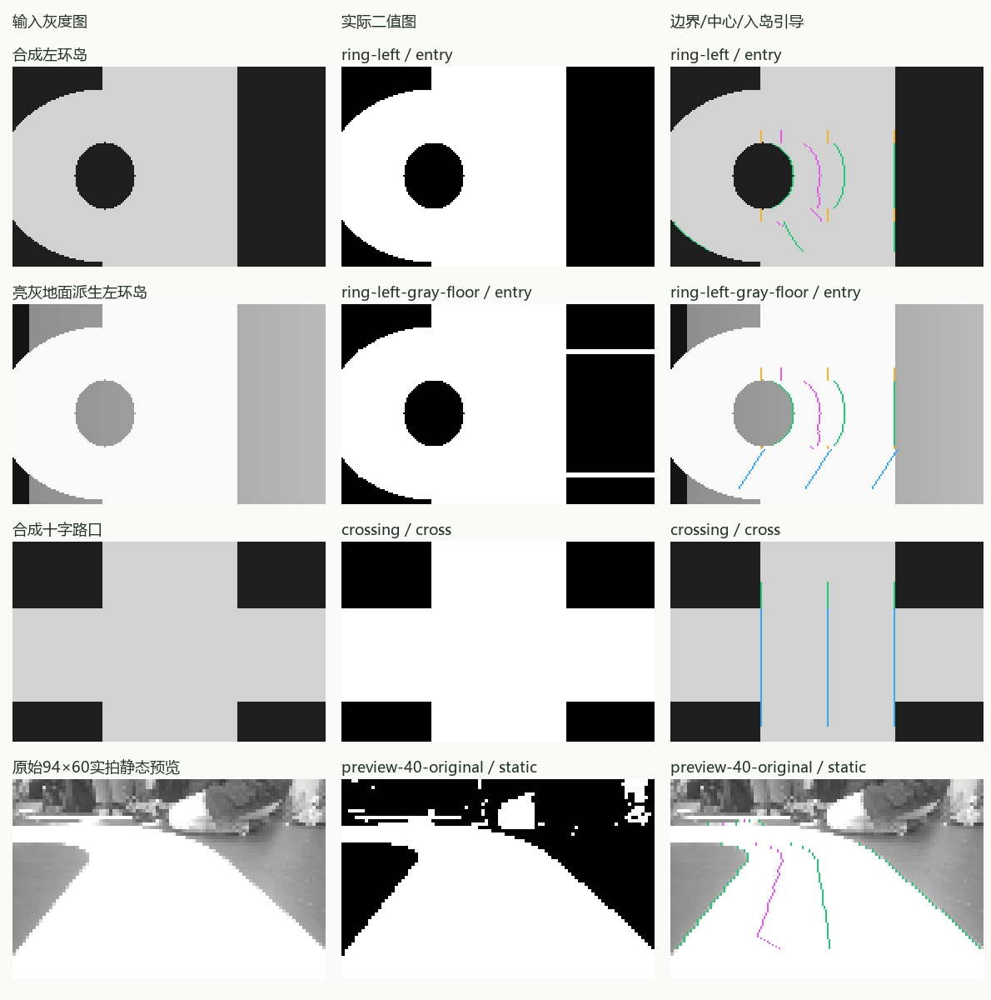
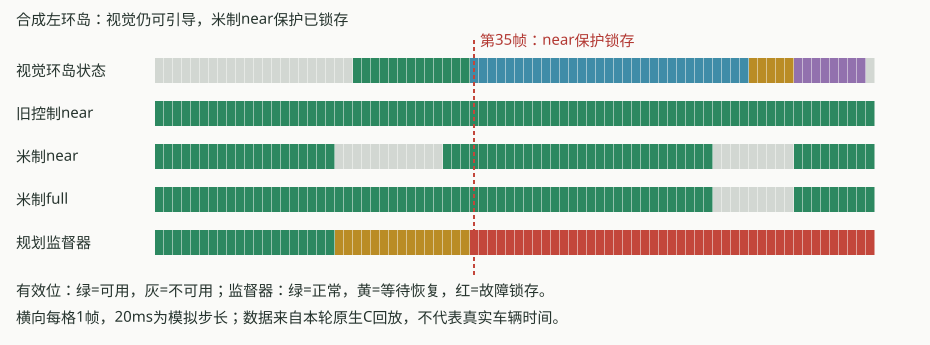

# 环岛及视觉—速度规划器配合验证

**阅读提示：** near/full是规划器分别判断的近场/完整路径预瞄；IoU是交并比，即预测白色区域与参考白色区域的交集面积除以并集面积。两者的适用范围和旧控制器near/far的区别见[术语索引](../../MPC_TERMINOLOGY.md)及[对应关系](../../MPC_GUIDE.md#near-full)。

**结论：视觉状态识别和保护契约通过，连续米制过环岛尚未通过验收。** 本轮17项相关测试通过、无跳过；新增57个场景/配置组合，共2030次灰度图处理。没有修改生产算法、速度参数或模块依赖。

## 场景识别结果

| 场景 | 本轮结果 | 证据范围 |
| --- | --- | --- |
| 左/右环岛、亮灰地面派生环岛 | 4个序列的进岛→环内→出岛→恢复状态符合预期 | 解析合成图，非真实绕行 |
| 侧裁切环岛 | 两侧进入、环内及退出状态通过 | 合成图 |
| 十字路口、开放暗区反例 | 未误进入环岛 | 合成图 |
| 透视、镜像及安装偏差 | 40组透视/镜像＋18组接近姿态通过 | 固定姿态投影，不含车辆动力学 |
| 实拍静态预览 | 11/11正例及派生姿态识别方向正确，8/8反例及派生姿态末帧未入岛 | 6个正例原姿态、4个反例原姿态和9个镜像；不是19张独立原图 |

**仍有分割遗漏：** 亮灰地面左环岛入岛图的解析白区IoU为96.94%，基础左环岛为99.98%。虽然状态仍判对，但该阶段full预览从12/12可用降为0/12；原直道误合并修复不能据此扩大为所有场景均已解决。IoU只计算阶段末帧第24～110行的合成白区，实拍图没有全像素真值。

左列为输入，中列为当前原生C算法二值输出，右列叠加本轮边界、中心和引导：绿=真实双边，橙=单边推算，蓝=路口补线，紫=入岛引导。前三行是合成图，最后一行来自已有94×60实拍预览，最近邻放大到188×120。第二行右侧的白色泄漏是真实算法输出，未修饰。

## 与near/full、速度规划器的配合

测试链路从灰度图开始，运行生产视觉、米制适配、累计编码器时间对齐和影子规划器；同时记录旧视觉控制器。没有直接构造行边界或注入near/far有效位。既有运行时测试另行覆盖真实C26/PI/最终输出写入逻辑，硬件IO由桩模拟。

| 场景/事件 | 实际配合结果 | 连续米制驾驶判断 |
| --- | --- | --- |
| 直道、左右弯道 | near/full接纳，规划候选持续产生 | 合成条件下通过 |
| 十字路口 | 补线期间米制预览拒绝；短时抑制后恢复 | 保护行为符合契约 |
| 完整环岛序列（两侧及亮灰派生） | 4/4序列旧控制器可引导，米制规划出现抑制并锁存 | **未通过** |
| 短时near缺失 | 保留独立full证据，目标立即归零；连续确认后恢复 | 通过 |
| 低速短时far缺失 | 使用near限速，恢复full后退出降级 | 通过 |
| 长时near缺失、整帧失明 | 到期锁存，图像恢复不会自动重新启动 | 通过保护验收 |
| 长时far缺失 | 预算耗尽进入受控停车；合成反馈持续非零后到期锁存 | 通过保护验收，非实际停车距离验证 |
| 高规划速度突发far缺失 | 降级上限无法在制动约束内满足，返回不可行并锁存 | 已确认边界，不能当作正常降级成功 |

完整合成左环岛中，入岛12帧near因第90行单边推算被拒绝；恢复要求连续5帧确认，在满足之前即达到300ms窗口。第35帧触发near故障锁存。随后图像和near/full恢复，锁存仍按设计保留。亮灰派生图还出现补线行被米制适配拒绝。

图中每格为一帧，20ms是模拟步长。它展示了“视觉仍能识别/引导”与“米制规划允许继续”的差别；不代表实车时间。near超时包括恢复确认过程，不能只统计不可用帧的时长。

两套near/far的含义不同：[旧控制器](../../../demo/code/vision_control.c)可以在受约束条件下采用单边推算、路口补线和`entry_guide`；[米制适配器](../../../tools/speed_planning/vision_adapter.c)仅接受指定行的真实双边，且取左右边界中点，没有采用环岛引导路径。因此，识别成功或米制预览被接纳，都不能单独证明环岛目标路径与速度规划几何一致。

高规划速度案例中，请求速度为1m/s，失效前规划速度约0.565m/s，突发far丢失要求降到0.5m/s上限，原生规划器返回`VP_INFEASIBLE`。低速对照请求为0.4m/s，降级与恢复正常。这两个数是测试配置；编码器提供显式0.3m/s合成反馈，没有模拟车辆跟随规划速度。生产配置未改。

## 当前数据能证明什么

现有实拍环岛数据只有静态94×60预览。放大和镜像不能补出原始分辨率或动态时序。当前影子映射仅完整接纳11个正例/派生姿态中的2个镜像；该映射来自另一安装/采集条件，此处是跨条件接纳诊断，不能据此判断真实投影准确率或环岛通过率。

另对750帧原始直道/遮挡图重跑：近端530/750、完整预览459/750；原28组局部边界及新增故障图验收保持通过。本机图像处理均值/P95为：路线识别关闭0.174/0.211ms，启用0.204/0.225ms。这些是主机观察值，不能换算为MCU耗时或120 ticks/10ms实车能力。

建议优先补齐环岛引导路径到米制几何的受验证适配，再结合动态相机/编码器回放评估near确认窗口和far降级边界。当前严格拒绝和锁存保护保持原样，本轮没有用放宽有效性条件来获得“通过”。

## 回归记录与范围

- [最终17项相关回归报告](../../../.test-results/20261109T163644-e2e1ac6815/user-report.md)：全部通过，报告单列连续环岛未验收结论。
- [场景集成子报告](../../../.test-results/20261109T163644-e2e1ac6815/suites/vision-scene-integration/artifacts/work/vision-scene-integration/user-report.md)、[逐场景/阶段数据](../../../.test-results/20261109T163644-e2e1ac6815/suites/vision-scene-integration/artifacts/work/vision-scene-integration/cases.md)、[原始结果/编译和源码绑定](../../../.test-results/20261109T163644-e2e1ac6815/suites/vision-scene-integration/artifacts/work/vision-scene-integration/report.json)。每个场景目录保留灰度输入、实际二值图、逐行输出、编码器/规划器轨迹及命令。
- [本轮初始覆盖回归](../../../.test-results/20261109T162600-44719286d3/user-report.md)、[首轮统一场景回归](../../../.test-results/20261109T163420-18026c9d3b/user-report.md)。
- 探针构建中曾漏包含控制器头文件；随后发现探针发布两次编码器样本却只规划一次，引起正确的丢样保护，均在测试工具中修正。[早期采样探针报告](../../../.build/vision-scene-integration-20261110/second/user-report.md)不作为算法失败证据。[后续边界回归](../../../.build/vision-scene-integration-20261110/third/user-report.md)保留高规划速度far丢失的失败信号；最终将低速恢复与高规划速度不可行分别验证。
- [汇总证据](evidence.json)。JSON/CSV及原始图像元数据为`structured_parsed`；原生C回放、解析IoU和逐帧统计为`computed`，图像输出已目视复查。没有仅凭`md_extracted`作出的数值结论。

本轮新增[原生集成探针](../../../tools/testing/vision_scene_pipeline.c)、[场景测试入口](../../../tools/testing/vision_scene_integration.py)，将其加入[常规测试目录](../../../tests/suites/catalog.json)，并更新[用户报告生成器](../../../tools/testing/user_report.py)及其[报告契约测试](../../../tests/framework/test_framework.py)，避免“保护契约通过”掩盖“连续场景未验收”。生产源码、速度参数、全局配置、skill及AGENTS.md均未修改。

未执行烧录、真实车辆绕行、板端实时性、DMA时序或实体输出验收。本轮是相关套件回归，不宣称重新执行全部Host或完整PreFlash配置。
