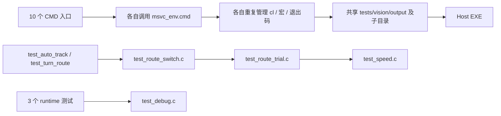
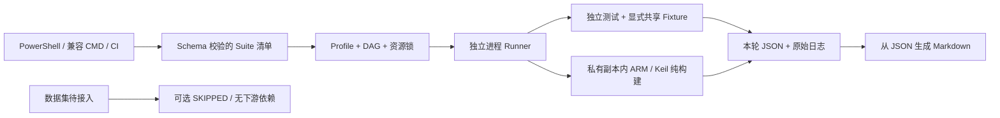

# 测试资产与迁移前流程

机器可读清单：`inventory-before.json`。每个原有测试文件、fixture、stub、参考实现
及入口都有原始 SHA-256、用途与套件归属；诊断工具明确说明排除原因。现有顶层
tools 工具也单独记录。C31 新增/扩展项通过提交 `79c8ec6` 的文件状态核对，
不把注释、历史通过记录或本轮新框架当作 C31 原始结果。

迁移前的真实入口为十个 CMD；Field Protocol 和七个 Python 离线测试此前另行
调用。`replay_preview.c` 是带参数的诊断回放工具，没有自验证场景，因此保留
源码，不伪装成自动通过的套件。

旧的包含链包含被重命名但不执行的其他测试 main，并不是运行时真实前置条件。
共享对象是模拟 IO 与辅助函数，因此迁移后将这些模型提为 fixture，没有把
原本独立的测试机械串成执行依赖链。

迁移前 MSVC 入口在本机因为缺少 C++ Build Tools 被环境阻塞；日志位于
`.test-results/legacy-baseline-20261101T172646Z/`。随后对**尚未拆分的原始 C
场景**使用同一宏配置、显式 GCC 工具链取得基线，基线与拆分后结果分别归档。
具体证据见 `VALIDATION.md`。这一区分避免把“执行器未启动”算成原有业务失败，
也避免将 GCC 的验证声称为已取得 MSVC 结果。
