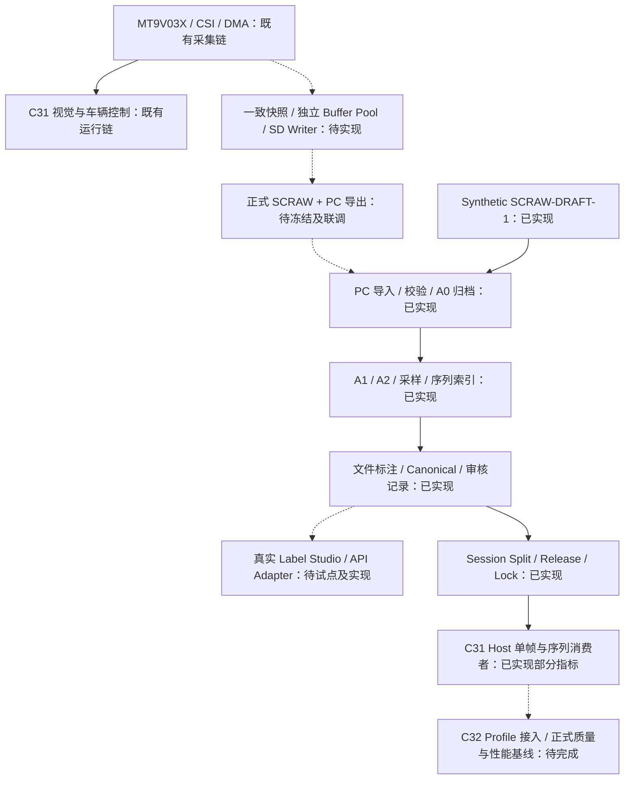

> **维护口径（2026-11-09）：** Phase2实测与诊断工具已单独发布于bd94f27；没有据此验收Recorder运动写卡、Camera/SD/PI组合或正式训练数据集。现有静止/软件结果按本文原构型阅读；其他未提交Recorder/Phase3实现不能写成main已发布或当前车载配置。 统一状态与历史适用范围见[文档维护总览](../DOCUMENTATION_STATUS.md)。

# SmartCar 视觉数据链条：架构交接

交接日期：2026-11-04。范围：车载原始视觉采集、PC 数据处理、人工标注与算法评测的衔接。

后续更新：用户批准后，训练分支已实施首版 RTOS/Recorder/SD 与 SCRAW-1 adapter，
见[当前实施说明](../vision_recorder/IMPLEMENTATION.md)。以下保留最初 PC 交接快照，
其中“车载未实现”属于当时状态；实际板端稳定性和真实数据仍待验收。

**目前完成的是可运行、经 synthetic/mock 验证的 PC 软件架构。车载 Recorder、正式
SCRAW 协议、真实 Label Studio 接入与真实数据验收仍需完成。** 接手时应保留现有
PC 模块及 C31/C32 基线，优先补齐上下游接口和实测证据。

本文件是交接时点的架构快照；操作命令见 [使用指南](README.md)，当前项目状态继续
维护在 [项目演进档案](../PROJECT_EVOLUTION.md)，实际运行证据见
[软件验证记录](SOFTWARE_VALIDATION.md)。

## 1. 接手基线

| 项目 | 当前事实 |
| --- | --- |
| 工作目录 | `C:/shengchanli/smartCar/smartcar` |
| 分支 / HEAD | `main` / `de1415743b004160f520d385c9e3e63008f52007` |
| 已提交工程版本 | C32 测试体系；生产固件仍为 C31 的 switch / auto-track 构型 |
| 新增 PC 工具 | 当前工作区文件，尚未 commit/push，不能仅凭 HEAD 恢复本轮成果 |
| 远端关系 | 本地缓存显示 behind 1；缓存新增提交 `018a1e1 Create 1103`，本轮未联网确认或同步 |
| 既有工作区 | switch 工程 M 标记但无文本差异；前轮历史快照、patch、日志等仍在本地 |
| 生产边界 | 本轮没有修改 `demo/code`、`libraries`、现有测试 Runner、套件清单或 CI |

主要基线提交：`79c8ec6` 为 C31 软件硬化，`d78eb9d` 为 C32 测试重构，
`1a96c8f` 补录 main CI，`de14157` 增加测试手册。详细固件审计见
[C31_BASELINE_AUDIT](../vision_recorder/C31_BASELINE_AUDIT.md)。

接手前先检查实际 Git 状态；不要执行 clean/reset、覆盖既有工作区或把生成数据
整批加入 Git。本文件并不授权提交、推送、固件实现、硬件访问或实例写入。

## 2. 总体架构和实际接通位置



实线表示已有实现的职责连接，虚线表示尚缺生产接通或验收的连接；不表示实车已验收。
图中 PC 已完成部分的端到端证据全部来自 synthetic/mock。

三个层次必须继续独立：

1. **车载采集层**获取实际源头帧并记录，不依赖 Dataset、Label Studio 或测试 Runner。
2. **PC 数据层**消费已经导出的会话，维护像素、身份、标注、审核和 Release。
3. **评测层**消费冻结 Release，输出可追溯结果，不把结果反馈为车辆控制许可。

C31 原控制链和 C32 测试框架已有各自职责；数据项目不接管它们。

## 3. 已完成的 PC 架构

以下“已完成”表示代码存在且在本轮软件验证范围内可运行，具体限制列在最后一列。

| 模块 | 已实现职责 | 实现入口 | 完成边界 |
| --- | --- | --- | --- |
| 公共存储约束 | 相对路径限制、ID 校验、独占创建、禁止覆盖、哈希、严格 JSON、PNG 编解码 | [common.py](../../tools/vision_data/common.py) | 文件级策略和损坏检测；不是 ACL、签名或真人认证 |
| 源记录协议 | Header/Frame/END、两层 CRC、长度限制、损坏扫描与完整帧恢复 | [scraw.py](../../tools/vision_data/scraw.py) | **SCRAW-DRAFT-1**；不是正式固件协议 |
| Session 入库 | 只读复制源文件、归档 A0、生成帧 JSONL/CSV、完整性报告与锁、A2 PNG | [archive.py](../../tools/vision_data/archive.py) | 不覆盖原始像素；异常不补帧；incomplete 默认不能发布 |
| 数据契约 | Session、Frame、Event、Annotation、Prediction、Review、View、Split、Release、Run 的固定契约 | [contracts.schema.json](../../tools/vision_data/contracts.schema.json)、[contracts.py](../../tools/vision_data/contracts.py) | 验证器只支持当前固定 Schema 词汇，跨对象约束另检查 |
| 抽样与划分 | 全序列引用、均匀采样、事件窗口、前后帧索引；Session 级 split；exact/near duplicate 检查 | [sampling.py](../../tools/vision_data/sampling.py) | Event 上下文已有；独立审核 Event 真值链和事件指标仍缺 |
| 人工文件交换 | Label Studio 文件投影/转换、原始导出留档、原生 Canonical 降级、坐标/Mask/拓扑 QC | [annotations.py](../../tools/vision_data/annotations.py) | 开放折线用有序点和 sidecar；未知类型拒绝，真实 UI 往返未验收 |
| 审核记录 | submitted → reviewed → approved/rejected，独立 reviewer、时间、内容哈希和追加日志 | [annotations.py](../../tools/vision_data/annotations.py) 的 `add_review` / `review_history` | 要求操作者显式声明；演示 reviewer 全为模拟，不是已有人审 |
| 候选与素材视图 | 独立 Prediction 文件、绑定输入哈希、曝光血缘、Holdout 禁用；只读 loopback 选定图像服务 | [exchange.py](../../tools/vision_data/exchange.py) | 不启动或修改现有 Label Studio，不提供任意目录服务 |
| 批次接口 | mock transport、分页、dry-run、幂等、冲突检查、超时后查证和检查点 | [connector.py](../../tools/vision_data/connector.py) | **没有真实 HTTP API transport**，不能称为 Label Studio API 已接通 |
| 数据集发布 | 按 purpose 选 Session，冻结采样/切分/标注/审核快照，Release 内容锁和消费前复核 | [releases.py](../../tools/vision_data/releases.py) | 同帧多个 approved 要先裁决；没有真值的帧明确计数 |
| C31 生产视觉消费者 | 编译未改动的 `vision_midterm.c`；单帧 reset、序列推进/边界 reset；独立机器结果 | [c31_adapter.c](../../tools/vision_data/c31_adapter.c)、[evaluation.py](../../tools/vision_data/evaluation.py) | 只复用视觉模块；不重放完整车辆、执行器或 Bayes 调度 |
| 指标与比较 | 几何误差、可见行覆盖率、预处理 Mask IoU、序列步差、Host 成本；独立门禁与基线绑定 | [evaluation.py](../../tools/vision_data/evaluation.py) | 无对应标签不伪造指标；分类/事件 NOT_MEASURED；无批准基线为 INCONCLUSIVE |
| 统一工具入口 | 独立 CLI、合成端到端演示、专项测试 | [vision_data.py](../../tools/vision_data.py)、[demo.py](../../tools/vision_data/demo.py)、[专项测试](../../tests/vision_data/test_pipeline.py) | 当前独立于 C32 Profile；不是改写全局 Runner |

### 已落地的数据关系

- **A0**：原始 `.scraw` 和源 `session.json`，不改字节，保留行 padding。
- **A1**：按 stride 提取可见像素，当前无缩放或滤波；生产消费者只接受 188×120。
- **A2**：PNG 等派生物，绑定来源与哈希；94×60 预览不会被放大冒充原图。
- Frame ID 为 `session_id:source_sequence`，沿用源序号，恢复和采样不重编号。
- View 只存 ID/理由/上下文；全序列留在 Session，不因抽样删除。
- Prediction、人工提交、审核日志和 approved 真值分别存储；导入不授予批准。
- Split 按 Session 分离；Release 冻结一组确定引用；Run 再绑定 Release、源码、配置、
  工具链、环境、测量和结果。

具体目录及 Schema 字段已在 [使用指南](README.md) 和
[兼容性说明](UPSTREAM_DATA_COMPATIBILITY.md) 中维护，交接后不另复制第二套规范。

## 4. 需要完成的架构

下表是实际缺口，不表示已选择最终实现方案，也不授予相应硬件或实例操作权限。

| ID / 优先级 | 待完成架构 | 必须形成的接口或证据 | 可复用部分 |
| --- | --- | --- | --- |
| A01 / P0 | **正式源数据契约** | 冻结 SCRAW 版本、字节序、CRC、分段、结束统计、源序号/回绕、时间单位及事件语义；独立生产者与 PC 解析器互验 | 现有 draft codec、损坏/截断测试、Session/Frame 契约 |
| A02 / P0 | **相机快照与 Buffer 所有权** | 证明完整 Capture 帧如何进入 Recorder，FREE/FILLING/QUEUED/WRITING/FREE 生命周期、丢帧分类和 Cache/DMA 可见性 | 现有相机/CSI 代码只作接入基线，不能把稳定序号当独占证明 |
| A03 / P0 | **独立 Recorder / SD Backend** | 单一文件系统所有者、有界队列、独立启停、非阻塞提交、失败不影响控制；明确写入长尾、容量、超时和收尾 | SDK/FatFs 驱动已在工程中，但当前应用未接通记录 |
| A04 / P1 | **正式导出到 PC 的生产适配** | 使用实际导出会话验证格式、原字节、源帧计数、PNG 像素、断电截断恢复；不能只用同一 Python writer 自证 | `archive.py` 的归档/报告框架，正式格式优先加 PC adapter |
| A05 / P1 | **真实 Label Studio 集成** | 核验本机版本/端口/配置/API；少量任务导入→人工编辑→导出→Canonical 往返；确认开放折线/点组/Mask 元数据保留情况 | 文件接口、原生 Canonical 降级、素材只读视图、mock 批次状态机 |
| A06 / P1 | **真实 API transport** | 获批实例/项目/批次范围，最小权限与凭据来源、dry-run、远端核对、超时歧义处理、恢复；不能覆盖人工结果 | `connector.py` 的 injected transport 边界；不是直接把 mock 改个名字 |
| A07 / P1 | **真实人工数据生产与审核闭环** | 代表性 Session、T1/T2/T3 覆盖要求、独立 reviewer、冲突裁决、Holdout 盲化、候选污染审计及第一份真实 Release | 现有 Annotation/Review/Release 工具；需真实人和素材提供证据 |
| A08 / P1 | **Event 真值与序列评价契约** | Event 起止/阶段/不确定区间的独立审核记录，真实 Frame ID 关联，事件匹配、漏检/误检和边界误差定义 | Event/phase 数据对象、窗口索引、Sequence Replay 已有 |
| A09 / P1 | **分类/状态输出适配** | 明确生产输出与 T1 场景、事件阶段的可比较关系；无法对应时保留未知；建立覆盖/缺失规则 | C31 原始 status/roundabout_state 已导出，不能硬凑十类标签 |
| A10 / P2 | **C32 下游注册** | 独立消费者套件、外部数据根/Release 参数、证据归档和状态映射；解决与旧 benchmark 仓库相对路径契约的边界 | 原 Runner/Profile/Reporter 保持；增量注册而非重构 |
| A11 / P2 | **正式性能与质量基线** | clean 代码身份、固定真实 Release/参数/主机、独立指标、批准人/时间/内容哈希、噪声与退化门槛来源 | 现有 `compare` 和 C32 benchmark 的独立门禁思路 |
| A12 / 后续 | **规模和管理能力** | 大规模索引、长序列吞吐/内存、近重复人工复核、存储备份、审核身份/签名需求 | 当前文件式架构；未证明百万帧性能，不提前引入平台或数据库 |

### 车载部分尚缺设计决策

当前不能直接决定把 `f_write` 放入主循环：同步调用和卡忙等待可能占用控制期限。
也不能因 SDK 文件名含 non_blocking 就宣称端到端文件写入非阻塞。

实施 Recorder 前，至少需要完成以下设计并审查：

1. 在现有调度条件下选择存储路线：独立任务、可证明时限的协作式写入，或经过完整
   文件系统一致性论证的预分配/异步块写入；不默认引入 RTOS。
2. 明确从哪个完成事件取得源帧、何时授予/释放快照所有权，如何记录跳过或覆盖。
3. 根据实测 Capture FPS、SD 最长写停顿、实际可用 RAM 和快照耗时计算缓冲容量。
4. 明确队列满、介质错误、卡移除、空间不足和断电时只影响记录功能的处理。
5. 明确安全结束、分段与恢复协议，核实 `CTRL_SYNC` 和物理写完成语义。

这些决策目前尚未形成可执行的固件方案。C31 的 DMA 所有权、完成时戳可信度、
IRQ/PWM 时序三类风险继续开放，PC 测试不能关闭它们。

## 5. 建议接手顺序与里程碑

### M0：固定当前软件交接基线

复核工作区、工具源码及验收证据；按后续明确安排归档提交。确认与远端新增提交的
关系，不覆盖本地成果。**完成条件：**接手方能恢复相同源文件并独立运行现有软件验证。

### M1：冻结采集/导出契约，补齐 Recorder 设计

先做 A01 与 A02/A03 的设计，PC 正式 adapter 可用独立构造的格式样本先测。
固件实施及真实 SD/板端测量需要相应授权。
**完成条件：**正式协议和快照/写入职责得到审核，格式互验及故障样本有明确预期；
不能仅凭 Python draft 序列化/解析往返宣称兼容车载。

### M2：完成小批量人工文件往返

A05 可与 Recorder 设计并行，先查非秘密部署元数据，再在获批范围试点；文件接口可
先于真实 API transport。**完成条件：**同一组帧在人工界面编辑后能保留 ID、几何、
Mask、曝光血缘和审核语义；不支持的对象有明确降级，不能静默丢失。

### M3：接入第一批真实 Session 并发布数据

在 Recorder/硬件和人工试点条件具备后完成 A04/A07。
**完成条件：**源记录和异常报告可信，真实人工审核完成，分区无 Session 泄漏，
Holdout 未参与调参，有一份可锁定、可复核的真实 Dataset Release。

### M4：补齐评测语义并接入下游

基于真实标签完成 A08/A09，再做 A10/A11。
**完成条件：**单帧与序列/事件指标可解释，质量/覆盖率和速度独立门禁，批准基线
可追溯，C32 可受控调用消费者。Host 性能结论继续限定在 Host，不推断 MCU WCET。

规模化管理、数据库、主动学习或学习模型接入属于后续候选，不作为以上里程碑的隐含前提。

## 6. 已有验收证据和不能扩大解释的结论

| 证据 | 已知结果 | 不能扩大为 |
| --- | --- | --- |
| 本轮数据链条专项 | 33 tests 全通过，含真实生产视觉的 Host 编译/运行 | 原 C32 PreFlash 已包含新增 33 项 |
| 本轮原生 Schema 交叉检查 | 10 类实体通过 `Test-Json`；模板 XML 可解析 | Label Studio 实例往返已验证 |
| C32 清单核验 | 原 66 套件的 Schema/路径/DAG 检查通过 | 本轮重新运行了原 66 套件 |
| 合成整链演示 | 2 Session / 10 帧；Regression/Holdout 分开发布；两种评测模式运行 | 已有真实赛道、人类真值或正式性能基线 |
| 基线比较反例 | 无批准基线为 INCONCLUSIVE；更快不能抵消质量退化 | 当前算法在实车更快或更准确 |

本地最终演示：`C:/shengchanli/smartCar/vision-data-acceptance-20261104/`。
入口索引为 `demo-report.json`，数据根在 `dataset/`；真实会话、真人审核和真实
Label Studio 调用计数均为 0。原始测试/哈希摘要位于仓库忽略目录
`.build/vision-data-validation/`。更多结果以 [软件验证记录](SOFTWARE_VALIDATION.md) 为准。

## 7. 接手检查与复验入口

先阅读本文件、[使用指南](README.md)、[格式约定](../vision_recorder/DATA_FORMAT.md)、
[上游兼容性](UPSTREAM_DATA_COMPATIBILITY.md)、[软件验证记录](SOFTWARE_VALIDATION.md)。

源码核对和软件复验命令（从仓库根执行）：

```powershell
git status --short --branch
git log -5 --oneline
python tools/vision_data.py --help
python -m unittest discover -s tests/vision_data -p test_pipeline.py -v
pwsh -NoLogo -NoProfile -File tools/testing/Test-Manifest.ps1
```

生成新的整链演示时选择一个不存在、位于 Git 仓库外的输出目录；不要覆盖当前交接
演示或把其图像/可执行文件加入 Git。测试只使用合成素材和 mock；其中一个素材服务
测试会短时启动自己的 loopback HTTP 服务，结束时关闭，不连接已有 Label Studio。

软件发生变更后重新记录源码/参数/输入哈希和执行结果；本次纯文档交接没有重跑测试。
需要真实硬件或实例操作时，先明确相应范围；不能把此前 PC 实现授权延伸成硬件授权。

## 8. 证据层次与本次自查

本文件依据当前源码、Git 状态、原生 Markdown 及已有 JSON 验收记录编写。
模块职责由源码定点核对；JSON/Schema/配置为 `structured_parsed`，测试/CRC/像素/
哈希为前一轮实际 `computed` 证据。本次只核对文档、来源哈希与导航，不新增软件
运行通过结论；无仅靠 `md_extracted` 的关键数字，无 `pdf_verified` 或硬件证据。

本轮仅新增本交接文件并维护文档导航；不修改生产代码、PC 工具、全局配置、Skill
或持久 Agent 行为，不执行 commit/push。真实格式、实例兼容性、真实真值、分类/事件
语义和硬件时序是接手方必须继续关闭的架构与验证缺口。
