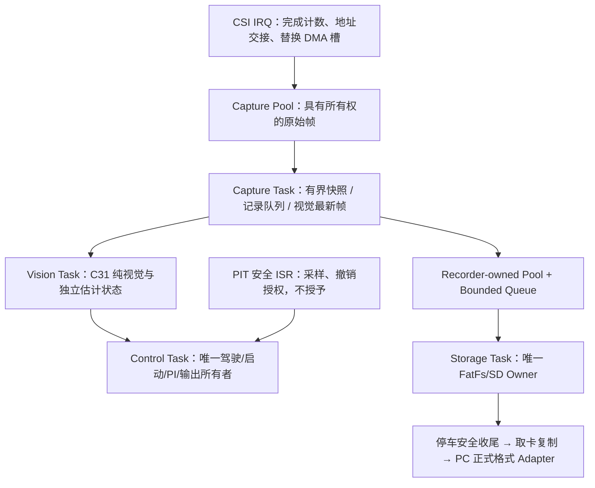

# 车载持续视觉采集：存储架构设计

日期：2026-11-04。状态：**用户已批准采集训练分支的最小 RTOS；首版软件与纯构建已实现，尚未上板。**

本文保留设计推导和候选预算。当前代码、实际取舍与验收进度以[实施说明](IMPLEMENTATION.md)
为准；下文未决项来自批准前快照，硬件门槛继续有效。

本轮明确决定：必须在车辆正常行驶时持续采集并写入 SD；先完成存储架构设计。
不采用“行驶只存 RAM、停车才写卡”。稳定性优先，必要时可降低车速，不设本轮速度
成绩目标。**本功能只属于独立数据采集训练分支，不能称作正式赛道版本。**

## 1. 验收目标和版本边界

合格配置应在整次训练行驶期间保存摄像头实际完成的原始灰度帧，并持续排入 SD，
不能把视觉处理帧当作源帧，也不能用周期性停驶/停车写卡代替并行记录。
存储介质故障时可以停止记录并报告，但不能阻塞/重启视觉或修改电机、舵机许可。

稳定性包含循迹、不出界、无存储导致的离散卡顿、无样本积压和异常停车。降低车速
只能增加车辆运动余量，不能消除同步 SD 阻塞，也不能替代控制期限验证。

建议分支名 `feat/vision-recorder-training`，专用工程建议为
`demo/mdk/training/recorder_train.uvprojx`，标识建议为 `RECORDER_TRAIN_1`，
产物放 `.build/recorder-train/`。这些名称已在独立训练分支落实。
现有 main/C31/C32 入口保持原身份；采集版不得伪装成 `MIDTERM_C26_31`。

实施前必须先建立隔离分支/工作区并保存当前未提交 PC 工具；本轮不替用户提交或清理。
只有独立审查后才可能复用公共修复，不自动合入采集版的 RTOS、SD 或速度参数。

## 2. 本轮复核发现的阻塞点

设计审计时基线 HEAD 为 `de1415743b004160f520d385c9e3e63008f52007`，当时位于 main，
既有 PC 工具与历史资料未提交。更完整基线见 [C31_BASELINE_AUDIT](C31_BASELINE_AUDIT.md)。

| 事实 | 可定位源码 | 对设计的影响 |
| --- | --- | --- |
| PI 由前台服务，未消费样本只允许 1 个 | `demo/code/vision_drive.c:205`、`vision_speed.h:8–16` | 存储不能占用当前前台等待 SD；PIT 活着不代表 PI 正常 |
| 10ms 名义采样，20ms 最大间隔、30ms 样本年龄、50ms 控制停顿保护 | `demo/code/vision_speed.h` | 不能靠放大现有保护阈值掩盖记录阻塞 |
| 采集标志是最新帧邮箱而非完整帧队列 | `demo/code/app_runtime.c:261–296` | Recorder 不能只挂在 `vision_midterm_process` 后 |
| 回调立即交回另一个缓冲 | `libraries/zf_device/zf_device_mt9v03x.c:393–423` | 缺少消费者持有/释放，不能交给任意时长的 SD 写入 |
| SDK 双 DMA done 时跳过，缺空缓冲会把另一活动地址复用 | `libraries/sdk/drives/fsl_csi.c:865–927` | 必须显式处理源头歧义和缓冲饥饿，不能声称旧驱动已证明零覆盖 |
| SubmitEmpty 包装未传播底层失败信息 | `libraries/zf_driver/zf_driver_csi.c:csi_add_empty_buffer`；`fsl_csi.c:777–791` | 原包装的返回约定不足以作为池协议的成功证明 |
| SDK SD host “non_blocking” 内部仍等事件 | `libraries/components/sdmmc/host/usdhc/non_blocking/fsl_sdmmc_host.c:381,508–522` | 非阻塞硬件启动不等于调用者非阻塞 |
| 事件等待超时为 `~0U`，Host mutex 使用 forever | 同文件 `:20,395` | 必须替换无限等待并审计所有嵌套等待/恢复 |
| 现有 OSA 是 bare-metal polling，默认无 OSA timer | `fsl_sdmmc_osa.c:62–105`；`fsl_os_abstraction_bm.h:29–30` | 不能只改一个 timeout 常数就声称超时有效；需真实单调时钟和任务阻塞 |
| 卡插入是无限循环 | `libraries/components/sdmmc/sd/fsl_sd.c:2196–2267`；`zf_driver_sdio.c:73–92` | 没卡必须直接禁用记录，不能等待插卡或 assert 全车 |
| `CTRL_SYNC` 直接 RES_OK | `libraries/components/fatfs/source/fsl_sd_disk/fsl_sd_disk.c:109` | 不能把 `f_sync` 返回等同掉电持久化证明 |
| LFN=0、FASTSEEK=0、EXPAND=0、REENTRANT=0 | `libraries/components/fatfs/source/ffconf.h:45,49,124,287` | `.scraw` 和 `session.json` 超过 8.3 限制；预分配也尚不可直接使用 |
| SD 时钟配置会重新初始化 SYS PLL/PFD | `libraries/components/sdmmc/sdmmc_config.c:49–59` | 不能行驶中恢复卡时随意重配共享时钟，需依赖审计及初始化顺序 |
| 当前无运行中的 RTOS，工程链接 bare-metal OSA | `demo/mdk/competition/midterm_auto-track.uvprojx:2083,2215`；`demo/user/src/isr.c:55` | 独立存储线程需要真实调度层改动，不能仅新增一个 poll 函数 |

以上是源码事实；没有实测卡速、复制耗时、Capture FPS 或新构型 map/WCET。

## 3. 路线比较与推荐

| 路线 | 连续边采边写 | 稳定性/实现成本 | 决定 |
| --- | --- | --- | --- |
| 原主循环直接 `f_write` | 表面可写 | 卡内部编程/事件等待阻塞前台，PI 无法持续服务 | 排除 |
| 每轮写少量同步 FatFs | 不能据此保证 | 512B 写也可能长等待，单纯减少批次不形成执行上界 | 排除作为当前答案 |
| 行驶存 RAM、停车写卡 | 不符合要求 | 容量有限，用户已明确不采用 | 排除 |
| 纯裸机异步文件系统/预分配原始块写 | 原理上可设计 | 需可恢复 FatFs 状态机或完整预分配块映射、独占、busy、事务和元数据一致性；不能直接绕过 FatFs 写扇区 | 备用路线，成本和证明范围较大 |
| 可抢占调度 + 单一低优先级存储任务 + 有限等待 | 符合目标 | 保留文件系统编程模型，但必须审查 OS 端口、IRQ、共享状态及任务 CPU 预算 | **推荐候选，只在采集训练构型引入** |

推荐采用最小、明确的 RTOS 任务分层（例如经审核的 FreeRTOS Cortex-M7 端口），
不手写隐藏的“小调度器”，不在 ISR 内执行文件系统。当前仓库未发现可直接使用的
FreeRTOS kernel/port；版本、许可证、工具链和 FPU/栈端口都需在实施前固定。

任务可抢占不自动证明实时性：高优先级忙等会饿死存储，驱动关中断/总线争用仍会
影响控制。以下契约及目标平台证据是采用条件。[FreeRTOS 官方调度说明](https://www.freertos.org/Documentation/02-Kernel/02-Kernel-features/01-Tasks-and-co-routines/04-Task-scheduling)
描述固定优先级抢占；这里的具体任务和预算是本项目设计建议，不是该文档替项目证明。

**此路线涉及主循环调度迁移，已获用户后续批准，仅在采集训练分支实施。**
纯软件实现不等于已证明板端无阻塞。若未来取消调度迁移，则需单独审查裸机异步
存储路线，不能退回在原主循环同步写卡。

## 4. 推荐任务与所有者

| 上下文 | 相对优先关系 | 唯一职责及约束 |
| --- | --- | --- |
| PIT 安全 ISR | 保留最高安全优先级的语义，实际 NVIC 配置审查后定 | 编码器采样/超时保护/撤输出；不调用 OS、不碰 FatFs，不依赖存储 mutex |
| CSI IRQ | 有限短处理，具体与 PIT/OS 边界核对 | 取完成状态、时间/序号、重装 DMA、发布 descriptor；不 memcpy 整帧、不 CRC、不格式化 JSON、不等待 |
| Control Task | 任务最高 | 单独拥有 `vd`、`vc_controller`、PI、启动状态和模式变化；周期/事件唤醒，非忙轮询 |
| Capture Task | Control 以下、Vision/Storage 以上 | 持有已移出 DMA 的帧，向记录池做一次有界复制，给视觉最新帧邮箱；不等待空记录槽或 SD |
| Vision Task | Control/Capture 以下 | 运行纯视觉、其学习/环岛状态和估计；发布完整带帧号/时戳结果，不直接调用 drive 接口 |
| Storage Task | 上述任务以下、诊断流量以上 | 文件系统/介质唯一访问者；等待卡时真正阻塞自身，不自旋占 CPU |
| Communication/诊断 | 最低或有预算 | 命令作为消息送 Control，记录命令送 Recorder；无无限 printf/发送等待，不直接修改多线程控制状态 |

任务号先不写死为 NVIC 数值。Control 初始设计周期可为 1ms；这是**待验证候选**，
必须保证实际编码器新样本在下一个采样到来前被消费，维持现有 10/20/30/50ms 约束。
优先级与抢占响应按实测 WCET/干扰预算确认，不调大保护门槛来通过。

### 调度迁移的必要接口改动

- 从 `app_runtime_run` 拆出 Control step、Vision step 和通信消费边界；不能把原有
  无限 while 直接放进最高优先级任务而不阻塞。
- Vision 发布不可变 `result + source_seq + capture_timestamp + valid` 的双缓冲/邮箱。
  Control 原子取得完整结果后调用驾驶观测；不能读正在写的 `vision_result_t`。
- 所有 `vision_drive_*`、midterm boot、profile/field 配置和启停命令在 Control 上下文
  串行处理；禁止 Vision/Link/Storage 多个任务同时操作 `vd`。
- 速度 ISR 只生成现有样本和安全撤销。Control 必须持续服务 PI，即使视觉尚无新帧或
  Storage 正在等待。捕获和存储不等待控制的浮点互斥锁。
- 评估模式切换、STOP sticky、缓存归零及跨任务消息失效。**Recorder stop 不能调用
  drive stop，drive stop 也不能被反向用作 Recorder arm。** 可只读观察停车供安全取卡。
- 新任务栈静态分配，采集期间不 malloc，不跨任务共用 C library 非重入状态；
  ISR/任务之间的复合状态用专用协议，不以 volatile 替代所有权或原子发布。

### RTOS/IRQ 接口必须核验

现有 SysTick/SVC/PendSV 入口、bare-metal OSA 与 SDMMC OSA 一并审计，不能只追加
内核源文件。PIT 当前优先级 0；如仍处在 OS API 允许范围外，只用无 OS 的桥接/标志，
绝不从它调用 `FromISR`。CSI 如需通知任务，须使用合规 IRQ 优先级或延后通知桥接。
[FreeRTOS 官方 Cortex-M 中断规则](https://www.freertos.org/Documentation/02-Kernel/03-Supported-devices/04-Demos/ARM-Cortex/RTOS-Cortex-M3-M4)
明确了 `configMAX_SYSCALL_INTERRUPT_PRIORITY` 边界；数字优先级、FPU 上下文、
BASEPRI/PRIMASK 临界段在选定内核/端口和芯片配置上验证，不能照抄通用示例数值。

## 5. 两级缓冲及 DMA 所有权

### Capture Pool（建议初始 8 槽，未定容）

候选状态：`FREE → DMA_QUEUED → DMA_ACTIVE → COMPLETE_OWNED → CPU_COPYING → FREE`。
每槽另带 generation、source sequence、timestamp、owner/ref 状态；当仍有 CPU 引用，
绝不能进入 DMA queue。CSI 完成后，**先把该硬件槽指向已保留替换缓冲，再发布完成
descriptor**；该顺序需通过 CSI 寄存器装载语义确认，现有 SDK 的 callback 前后顺序
不直接满足这一证明。不能仅把 SDK full-buffer 指针当作已经移除全部硬件引用。

两个硬件活动槽加紧急替换预算始终优先于 Recorder。Capture Task 取得完成帧后，
先保证视觉最新帧发布，再尝试记录池；遇到存储满队列，只拒绝本帧记录，不等待。
精确的池索引数、SDK queue 深度和最低空闲水位须静态断言和模型测试，禁止重复提交
同一指针或依赖 SDK“空队列时复用另一活动地址”的降级。

ISR 合并/双 done 无法确认的帧不作为可信原始帧发布；增加 capture ambiguity/lost
计数并标记数据不完整。Source 序号以能确定的硬件完成事件赋值；无法知道真实 Sensor
丢帧数量时保留 `unknown`，不能只递增回调序号来伪造完整性。

如果池/硬件时序无法保证视觉帧的有效所有权，**这是采集构型启用阻塞**，必须在
上车前关闭；不能在运行中为了释放 SD backlog 停掉 CSI 或强制回收视觉引用。

### Recorder Pool（建议初始 64 槽，未定容）

状态：`FREE → FILLING → QUEUED → PACKING/WRITING → FREE`。帧复制只在 Capture
Task，且输入已归 CPU 所有。Capture 是单生产者，Storage 是单消费者；采集提交为
try-submit，不阻塞。元数据完整写完、屏障后发布 READY；writer 仅消费 READY。

CRC 在 Storage 任务计算，不能把 CRC/文件操作放进相机 ISR。若 writer 已把记录全部
复制进自己的 staging buffer，可释放源记录槽，但 staging 在 DMA 完成/取消前必须保持
独占，另记录“已接收/已提交给文件系统/已同步”等计数，不能提前算写入成功。

Capture Pool 与 Recorder Pool 分开，避免 SD 长尾持有所有相机原始槽。
记录池仅吸收长尾，不是停车后集中写卡缓存；正常情况下 writer 持续排空。

## 6. SD/FatFs 后端

### 单一 Owner 和执行上界

Storage 独占 `FATFS/FIL/SD host`，其他任务只发命令/读快照；不允许训练日志、
USB 大容量存储或另一个进程式入口并发访问同一卷。保留 non-reentrant FatFs 的前提
就是单一 owner，不是宣称它跨任务线程安全。OS 的 SDMMC lock/event 必须是真的
有限等待，不能链接原 bare-metal 无限 polling 实现。

每次操作使用一个单调绝对 deadline；重试、命令/数据等待、卡忙、错误恢复消耗同一
预算，不在嵌套层重置期限。初始台架候选单次写事务预算 250ms，必须与实际卡和
内存余量一起修订；它不是已验证卡片可满足的门槛。超时只结束/降级记录。

超时后的顺序：撤销新 SD 请求 → 中止 host 事务并确认 DMA idle → 使旧 completion
generation 失效 → 标记在途 staging 不可信 → 关闭/隔离卷。若无法确认 DMA idle，
保留在途 buffer 不复用、禁用 Recorder；不能释放仍被 DMA 访问的内存。
不强行删除任务以绕过驱动清理，不自动重启全板或重置共享相机/系统时钟。

### 初始化和文件布局

- SD clock/引脚/电源在采集构型 bring-up、驾驶许可尚未开放时配置。没卡/初始化失败
  用有限状态返回；不调用会无限等卡或触发全局 assert 的旧便捷初始化路径。
- 运行中移除卡后锁止本次记录，不自动重新初始化时钟/挂载；下次独立记录请求可在
  明确安全条件下重试。车仍按 Control 自身有效观测运行，Recorder 无权发车或停车。
- 建议采集构型启用 `FF_USE_LFN=2`，仅 ASCII 固定名字，最大长度 255；LFN 工作区
  计入 Storage 栈。正式赛道配置不因此改变。若选择 8.3 文件名，应另定协议和 PC
  映射，不能假称现有 `.scraw/session.json` 在 LFN=0 下可直接使用。
- 每 Session 独立目录、排他创建，完整 UUID/firmware SHA 在文件头；随机/唯一源未
  核验前不能用未经验证的 RTC。目录名碰撞以 CREATE_NEW/FR_EXIST 判定，不覆盖。
- 建议段上限 64MiB，在记录边界切段；下一段提前由同一 Storage owner 准备。申请
  预分配需要启用/验证 `f_expand`，它仍只在 Storage 执行；不混用 FatFs 和直接块写。
- 每段小块聚合后多扇区写（候选双 64KiB staging），仅 Storage 填写/提交；两缓冲
  不自动等于双 DMA 并行，介质仍串行且只有一个在途事务。
- `f_write` 必须 FR_OK 且实际字节数等于请求数；短写、满卡、卡拔出均错误。按指定
  周期/段边界/STOP 做有限时限 sync，记录延迟和最后确认边界。
- 修复/替换 `CTRL_SYNC`：等待本次 host 完成及卡不忙并满足有限 deadline；SD 内部
  掉电持久化能力仍由真实断电实验限定，不从返回码推出绝对可靠。

## 7. 会话状态、独立启停和故障隔离

状态建议：`DISABLED → READY → PREPARING → RECORDING → DRAINING → SYNCING → CLOSED`，
错误进入 `FAULTED/INCOMPLETE`，禁止自动回 RECORDING。Recorder 命令为单独
`record_start(session_config)` / `record_stop()` / `record_status()`，不复用 C26/C12
拨码、驾驶 arm/clear 或既有停车字节。UI/板端输入形式尚待独立选定。

READY/打开文件不是驾驶授权；允许车辆在 Recorder 不可用时按原许可正常运行。
开始采集以 PREPARING 完成后的下一可信 Capture 为边界，明确 before_start 不记录。
停止请求先禁止接收新记录、固定 cutoff_seq，再排空已接收记录及写 END。排空有总
期限，不为了“写完”阻塞 Control；失败时保留可恢复前缀，不能写正常 END。

常态不主动降 Capture 分辨率/FPS 或每 N 帧抽样；Vision 可处理最新帧而不必每帧
全分析，Recorder 则订阅所有可信 Capture。降低车速是采集训练 profile 的已审核参数，
不根据 SD 队列突变直接限速/停车。未能持续全帧保存时本次数据判 incomplete，不能
用反复抖动车速伪装成“同步采集成功”。

如果存储拒收，仍可行驶，但验收记录必须体现 Recorder FAIL。若是独立的视觉/
控制保护触发，保持原停车，不以“采集 fail-open”绕过车辆安全。

## 8. 统计和导出

分开记录：sensor_configured_fps、observed_capture_events、capture_ambiguity、
vision_processed、recording_window、accepted、queued、written、synced、
drops_by_reason、write_latency、queue_high_water、storage_errors。无法测得的
Sensor 真实输出量记 null/unknown；不要伪造 capture 帧数。

源序号不改；时戳建议来自专用微秒单调时钟（GPT2 为待核验候选），事件明确为 CSI
IRQ/回调采样，不能叫曝光。32bit 计时扩展由有确定回绕间隔保证的时钟维护者提供，
GPT1 现有毫秒控制时钟不改单位。时间质量、回绕和源头歧义进入协议标志。

停车后仅用于**完成收尾、安全取卡**，不是首次写卡。正常 CLOSED 才能提示可取卡；
异常中断由 PC 只读复制后扫描恢复。最终源文件和导出设计见
[正式格式提案](FORMAT_V1_PROPOSAL.md)。当前 Python draft 工具保留，不静默改名为正式版。

## 9. 交付和下一步

本轮交付：[内存预算](MEMORY_BUDGET.md)、[格式提案](FORMAT_V1_PROPOSAL.md)、
[验收计划](ACCEPTANCE_PLAN.md)、[未决问题](OPEN_ISSUES.md)。
推荐方案的实施范围需要确认：**仅采集训练分支引入调度层、Capture 所有权适配、
有限等待 SD/OSA、单 Owner FatFs 和正式 PC 格式 adapter**。原算法目标和原保护
阈值不因存储迁移擅改。完成设计不等于固件实现或稳定性已证明；本轮按用户选择
停在设计阶段，等待上述具体路线审核。

证据层次：原始 Markdown/源码直接读取，工程/map/配置为 `structured_parsed`；容量
算式为 `computed`；无仅 `md_extracted` 的关键数字、无 `pdf_verified` 或硬件实测。
外部通用调度/IRQ规则只采用上述 FreeRTOS 官方文档，未据此替代本板验证。
