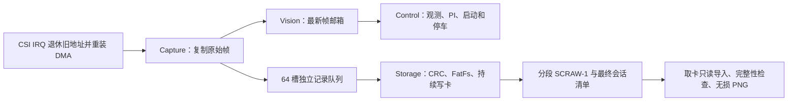

# RECORDER_TRAIN_1：实施、使用与验收

2026-11-06审核更正：AUTO_TRACK与RecorderTrain的后续统一目标为MPC预算降级。预算尚未集成前，当前共享C31源码采用零动力恢复窗口；本文较早rev5“远场失效继续驱动”的开发描述不再作为现行保证。源码锁已对照原冻结字节审查，Encoder方向宏替换已纳入新锁；默认构建仍`review=0`。最新测试与发布范围见[本轮审核](../changes/2026-11-06_MPC_AUDIT_AND_PUBLICATION.md)。下文保留各次实施时点及其证据，不能拼接为一次完整验收。

更新：2026-11-04。分支 `feat/vision-recorder-training`，基线 `de14157`，当前未提交。
用户已批准仅采集训练分支引入最小 RTOS；最终目标是稳定行驶时持续采集并写 SD，
车速可降低。**本次完成首版软件和纯构建，尚未证明实车持续记录或循迹稳定。**

## 1. 已实现的链路



| 模块 | 位置 | 当前职责 |
| --- | --- | --- |
| 静态内核/专用入口 | `demo/recorder/recorder_main.c`、`libraries/third_party/FreeRTOS-Kernel/` | FreeRTOS V11.1.0，静态任务/队列/信号量，不使用内核 heap；独立异常向量 |
| Capture 所有权 | `recorder_core.c`、`recorder_capture.c` | 8 个相机槽；先替换 DMA 地址、DSB、再发布；CPU 持有帧不回 DMA；双完成/溢出计歧义，池满不等待 |
| Control | `recorder_control.c` | 最高任务优先级，1 tick 让出；唯一调用驾驶、启动和 PI 的任务；复用 C31 安全保护 |
| Vision | 同上与 `recorder_capture.c` | 三槽最新帧邮箱，不能覆盖正在处理的槽；完整结果通过长度 1 的静态队列交 Control；不调用执行器 |
| Storage | `recorder_storage.c`、`recorder_disk.c`、`recorder_sd_osa.c` | 独占 FatFs/SD；原图持续写入；CRC/分段/同步/收尾；OS 事件阻塞自身、有限 deadline、错误锁定 |
| Link | `recorder_link.c` | USB UART1 / 无线 UART8 有界收发，独立记录命令；停车请求只交 Control 执行 |
| PC adapter | `tools/vision_data/scraw_v1.py`、`archive.py` | SCRAW-1 与原 draft 明确分派，原字节归档、CRC/身份/序号/像素检查、缺失或损坏最终 JSON 的只读恢复 |

这些 `.c` 按所有者分工，没有把 SD、串口或图像处理塞进 `vision_drive.c`。
任务优先级为 Control 5 / Capture 4 / Vision 3 / Storage 2 / Link 1；各循环都有阻塞点。
PIT NVIC 0、CSI 2 不调用 OS；USDHC 5 可以使用 FromISR，内核异常优先级 15。
原中断分组 3 对应 4 位抢占优先级。FPU/上下文切换的实际行为仍需板端验证。

控制沿用编码器3左/4右、符号 -1/+1、Kp=1、Ki=0.05、1430/1550/1670us 舵机端点。
训练专用驾驶源副本将轮速请求最大刻度设为 **40 ticks/10ms**，用于保守起步验证，
不是实测 m/s 或新确认参数。PWM 物理范围、差速/舵机协作和既有保护保持原逻辑。
没有放宽采样、未消费样本数、帧新鲜度或 50ms 控制停顿保护。

## 2. 工程与构建

仓库根目录：`C:/shengchanli/smartCar/smartcar`。

```powershell
./tools/build_recorder.ps1
```

脚本完成：校验 SDK 源锁与 FreeRTOS 内容锁 → 生成训练专用适配文件与 Keil 工程 →
禁用所有 Keil 构建 hook → 编译/链接 → 生成 BIN → 校验 map → 保存构建证据。
不会连接下载器、串口或 SD，不会烧录。

- 专用工程：`demo/mdk/training/recorder_train.uvprojx`。
- 专用产物：`.build/recorder-train/Objects/recorder_train.axf`、同目录 `.bin`。
- 完整日志：`.build/recorder-train/build.log`。
- 输入及 SDK 适配来源：`.build/recorder-train/adapted/provenance.json`。
- 固件 SHA256、构型、内存与异常向量检查：`.build/recorder-train/build-evidence.json`。

**默认 `MIDTERM_VISUAL_REVIEWED=0`，不会自动发车。** 静态采集可以运行，但这不是已放行
的地面训练固件。完成下面 H0/H1 后，才使用 `./tools/build_recorder.ps1 -MotionReviewed`
生成允许训练运动的构型；该参数不代替实测验收。不得直接编辑生成工程绕过门禁。
有运动资格的构型沿用 C31：持续有效新赛道观测满足约 1 秒后尝试启动，不依赖 C26/C27；
通信不能授予驾驶 arm，停车后本次上电不重新启动。
2026-11-05 已同步 main 启动实测修正：UART 损坏字节不进入有效输入队列，等待阶段纯接收错误重新计时；
行驶中接收错误仍锁止停车。训练专用 `@rec status` 查询保持可用，具体证据见第 11 节。

模板仍是 `demo/mdk/base/rt1064.uvprojx`。专用副本位于 `.build/recorder-train/adapted/`，
原 `demo/code`、相机/SD/FatFs SDK 源和 competition 工程没有被本轮改写。
SDK 锁按原字节校验，遇到基线改变会失败，需要重新审查适配上下文；不要直接更新锁掩盖差异。
已有 switch 工程的 M 标记和历史未提交资料保留。

FreeRTOS 固定为官方 V11.1.0 / `dbf70559b27d39c1fdb68dfb9a32140b6a6777a0`，MIT 许可，
来源与裁剪见 [PROVENANCE](../../libraries/third_party/FreeRTOS-Kernel/PROVENANCE.md)。
不含会在 Windows 上与 `stack_macros.h` 大小写冲突的废弃转发头 `StackMacros.h`。

## 3. SD、命令与导出

支持当前 FatFs 的 FAT/FAT32、512B 扇区；不自动格式化，不支持 exFAT。
训练专用 LFN=2 / codepage=437；原工程 FatFs 配置不变。没有预分配或暴露旧簇尾部。
卡在启动时初始化一次，不在行驶中热重配共享时钟或自动重新挂载。
当前训练专用配置为 **USDHC1原生1-bit / 3.3V / 最高25MHz**，只复用D12/CMD、D13/CLK、D14/DAT0。
D16/D17保留UART8，C30保留舵机PWM；不再调用会覆盖这些引脚的通用 `sdhc_iomuxc`。见第12节。

Storage 挂载、排他创建目录及段头成功后，自动开始记录，**开始采集不需要无线指令**。
目录类似 `0:/R0000001/000000.scraw`，按完整记录边界在约 64MiB 切段，最多 256 段。
每秒同步一次；`synced` 表示文件系统同步及卡忙检查成功，不是绝对掉电持久化保证。

命令通过已有 UART1 或 UART8 发送，需换行；任意端口都可发送，没有驾驶 arm 命令：

| 命令 | 行为 |
| --- | --- |
| `@rec status` | 返回状态、FatFs 错误码、目录、written/synced、队列水位/丢失、歧义与若干耗时峰值 |
| `@rec stop` | 仅停止记录接收、排空、写 END、同步/关闭和卸载；不停止车辆 |
| `!` 或 Ctrl-C | 向 Control 提交本次上电不可撤销的停车请求；不隐式停止记录 |
| `@export` | 提交停车锁和记录收尾请求；成功关闭/卸载且 Control 已撤销运动输出后允许取卡 |

首版每次上电只支持一个记录会话；不支持 stop 后重新 start。状态为：
0 boot / 1 mount / 2 recording / 3 draining / 4 closed / 5 fault。
命令回复走有界发送队列；不开启全帧串口图传，不做车载 USB 大容量存储。

取卡流程：发送 `@export`，查询 `@rec status`，等待 `state=4 safe_to_remove=1`，
确认车轮实际停稳，再取卡。`stopped_command`/`safe_to_remove` 是软件输出禁止与卸载状态，
不是真实车速、制动距离或车轮停稳传感器。`state=5` 不宣告 safe，需停车后断电再取卡。
SD 故障不改变驾驶许可，车辆控制继续受原保护约束；操作员应单独决定停车。

导出采用读卡器复制/只读导入，以下盘符和会话只是示例：

```powershell
python tools/vision_data.py import --source E:/R0000001 --data-root C:/shengchanli/smartCar/vision-data
python tools/vision_data.py verify-session --session-id <导入输出中的session_id> --data-root C:/shengchanli/smartCar/vision-data
```

数据根必须在 Git 仓库外。SCRAW-1 不需要 `--allow-draft`；旧 SCRAW-DRAFT-1 仍需要。
PC 保留 A0 原文件；缺失或部分写入的最终 `session.json` 从有效段头恢复到独立
`recovered_session.json`，状态必为 incomplete，不回写源卡。已有身份不覆盖。
已有标注/审核/Release 软件链继续使用；Release 的 DRAFT 标识仍保留，未把板端未验
的数据或 mock 人工审核包装成正式成品数据。

## 4. 原始数据与故障边界

- 记录 188×120 原始 GRAY8，22560B；不缩放、叠字或只保留视觉处理帧。
- 段头 64B，FRM1 记录头 40B、尾 CRC 4B；GAP1 累计已知丢失和未知数量，END1
  记录会话计数。序号不在复制/写入时重新编号，CRC 为 IEEE/zlib 兼容。
- 事件为 CSI IRQ 完成观测，不是 sensor frame ID；时间为 GPT1 毫秒转换 us，
  `timestamp_resolution_us=1000`，不是曝光时间或微秒精度时钟。
- 双完成/溢出不能证明真实漏帧数；保持 `capture_frames=null`，记录可观察计数、
  `capture_ambiguous` 与 `unknown_source_loss`。PC complete 仅表示已观测窗口的完整性。
- UUID 由 OCOTP CFG0/CFG1 影子值、卡 CID serial 与排他目录计数组合；不写 OTP/Flash。
  没有独立随机源或有效 RTC，不能保证同卡格式化后身份不重复，PC 必须拒绝覆盖。
- SDMMC 单次 CMD/DATA 事件等待上限 250ms；单个文件操作有 3s 共享绝对预算，首次 mount 5s。
  插卡检查不无限等待，busy 轮询让出任务，重试/无关唤醒不重置预算。
- Recorder 启停确认上限 1s；排空检查预算 5s，可再受当前有限文件操作延迟影响。
  短写、满卡、超时、sync/close 失败均进入 fault；不宣告成功、不自动重启。
- SD 读写经过独立 32KiB bounce，内部卡缓冲和描述符也在非缓存区；不借用相机、
  视觉或记录帧作 SD DMA。错误后禁用 SD IRQ、隔离在途 SD 内存到 MCU 复位，
  不继续调用文件系统或复用这些缓冲。真实硬件 abort/迟到 IRQ/总线行为仍待验证。
- 队列满只累计丢失、不等待和不回收 CPU/SD 持有帧。能保持控制服务不等于本次
  数据合格；出现丢失必须报告 incomplete，不能以“程序没崩”作为零丢帧验收。

首版未实现双 64KiB staging；实际是独立帧队列 + FatFs 多扇区请求 + 32KiB SD bounce。
这保留了所有权隔离，但文件系统分配/切段/同步长尾还需测量，不能用较低车速代替卡吞吐验证。

## 5. 已执行的软件验证

| 检查 | 结果与范围 |
| --- | --- |
| `python -m unittest discover -s tests/recorder -v` | 17 项 PASS；包括实际 C Storage task 的 10 种 mock 场景、约 64MiB 分段轮换、短写/满卡/同步/关闭/排空失败与命令隔离 |
| C Capture 核心 | 两个 DMA 活动槽、六个 CPU 持有槽、饥饿/非法释放、100000 次状态交接与 CRC 已知向量 |
| 实际 C SD OSA 的 mock | 绝对预算、无关唤醒不延寿、tick 回绕、错误后永久隔离；mock 阻塞不证明实际调度 WCET |
| 实际 C writer → 独立 Python parser | 完整会话、GAP、sync 失败后的缺清单恢复、PNG 像素相等、64 位序号、截断/损坏/身份冲突 |
| 原 PC 链条 | 33 项 PASS，旧 draft、标注/审核、切分/Release、C31 离线消费者回归 |
| C32 Host / GCC optimized | 43 PASS / 1 个性能接口 SKIPPED，执行目录 `.test-results/20261104T153559-e6d797cbfb/`；`releaseEligible=false` |
| 专用 Keil ARMCLANG 6.21 | 完整编译/链接 0 Error / 0 Warning；AXF/BIN 和输入哈希见 build-evidence.json |
| map 检查 | non-cache 地址/尺寸/对齐、8/64 槽、内核 SVC/PendSV/SysTick 符号归属检查通过；不证明 DMA 实际可达 |

日志在 `.build/recorder-implementation/recorder-tests.log`、`pc-regression.log`、训练构建
日志及上述 C32 执行目录。本轮未扩展或改写 C32 全局 Runner/套件清单，也未进行硬件放行。

当前 non-cache map 使用 1664448B / 2097152B，余 432704B；raw=180736B、
recording=1449984B、bounce=32768B、g_sd=772B、描述符=128B（另有对齐空隙）。
任务静态栈合计 53248B，另有 idle 1024B；实际最大栈深度尚未测量。
50FPS 配置下数据最低负载约 1.13MB/s，64 空槽理论仅吸收 1.28s；不是卡速或长尾实测。

## 6. 接下来必须完成的板端验收

按 [ACCEPTANCE_PLAN](ACCEPTANCE_PLAN.md) 的 H0 → H1 → H2 → H3 推进，不把软件通过
直接升级为地面运行通过。本轮没有连接串口、读写真实 SD、烧录或运行车辆。

1. **H0 静态**：使用默认锁定构建；核验板载 SD 插槽/供电/CD、电压、时钟、相机
   像素和源计数、CSI/USDHC 对 SDRAM 的实际可达性、FPU/内核切换、栈/队列水位。
   无卡、卡移除、无 completion、同步失败/断电都应有可解释状态与 PC 恢复结果。
2. **H1 架空闭环**：通过静态方向/舵机核验后才开启运动构型；测量编码器10ms样本、
   消费无积压、30/50ms保护不被触发、帧年龄<100ms；加入 SD 长尾和无线流量压力。
   用独立测量确认 IRQ/临界段/复制/CRC WCET，不能只依赖 Link 的几个峰值。
3. **H2 低速实车**：同安装/光照/电量下做记录关/开对照，核对轨迹和卡顿，连续完整
   记录无丢失、无越界、无记录导致的异常停车，完整收尾导入。必要时调低训练速度。
4. **H3 长时/多卡**：实际持续速率、文件分配/切段/sync 最大延迟与队列余量；不同卡、
   光照、电压和温度重复验证。确认 UUID 复用处理与实际时间质量后再冻结格式。

尚缺：微秒独立时钟、强会话随机身份、热重挂载、车载 USB 文件导出、无线图文调度、
真实 Label Studio 联调，以及完整 RTOS/总线时序证据。本轮没有把贝叶斯、SLAM 或学习
控制接入驾驶，未将这些候选技术扩入此次采集任务。

文档使用原生 Markdown/源码/JSON 读取（`structured_parsed`），测试与 map 算术为
`computed`；未使用 PDF/排版推断，没有仅凭 `md_extracted` 下硬件结论。

## 7. 2026-11-05：重复构建审查

现有日志均已结束：上次采集测试 4.278s、PC 测试 12.922s、C32 Host 95.543s，
上次固件构建于北京时间 2026-11-04 23:50 结束，Keil 编译耗时约14s。
审查时未发现运行中的 UV4/ARM/GCC 编译进程。Python 进程命令行未能完整读取，
不能据此认定所有 Python 后台进程均属于或不属于本项目；未终止未知进程。

| 发现 | 修正/结论 |
| --- | --- |
| 生成脚本每次覆盖相同 SDK/头/工程，mtime 变化扩大增量编译范围 | 生成内容不变时不写文件；隔离环境两次生成验证16个输出的字节与mtime均不变 |
| 实现期间多次主动启动编译，生成器的时间戳问题又放大每次成本 | 验证按变更范围执行；无新失败或相关源码修改不重复全套验证 |
| Keil `WaitForExit()` 原来无限等待，且同工程无并发保护 | 增加默认180s等待上限、工程文件锁；超时/异常时清理本次启动的进程树 |
| 固定 build.log 可能在本次无新日志时误读旧 PASS | 每次使用唯一日志，确认存在后更新 build.log |
| 新采集 unittest 的编译/运行 subprocess 原来没有 timeout | 编译60s、运行30s；Git身份查询15s；未改固件控制源码 |
| 新采集测试没有注册 C32 Host/CI | 保留独立运行入口并明确覆盖边界，不能把43项Host通过解释为17项采集也已自动执行 |

本次仅执行隔离生成校验、Python AST/调用上限检查及 PowerShell 语法解析，**没有调用
真实编译器或重跑全部回归**。Keil 超时/清理与日志行为尚未做真实进程故障注入。
证据：`.build/recorder-implementation/build-audit-2026-11-05.json`。
原固件/日志未覆盖；下一次显式构建会因生成工具身份发生真实变化而更新身份头，
以后相同输入不再因无意义重写造成大范围重编译。上节固件证据仍对应11月4日版本。

后续测试接入（2026-11-05）：已注册 `recorder` 与 `recorder-tools` 为 Host/PreFlash 必选
套件，现有 Host CI 会通过同一清单选入；`recorder` 继承已初始化的编译器环境和
optimized/ASan 模式，避免在 MSVC job 中偷偷使用 GCC。Runner 的输入快照已包含
`demo/recorder`，防止采集源码变化未使报告失效。

针对性验证：GCC optimized 的 `recorder` 17项通过（执行目录
`.test-results/20261104T163231-3be013b33e/`）；15项清单/编译环境桥接契约通过；
`recorder-tools` 两项生成契约通过（`.test-results/20261104T165726-2b785b4af4/`）。
执行目录名使用 UTC，以上两次运行北京时间均为11月5日。没有为接入测试重跑整套
Host/PreFlash；本地没有可用 MSVC，远端 MSVC/ASan 实际执行仍待后续 push 后验证。
详细命令见 [采集测试说明](../../tests/recorder/README.md)。

## 8. 2026-11-05：运动构型与 COM10 联调准备

用户明确要求将采集训练工程运动审核设为1，同时采集/运动，并通过无线串口检查。
已执行一次 `tools/build_recorder.ps1 -MotionReviewed`，0 Error/0 Warning；当前生成
工程 `MIDTERM_VISUAL_REVIEWED=1`，构建证据 `motion_reviewed=true`，不代表硬件验收通过。
默认脚本无该参数时仍生成审核锁定构型，避免更改所有未来构建的默认行为。

COM10 @115200/8N1/无握手打开成功；被动4秒仅收到一个 `[`；三次
`@rec status` 查询没有有效回复。未发送驾驶启动、STOP、记录停止或导出命令。
电脑端打开串口不证明无线链路/板端应用响应；尚未确认板端已烧录新构型。
需烧录/复位后重新查询，再核对 `state=2 recording=1`、written/synced增长、丢失/歧义
及控制耗时；当前不能宣告运动中持续写卡成功。

本次运动构型AXF SHA256：`d005e20e643d4a104feb650615a18ae059cc69143c265d1849094ab4ac87154b`。
实际烧录与复位状态独立记录，不能由构建参数推断。串口记录位于
`.build/recorder-implementation/COM10-*-2026-11-05.txt`。

串口后续事实：延长被动监听30秒收到约53K字符，含旧 `[VISION2]`、C26模式与速度
日志，未出现 Recorder 标识；当时有效赛道为0、NO_LANE、PWM为0。用户随后确认已
烧录并复位；再次打开COM10，在16秒内发送8次 `@rec status` 仍无回包，未验证新
固件的无线命令响应。旧程序能回传不能证明新RTOS链路/SD/行驶已正常。

## 9. 2026-11-05：按用户要求停止蜂鸣器提示

原 `midterm_boot.c` 触发：等待赛道时每1000ms鸣100ms；启动成功后鸣200ms；停止/
被阻止时前600ms内每200ms鸣100ms。B11为高电平使能，通过Q2驱动蜂鸣器，并非
用PWM产生蜂鸣器音调；持续等待会无限重复第一种提示。

已将采集训练工程的 `board_buzzer_set` 生成为始终写B11低电平，初始化仍为低；
panic路径额外调用关闭。采用训练私有 `board_io.c` 副本，正式赛道源码未改。
全部启动/停车/等待提示在训练固件中禁用，车辆控制和采集启停判断保持原逻辑。

即时向COM10发送过一次 `!\r\n`（仅请求停车，不结束记录），等待3秒无回包，
无法证明板端收到或已经关闭蜂鸣器。若应用任务没有服务串口，不能靠无线保证静音。
需要重新烧录本次禁鸣构建；旧固件不会因本地修改而改变。

本次仍为 `MIDTERM_VISUAL_REVIEWED=1`，仅因真实禁鸣修改构建一次，0 Error/0 Warning；
两项隔离生成契约通过，检查确认生成的B11写入只有低电平。
AXF SHA256：`77e2c9be89d775bb3fad358aa5073882cac350e0afd58a9bbcced17109f8c2fa`。
产物路径仍为 `.build/recorder-train/Objects/recorder_train.axf`，尚未由本助手烧录。

## 10. 2026-11-05：完全不动的排查与启动诊断修订

操作者明确反馈两版采集固件均完全不动。再次COM10查询6秒没有回包；现有证据不足以
在“摄像头未初始化/无有效赛道”“RTOS异常”“任务饥饿”“速度环未就绪”之间定因。
先前的17项Host测试未覆盖真实启动、调度、串口与硬件DMA，不能把它们当作上述路径已验。

源码确认的启动风险：CM7 FreeRTOS端口在调度器启动前使用非零critical nesting，
创建队列会保留BASEPRI屏蔽，旧入口却在此后才初始化相机及其串口。外设UART默认
IRQ优先级为0，因此这不能直接证明是本次根因；仍应消除不必要的启动依赖。

本次仅在训练目标修订：

- 把纯Capture池准备与RTOS队列创建拆开：先池、相机/外设，再队列/任务，最后启动调度器。
- 训练入口显式将VTOR指向链接Flash向量；旧BIN的SVC/PendSV已与map相符，未发现
  旧向量链接错误，因此该项是明确运行配置，不宣称已发现向量损坏。
- UART1/UART8启动阶段输出 `[REC_BOOT] rev=2 stage=...`，不依赖调度器或RTS。
  stage以十六进制输出：0x0a串口、0x14板级外设、0x1e相机开始、0x28相机返回、
  0x32队列准备、0x3c调度器即将启动、0x46 Control就绪、0x50 Link就绪。
- 断言/异常先撤销输出、关闭蜂鸣器，再通过有界直接UART循环输出 `[REC_PANIC]`，
  包含阶段、源码行号、异常号和CFSR/HFSR/BFAR，便于定位静默停机；不自动复位重启。
- Link每秒主动输出已有采集状态与新增 `[REC_DRIVE]`：相机初始化、boot/state、
  Control迭代、处理帧数/年龄、有效/远场、编码器采样、故障、目标与PWM。
  状态从Control快照读取，Link不直接访问驾驶可变对象或授予运动许可。

此修订不提高车速、不绕过有效赛道准入、不放宽保护；审核仍为1、蜂鸣器禁用。
20项针对性Host测试通过（17采集+3构建契约），完整训练构建一次，0 Error/0 Warning。
AXF SHA256：`cb45ea90385a746a9643581b3297009e24c54fd83633106124ff7b247f5c5cf7`。
等待重新烧录并取得rev2板端输出后，才能确认实际故障位置/修复效果；未宣告已能行驶。

## 11. 2026-11-05：整合 main 启动修正到采集训练工程

用户已在独立 main 验证工作树确认有效赛道自动启动恢复。板端日志确认一次无线 framing error，
DATA 字为 `0x00002000`，即低字节 `0x00` 带帧错误标签。此前 uint8_t UART 读取丢掉标签，
将损坏字节当作输入，加上错误即永久停止策略，导致未发车就锁止。
本次按用户要求整合到当前 `feat/vision-recorder-training`，保留其独立采集用途；未合并 RTOS/SD 到 main。

### 正常启动与通信规则

1. 上电先建立电机/舵机零输出，完成相机和板级外设初始化，再启动既有五任务调度。
2. Storage 独立挂载 SD、创建会话并持续写原图；不需要无线启动指令。
3. Control 独占启动状态机：连续不同序号、时间有效且近/远场满足准入的赛道观测达到 **1000ms** 后，
   审核为 1 且速度环/硬件就绪时启动。不依赖 C26/C27，也不因上电满 1 秒就盲目启动。
4. 带 NXP 逐字节帧/校验/噪声错误标记的数据单独计数并拒收，不作为有效命令。
   Link 仅递增错误事件序号；Control 在等待期重新计算完整准入时间，在行驶期则停止并锁止。
   若报错时还有干净接收字节或未完成命令，保守地取消驾驶，避免执行受损命令。
5. 保留训练命令语义：`@rec status` 不取消启动/行驶；`!`/Ctrl-C 停车；`@rec stop` 只收尾记录；
   `@export` 同时请求停车与收尾、禁止本次上电重启。纯损坏字节不会吞掉下一条完整状态查询。

SD 故障仍只锁定采集，驾驶继续受视觉/编码器等原保护约束；没有新增“等待 SD 成功才发车”条件。
这沿用第 3 节批准的隔离策略，因此仅看到车辆运动不能证明采集成功。
训练私有轮速仍为40 ticks/10ms，1430/1550/1670us 舵机配置、保护期限和 B11 静音保留。

### 架构与诊断

- 共用 UART 适配层保留完整 DATA 字；新增 corrupt/错误位计数，保持每 IRQ 最多 32 个字的预算。
- 共用 `midterm_boot` 接受“重新计时/运行中停止”事件；不让 Link 调用执行器或授予启动许可。
- Control/Link 各拆出任务拥有的 init/poll；生产 RTOS 包装循环保持原优先级和阻塞点，Host 可直接运行真实迭代。
- `[REC_BOOT] rev=3` 标识本轮；每秒 `[REC_DRIVE] rev=3` 增加 qualify_ms、reviewed、Control 已处理的错误事件数。
- 新增 `[REC_LINK]`：两通道有效 RX、错误与损坏字节数、原始错误位和无线最后一个损坏 DATA 字。
- 原 `[RECORDER_TRAIN_1]` 仍报告 state、recording、written/synced、丢失、fs_error 和 safe_to_remove。

### 已执行的验证与固件

| 检查 | 本轮结果 |
| --- | --- |
| `recorder-startup` | 审核0保持锁定；审核1的16种场景通过，实际运行 Control/Link、视觉处理、最新结果队列、启动、PI/保护代码 |
| 关键场景 | 无指令1秒启动、错误重置、持续错误不启动、启动前STOP、运行中错误、分片查询不误停、导出锁止、记录独立停止、迟来有效赛道、重复帧、断流、受损命令、存储故障隔离、无线忙 |
| `auto-track` / `transport` / `link-board` 及依赖 | 共9套件通过，含 bare-metal 兼容、损坏字节拒收与干净 STOP 保留 |
| `recorder` / `recorder-tools` 及依赖 | 共4套件通过；17项原有采集/存储/PC解析测试及3项生成工具契约通过 |
| Keil 训练构建 | 仅构建一次，0 Error / 0 Warning；生成BIN，map中缓冲/内存/内核向量隔离检查通过 |

测试报告分别为 `.test-results/20261104T184522-8736c84c74/summary.md` 和
`.test-results/20261104T184638-bcf9685e78/summary.md`（目录使用UTC，北京时间均为11月5日）。
新启动测试使用 Host 模拟外设、队列和调度调用，不是实际 FreeRTOS 抢占、DMA 或 SD 压力时序实测。
Host 共用驾驶源保持其原始参数；固件私有40 ticks副本由生成器及构建 provenance 单独记录。

工程：`C:/shengchanli/smartCar/smartcar/demo/mdk/training/recorder_train.uvprojx`。
固件：`C:/shengchanli/smartCar/smartcar/.build/recorder-train/Objects/recorder_train.axf`。
构建：`./tools/build_recorder.ps1 -MotionReviewed`；本次审核为1，脚本默认无参数仍为0。
AXF SHA256：`1cf691faaf4984e69e292e8781ba19d686dda36aa4eefdc8d6c48105ef937fa9`。
BIN SHA256：`3731b95d8cdb2ab824cd1b9dc229451e5397fb64aa9d01886789b63e67383989`。
构建证据：`.build/recorder-train/build-evidence.json`，仍为未烧录/未硬件验收；尚未 commit/push。

### 烧录后验证

重新打开上述采集工程，下载本次 `recorder_train.axf`，避免混用 main 的 `rt1064.axf`。
通过 COM10/115200/8N1 核对 rev=3、reviewed=1、qualify_ms=1000。
先核对正确赛道前静止、正确赛道后发车；同时确认 `state=2 recording=1` 且 written/synced 持续增加，
记录丢失计数和控制期限。之后依次核对查询不误停、停车、导出关闭与取卡。
无卡或 SD 故障应明确出现 state=5/fs_error，不能算边行驶边采集通过。
本轮没有发送新的串口命令、操作真实 SD 或烧录；需要新的板端证据才能把 main 的启动结论推广到采集 RTOS 构型。

## 12. 2026-11-05：SD与无线/舵机引脚冲突审查

操作者确认已烧录rev3，车辆能够运行但未正常循迹，并要求先只核验SD。卡已插入且用户确认FAT/FAT32；
照片可识别为SanDisk 32GB microSDHC、Class4。仅凭标识不能判断当前主机吞吐、短写或数据完整性。
SD协会说明速度等级针对规定条件下的顺序访问，不等同于本固件实测速率：
https://www.sdcard.org/developers/sd-standard-overview/speed-class/ 。

### 本次实测与确定的配置问题

- COM10/115200被动25秒只收到22个字符的旧`[AUTO_START] build=MID`片段。
- 随后18秒内4次只读`@rec status`均无回包；没有发送STOP、记录停止或导出命令。
- 监听中再次复位，仅收到41个字符的乱码/启动尾部，未获得written/synced/state。
  日志在`.build/recorder-train/COM10-rev3-20261105-025304.txt`及`COM10-sd-boot-20261105-025514.txt`。
- 源码确认`sdhc_iomuxc()`在UART初始化之后调用，把D16/D17从UART8改成USDHC1 DATA2/3，
  同时把C30从舵机PWM改成USDHC1 VSELECT。前者解释SD初始化后无线消失；后者会撤销舵机引脚复用。
- 上游Host初始化无条件写入4-bit/1.8V等能力，卡初始化只看卡的4-bit标记就发ACMD6。
  原先仅改host头文件宏，无法完整约束实际协商，必须一起修正。

原理图核对：本地旧版`MIMXRT1064-xVL CoreBoard V1.6 原理图.pdf`第5页显示SD DATA2/3与扩展D16/D17同网，
第3页C30/B1_14经默认不焊的J1连接SD电压选择，第6页给出卡电源/IO电压电路。
这些页已渲染检查（`.build/recorder-sd-audit/`），同时与本仓库NXP IOMUXC定义和PWM映射交叉核对。
用户实物核心板的具体版号/J1焊接状态尚未确认，因此不把V1.6所有供电细节无条件套用到实物。

### rev4修正

- 新增`recorder_sd_pins.c`独占SD引脚配置，只设置CMD/CLK/DAT0及卡检测/电源。
  DAT1作为未用输入上拉，D16/D17与C30的MUX和PAD均不被SD配置覆盖。
- 训练私有Host除头文件宏外，实际清除宽总线、1.8/1.2V、UHS/DDR等能力；
  卡侧切换4-bit增加Host能力检查，保持原生1-bit。仍为3.3V、最高25MHz，不改原始SDK。
- 私有SD调驱/检测回调不再写DATA2/3 PAD，禁用DAT3检测修改；继续使用D4独立插卡检测。
- `[REC_BOOT]/[REC_DRIVE] rev=4`；新增`[REC_SD]`报告card、initialized、bus_bits、clock_hz、
  init_status、quarantined、host_caps及UART/舵机实时MUX。正常MUX应为UART_TX/RX=2/2、servo=1。
- 运动启动和SD故障隔离策略不变，没有优化循迹参数。使用单数据线的实际吞吐与长尾仍须实卡测量。

### 软件结果与当前固件

`.test-results/20261104T190843-03e8145f74/summary.md`共10套件通过：新增SD引脚模拟测试、
生成器真实能力/卡协商/PAD约束、采集/存储/解析、Control-Link启动及依赖。
一次Keil构建通过，0错误、0警告；BIN与map隔离检查通过。
AXF SHA256：`8002477265b12cc4b65280542c3a7f9df6365fde40f4c4da4ecc5f7ec046521d`。
BIN SHA256：`846c10143820dbb5c4e0cefb0f090c2ef5f3ba9ade13d1f05b3263b1acfebdf1`。
路径仍为`.build/recorder-train/Objects/recorder_train.axf`；review=1、1秒准入、40 ticks、蜂鸣器静音保留。

第11节固件在操作者IDE中重建后的哈希为`c3cf81ca2f5346b6582d5e9c779bec4f902f5ec0fdace60569b5ed84da4cf1c6`；
该快照与本节rev4分别记录，不能混用构建证据。操作者随后确认已重新下载并复位，
但监听仅捕获`[REC_BOOT] rev=3 stage=0x0000000a`，没有rev4运行/SD状态，故板载版本身份仍需核对。
当时本地IDE重建输出的AXF为`7646262e464a0e164b04986651670345689136b74cd1dde90cd161332210782c`，
源码与AXF字符串均为rev4、构建0错误/0警告；这不能代替Flash内容核验。其后COM10设备已断开，未获得新日志。
不能宣告SD正在正常写入。
下一步烧录后观察`[REC_SD]`及`state=2 recording=1`、written/synced连续增长和丢失计数，
再按既有导出流程收尾、读卡器只读导入核对文件CRC/源序号/像素与会话完整性。

阅读层：源码/JSON为`structured_parsed`，原理图关键网线/连接器经原图检查为`pdf_verified`，
测试/构建/哈希为`computed`；没有只凭`md_extracted`作引脚结论。MarkItDown工具不可用，采用原生文本定位后渲染核验。
保留风险：实物板版本与J1状态、实际IO电压、单线写速/长尾、DMA/Cache与卡上内容尚待硬件证据。

## 13. 2026-11-05：操作者离线反馈与停车候选

硬件当前不在操作者身边。补充实车反馈：启动逻辑正常；行驶速度较慢但部分路段还算稳定；
场地为中期检查同款完整赛道，只能完成部分赛道后异常停止。尚无明确停车路段、该次固件rev/SHA或故障日志。
将“能启动/部分行驶”与“完整稳定循迹/持续写SD”分别记录，后两项未通过。

源码核对：训练专用速度刻度保持40 ticks/10ms，main基线为132；这是低速的配置来源之一，不是实测m/s或实际速度比例。
`vision_drive_observe()`在C31自动构型RUNNING时，只要当前observation_valid或far_valid为0，立即触发`VC_FAULT_VISION=2`；
`midterm_boot_poll()`再锁止停车，本次上电不自行恢复。短暂远场缺失即可触发，是值得优先核对的代码路径，
但不能把此前main出现过faults=2当作本次采集构型的故障证据。
rev4之前SD覆盖C30的冲突也是已知问题，需先用rev4的MUX回报核对已排除，不能直接归咎于识别算法。

下一轮有硬件时，先核对rev4和UART/舵机MUX，再收集停车前后`[REC_DRIVE]`的faults、speed_fault、帧年龄、
valid/far与`[RECORDER_TRAIN_1]`的ctrl_gap_ms、written/synced/丢失及`[REC_SD]`状态；需要图像才能复现具体失效场景。
SD成功仍须写入增长、完整收尾与PC只读CRC/像素核对。当前按用户要求以SD验证为主，未调整速度/视觉/保护、未重跑构建测试。

## 14. 2026-11-05：按用户要求取消单帧视觉失效锁止

用户进一步明确要求优化掉“运行中单帧观测或远场无效就永久停车”的保守策略。
本节修正第13节描述的旧策略，修改范围为当前采集开发分支的共用驾驶模块和recorder任务，未自动改写独立main验证工作树。

### 新的运行策略

| 当前证据 | 行为 | 边界 |
| --- | --- | --- |
| 合格近端道路，远场暂缺 | 继续近端反馈和既有速度/转向控制，不因far=0报错 | 缺少远场时不启用原有远场直线加速；不对启动准入放宽 |
| 近端总体观测不合格，但当前帧仍有可验证局部道路 | 使用原有局部道路恢复，保留本次输出权限 | 弱证据300ms；持续强证据可到距最近合格近端观测1200ms，强证据新鲜度100ms |
| 当前道路证据完全缺失，但图像继续更新 | 电机需求/PWM归零，保留恢复窗口；恢复后继续本次运行 | 最近合格近端观测后最多300ms；长期局部恢复中短暂失去局部证据受100ms/1200ms共同约束 |
| 持续失道超过上述边界 | 视觉故障并锁止 | 后来的图像不能清除真实故障并重新arm |
| 人工STOP/导出、相机断流、数值或编码器故障 | 原锁止策略保留 | 未放宽100ms帧新鲜度、轮速服务期限、硬件/审核许可 |

启动仍需要不同序号、近远均有效的赛道连续1000ms；局部道路不能在上电等待期授权起步。
恢复延续原有RUNNING和输出lease，不调用clear/arm，也不重新启用C26或UART启动入口。
零动力等待时停止并清积分，但不撤销整次运行权限；这避免视觉恢复后控制器RUNNING而输出权限已为0的问题。

### 实现与身份

- `vision_drive.c`删除C31外层的单帧无效强制trip，交由控制器决定故障与恢复。
- `vision_actuator.c`允许C31的当前有效观测或控制器声明的有界恢复通过仲裁；保留所有故障/授权/帧时效检查。
- `vision_control.c`让C31无证据阶段在300ms内零动力等待；保留局部恢复的300/100/1200ms既有边界。
  原C26 switch的两帧/40ms宽限保持不变；三个共用时间常量集中到`vision_profile.h`。
- Control快照和`[REC_DRIVE] rev=5`新增recovering/source，分辨短时等待/局部引导与真正锁止。
- 训练SDK适配锁中仅`demo/code/vision_drive.c`条目因已审阅的外层trip删除而更新：
  `1152646b0cc6804c23322948dd9fa1f4664282cfa20a97f9144421edb6a114b2`
  → `572d1a38d35eff1911db3c7fa8ce809051459f56eee5e732918d3a7b87dcd2c6`。
  原始厂商SDK源与其他锁条目保持不变，40 ticks私有速度替换仍成立。

### 验证

- `.test-results/20261105T015722-519837885d/summary.md`：auto-track、switch-runtime、route-switch与依赖共8套件通过。
  覆盖近端有效远场缺失仍有真实PWM、短时完全失道零输出但权限存在、局部恢复、局部道路间的短暂空隙、
  恢复后重新输出动力、长期失道/弱证据/强证据超时锁止、恢复期间STOP、启动近远准入不变。
- `.test-results/20261105T015919-6d7ec936a5/summary.md`：recorder-startup、recorder-tools、recorder及依赖共9套件通过。
  采集审核1扩至22个场景，实际Control/Link/视觉/速度环代码通过单帧黑图、200ms无路后恢复、持续无路故障、
  仅近处道路的真实像素场景、恢复期间STOP及导出测试；审核0仍不运动。
- 仅一次训练Keil构建，0 Error/0 Warning，BIN生成及缓冲/内存/内核向量map检查通过。
  `.build/recorder-train/build-evidence.json`记录完整输入身份。

当前工程仍为`demo/mdk/training/recorder_train.uvprojx`，AXF为`.build/recorder-train/Objects/recorder_train.axf`。
AXF SHA256：`8fcd8c7ea83a8f9eb69614baca8987c80404118272149ad572b45aface28fe61`。
BIN SHA256：`cb0936ec72accf7eed0e73b88c78e598230ba29f793a279600da6007bfd118ed`。
本次构建review=1，1秒启动、40 ticks、B11静音和rev4的1-bit SD/引脚隔离保留。
硬件不在操作者身边，本次未打开串口、未烧录、未宣称停车问题或SD实卡验收已解决；未commit/push。
证据为源码/原生JSON读取`structured_parsed`、Host/构建/map/哈希`computed`，没有新增实车测量。
